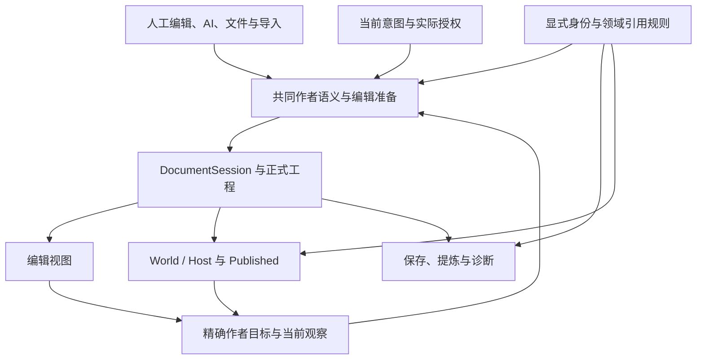

# 果铃架构统一与功能回退根因深度审计

> 历史正文（2026-10-22 归档）：保留原调查、方案和当时措辞，不作为当前待执行指令。最新实现、未完成范围和证据见[当前状态](../development-plan/CURRENT_STATUS.md)及[结果记录](../development-plan/SOFTWARE_AUTHORING_RESULT.md)。

<!-- REMEDIATION_PLAN_20261018 -->
> **架构修复方案已生成：[果铃架构收敛与系统修复方案](果铃架构收敛与系统修复方案.md)。**
> 方案统一覆盖本报告第一至二十六节，按业务根因组织目标架构、实际消费者迁移、旧分支删除、分阶段实施、性能度量和验收；经三领域设计及三项独立反审整合。保存、恢复、停止与合法修改优先，完整多智能体作为其后的能力扩展。
> 本报告继续保留问题与证据；方案尚未实施，不将设计审查写成产品修复完成。

<!-- AUDIT_UPDATE_20261018_DEEP_REVIEW -->
> **2026-10-18 第二轮深审已完成：新增10项具体问题（N01–N10），请优先阅读第二十至二十六节。**
> 本轮分波调用9名子智能体，最高同时为主审加3名子审；新增结论经当前源码、明确边界的函数探针及独立反驳核验。重点是HTML另存与资源、原始输入恢复、委派停止、上下文归档、Source能力接续和页面导航关系。
> 第一至十九节及其旧证据完整保留。新发现按实际触发条件整合，不把同一根因的多个入口重复算成新的架构根因。本次仅更新本报告，未修复产品代码；最终写入与源码指纹核对见第二十六节。

<!-- AUDIT_UPDATE_20261018_GEMINI_MULTIAGENT -->
> **2026-10-18 更新：已完成 Gemini 当前源码核验，并加入果铃产品多智能体创作、通信与缓存复用评估。请优先阅读第十三至十九节。**
> 当前结论：保留 A/B/C，增加创作表达与能力可达性主线 D；多智能体沿现有执行与正式提交链扩展。已复现能力查询过滤与请求前缀重排，不能再沿用“所有动态 HTML 都被计算样式冻结”的概括。Codex 的完整子历史前缀保留为已合并但默认关闭的可选机制。
> 第一至十二节保留为 2026-10-17 历史审计；其中旧探针与多审阅记录不是本轮新执行的验证。此次仅更新本报告，未修复产品代码、配置或 Skill，未调用收费模型。


**日期：2026-10-17**<br>
**范围：近期 Codex 修改、当前工作区、内容接入与持续编辑、运行时、内置 Agent Harness、委派与成果接续。**<br>
**性质：只读探索与架构建议。本轮没有实施修复。**

## 一、结论与建议

**建议进行一轮有边界的架构收敛。最需要统一的是决定用户行为的业务语义，以及这些语义在真实入口中的消费方式。**

果铃已经有统一正式文档、事务、History、保存和运行会话的主要骨架。问题集中在骨架前后：同一项用户授权，在不同入口变成不同权限；同一个按钮的关联规则，在复制、普通属性和完整互动编辑器中被不同地识别；同一个运行状态 API，因直接调用或跨 Sandbox 传输而具有不同的值所有权；同一份作者内容，也可能因测量、保源、运行包装和已有工程代码版本的差异，得到不同的编辑及见效结果。

这能解释为什么一个局部修复通过验证后，相邻操作仍可能出现问题。**最终写入同一个 Session，并不能保证写入前的目标选择、关系收集和权限判断已经一致；经过同一个 Host，也不能保证各类更新和传输具有同样的业务语义。**

本轮最有力的证据分为四组：

| 证据组 | 本轮判断 | 对架构的含义 |
|---|---|---|
| 同一授权在不同入口变窄 | 指定报告 R01–R04、R06 主体成立；另确认已批准的外部文件分支与 full/工作空间内分支采用不同的授权接力。 | 用户授权、当前焦点、默认披露、精确目标和真实服务条件需要分清，并贯穿修改到交付。 |
| 同一对象的正式关联被不同入口解释 | 合法的项目级规则可以引用页面按钮；对象复制会带入其关联规则，整页复制不会。普通点击属性也可能读不到该项目规则。 | 物理存放位置、行为作用对象和编辑入口默认范围不能互相替代。应复用已有领域关系函数。 |
| 同一运行值 API 在承载间语义不同 | Native 可读到 World 内部 JSON 对象引用；原地改后 set 同一引用会不通知，跨 Sandbox 的结构克隆输入则通知。 | 单一 World 已有，但值所有权、写入和通知合同仍需在两个端口一致落实。 |
| 代码修复与原作品受益不是同一事实 | 已保存的整页对象不会自动拆开；增强生命周期包装还会作为普通 Source 写入工程。修改软件模板不等于修改已有作品内的包装。 | 必须明确修复影响宿主、新建模板还是工程内源码，并在同一作品上证明采用。 |

同时，需要防止过度归因：

- 近期已经有真实 Chromium、Electron、Source 编译执行、Undo、保存与冷开验证。不能概括为“只做形式测试”。
- CSS 保源上浮、状态 ACK、已知输入偏差误分 unknown、DOM/PNG 时序等已有具体修复；它们可以说明问题如何跨职责传播，不能全部重报为当前未修。
- 增强在更新时先清理旧增强、执行原实现的 update，再重新接入，是目前公开说明和测试共同保护的设计。名称变化触发闭包重启是一个明确的设计耦合和条件风险，不能直接称为所有状态丢失。
- 长行搜索片段、视觉问答缓存等也有具体局部实现问题。这些可以在现有 owner 内修正，不需要借此建设新的全局平台。
- 没有可比的变更前后输入及运行证据时，不能把“后续发现问题”一律写成“前一次修复引入了回退”。

**下一轮建议围绕三个主线收敛：任务与作者操作闭环、显式关系的共同解释、持续编辑与运行值合同。** 各主线都应以完整用户能力为单位，让直接消费者接入同一决定，退出对应的重复判断。不要按十几个报错逐个增加特判，也不需要重写 V10、Published V3、API5、所有渲染器或正式文档底座。

---

## 二、审计方法、基线与证据边界

### 2.1 当前基线

本轮读取的是 **`D:/果铃工作台` 当前实际文件**，包括 HEAD 之后尚未提交的成果：

- 分支：`main`。
- HEAD：`bdb9e1dc2384b1452052d43a49033619e62c15fa`。
- HEAD 提交时间：2026-10-14 16:28:34 +08:00。
- 提交说明：`feat: integrate workbench authoring and playback repairs`。
- 初始只读快照约在 2026-10-17 11:33 UTC：239 个 modified、19 个 deleted、86 个 untracked，共 344 条状态记录。
- tracked diff 为 258 个文件，约 +7,938 / −8,649 行。

这些数字只限定本轮观察的代码版本，不作为“架构差”或工作纪律问题的证据。Owner 既有指令暂停提交；不能仅用 git log 代表近期实际实现，也不能清理现有 dirty 成果来获得看似整齐的基线。

已读根目录 AGENTS、开发入口、CURRENT_STATUS、TASK_BOARD、现行 ARCHITECTURE_CONTRACT 的当前约束、WORKING_PROTOCOL、用户指定 REPORT，以及多份近期修复报告和相关当前实现、测试。

### 2.2 多智能体审查

本轮先后安排了 9 个子智能体。在同时最多 4 个活动智能体（含主审）的条件下，分波次展开。

第一波 3 个子智能体的远程读取阻塞，没有取得文件内容；主审终止等待，**没有将它们计为独立验证**。随后由主审只读取得当前源码文本快照，6 个子智能体在共享快照上分别进行：

1. 修改历史与验证证据复核。
2. 指定 Harness 报告及权限、上下文复核。
3. 内容接入、作者粒度与运行生命周期复核。
4. 复制、关系、依赖诊断复核。
5. 对架构建议的独立反驳与范围审查。
6. 委派、任务身份及成果接续复核。

主审负责原始取证、正式文档及提交链检查、纯内存反例、交叉核对和最终综合。多智能体的价值来自不同职责的审查与反驳；同一份主审探针不会被重复计成多次实机验证。

### 2.3 证据分级

| 标记 | 含义 | 本轮能证明的范围 |
|---|---|---|
| **H：历史实跑** | 近期报告中已有的真实输入、截图、Electron、保存冷开等记录。 | 支持对应历史样本；本轮没有重新跑那些用户旅程。 |
| **C：当前源码** | 直接读取当前 producer、owner、consumer、schema、测试。 | 支持确定分支和调用条件；不自动等于用户已实机遇到。 |
| **P：纯内存探针** | 执行当前实际函数、序列化运行代码或真实方法体；外围使用最小内存夹具。 | 支持当前函数的反例，不替代 GUI、真实模型或完整运行桥。 |
| **A：架构判断** | 由多项证据推导的共同职责与建议。 | 属于论证和设计建议，未实施，也不是性能保证。 |

本轮没有修改产品代码、测试、配置、任务板或原作品；没有调用果铃的真实模型、执行付费服务、启动应用、构建、重启、提交、推送或发布。最终只新增本报告。源码文本快照和分析材料用于只读研究，不属于产品变更。

以下代码路径均相对于 `D:/果铃工作台/`，行号针对本轮读取的当前工作区。已有报告中的“通过”与本轮新增 P 探针分别说明。

---

## 三、近期修改为何让人感觉“修一处，又坏一处”

### 3.1 有证据的传播链比报错清单更重要

| 传播链 | 已记录现象 | 当前状态与结构含义 |
|---|---|---|
| 观察内部载荷 → 模型输入 → 上下文压缩 | bootstrap URL 携带 HTML；20K 硬分包增加摘要往返。 | 已沿共同观察报告出口和实际请求预算修复。说明内部传输数据与模型所需事实的边界曾混用。 |
| CSS/DOM 关系 → measurement → 作者对象边界 | 纯 cursor 规则曾扩大保源范围；后续 SVG 内部 paint 关系又上浮到 HTML 祖先，正文成为整页 Web。 | 两类输入已分别修复。共同敏感点是视觉依赖分析可以改变正式作者粒度，影响背景归属、对象编辑和后续操作。 |
| Sandbox 状态回显 → 原生输入终值 → 动作结果分类 → Agent 接续 | 输入 40 最终为 8；快速增量旧回显覆盖新值；已知终值偏差又被分成 unknown，锁住动作族。 | ACK、待确认写入及结果分类均已有修复。应保留真实 unknown 不重放，不能用取消所有保护解决已知偏差。 |
| 子文档准备 → DOM/几何 → PNG | DOM 已显示新数值，同一回执的 PNG 仍可能是旧值。 | 叶到父准备后再取 DOM/几何/PNG 的修复已有实跑证据。共同捕获顺序有价值，不应重新否认。 |
| 作者内容 → 嵌套文档 → 编辑记录 → 执行身份 | srcdoc 文字、首次 key、重排后的身份接续、Undo、字体色彩与命中路径先后暴露缺口。 | 最新已使用同一 authoring adapter、records 和正式事务；软件生成身份从执行源码身份中排除，真实源码变更仍会换代。 |

直接依据：

- [作者回退修复报告](../../output/authoring-regression-repair-20261017/REPORT.md)，L7–18、L24–33。
- [页面动作修复报告](../../output/page-action-repair-20261017/REPORT.md)，L7–28。
- [编辑能力、背景与截图修复报告](../../output/editability-background-snapshot-repair-20261017/REPORT.md)，L11–26、L34。
- [Source 增强与状态连接实施报告](../../output/content-behavior-20261017/REPORT.md)，L16–35、L46–74。

这里有具体前像和红绿证据，但本轮没有为每条问题恢复历史工作区并重新实跑。因此，报告使用“后续样本暴露”“修复前反例”等准确表述，不推定每一个后发问题都是上一补丁引入。

### 3.2 “软件已修”至少存在四种不同见效边界

| 修改落在哪里 | 何时可能见效 | 不能据此宣称什么 |
|---|---|---|
| 宿主、编辑器、状态桥、命中或捕获消费者 | 实际运行新实现，并重新消费相应内容后。 | 磁盘源码已变不代表旧进程、旧冻结任务已使用新实现。 |
| 首写、导入、测量、装配规则 | 后续接入或明确重新装配内容时。 | 已保存的整页 Web 不会自动分解成原生对象。 |
| 新工具、短 Source、增强便利入口 | 模型或人工实际使用该能力时。 | 技术夹具通过不代表自然作者已经采用，也不代表内容质量提升。 |
| 写进工程的普通 Source 包装或基实现 | 工程实际采用了对应的新源码时。 | 软件模板更新、重新启动程序，均不必然更新工程内旧源码。 |

最后一项是本轮新增的直接源码证据：

`src/core/components/source/componentAuthorSource.ts:74–85` 将增强生命周期运行包装作为普通 Source 写进 `project.definitions`。对已经增强的对象再次 enhance，L65–69 主要替换业务增强依赖；不是自动升级原运行包装。L76–77 遇到同名但不同源码的运行包装，会另分身份，保留已有定义。

这是自由 Source、自包含工程与保护人工深改带来的合理版本边界。需要说清楚、验证采用；不能按名称匹配就自动覆盖原作品，也不能拿一个新建 fixture 的结果代签旧工程已受益。

### 3.3 不能拿来作为架构因果的现象

- 雨水示例明确要求六页；页数本身不证明架构导致“PPT 感”。
- 7:35.905、41 次顶层工具的冻结样本中，`surface.recipe` 调用为 0。该入口存在固定新页/布局限制，不能反推它造成了该样本的表达问题，也不能把这个调用统计泛化到所有后续轮次。
- 原始 HTML 自身的溢出，不能自动归因于软件新加裁切。
- `stateBindings=0` 只证明对应样本没有采用该接口；其技术链已有执行证据。
- 16:13.610、7:12.622 partial 等轮次，模型、effort、软件与完成状态不同，不能直接计算架构提速或退速。
- 字体任务墙钟包含等待用户回答；不是纯模型性能基准。

依据：[CURRENT_STATUS](../development-plan/CURRENT_STATUS.md)，L10–21、L28；[内容接入与联动方向](../development-plan/内容接入与联动创作修改方向-2026-10-17.md)，L12–23、L100–117、L143–146；[字体失败诊断](../../output/ai-font-failure-diagnosis-20261017/REPORT.md)，L9；页面动作修复报告 L26–28。

---

## 四、应保留的现有架构资产

本轮没有发现足以支持“需要另建统一文档或第二运行引擎”的证据。以下共同能力已经存在，后续应接入它们：

| 现有 owner | 已承担的正式责任 | 直接证据 |
|---|---|---|
| DocumentSession | 正式内容与 History 的唯一写入；身份、epoch、修订、幂等回执；持久成功后通知。 | `src/core/documents/DocumentSession.ts:193–315` |
| DocumentHostService | 打开稿读取、保存；对 V10 捕获字段作 expectations 检查，再接当前 revision，最终仍由 Session 条件提交。 | `src/main/workbench/DocumentHostService.ts:378–402` |
| CourseV10DocumentBridge / Projection | 编辑表面捕获目标、映射命名展示态、提交相同正式编辑；保存前 drain。 | `src/renderer/documents/CourseV10DocumentBridge.ts:200–237` |
| CourseV10Driver / Source authoring | Source 文件字节 CAS、共享 owner 写时复制、资源闭包与专业数据检查。 | `src/core/drivers/CourseV10Driver.ts:40–71`；`src/core/components/source/sourceAuthoringEdits.ts:17–52` |
| World / Host | 共享运行值、实例作用域、生命周期、取消、输入与动作等；运行值不写作者文档。 | `src/player/components/ComponentRuntimeWorld.ts:213–237,708–714`；`src/player/components/runtime/ComponentRuntimeHost.ts:128–159,246–257` |
| authoring records / owned document bridge | 运行承载内部的普通作者目标、记录应用、srcdoc 身份和坐标接力；没有另建作者 store。 | `src/shared/contracts/component-platform/project.ts:54–58,74–75`；`src/components/web/ownedDocumentAuthoring.ts:20–45,89–144` |
| ToolCatalog / ContextRead / ExecutionContextProjection | 按需披露、隐藏单工具展开、历史原文/图片回读与近期工具链保留。 | `src/core/tools/DocumentToolGateway.ts:486–508,1968–1971`；`src/main/workbench/execution/ContextReadTool.ts:4–38`；`ExecutionContextProjection.ts:128–160` |
| DelegationJobService / HostToolCoordinator | 持久作业、原 run/job 身份、取消、结果未知、防重放、封存成果和字节读取。 | `src/main/workbench/delegation/DelegationJobService.ts`；`src/core/tools/HostToolServices.ts:289–301,625–640` |

**后续整理的对象是共同业务决定及直接消费者，不是文件夹命名，也不是把所有代码移动到一个更大的类。** 单一 writer、同名 API、同一注册表都很重要，但需要进一步证明它们上方的语义一致。

---

## 五、共同根因：哪些地方需要统一，怎样避免过度统一

### 5.1 任务授权、焦点、目标事实与披露相互混用

**C + H：最强的实际失败链是独立 HTML 字体任务。**

软件知道选中的是顶部导航 `button.tab[0]`，模型主要收到 `Conversation 1` 文本；同名文字还出现在别处。模型后来猜出不存在的 `.transcript-card h2`，并在尝试修改已授权工作空间中的打开稿时，被旧局部 document grant 拒绝。结果为 partial。精确事实不足和合法执行路径断裂同时存在。

同一模块里已经有两种不同语义：

- `SelectionContextController.ts:193–194`：元素卡捕获把选区同时写为 selection 和唯一 writable。
- L197–205：普通文档捕获使用完整文档 grant 加独立选区，注释明确“焦点不是更窄写授权”。

文件修改还有第二层分叉：

- `AgentFileText.ts:137–146`：非 full、工作空间外且已明确批准的打开稿，直接进入正式 Session.execute。
- L149–155：full 或工作空间内，走 attachRunDocument → Gateway，却可能受到旧局部 grant 拒绝。
- 两条都使用正式 writer；差异发生在之前的授权解释。没有证据表明这是未经批准越权。

工具目录又把支持性、授权与披露组合在一起。隐藏单工具能按需执行，batch 却使用已披露名称形成 schema，于是同一已允许操作可能因披露顺序而不同。

**共同收口：**用户实际授权、当前任务意图、精确目标、服务是否接入、目标是否适用、首轮披露分别有明确事实；由既有接收、Gateway、Catalog 和作者事实 owner 消费。已授予的手段不应被默认焦点重新删去；真正由用户明确给出的窄限制必须保留。

这要求完成整条“局部目标 → 事实 → 可用手段 → 正式编辑 → 保存”链。只放开 file.patch 会留下错误候选；只增加截图或提示词会留下权限拒绝。

### 5.2 作者身份与运行承载仍会互相影响，但已有部分解耦

**C + H：measurement 的结果仍会影响正式对象粒度。**

`src/core/contentApply/assembly/htmlAssembly.ts:185–194` 在 body 被判为共同保源范围时，将整个输入保留为一个 Web/program 根；L257–262 对局部范围也会停止向下拆分。L281–315 还考虑 Flow、flex/grid、绝对定位、transform、装饰、脚本等真实关系。后续背景提取依赖前序形成的 shell，见 `pageHtmlAssembly.ts:95–110`。

这意味着一个看似只影响视觉的 CSS/DOM 关系，可能改变整个输入的正式作者粒度，继而改变后续编辑入口。历史 cursor 与 SVG paint 两轮问题体现了这一传播路径。

但保源判断本身有现实必要：强行拆开动态程序可能损失样式、布局、事件和共享状态。当前也已经可以通过 authoring records 在同一个运行文档内部提供作者目标，不能再说“保成一个文档就完全不可编辑”。

**共同收口：**

- 对用户已明确的局部任务和可确认的作者范围，入口先保留该意图与目标身份。
- measurement 决定如何保真承载、哪些边界可安全拆分；不重新扩大用户操作意图。
- 对必须一起运行的 HTML/Source，继续用已有 authoring records 和 scope 暴露受支持的内部编辑。
- 同一作者目标的读取、定位、支持动作及编辑准备，不因 Native、普通 HTML 或 owned srcdoc 承载而另起一套业务解释。

这里不需要统一渲染器，不要求每个可编辑文本都成为独立 iframe，也不承诺把任意外来 React/JS 自动转换成全部可视编辑对象。外来程序仍需判断、保源和明确能力边界。

### 5.3 物理拥有关系被误当成完整的行为与依赖关系

这是本轮新增最强的跨入口反例。

**P2：同一合法按钮，整页复制与对象复制的关联行为不同。**

夹具使用官方 `componentRuleEdits(project, {kind:'project'}, rules)` 创建项目级行为，其中一条规则为：

`node.click(页面内按钮) → scene.next`

这种配置在正式 UI 和 AI 规则入口都合法：全局互动编辑器 target 为 project，但仍可枚举当前页面按钮；项目级规则只是存放在 global.underlay。见：

- `src/renderer/interactions/componentInteractionAuthoring.ts:26–35`。
- `src/shared/componentInteractionData.ts:36–55`。
- `src/core/course/courseAuthoringReferences.ts:61–68,94–97`。

本轮执行当前实际 planner 和正式 operation，得到：

    pageCopyHasTrigger = false
    objectCopyHasTrigger = true
    originalTriggerRetained = true

原因不是提交失败。`courseSurfaceStructure.ts:35–58,132–149` 主要遍历页面拥有树并扩大全局显示范围；`courseObjectEdits.ts:306–326,482–496` 则收集拥有树外、与所选对象有关的触发规则及动作完成链。

**新增同源旁证：普通点击属性也可能读不到原规则。**

`componentInteractionData.ts:94–123` 按按钮物理归属选择 surface 或 project owner，然后只读该 owner 的规则。因此页面按钮在 project 规则中已有动作，普通属性入口仍可能显示没有动作；L127–152 会为新设置创建另一条页面规则。完整互动编辑器及全工程可点击提示却知道原规则存在。

这是确定的读取/编辑路径差异；本轮未实机验证并存规则的最终导航竞争，不能写成必然双重跳页。

**P3：依赖诊断使用了另一份不完整的依赖定义。**

正式 Source 支持 moduleBindings；`library/references.ts:188–189` 与 `compilation/liveSourceReferences.ts:83–91` 使用它。`componentProjectHealth.ts:56–60` 只检查 dependencies。

本轮对显式使用缺失模块的 Source 执行实际健康收集，得到 `[]` 和 `canExport:true`。工程健康面板会据空列表显示未发现问题；编译器仍可能另报错误，所以不能宣称系统永远无法发现，也不应增加整份内容拒绝导出的门。

还有相似分叉：资源引用函数通过专业身份识别 Source 承载的图片/媒体，健康检查 L62–76 却仅接受 builtin implementation。此项是源码分支补充，本轮未另运行媒体样本。

**共同收口：**复用已有领域函数来回答“引用了谁”“哪些规则与此对象关联”“实际导入哪些模块”；操作意图再决定复制、保留、解除或诊断。

已有 `associatedInteractionRules` 位于 `library/references.ts:192–196`；剪贴板 L308–316 又写了一份相同类型算法，整页复制未接入。可以从这些真实重复收拢，而无需另建持久图。

必须保留的差别：

- 具体节点的局部关联可以随独立副本迁移。
- 真正共享的全局背景、课程事件或公共行为应继续共享。
- 复制范围外目标是否保持引用，由操作意图决定。
- 普通正文、任意 JS 字符串不属于软件可猜测改写的正式引用。
- 未使用的 dormant module binding 与实际 import 缺失不一定应同级报错；不能把共享“已有 definition 集合”误当全部依赖事实，否则仍会漏掉不存在的目标。

### 5.4 运行值、更新原因和生命周期需要明确合同

**P：JSON 状态值的所有权在 Native 与 Sandbox 中不同。**

World 的直接 state.get 返回内部 Map 中的对象，Host 原样转发；setState 先做 Object.is，同一引用直接返回。Sandbox 则经 MessagePort 结构克隆进入同一个 World setter。

对对象型运行值采用如下“读取—原地修改—set”写法；现有作者说明未明确读取值的所有权及可变性：

    const value = scope.state.get("records")
    value.counter += 1
    scope.state.set("records", value)

本轮提取并执行实际 World.setState 方法体，对比直接引用和结构克隆输入，得到：

| 输入路径 | 最终 counter | state 通知 | runtime state 事件 |
|---|---:|---:|---:|
| 直接引用 | 1 | 0 | 0 |
| 结构克隆输入 | 1 | 1 | 1 |

源码：`ComponentRuntimeWorld.ts:232,708–714`；`ComponentRuntimeHost.ts:489–492`；`SandboxComponentRuntime.ts:445–451,1419–1423`。

这证明同名 API 的值所有权及通知语义不一致。探针没有启动完整桥或 GUI，也没有证明既有作品已触发。应在现有 World 边界明确读取值是否可变、如何提交和通知，再让两端遵守同一业务语义；不必机械追求每次内部消息数量相等。

Sandbox 的 state map 是观察缓存及乐观写入缓存，不是与 World 竞争的第二正式状态库。L437 已明确其为 latest observed snapshots，而非同步 RPC。统一不能把异步传输伪装成同步调用。

**P1：增强更新重接是公开设计，但更新分类较粗。**

Host 的 contentSignature 只排除 frame 和 implementationOverride，name、authoring、style 等进入同一 mounted.update；refreshTargets 也能触发 update。增强包装每次 update 都 retire → base.update → start。

本轮实际运行包装代码得到私有计数 `[1,2,1]`：一次正常触发、一次 frame-only 更新后继续触发、一次 name 更新后重新从 1 开始。共享 scope.state 不因此清空。

重要限定：

- `componentAuthorSource.ts:19–20` 已公开说明更新后重新接入。
- 增强测试真实覆盖底层 DOM 重画后的监听重接、共享状态延续、取消与别名变化。
- 自由 Source 可以读取 instance.name，因此不能一律认定 name 对所有程序无关。
- 不应删除所有重接，也不承诺任意 Source 热换后保留 JS 堆和闭包。

这项应归类为**已公开设计的取舍与条件性体验风险**。后续先明确哪些普通编辑有业务连续性保证，哪些更新确实替换 DOM、重绑状态或改变代码，再判断是否扩展增强更新能力。Host generation 不变、共享 state 保持、私有闭包保持是三个不同属性。

### 5.5 任务身份、当前问题和单次结果的作用范围不够精确

这里有结构性接续问题，也有可在现有服务内修正的局部问题，不宜统统并入 Runtime 重构。

**视觉服务的内部工作身份不含问题。**

`VisualAnalysisService.ts:22–30,45–53` 以 run + 图片 resource/source 身份缓存整次回答，question 未进入 key。本轮使用实际 service、内存 mock provider、零外部请求验证：同图提出两个不同问题，只调用 provider 一次，二问得到第一答。

同一个服务还将某次 unknown 保存到 unknownRuns[runId]，在检查新图片 key 前就返回。探针中换全新图片也不会形成新请求。原请求不得盲目重发是合理要求；未知结果的范围是否应占据整项视觉能力，需要在该服务内收口。

当前 Engine 的辅助视觉调用通常传初始 instruction；steering 会进入主模型 messages，却未更新该辅助问题。见 `ExecutionEngine.ts:1134–1147,2562,2655`。因此不能把内部函数反例夸大成已经存在的公开多轮视觉问答失败，更不能作为字体案已证原因。

**同任务继续执行时，已封存委派成果的读取与 compute 不一致。**

`HostToolServices.ts:454–477` 对 compute 使用 continuationReads 寻找已完成祖先成果，对 image 也有合法来源恢复；delegation 则保留当前 runId。L635–640 随后用当前 run 读取旧委派成果，而 `DelegationJobService.ts:393–404` 按原 producer run 校验并拒绝。

这是当前源码中的成果接续差异。本轮没有 GUI 重现。合理目标是由既有 continuation/成果 owner 明确允许读取同任务哪些已完成候选，保留来源和完整性；不自动继承取消权、写权限，也不放开任意跨 run 访问。

**共同原则：**当前目标、图片字节、问题、一次执行请求、父任务与生产 run 是不同身份。应按实际职责引用它们，不让一个缓存 key、局部句柄或生产 run 身份代替所有含义。实现仍分别归现有 Gateway、VisualAnalysisService、HostToolCoordinator 和 JobService，不新建统一超级状态机。

---

## 六、对用户指定 REPORT 的逐项核验

指定文件：[通用 Harness 权限、能力披露与上下文断点报告](../../output/harness-capability-context-audit-20261017/REPORT.md)。

**R01–R09 主体得到当前源码独立支持。** 表中补充更精确的行号、边界和后续应统一的责任。

| 原项 | 核验结果及直接证据 | 本轮补充与应避免的误读 |
|---|---|---|
| R01 焦点成为 grant 上限 | 成立。SelectionContextController L193–194；elementCardController L409；ExecutionAssistant L134–138。 | 同模块 L197–205 已有完整 grant + 独立焦点的正确入口。用户明确窄授权仍须保留；缺陷是入口自动制造窄授权。 |
| R02 allowed 与披露混用 | 成立。ToolRegistration L87–89；ToolCatalog L197–200；Gateway L450–508、L1966。 | 应区分未授权、不适用、服务未配置、尚未披露。不能把真实未接入能力宣传为可执行。 |
| R03 打开稿 Source 与保存接力断开 | 成立。AgentFileText L149–155；Gateway L616–621、L1423、L1549–1566。 | 新发现批准外部路径与 full/工作空间内分支解释不同。继续走当前稿、Session、History，不能改磁盘绕过。 |
| R04 batch 按披露集合校验 | 成立。Gateway L1599–1601、L1966–1971。 | 原报告纯 schema 探针有效；本轮独立核代码，未重跑真实 batch。执行不应依赖披露先后，同文档原子约束仍保留。 |
| R05 full 下 local.run 仍逐次 ask | 成立。ExecutionEngine L1273、L1338；DelegationJobService L214–225。 | LocalToolRunner L45–67 还依赖 Windows 原生 sandbox、受管副本、真实 EXE、shell:false。去掉询问不等于已有原地任意 shell。按用户实际授权定义 full，勿只改标签或默认常量。 |
| R06 精确目标未形成可取事实 | 成立。ExecutionEngine L876–893；Gateway L2920–2928；ContextReadTool L10–11。 | 不能把历史回读当当前 DOM/作者目标查询。字体案同时有错误候选和权限断点，需要一起闭合。 |
| R07 grep 长行片段不含命中处 | 成立。FileGrepPages L71–80；AgentFileTools L21–22。 | file.read.limit 没有该接口的 64K 硬上限，可继续读。另一通用 Gateway read 有 64K 分页，两者不能混说。问题是缺少命中附近片段及可直达位置。 |
| R08 HTML 观察固定裁剪不可扩展 | 成立。HtmlActionPageScript L195–227；HtmlActionService L254–266；HtmlActionTools L11–17。 | 120 项概览、240 字符文本、4000 字符正文可以是首轮摘要；缺少详情、过滤、分页继续读取。没有本轮实测第121项。 |
| R09 错误推荐 AI 不具备的样式入口 | 成立。ToolCatalog L53–56；Gateway L2730–2731；人工 HtmlStructureEditor L95–105；HtmlActionTools L11–17。 | 字体案没有实际触发该 text.format 文案。普通错误会回送模型；partial 是诚实结果，不能改成假成功，也不能仅提示“必须继续”而不给恢复路径。 |

### 6.1 对既有测试结论的必要修正

`tests/integration/g20ScopedToolCatalog.test.ts:103–125` 明确输入 `writable:[range]`，并断言越权 batch 零写入。这个测试对**用户真的只允许该范围**仍然正确，不能整体当成应删除的旧错误合同。

应新增或调整的是授权来源的区别：完整文件/工作空间授权下的局部焦点，与用户明确禁止范围外修改，是两种输入。问题首先在 producer 端把它们合成同一种 grant。

同一测试 L150–185 已经证明 whole-document grant 下按需加载、真实 schema 扩展和同 run 执行；L213–224 证明隐藏单工具直接解析后披露。需要保留这些有效机制。

### 6.2 对恢复和并发的必要限定

当前 Gateway 已有冲突句柄、字段 expectations、新事实确认等机制。不能说系统没有并发处理。

但一些局部范围在重叠变化后会从 writable 中退役，重读返回只读目标，并提示重新发任务；另一条路径又能在新事实进入模型请求后更新依据。见 `DocumentToolGateway.ts:1157–1179,1412–1424,2888–2899`。

后续应区分：**旧候选失效、目标身份变化、用户授权变化**。旧候选不能重放；真正读到当前事实后，能否在已有授权下形成一个新候选，应由同一规则处理。此处是静态接续风险，本轮没有证明所有冲突都无法恢复。

## 七、补充范围：委派、当前稿与成果接力

### 7.1 已有能力与 queued 能力应分开

当前委派已经具备 codex/local/readonly 的共同持久作业、受管副本、run/job 身份、停止和 unknown 防重放、成果封存及完整性检查。`artifact.save` 能直接从成果 owner 读原字节并交给文件服务，无需父模型复述整个产物。

`ReadonlyTaskRunner.ts:17–48,59–73` 是使用父任务冻结连接的一次有限、无工具模型请求，输入为 goal 与宿主冻结来源。它可以辅助独立推理，但不是能自行探索、调用工具、递归委派的完整子 run。输出预算耗尽时会保留并标记不完整候选，见 L85–91；不应为此再增加一层一律拒收门。

TASK_BOARD 和 CURRENT_STATUS 仍将完整自主子 run、窄上下文与成果文件组直接采用列为 queued。它们是尚未完成的能力，不是本轮发现的已存在并行能力回退。

### 7.2 同任务接续断点已经可定位到共同成果 owner

主审及委派子审阅者核实：

- `ExecutionEngine.ts:736–747,862` 计算并授权同任务可信祖先。
- `DocumentToolGateway.ts:1003–1006` 明确只接续读取，不恢复旧写权限。
- `HostToolServices.ts:240–243` 保存这项读取授权。
- L454–477 仅对 compute、image 落实旧成果读取，遗漏 delegation。
- L635–640、`DelegationJobService.ts:393–404` 因生产 run 与当前 run 不同而拒绝。

因此，“同一任务 Continue 后回读已封存 readonly/local 候选”是现有功能的具体接缝，不需要等待完整自主子 run 平台。后续应把可信祖先、成果状态、原生产者、只读授权接入现有 owner。原 job 的写权限和取消权继续单独处理。

### 7.3 文件组直接采用仍是明确未完的接力能力

`HostToolServices.ts:289–301` 已支持 delegation/compute 单文件保存；L773–790 的直接资源读取未提供 delegation 同等接入。`componentPlatformFileInput.ts:34–61` 仍以实际文件及 realpath 闭包摄取内容。

一组带相对依赖的候选通常需要先分别保存为文件，再应用。这与已有方向中的“模型选择成果组和目标，宿主从原字节沿依赖闭包直接采用”吻合。可以沿现有成果、文件输入和 project.apply owner 完成，子任务不持有第二主文档 writer。

### 7.4 两项需保留条件的当前线索

| 线索 | 本轮已确认 | 尚未证明及建议分类 |
|---|---|---|
| 旧 delegate.start 与 local/readonly 读取材料不同 | `WorkbenchServiceTools.ts:89–90` 注册 delegate.start；`ToolCatalog.ts:298` 纳入正式目录；`HostToolServices.ts:567–580` 调用 startManaged，由 `DelegationJobService.ts:263–274` 从实际磁盘读材料。local/readonly 在 HostToolServices L602、L621 使用 taskInputs.freeze。 | 该入口当前说明是复制点名的工作区文件。当执行器可用、存在未保存稿，且用户或上层把它作为当前作者稿的委派入口时，磁盘版本可能与 local/readonly 的宿主冻结来源不同。应明确统一入口对当前稿的承诺；不能仅凭磁盘读取认定违反现行工具说明。本轮未做真实委派复现。 |
| 只读子任务取消被归入写能力 | `WorkbenchServiceTools.ts:85–95` 将 job.cancel 标为 write，delegate.readonly 标为 read；`HostToolServices.ts:500–502` 的取消使用 writableRun，而只读启动 L617–623 使用 builtInRun。 | 父任务整体 Stop 仍会取消，不能说无法停止。可以列为“取消自己已发起的只读子任务是否应取决于作者写权限”的次要合同问题，不扩大成新的权限平台。 |

辅助角色还有一个已确认的解释差异：主模型 `vision=unknown` 可以实际接收图片，见 `ExecutionEngine.ts:2541–2546`；辅助视觉角色在 `VisualAnalysisService.ts:59–61` 直接拒绝 unknown。能力事实的含义应统一说明，但本轮没有把该差异认定为字体失败原因。

---

## 八、目标架构：收拢既有职责，保留自由表达

### 8.1 需要共同持有的事实

下面是职责分工，不是新增一批数据库、管理器或强制接口名。

| 事实或决定 | 应沿用的现有位置 | 直接消费者应得到什么 |
|---|---|---|
| 用户授权、明确限制、当前任务状态 | Main 接收、ExecutionEngine、Gateway 当前 run | 同一任务、同一授权的稳定解释；焦点、披露和目标变动不自行改写授权。 |
| 当前意图、焦点及追加要求 | selection、任务输入、steering | 精确当前目的；辅助任务得到所需的新要求，不被迫接收整个父聊天。 |
| 当前作者目标及支持动作 | 实际作者模型、authoring adapter、records、DOM scope、Source 准备 owner | 同一目标的来源、身份、可读事实、可用修改手段；人工与 AI 允许不同表现形式，但不能读到不同对象事实。 |
| 显式关联及依赖 | 既有 interaction、Source/module、资源、状态引用领域函数 | 同一字段引用谁、是否存在、哪些关联应按当前意图迁移；不猜普通业务字符串。 |
| 正式修改、条件提交和历史 | capture/prepare → CourseV10Driver → DocumentSession | 操作按当前事实准备，保留人工作品、版本冲突、Undo 和同一保存结果。 |
| 共享运行值及其通知 | ComponentRuntimeWorld 的现有 state 端口 | 明确 JSON 值所有权、提交与通知；Native、Sandbox 满足同一业务合同。 |
| 实例生命周期与更新 | ComponentRuntimeHost、已有 Source/增强包装 | 区分布局、基实现更新、绑定接续和真实源码换代；保留取消和有效监听。 |
| 观察、请求及候选成果 | 原观察、请求、Job、资源 owner | 与实际问题、版本及原执行对应的事实；历史摘要可回读，当前状态另取；未知影响正确范围。 |
| 软件变更的采用 | 既有宿主、模板、工程源码来源与保存机制 | 清楚指出此次修复由哪份代码消费，原作品是否实际采用，人工深改得到保留。 |

### 8.2 各入口与共同正式工程的关系



这张图表达的是已有 owner 之间应共享的业务决定。正式工程仍只有一份，观察与运行值仍是各自职责的派生事实。关系函数不需要保存另一张图；保存、复制和诊断可以采用不同策略，但必须认识同一份声明。

### 8.3 应继续交给模型或作者的决定

模型应继续决定题材、解释、公式、布局意图、业务程序、哪个结果值得采用、哪些状态共享，以及是否需要图片或子任务。软件负责确定性的身份、目标适配、引用、生命周期接线、字节、事务和保存。

对任意 Source：

- 普通业务 JS 保持自由，不反向猜测所有字符串引用。
- 允许完整 API5 深改；短增强是便利入口，不成为唯一编程方式。
- scalar stateBindings 与任意 JSON scope.state 各保留其用途。
- 对可视编辑能力明确支持范围，不能因为没有专用可视控件就禁止合法 Source。
- Slide、Flow、Spatial 保留各自导航、排版和相机语义。

现行 ARCHITECTURE_CONTRACT 当前约束与 WORKING_PROTOCOL 已经体现了相近分工。本轮主要新增的是**可以定位到代码及反例的收口位置**，而不是更长的原则。

---

## 九、建议的架构收敛顺序

本节仅给后续方向，**不构成已实施修复或本轮新增实施授权**。

### 主线 A：先让一个已授权的修改从入口到交付完整闭合

**代表性用户能力：**从原字体任务的局部 AI 入口发起，找到真正的导航文字与 Hello 参考样式，使用合适的专业编辑或 Source 手段，完成修改、Undo、保存和冷开。

这一主线应同时覆盖授权与目标事实两侧：

1. 将入口的 focus 与实际授权来源分清；整文档、局部卡片、文件路径授权采用一致解释。
2. 由现有作者事实 owner 交付精确目标和来源，支持按需扩大读取。
3. Catalog 负责披露，执行资格由真实授权、适用性和服务能力决定；单调用与 batch 不依赖披露顺序。
4. 专业工具未覆盖时，源码修改继续接回当前稿与 Session。
5. 保存/导出接续同一合法任务，不在最后一步重新要求入口不曾给出的另一套 grant。

这些是一次**任务执行语义**的收口。完成标准是多个入口都消费同一决定，旧的“选区=唯一授权”“未披露=不可执行”替代判断退出对应路径。

涉及委派成果的真实任务，另沿第七节的既有成果 owner 完成接续；不作为字体修改闭环的前置条件。

保留显式窄授权、真实服务缺项、停止、当前事实冲突与正式条件提交。字体候选必须基于准确目标重新形成，不能原样放行先前错误选择器。

### 主线 B：让对象的显式关系随明确的作者意图保持

**代表性用户能力：**一个有行为的现有按钮，在完整互动编辑器与普通属性中得到一致解释；独立复制按钮或整页后，副本保留约定的局部关联，真正共享全局内容仍共享。

首先复用已经存在的关系知识：

- 节点触发和动作完成关联沿 associatedInteractionRules 等现有函数。
- 规则与动作身份沿现有 remap 和 identity 分配。
- Source 实际 imports、moduleBindings、资源字段沿现有 Source/资源解析。
- 专业身份通过当前统一 professionalBuiltinKey 语义读取。

再由每种操作保留其专有策略：页面复制仍处理页面与展示态、空间 frame；库提炼仍处理依赖闭包；删除仍处理断开关系；健康检查提供局部可解释诊断。这些策略不必合并成一个万能函数。

内容承载与作者粒度在这条主线中有一个具体要求：已经确认的作者目标及其显式关联，不应因 Native、HTML、Source 或 owned srcdoc 的承载差别无故消失。对于必须保源的程序，继续使用已有内部作者目标；外来动态 HTML 的未知边界仍按保真处理。

完成标准是共享领域函数实际接入相关直接消费者，并退出重复关系推断。只新增 helper、只让一个复制测试变绿，均不足以签收该主线。

### 主线 C：明确持续编辑与运行值的实际保证

**代表性用户能力：**在已有互动内容中做受支持的普通文字、布局或绑定修改，运行值、有效监听及保存结果按既定合同保持正确；Native 与 Sandbox 的相同业务写法得到相同状态语义。

优先顺序：

1. 先消除 JSON 值所有权与通知的跨承载矛盾。明确读取是否返回可变引用、怎样算一次提交和变化。
2. 明确 Host、基实现与增强包装之间的更新保证。区分需要重建 DOM、重接绑定、改变代码，以及已承诺不改变业务的普通编辑。
3. 再决定是否扩展增强重接能力。保留目前必要的 cleanup、异步 dispose、失活检查和 Source 自由。
4. 对涉及工程内包装源码的调整，明确新模板与已有工程采用的不同路径。保护人工改写，不自动批量迁移原作品。

完成标准不是“所有闭包永远不重建”，也不是两端消息数量机械相同；而是受支持业务连续性、明确值语义、有效监听、取消和保存结果正确。没有这项合同，给 name、locked、某个样式分别加排除条件仍容易形成下一轮回退。

### 可在现有 owner 内并行收口的项目

长行 grep 命中片段、HTML 观察详情读取、视觉问题缓存身份、单请求 unknown 的范围，以及辅助角色当前目的，可以在各自现有服务内纠正。同任务已完成委派成果的回读，也可沿现有 continuation 与成果 owner 接续，退出用当前 run 身份代替全部读取资格的判断。它们不必等待三条主线全部完成，也不应借机扩成统一上下文或生命周期平台。

每项只需要验证其真正风险：例如同图异问不得返回旧问题答案、旧未知请求不得重放而不同工作仍按实际能力处理。无需为这些修正增加全新审批、强制全局恢复器或完整工作流引擎。

### 为何这条路线能比逐症状修补更快收敛

它减少的是**重复决策的数量**，不是追求更少代码行数：

- 一次正确的授权/focus 生产与消费，能同时改善元素卡、源码、工具展开、batch 和保存链。
- 一份正确的关联规则解释，能同时影响普通属性、对象复制、页面复制和库提炼。
- 一份明确的运行值合同，能消除 Native/Sandbox 对 JSON 的不同隐含假设。
- 明确宿主/模板/工程 Source 的采用边界，能防止反复用新夹具证明旧作品已经受益。

这样每完成一条主线，相关入口间的差异应该实质减少。若完成后旧判断仍由多个入口独立维护，应认为结构尚未收口；不以补丁数量、类名统一或测试总数代替这一结果。

---

## 十、验证应该证明什么

### 10.1 现有验证应继续有效

本轮独立读取了当前测试，而非只看报告标题：

| 当前验证 | 实际证明了什么 | 不能自动扩展成什么 |
|---|---|---|
| componentEnhancement20261017.test.ts L51–61、L89–142、L192–214 | 实际 Source 图编译执行；基实现 namespace/this；DOM 重画后增强重接；共享 state 保持；暂停、取消、绑定改名。 | 任意私有闭包在所有作者变化或 Source 热换后保持。 |
| timedR1CopyReferences.test.ts L24–38、L41–76 | 真实互动 executor；页内行为与按钮、专业别名、Source 行为、命名状态及全局装饰范围映射。 | 拥有树外的项目规则也被所有复制入口一致处理。 |
| g20ScopedToolCatalog.test.ts L45–90、L103–125、L150–185、L213–224 | HTTP、Provider 序列化、Engine、Gateway、Session；batch 一次 revision/Undo；明确窄授权防扩大；按需 schema 和隐藏单工具。 | 入口已经区分“局部焦点”和“用户明确窄授权”；batch 与单工具不受披露差异影响。 |
| publishedViewActions20261017.spec.ts L11–49、L68–84 | 真实 Electron、可信输入、跨页同 worker、操作去重、Stop、作者 revision/Undo/data 隔离、viewport/PNG 与多次 DOM/PNG 回执。 | 独立 HTML 字体完整旅程、所有持续动画原子截图、所有作者字段的生命周期影响、自然模型作品质量。 |

`package.json:19` 的 test:authoring-regressions 是 18 个定点 Vitest 文件、三项构建及真实 Electron spec 的聚合入口。默认 test、产品测试与 E2E 也存在；没有证据表明产品测试被治理测试整体替代。

但该定点集合不含增强生命周期和复制关系那两份测试。因此命令通过，只能代表它列入的范围，不能泛称全部创作语义统一。没有必要把所有检查强行塞进一个越来越大的命令。

### 10.2 最小但能区分架构是否收口的不变量

| 不变量 | 有效证据 | 保留的边界 |
|---|---|---|
| 同授权、同意图、不同入口具有一致合法手段 | 主聊天/元素卡；已披露/按需披露；单调用/batch，使用相同当前稿与修改目标。 | 真正只读、窄授权、服务不可用仍如实处理。 |
| 观察到的目标与正式编辑是同一对象 | 字体案原导航与参考样式；同名节点；同期人工修改后重新读取当前事实。 | 不靠宽松选择器碰巧改中；与目标相关事实冲突的旧候选须被拒绝，无关修改可沿既有 expectations 和最终 CAS 合法接续。 |
| 显式关系的存放位置不改变约定复制能力 | 同一按钮行为分别存页内和合法 project owner；复制对象/页面后核目标映射。 | 无关全局行为不复制；正文同名字符串不改。 |
| 专业身份及实际依赖被消费者一致识别 | 缺失实际 module import、Source 承载专业对象；健康、提炼与编译使用相同目标身份。 | 坏源和局部可用内容保留；不将 dormant binding 一律变为阻断。 |
| 同一状态 API 有明确值语义 | 对象/数组 JSON、Native 与 Sandbox、订阅消费者和最终业务值。 | 验合同，不机械比较内部消息总数；不强迫 JSON 改成标量。 |
| 已承诺的普通编辑保持业务能力 | 选定文字、frame、绑定等真实受支持修改；记录运行值、有效监听、取消、保存冷开。 | 不承诺任意 Source 热换和所有私有闭包迁移。 |
| 问题与成果接续使用正确身份 | 同图不同问题；一次 unknown 后不同工作；同任务 Continue 后回读已完成委派候选。 | 原未知请求不盲重发；读取不继承旧写权限或取消权。 |
| 修复采用在对应代码来源上得到证明 | 标清宿主、新建模板、工程已有 Source；需要时在同一原工程作明确采用验证。 | 新建夹具成功不代签旧作品；不自动覆盖人工源码。 |

这些是按真实反例形成的少量检查，复用已有测试与实机证据即可。没有要求全模型、全表面、全组件、全发布矩阵，也没有要求为文案或可逆低影响修改补一套镜像测试。

### 10.3 三种结果必须分别签收

1. **软件合同正确：**入口、引用、状态与保存的业务语义成立。
2. **模型实际采用：**一次真实作者任务确实使用新能力，并减少确定性的重复接线。
3. **作品表达和持续编辑良好：**用户操作能看出主体变化、结果及解释关系；同一作品后续修改仍成立。

软件正确不能代签表达质量；模型没调用接口也不能直接证明软件无用。只有需要比较效果时，才做可比任务与冻结条件的实际作者样本；本轮不追加付费模型或整课重跑。

---

## 十一、本轮探针的可复核记录

以下探针均未写入用户工程、运行记录或磁盘产品文件。下面分列五项语义结果：增强包装、图关系、健康诊断、视觉缓存、World JSON 状态。图关系和健康诊断来自同一次内存脚本；World 方法级探针另经独立复核。脚本次数、发现数量与实机验证不是同一种计数。

### P1：增强包装的 update 生命周期

**输入：**从当前 componentEnhancement.ts 提取实际 componentEnhancementRuntimeSource；基实现 mount 一次；增强闭包内有局部计数和受管事件；依次触发、只更新 frame、再只更新 name。

**输出：**

```json
{
  "baseMounts": 1,
  "baseUpdates": 1,
  "enhancementStarts": 2,
  "enhancementStops": 1,
  "closureCounts": [1, 2, 1]
}
```

证明当前重接行为；不证明共享 state 丢失，不证明所有 Source 都不需要 name 更新。作者说明和真实测试明确允许重接，故报告将其归为设计耦合与条件风险。

### P2：页复制与对象复制

**输入：**实际 createBlankCourseProjectV10、componentRuleEdits、capture/applyComponentOperation、duplicateSurfaceEdits、prepareCourseObjectPaste；页面内一个按钮，项目级一个正式 node.click → scene.next 规则。

使用 esbuild **write:false** 在内存组合真实 planner，执行当前正式 operation。没有启动产品构建。

**结果：**

```json
{
  "pageCopyHasTrigger": false,
  "objectCopyHasTrigger": true,
  "originalTriggerRetained": true
}
```

副本 ID 由实际身份分配生成；这里只列语义结果。证明当前合法关系位置下的路径差异，未进行真实按钮 GUI 点击。

### P3：实际模块缺失的健康诊断

**输入：**结构合法的 Source，实际源码 import 一个模块，moduleBindings 明确映射到不存在的 definition。

**结果：**

```json
{
  "findings": [],
  "summary": {
    "error": 0,
    "warning": 0,
    "info": 0,
    "total": 0,
    "canExport": true
  }
}
```

这是 health 消费者漏检。完整执行或编译仍可能产生局部错误，不能从该结果推定所有消费者漏检。

### P4：实际 VisualAnalysisService 的缓存和 unknown 范围

**输入：**当前 service 经 TypeScript 内存转换后执行，注入 mock provider，真实网络请求为 0。先对同一 sourceId 问两个不同问题；另建 service，让第一张图返回模拟 unknown，再提交另一张图。

**结果：**

```json
{
  "differentQuestionsSameImage": {
    "providerCalls": 1,
    "first": "answer-for-first-question",
    "second": "answer-for-first-question"
  },
  "unknownThenDifferentImage": {
    "providerCalls": 1,
    "first": "mock-interruption",
    "second": "mock-interruption"
  },
  "externalRequests": 0
}
```

证明内部 service 的 question 与缓存身份不同，以及 unknown 被扩大到 run。没有运行真实视觉模型，不是字体任务的重现。

### P5：World JSON 值的直接引用与结构克隆输入

**输入：**从当前 World 源文提取真实 setState 方法体；一个 counter 对象，一个订阅；比较实际内部引用和跨消息结构克隆输入。子审阅者与主审分别执行该方法级夹具。

**结果：**

```json
{
  "native": {
    "state": { "counter": 1 },
    "notifications": 0,
    "events": 0
  },
  "sandbox-clone": {
    "state": { "counter": 1 },
    "notifications": 1,
    "events": 1
  }
}
```

桥的结构克隆是模拟输入，未启动完整 Sandbox 或 World。源码调用链表明这两种输入条件实际存在；现有作品是否触发仍待具体场景验证。

---

## 十二、证据索引与审计限制

### 12.1 近期报告与开发约束

| 文件 | 本报告使用目的 |
|---|---|
| [AGENTS.md](../../AGENTS.md) | 当前工作边界、唯一作者事实、保留既有成果、正式写入与验证原则。 |
| [CURRENT_STATUS.md](../development-plan/CURRENT_STATUS.md) | 近期修复、实际作者结果、未签边界和 queued 能力。 |
| [WORKING_PROTOCOL.md](../development-plan/WORKING_PROTOCOL.md) | L54–81 已要求共同 owner、直接消费者、退出旧决定及有效验证。 |
| [ARCHITECTURE_CONTRACT.md](../development-plan/ARCHITECTURE_CONTRACT.md) | 当前第 0 节约束；不将较早格式章节重新当作 V10 当前实现事实。 |
| [用户指定 Harness 报告](../../output/harness-capability-context-audit-20261017/REPORT.md) | R01–R09 原始论证、既有机制与边界，已逐项独立核查。 |
| [字体失败诊断](../../output/ai-font-failure-diagnosis-20261017/REPORT.md) | 真实 run、原目标、错误候选、权限拒绝与 partial 的区分。 |
| [作者回退修复](../../output/authoring-regression-repair-20261017/REPORT.md) | 上下文、cursor 保源、真实修复和旧进程/旧作品边界。 |
| [页面动作修复](../../output/page-action-repair-20261017/REPORT.md) | ACK、实际终值、结果分类、原 HTML 溢出。 |
| [编辑能力、背景与截图修复](../../output/editability-background-snapshot-repair-20261017/REPORT.md) | SVG scope、srcdoc、身份、色彩、字体、命中、DOM/PNG 与冷开。 |
| [增强与状态连接](../../output/content-behavior-20261017/REPORT.md) | 已有增强包装、正式 bindings、真实编译/运行/保存证据。 |
| [作者后续修复](../../output/authoring-followup-20261017/REPORT.md) | 路径、回执、输入与作者效率证据范围。 |
| [内容接入与联动方向](../development-plan/内容接入与联动创作修改方向-2026-10-17.md) | 软件与模型分工、recipe=0、运行/编辑粒度、成果直接接力与验用限制。 |

报告各发现附近列出了具体当前源码路径和行号。行号是定位辅助；后续文件继续修改时应以函数名与本轮基线共同定位，不把行号漂移误作结论失效或成立。

### 12.2 本轮没有证明的事项

- 没有恢复所有历史工作区并重演每轮修改，因此没有给每个新问题指定“是哪一次补丁引入”。
- 没有重新操作真实果铃 GUI、真实字体任务、Continue、复制按钮或完整 Sandbox。
- 没有评估所有原生组件、所有任意外来 HTML、所有模型和所有 Surface 组合。
- 没有进行运行耗时、内存、并行提速或作品教学效果的可比实验。
- 没有完整产品构建或全测试重跑；本轮读现有测试代码，并使用最低必要成本的内存探针。
- 没有把所有 exception、文件长度、dirty 数量、文件名带日期或存在 iframe 当作架构缺陷。
- 没有建议自动重写旧作品、覆盖人工 Source、放弃明确用户限制、绕过正式事务或重放未知操作。

### 12.3 后续工作的停止标准

这轮建议的价值，应由实际减少的重复业务决定衡量：

- 相关入口使用同一授权与目标解释。
- 同一显式关系在直接消费者中保持约定语义。
- 受支持的普通编辑与运行值合同在实际承载中一致。
- 源码修复、运行实现、工程内包装和原作品采用的版本来源清楚。
- 已有局部问题修正后，不再需要在相邻入口补一份同样的判断。

达到对应能力的有效证据后，应停止扩大检查，转向用户作品的实际采用和持续编辑。无需再建一层永久台账、全矩阵、审批流或“统一平台”来证明架构统一。

**本轮交付的是上述证据、分类与收敛路线；本轮未修改产品代码或原作品。**

### 12.4 结束前的版本完整性复核

2026-10-17 12:23 UTC，HEAD 仍为 `bdb9e1dc2384b1452052d43a49033619e62c15fa`。下列 9 个关键证据源码的 SHA-256 与本轮早先记录完全相同。这是关键文件核对，不是全仓每个字节的完整校验。

| 关键证据源码 | SHA-256 |
|---|---|
| `src/core/documents/DocumentSession.ts` | `a6a1736da64dd0a7546c5c6194897bf573741e954b5d0a00c306249400a9f660` |
| `src/main/workbench/DocumentHostService.ts` | `4da3a415739bc61a9a168b8b24cccf84be43cad016dde4bb6d6ee4fbcbe49404` |
| `src/core/drivers/courseV10Operations.ts` | `3dc656abd7aa65e48ffa35c125d0d2f8586ff7836f8a513c04839463da83f8f5` |
| `src/core/course/courseObjectEdits.ts` | `52f313a37dbca5d38fb21de7d24c3b5aeacee7c24b26748ae8c29f8fa2bc10b0` |
| `src/core/course/courseSurfaceStructure.ts` | `fe89f903c9a9f5439a45e0227275615a44e7da05a647192ea2f1fc29528872d5` |
| `src/core/components/source/componentEnhancement.ts` | `397ab2bdec5c9d6f2d9d5a96eb667aafb263667be385d5f353d3f89dd95bfd1e` |
| `src/player/components/runtime/ComponentRuntimeHost.ts` | `f08af6e69cfec0e6efdd69cc6559805eb1d3ddd80c34cdc9c67b6e31e694e62e` |
| `src/shared/componentProjectHealth.ts` | `f901743682fc9727cc6b58a5e88626fe18bca8061bfdffa6388cbdd915e01527` |
| `src/core/tools/DocumentToolGateway.ts` | `b201124841816a76380b81ec792f541c2046f19f5dbb17242edba39213c6ee46` |

两次 Git 快照之间，工作区记录从 344 条变为 359 条：`双形态UI设计/` 下多了 15 个已跟踪文件的删除状态；modified 仍为 239，untracked 仍为 86。本轮没有操作该目录，未追踪这项变化的来源，也未将其作为架构缺陷或本轮修复证据。报告写入前已确认目标报告文件不存在；上述工作区变化与本轮新增报告分开记录。


---

## 十三、2026-10-18 增补：Gemini 评估的当前源码核验与吸收

### 13.1 本次版本、证据级别与修订结论

本节至第十九节为 2026-10-18 的新增核验，取代上一份《Gemini评估吸收补充》中“设备离线、待核查”的状态。第一至十二节保留为 2026-10-17 的审计记录，不把其中的历史探针、六个独立审阅方向或历史实跑算成本轮新执行的验证。

本轮读取 `D:\果铃工作台` 当前未提交工作区，HEAD 为 `bdb9e1dc2384b1452052d43a49033619e62c15fa`。核验开始时，原报告 SHA-256 为 `e5472e0921ac64e88b00420f830fabbc5a28f62ed28c97c4fd9657adc17c175c`。仓库存在大量先前未提交修改，因此下文行号指本次读取的工作区，不代表该 HEAD 的已提交文件。未调用收费模型，未生成课件，未启动应用或完整 GUI 验用，未修复产品代码、技能或配置。新增验证限于源码追踪、当前真实查询函数和供应商请求序列化函数的纯内存探针。

**吸收结论：Gemini 的五个方向均有研究价值，其中范例结构、特定任务下的工具过滤得到当前核验；“所有动态 CSS 被内联样式破坏”“下一步无法携带转场”“任意内部对象已经百分之百可编辑”等断言需要修正。E01—E05 不宜原样执行。**

| Gemini 诊断 | 当前核验结果 | 纳入原报告的方式 |
|---|---|---|
| G1 范例负向锚定 | 两个示例仍为双栏、按钮/滑块，未检出 transition、@keyframes、element.animate；源目录与生成目录一致。但没有本轮模型对照证明其因果权重。 | 主线 D：丰富可实际采用的表达范例，观察是否被加载及产物变化。 |
| G2 外围对象拆分迫使 PPT 化 | 当前 Skill 已允许合理局部程序整体，并非绝对禁止一体化场景；内部文本/图片编辑确已存在，覆盖有明确边界。 | 主线 B、D：按共同状态、真实关系和可编辑性决定组合，避免机械拆散与整页黑盒两个极端。 |
| G3 全量内联样式破坏全部动画 | 历史统计保留；当前已有动态 CSS/上下文保源分支，不能概括为所有 Web 都继续被拍平。 | 主线 C、D：核验源内容、测量、静态投影、正式入库的职责边界，不全局删除测量能力。 |
| G4 状态切换完全没有过渡路径 | 状态定义没有默认同对象 FLIP，不等于当前导航不支持转场；TeacherController 的 step 动作已有转场/镜头参数。 | 复用现有导航与 Motion owner，研究可选的语义过渡和低摩擦声明。 |
| G5 工具不可见且 Schema 摩擦高 | create 过滤 configure 已复现；design 还整体排除 tool。完整 schema 文件体积不等于每次实际请求体积。 | 主线 A、D：全局能力地图与具体可调用能力分层；修复错误遗漏，保留有用的参数投影。 |

### 13.2 G1：示例确实窄，仍须区分“观察”与“归因”

实读 `.agents/skills/orchestrate-courseware/references/examples/variable-relation.html` 和 `text-evidence.html`，并与 `artifacts/ai-capabilities/skills/orchestrate-courseware/references/examples/` 对应文件比较：前者 6,435 bytes，后者 5,260 bytes，两组分别字节一致；正则 `transition|@keyframes|\.animate\(` 均为零匹配。variable-relation 以外部 range 驱动 SVG 宽度，text-evidence 以按钮改变文本和选中状态，双栏结构仍在。

这支持“正向示范的覆盖不足”，不能单独证明“模型的最高能力被这些示例锁死”。还需区分该轮是否读取示例、是否另有更强范例、用户是否要求幻灯片，以及运行环境是否支持所选表达。

建议保留清晰、低成本的原型示例，补充有明显不同目标的优质示例：直接操纵与同步图像、同场景过程演进、证据比较、连续阅读、空间层级探索。示例应覆盖浅色/深色、写实素材/图示、多种布局，避免全体替换成深色毛玻璃 HUD。双栏、按钮、滑块、直接 textContent 更新均不是应禁止的语法；判断依据是它们是否有助于该内容的理解与控制。

### 13.3 G2：一体化场景可吸收，自动编辑能力不可无限外推

当前 `orchestrate-courseware/SKILL.md` 已允许共享计算、控制和排版关系的局部实验保持合理整体，并按内容选择 Slide、Flow、Spatial 与展示状态。Gemini 引述的严格拆分后果，应结合这份当前约定重新评估，不能作为现行绝对禁令。

`src/components/web/authoringDom.ts:83–89` 扫描的是 img 元素和合格文本节点；它排除 script/style/template、部分表单文本、contenteditable 等。`134–148` 从实际 DOM 的 data 身份/状态属性和 React 等上下文构造 scope；`198–238` 依据路径、基线和上下文重绑定。`authoringRecords.ts:8–20、34–40` 对绑定变动、未唯一绑定及内容冲突明确拒绝。`runtime.ts:76–118` 也明确区分 bound、unmounted、unresolved、source-required。

因此：可以在合适的 Web/Source 组件中让交互对象、提示、图例共享状态和坐标系，再把真实可编辑文字/图片交给作者锚点；尚不能承诺任意 Canvas 内的像素对象、任意 SVG 几何、动态同位文本都自动等价于原生专业节点。框体变换能力也不等价于几何内部结构编辑。

组合边界建议采用一个问题：**用户改变这一项时，哪些对象必须共同更新，哪些又需要独立复用和专业编辑？** 前者可形成场景单元，后者保留独立组件与正式关系。稳定身份、作者覆盖、撤销、保存、发布应沿已有机制完成，不为 Stage 再造一套对象系统，也不让模型自行编排机械锚点与持久 ID。

### 13.4 G3：当前已有保源链，应继续检查分支覆盖而非推倒测量

已读取以下当前分支：

- `browserCapture.ts:204–240` 收集源 CSS 等支持内容；`389–429` 针对动态伪类、关联布局和样式表可达性决定保留上下文，无法读取样式表时也有扩大保源范围的路径。
- `src/core/contentApply/assembly/htmlAssembly.ts:185–205` 同时存在 retainedSources 原始内容路径与静态测量样式路径。
- `src/main/workbench/contentApply/application/html.ts:140–170` 优先使用 `retainedSource.html`、`sourceScope` 或程序原始 HTML；保源对象不再统一套用静态计算样式。
- `tests/unit/htmlAssemblyFidelity20261015.test.ts:184–226` 已有作者 CSS、相关选择器等保真测试。本轮只读取，不将其写成新执行的 PASS。

历史“42,285 条声明、99.07% 内联样式”仍能说明当时样本的严重问题，本轮没有重新统计原样本或重放完整装配。当前准确结论为：**源内容与测量快照的分离已在部分真实链路落地，需要验证选择和落盘边界，不能继续声称整个链路无差别冻结所有 CSS。**

应保留测量尺寸、字体/资源观察、静态投影等用途的 getComputedStyle。动态作者内容优先保持原 CSS、类与脚本关系；静态提取仅在有明确语义边界时采用。保源后的裁切、资源、保存冷开、Source 再编辑是否保持，仍需整条产品链路验证。

### 13.5 G4：已有转场 owner；默认 FLIP 是产品选项，不是缺失一切动效

`src/shared/contracts/component-platform/teacherController.ts:13–23` 将 TeacherNavigationAction 与 ComponentNavigationMotion 组合，step.next/previous 的 schema 明确接受 transition 和 camera。仅引用旧 InteractionActionPayload 的无参 step 变体，会漏掉该入口。

`src/player/components/runtime/ComponentWorldInteractions.ts:376–390` 将 presentation.set 的过渡转交同一个导航 owner。`src/player/componentPlatform/publishedPlayer.ts:155–169` 的页面/状态变更也经 ComponentNavigationOwner；实际 owner 位于 `src/renderer/components/ComponentNavigationOwner.ts`。`DomMotionPresentation.ts:3–7、36–48、74–86` 使用受控 WAAPI，区分附加变换、透明度和清理，不写回作者内联样式。

可以进一步设计可选的同实例状态连续变化，但不宜一开始默认对所有内容加 380ms、错峰入场、颜色/大小插值。数据跳转、直接拖拽、教师快速定位、减少动态效果偏好、编辑暂停及静态导出具有不同需求。新过渡应复用现有取消、导航和静态采样接口，不在旧播放器或 Source 中另建并行事实 owner。已有资源就绪等待也不能自动保证未来动画终态；静态导出需要明确稳定终态而非任意延时截图。

### 13.6 G5：过滤确已复现，Schema 成本要看最终投影

真实调用当前生成目录的 `queryCourseAgentCapabilities` 与 discovery-data.json，未修改它们：

| 查询 id | 不传 task | task=create | task=design |
|---|---:|---:|---:|
| course.configure | 1 | 0 | 0 |
| surface.configure | 1 | 0 | 0 |
| presentation.update | 1 | 1 | 0 |
| interaction.update | 1 | 1 | 0 |

表中为返回 total。生成源 `src/shared/courseAgentCapabilities.ts:116–118` 分别实现 design 的 kind 过滤、create 的后缀过滤、edit/repair 的后缀过滤。create 中配置能力被遗漏是实际问题；design 的设计意图可能只是列出设计材料，但入口命名和主模型依赖方式仍可能形成误导。无 task 的明确 id 查询可返回，并非能力在整个系统消失。

已有 matchingVariants、模式/操作投影和引用裁剪，因此不以某个 JSON 文件 700 余行直接计算每轮 Schema 税。应记录实际序列化请求的工具定义、展开频次和大小，再决定稳定角色工具包、按需参数披露与便捷组合操作。能力地图应告诉模型“什么时候需要这项能力”，而不要求主模型每轮先读所有参数。

### 13.7 新增 G6：表面名称与承载路径的能力范围不一致

`src/player/surfaces/runtime/managedHtmlFlowAdmissionProfile.ts:1–14、108–141` 明确限定第一版自然垂直流文档：禁止该路径中的 SVG/Canvas/Math、自定义元素/Shadow DOM、多种非自然流布局与绘制效果，动画名和非零 transitionDuration 也被拒绝。`managedHtmlContentMeasurement.ts:124–127` 调用该准入；`surfaceRuntimeContentSize.ts:254–269` 将其用于对应 managed-document 的测量和布局确认。

这是**特定 managed HTML Flow 入口**的真实限制，不等于原生 Flow 所有组件都不支持互动，也不等于任意 Web/Sandbox 会吞动画。Gemini 的“Flow 长文 + 任意互动舞台”表格不能直接当成当前完整支持声明。

主线 D 应将“表面 × 承载类型 × 编辑能力 × 运行能力 × 导出能力”的关键限制接入同一能力说明和规划选择。无需建立庞大新矩阵数据库；沿现有能力元数据表达确实影响路线的限制即可。不能为了让示例准入，直接删除防裁切逻辑；需要扩展的承载路径与真实编辑/播放验证必须共同完成。

### 13.8 E01—E05 修订与主线 D 的完成含义

E01 吸收语义化动效与低摩擦操作，拒绝全局强制动画及第二套声明方言；E02 吸收共同状态的一体化场景，拒绝任意对象百分之百可编辑的保证；E03 吸收源/测量/静态投影分离，拒绝全局删除测量；E04 吸收发现覆盖，拒绝全量 schema 常驻；E05 吸收正向范例与直接操纵，拒绝固定 3—6 场景、所有点击都动画、所有滑块都降级的硬规则。

Gemini 新示例还存在可直接从附件核验的问题：SVG createElementNS 参数误含 Markdown 链接；slider 角色缺键盘实现；每帧更新 aria-live；记录 targetLen 与画面 currentLen 可能不同；固定每帧阻尼不等于按时间一致的跟手；示例自己仍采用双栏。因此保留设计价值，不把整份代码直接升为标准。

新增 **主线 D：创作表达与能力可达性统一**。它要让同一创作目标选到合适表达和可用承载方式，产出可持续编辑的内容，并降低发现、调用、组合现有能力的摩擦。D 与 A/B/C 共用现有 owner，不另建舞台平台。多智能体则是这些能力之上的执行策略，不能替代上述语义收敛。

## 十四、多智能体思路：方向成立，但并行单位与角色需要分开

### 14.1 对用户方案的直接判断

**建议进入有边界的设计与对照验证。对可拆的长创作，角色专注和并行生产具有明显潜力；当前证据不足以承诺速度、质量同时大幅提升。** 单个任务拆得不当，会多出设计交接、模型输出、冲突返工和总协调成本。这里研究的是果铃产品内部的创作执行，不把此前精简仓库开发工作流的决定误用成对本方案的否定。

用户提出的主智能体“知悉所有能力、不直接实现”有价值。建议明确为：主智能体掌握完整能力地图、用户意图和全局约定，负责拆分、必要的创作裁决与验收；不亲自连续生成所有代码、素材和装配调用。**不建议全量读取所有工具 schema、API 参考和例子，再期待它天然免于注意力衰减。** 若“完全不创作”连叙事取舍、视觉一致性、场景之间的承接都不允许判断，就会缺失真正的作品负责人。

角色专业化也不要求每项任务都启动五个人格。一个小修改可以由一个执行者完成；需要专家判断时，再配置相应上下文。角色名称本身不会增加知识或可靠性，收益来自输入、工具、技能和验收目标的合理限制。

### 14.2 当前基础：一个主推理循环，已经有部分工具并行

`ExecutionEngine.ts:3008–3041` 已将 read、inspect、listChildren、skills.list、skills.read 放入并行读取集合，随后按原顺序提交观察；`3044–3045` 已有等待运行作业的逻辑。因此，当前情况应描述为“主创作推理由单个循环承担，存在部分工具/作业并行”，不应概括为每一项工作都串行。

`ReadonlyTaskRunner.ts:47–73` 则只发送一次 `tools: []` 的模型请求，没有自主的工具调用循环；遇到 toolCalls 会失败。它能消费冻结材料并生成报告，尚不能独立读 skill、制作素材、编写/验用/修订并继续执行。现有持久作业、成果封存、取消、预算和 Gateway 是可复用基础，不能把该 runner 已存在等同于完整子智能体已经落地。

实现真实子智能体时，优先复用现有 ExecutionEngine 的角色化实例与执行边界，而非再写一个功能不同的 AgentEngine，或把 Claude Code/Codex CLI 引入为另一套最终权限与文档 owner。

### 14.3 “内容、视觉、素材、代码、装配”适合描述职责，不适合强制五段流水线

如果内容做完后视觉才能开始、视觉做完后素材才能开始、素材完成后代码才能开始，最后还要另一个模型重新读一遍所有产物装配，主链仍是串行，而且每次交接都可能丢失意图。

建议采用以下工作形态，按任务规模缩放：

```text
用户意图 + 当前作品/资料
          ↓
主协调者：目标、能力路线、场景/模块边界、关键约定
          ↕ 必要时由内容/视觉专家帮助形成共同方案
          ↓
版本化的简短创作约定 + 稳定的资源/组件接口
          ↓
独立场景 A       独立场景 B       素材任务       事实/内容校核
（所需角色技能） （所需角色技能） （按需求）     （按风险）
          \           |             /              |
            已封存成果与带依赖的修改提案             |
                          ↓                       |
              现有软件校验、装配、正式事务 ← 定向反馈
                          ↓
                   连贯性/关键交互检查
```

横向按“可独立交付的场景或模块”并行，纵向为同一任务选择需要的专业技能。内容/视觉设计前期存在相互约束，可以一起形成最少必要约定；不把所有细节前置成巨型设计文档。素材生产与代码可以用明确的逻辑资源槽位交叠推进，最终由软件映射真实资源身份，不能让模型猜 ID 或引用尚不存在的文件。

强耦合的同一实验、一个复杂空间场景、同一导航/状态 owner，宜交给一个负责完整体验的执行者；需要时咨询视觉或学科专家，不强行把状态逻辑和呈现代码分给互不知情的写手。审查者检查真实成果和用户目标，而不是只验证作者自报“已完成”。

### 14.4 哪些职责仍应交给软件

内容设计负责事实选择、解释、叙事与任务逻辑；视觉设计负责构图、风格、阅读层级和视觉反馈；代码负责确有需要的交互程序；素材角色负责素材方案、搜索/生成及一致性判断。

身份分配、资源入库、引用改写、关联闭包、测量后的机械装配、正式事务、撤销、保存、取消、等待和费用记账，继续由软件处理。所谓“装配智能体”只在合成需要新的设计判断时存在；不应重新要求一个模型抄写组件 ID、逐项搬运内容或人为模拟调度器。

主协调者只接收重要结论、差异、阻断和成果引用，必要时读取原文或截图。不把每个子任务的全部工具日志和代码回流到主上下文；否则只是把上下文膨胀延迟到了汇总阶段。

## 十五、通信、授权与并行成果采用：统一在现有执行链上

### 15.1 任务分配与通信的最小有效合同

应在现有 run/job/产物记录上增加必要关联，不另建聊天群式协作平台。每项任务需要明确：具体目标、真实接收者身份、所用资料/作品版本、负责的场景或修改范围、依赖成果、交付形式和预算。共享约定使用版本引用，不靠主模型每次重新概括。

消息由宿主标注发送者、接收者、任务/迭代、消息 ID 与关联成果；自然语言可以描述设计问题，但“对象是谁、在哪个版本、哪个结果”应由软件提供。主协调者处理全局方向、边界冲突和需要取舍的问题；子任务之间允许通过宿主定向询问确实存在的依赖，避免所有细节都等待主模型转述。软件可以直接转发“素材已到位”等事实，无需主模型再生成一句话。

至少应区分：请求裁决、约定已更新、成果可读、验用失败、取消/替代。这里是消息语义，不要求新造五套队列或强迫模型填写大表单。禁止将任意进度更新广播给全部成员；否则通信量和无关上下文随人数快速增长。

### 15.2 正确通信不等于“消息送到了”

采用可恢复投递与消息 ID 去重，比宣称端到端绝对 exactly-once 更实际。送达、模型已消费、结果被接受、正式文档已提交是不同事实。关键行为应由宿主回执确认；重复消息不得重复收费生图或重复写入。

同一个显示名称被新 agent 复用时，不应悄悄改变收件人；以稳定 agent/task 身份路由。来自旧任务迭代、已取消任务或旧约定的迟到结果可以保留查看，但不得直接采用。子任务等待依赖时释放推理资源；依赖完成由软件唤醒等待者，不让主模型反复轮询 job.status 来充当操作系统。

子任务失败、完成、暂停及 idle 必须区分。根任务只有在必需工作得到真实结算时才报告全部完成；用户要求阶段成果时可以明确交付部分。用户 Stop 后不能因为迟到消息又自动恢复写入。继续同一个任务时可恢复原子任务身份及其自己的上下文；一项新的独立任务则不应自动继承旧任务的全部包袱。

这些原则与 Claude Code 的身份检查、SendMessage、恢复边界，以及 Codex 的持久线程/消息唤醒设计相符，但具体产品入口不能照搬成第二套任务系统。参见来源 C1、C2、O6。

### 15.3 信息共享、工具可见与授权必须分开

父任务信息可以作为上下文；权限仍由现有宿主验证。子智能体获得与该任务相称的真实授权，不能从“主智能体知道所有能力”推导出任意文件可写，也不能把其他 agent 的“用户同意了”视为批准。

另一方面，不应让发现机制无意收窄合法能力：需要换图的任务必须能取得素材，需要 Source 的合法复杂编辑必须有可达路径。角色是默认上下文和工具偏好，不是将实际所需能力永久隐藏的硬分类。合法扩展应显式更新运行能力视图；授权变更由真实用户/宿主路径处理。

共享的是正式事实、版本化约定、只读资料和可采用成果。模型推断、任务消息、历史审批文本和运行中的进程句柄不具有同一种可信度，不应该扁平合并成“大家共享的世界状态”。

### 15.4 多人生产仍然只有一套正式文档提交语义

推荐子智能体先在各自负责的成果范围生成内容或语义修改提案，由现有 Gateway/DocumentSession 校验并提交。一个软件提交 owner 并不要求主模型亲自重写每份成果：独立部分可以持续生成、检查和依次快速采用，正式状态仍只有一个。

采用时至少知道该结果读取了哪个目标与版本、依赖哪个设计约定/资源、准备修改哪些语义对象。若人类刚修改了相同内容，应重新观察与协调；不能全量覆盖当前工程。若只有不相关对象改变，则沿现有 owner 的重验证能力判断是否仍可采用，不要机械地把所有文档 revision 变化都当成整份成果失效。

同一 HTML 大文件由多个 agent 任意改写，或多个 agent 各自产生一份全量 Project JSON，都是高冲突方式。优先按已有场景/组件/资源边界分工，不为并行拆碎本应统一的程序。对未知结果沿原 operationId 查证，不能因通信中断重放已经可能发生的操作。

产物 manifest 的作用是稳定定位正文、依赖和证据；不应让主模型复制长代码到最终调用中。直接成果采用也必须解决原报告第七节的同任务接续问题，保持原字节与来源；不能另加一层只会读摘要的“多智能体结果汇总器”。

## 十六、Codex 与 Claude Code：应吸收的实际机制与适用边界

### 16.1 Codex 本轮核验基线与近期子智能体前缀复用

本轮通过 GitHub API 确认公开 main 为 `8c076942cb70fba8e5c4732c23f1faabc4aed484`（提交时间 2026-10-18 01:58:02 UTC），并定点读取其源文件。以下“已合并”表示进入公开源码，**不表示用户安装的 Codex 版本或服务器配置已经默认启用**。

最直接对应本次问题的是 **2026-10-09，PR #52535 / commit `a06545b311fe01e51ce855c7aa5d8da21e9e7aaf`**：加入多智能体 V2 的 `preserve_fork_prefix`。当前 `config/mod.rs` 与 `feature_configs.rs` 均写明默认 false。启用后，在可复用的完整历史分叉上保留父模型可见前缀，包括相关消息及工具记录，并在尾部追加子任务身份和指令；旧压缩历史无法提供有效基线时仍重建上下文。[O1]

实际 `core/src/agent/control/spawn.rs:1114–1130、1230–1267、1299–1322` 同时处理旧压缩、历史标识和权限隔离：继承历史不使父任务的审批成为子任务授权，父级累计用量不算成子级新消耗，历史工具调用也不意味着活跃工具进程/句柄被继承。

这比“所有子 agent 复制上下文即可自动缓存”更严格：必须保住供应商实际看到的兼容前缀，并维持独立身份、权限和账本。该选项当前也不是所有分叉的无条件默认行为。

### 16.2 不要混淆四种名字相近的优化

| 实际机制 | 已核验变化 | 对果铃的参考 |
|---|---|---|
| 完整子历史的前缀保留 | #52535：上述可选 V2 路径；更早 #23352 保留 TurnContext 基线。 | 避免重排/重写已有消息；角色指令追加；无法复用时建立新基线。 |
| 临时根线程的缓存路由 | 2026-09-11 #44862：临时 root fork 继承父缓存亲和信息，真实线程身份仍独立；非 root 路由不因此统一改变。 | cache family 与 thread/run identity 分开，不用随机子 ID 作为唯一复用策略。 |
| 预测用途的上下文分叉 | 2026-10-08 #51884：experimentalPredictionMode 继承配置、工具和历史，限制覆盖参数。 | 适合强依赖同一背景的兼容分支；不能当作任何跨模型专业分工的普遍保证。 |
| Guardian 审查者的稳定 key | #24803：同父任务、同复用配置下使用稳定审查缓存 key。 | 按角色/配置族分组，而非所有请求同一个 key；不将审查专用实现泛化为所有子智能体。 |

上述来源分别为 O1—O4。当前 `core/src/client.rs:646–667` 仍明确区分缓存 key、内部来源与 Responses session-id；对非 root agent 保留自己的 session-id。把“缓存亲和 ID”直接替换整个系统里的 runId 会破坏追踪、取消或授权，不能这样移植。

另一个重要变化是 **2026-10-08 #52241**：子智能体的 selected capabilities/plugin choices 与是否复制父历史分离。fresh 与 history-forked 的启动可继承实际选中的能力，而无需为了拿工具把父会话全量复制。动态客户端工具另有独立功能开关，不能混作一个承诺。[O5]

### 16.3 Claude Code 的启示：fresh、fork、resume 服务不同目的

官方文档明确区分独立定义的 named subagent、继承完整背景的 fork，以及继续同一实例的 resume。fork 的输入不隔离，子过程的工具输出仍不全量回流主会话；named subagent 则使用自己的系统说明/工具/模型配置。SendMessage 可以定向接续子任务，真正用户取消与一般任务结束的处理不同。Agent teams 提供共享任务与邮箱，但不能把该实验型形态等同于所有子任务的必选前提。[C1、C2]

本轮还直接读取官方 CHANGELOG，文件顶部为 2.1.302；其中 2.1.265 记录修复 resumed subagent 的系统/工具前缀变化、预加载 skill 和 hook 上下文位置变化造成的缓存问题。其他后续条目继续修复工具重新渲染、连接重连和模型切换时改写旧前缀的问题；2.1.300 增加按 5m/1h 区分的缓存写入遥测。[C3]

对果铃最有价值的不是复制所有命令和角色，而是这三个不变量：**启动时的稳定上下文可重放；续作是同一任务的合法接续；动态事实与能力变化被显式传达而不无故改写旧历史。**

### 16.4 为果铃选择上下文策略

| 场景 | 优先策略 | 原因与约束 |
|---|---|---|
| 内容、视觉、素材等专业任务背景差异大 | 新建窄上下文 + 必要共同事实/约定 | 防止把全能力说明与全部失败历史复制给每个角色。 |
| 同类场景的多份并行实现 | 相同角色前缀/工具包 + 各自任务后缀 | 在同类任务之间争取复用；不同角色无须强行拥有相同工具。 |
| 已有子任务需要小范围返工 | 恢复原子任务自己的记录 | 避免重读并重构完整背景；同时重新检查作品/约定版本。 |
| 同一背景下探索替代方案或独立复核 | 条件允许时使用兼容完整 fork | 以更大的上下文换取背景完整与前缀复用，不作为默认万能路线。 |

**缓存命中降低重复预处理的成本，不会让继承的长上下文从模型注意力中消失。** 主智能体全量吞能力，子智能体再为缓存复制它，恰好可能把用户希望隔离的噪声重新传给全部成员。应按任务比较两种路线的最终产出与实际费用，不以命中率最大作为唯一目标。

## 十七、本轮新增：果铃缓存命中的真实结构风险与改进设计

### 17.1 H1：变化中的文档事实被供应商适配器重新提到前部

当前 `ExecutionEngine.ts:1851–1857` 每轮读取 currentDocumentFacts，并在 messages 尾部增加 system 消息，包含最新文档快照元数据。观察事实及时更新是正确的。

但是 `ChatGPTResponsesProvider.ts:79–81` 会把所有 system 消息抽取为最前部的 instructions；`AnthropicMessagesProvider.ts:76–79` 也把 system/developer 聚合到 system 字符串。因此原以为“追加在后面的事实”，在真实请求中成为前部内容。修改作品导致 revision/dirty 等变化时，旧会话大段内容之前的前缀可能变化。稳定的前半段仍可能命中，不能断言所有缓存每次归零；实际损失需要服务端用量验证。

本轮将上述**真实序列化函数**用 esbuild `write:false` 打包到内存，输入相同固定指令、用户任务和历史，仅把尾部 system 事实由 revision=1 改为 revision=2。结果：

```text
OpenAI instructions #1 = STABLE-CORE\n\nFACT revision=1
OpenAI instructions #2 = STABLE-CORE\n\nFACT revision=2
两次既有 input 相同 = true
```

这验证了前部重排，不是对实际计费命中率的模拟。没有发送模型请求。

建议在现有 ContextProjection 与 provider 之间区分固定系统约束、可信宿主事实、外部资料和会话增量；在供应商支持的格式中保留事实的正确位置与来源。**不能为了缓存停用实时文档事实，也不能把权限检查交给模型。** 需要保持的前缀是未变化的部分，变化事实则追加或显式更新，沿同一个软件权限 owner 生效。

### 17.2 H2：Anthropic system block 的缓存标记会被展平成字符串

另一项真实序列化输入，将 `cache_control: {type: 'ephemeral'}` 放在 system 的 text block 上。结果 `anthropicSystem` 为拼接的普通字符串，输出中该 system block 的 cache_control 不存在。该适配器当前无法保留这种细粒度稳定前缀边界。

这不等于“果铃完全不支持缓存”：连接 parameters 可能已透传顶层 cache_control；OpenAI 类服务也可能自动命中。`modelProvider.ts` 已有 cachedInputTokens；Responses、Anthropic、部分 Chat 适配器也读取相应字段。准确缺口是：**没有完整的宿主级前缀/角色复用策略，且某种有效边界表达在适配时被丢失。**

修改方向应落在公共上下文表示及 provider 序列化规则，不是在某一个子任务提示词中写“请利用缓存”。按实际 endpoint/model 能力映射显式块、顶层自动缓存或其他支持机制；不向不支持的接口硬发新参数。现有原生工具记录、推理内容等可重放表示应保留，不为压缩几百字破坏历史字节稳定性。

### 17.3 H3：子委派用量丢失缓存细项，无法评价方案是否更省

`ReadonlyTaskRunner.ts:69` 从 provider 的 event.usage 只复制 inputTokens、outputTokens、totalTokens，丢掉公共结构已有的 cachedInputTokens、reasoningTokens、raw。Responses 的 `usageOf` 在 `ChatGPTResponsesProvider.ts:127–133` 原本会读取 cached_tokens 并保留 raw；Anthropic 原始 usage 也能含缓存读写区分。

后续多智能体若沿该收缩结构统计，将只能看到输入总量，无法区分冷启动、缓存读、缓存写，也可能遗漏新的缓存写费用。应让真实请求账本完整保留用量与计费来源，在 UI/汇总层再投影所需字段。按 requestId 去重；fork 只继承上下文，不继承父级已累计费用。预算应同时覆盖主任务、子任务、重试、评审和素材费用，而不只是单个模型请求的 max_tokens。

### 17.4 供应商规则必须按当前接口核验

OpenAI 当前官方文档明确：GPT-5.6 及之后系列的缓存行为与早期模型有区别，支持显式前缀断点；写入通过 cache_write_tokens 统计，写入费率为普通输入的 1.25 倍。稳定片段后接变化内容时，不能再假设一定自动回退到任意未标记公共前缀。适配时应按支持情况选择显式稳定断点/模式，并测量新写入是否值得；prompt_cache_key 是路由与复用提示，不能令不同内容直接命中。[P1]

Claude 官方规则强调工具、system、messages 的前缀次序；支持的缓存标记应在适配后保留。并行请求冷启动时，后续请求不能假设第一个缓存尚未可用就已经命中；生命周期和写入成本也需要纳入选择。[P2]

上面是公开 API 的规则，不自动等价于 ChatGPT 订阅 OAuth、Bedrock/Vertex、第三方中转或所有旧模型的实际支持及收费。`store: false` 本身也不表示关闭提示缓存。产品不得仅按一个“OpenAI-compatible”标签假定全部新参数可用。

### 17.5 建议采用的缓存组织方式

**第一层是稳定且必要的公共内容。** 固定执行约束和消息语义版本保持确定顺序；同角色工具包及 skill 内容以实际版本稳定渲染；同项目的简短创作约定和确需多次使用的资料使用固定表示。不要每轮加入时间戳、随机标识、动态目录快照后又放到 system 前部。不同角色工具不同是正常现象，其后的完整前缀就应按不同家族衡量。

**第二层是按任务追加的变化事实。** 用户请求、当前目标与最新版本、必要子任务消息、工具结果进入后缀或供应商支持的增量表示。简短事实未变化时不重复注入，变化时必须明确告知。工具升级、权限变化、模型切换或压缩若改变兼容性，可以明确开始新缓存周期；不能为守住旧缓存隐瞒新事实。

**第三层是可解释的复用亲和信息。** 对同 endpoint/账户隔离边界、模型及兼容提示词/工具包建立稳定的角色或会话家族标识；真实 agentId、runId、requestId 仍各自唯一。key 不是权限票据，也不是跨不同供应商、模型或租户的通用缓存。高并发出现热点时，可根据真实命中/限流证据采用稳定分组，避免每个请求随机换 key，也避免把全体不相关任务强压到一个 key。

**第四层是有用工作的自然预热。** 可由第一个真实同类任务建立前缀，再启动其他同类任务；不默认追加一个专门花钱读一遍资料的虚假预热调用。等待预热与立即并发哪个更合算，要看端点缓存就绪语义、队列与关键路径；不能为节省少量输入而把所有生产重新串行。

多智能体之外，同一个主循环也会受益于以上修正。因此 H1—H3 值得先解决和测量，无需等完整 swarm 建成。

### 17.6 提示缓存、成果复用和权限不能合成一个“全局缓存”

提示缓存复用推理前缀；成果缓存复用已生成的素材、编译产物或分析结果；正式文档事务决定是否允许采用。三者有不同有效性条件。

同一图片的新观察问题可能需要新的视觉分析，原报告的视觉问题缓存缺口依然相关。成果复用应关联输入内容、问题、相关配置及版本，不因文件名相同就复用旧答案。缓存命中不证明成果与当前作品一致，更不证明当前用户授权写入。

## 十八、实施顺序、验证设计与取舍

### 18.1 架构收敛后的主线关系

保留 A（授权到交付）、B（正式关联解释）、C（持续编辑/运行值）三条主线，增加 D（表达能力可达性）。多智能体与缓存横贯 A—D，属于同一创作执行系统的扩展，**不另建独立作者工程、独立发布平台或第二个最终写入 owner**。

| 顺序 | 本阶段目的 | 主要落点 | 不应同时扩张的范围 |
|---|---|---|---|
| 1 | 建立准确能力地图与可测的缓存基线 | courseAgentCapabilities、ExecutionContextProjection、各 provider、ModelUsage/委派账本 | 不先全量注入 schema，不顺便统一所有旧格式。 |
| 2 | 让封闭子任务具有真实闭环 | 现有 Job/Delegation/ExecutionEngine：工具循环、定向消息、任务身份、恢复与预算 | 不建多个语义不同的子引擎，不默认递归无限生成。 |
| 3 | 小规模并行产出并沿正式 owner 采用 | 现有成果服务、Gateway、DocumentSession、资源/组件 planner | 不让多个子任务同时覆盖整份工程，不要求主模型搬运长代码。 |
| 4 | 按实测扩展角色、并行宽度和缓存策略 | 同类前缀/条件 fork、依赖调度、质量与费用观测 | 不固定“五角色全开”，不以更多 agent 或更高命中率作为成功。 |

如果当前只想尽快改善创作体验，第 1 阶段的例子覆盖、发现遗漏、请求前缀和用量记录可以在现有 owner 内先收敛；它们不依赖全面多智能体重构。阶段 2、3 应形成一条完整的“真实子任务→成果→原位采用→可继续编辑”纵向链路，而不是分别完成几个互不相通的模块后再宣布接入。

### 18.2 对照任务与验收，不新增机械全量测试税

建议仅选择两类代表任务起步，事先固定用户要求、模型/effort、素材条件、工具版本和预算：

**任务甲：四个可相对独立的场景。** 共用风格与叙事约定，各自包含不同内容及一个有效互动，检验并行生产、素材依赖和整体一致性。

**任务乙：一个强耦合的连续实验。** 几何/数值/图像联动、命名状态推进、局部文案和图片可改；过程中加入一次用户手动修改。检验分工是否破坏共同状态、版本处理和可编辑性。这里不预设一定适合四个 agent。

先比较现有单主循环与少量并行执行者，例如 2 个，再在收益成立时观察 4 个；比较模型相同且任务相同的结果，避免把更贵模型或更多重试误算成架构收益。上下文策略另做受控变量：窄角色上下文、同角色稳定前缀、兼容完整 fork、原子任务续作。冷启动与已热缓存分开记录，不把热测试收益全归于并行。

关键指标是从用户发起到可用成果的时间（含排队与返工）、首版可用率、关键互动/编辑能力、内容与视觉一致性、原文保留/人工修改回退，以及每份可用作品的真实总费用。辅以命中 token、缓存写入、输出/推理 token、子任务数量、通信量、冲突重做与失败原因。不得只报工具数减少、总 token 增多或 hit rate 上升。

时间受最长依赖链制约；缓存主要影响重复输入处理，无法替代必要输出、外部生图、验用和跨场景整合。并发预算应考虑同账户速率、共享计算/浏览器资源和外部服务限制，软件负责背压与取消，不把“尽可能并行”解释为无上限调用。

### 18.3 费用口径

建议采用供应商归一后的互斥分类：

`总费用 = Σ(未缓存输入×单价 + 缓存写入×写价 + 缓存读取×读价 + 输出×单价) + 素材/工具费用 + 实际重试与评审费用`

各供应商的 inputTokens 定义不同，不能在已包含缓存读写的输入总数上再次叠加同一批 token。原始 usage 保留后再归一。新增缓存写成本、较长缓存寿命的溢价也必须进入账本；不在报告里冻结可能很快改变的各模型价目表。

更高命中率可能只是每个子任务都读了大量无关历史。应优先比较满足质量约束时的总费用和用户等待，而不是强迫所有角色读取统一大前缀来美化命中率。收益没有成立时保留单执行者路径，不能让每次普通改字都支付调度与汇总开销。

## 十九、本轮证据、外部来源与交付边界

### 19.1 本轮实际执行的验证

| 编号 | 执行内容 | 实际结果 | 未覆盖 |
|---|---|---|---|
| N1 | 当前生成查询函数 + discovery-data，明确 id 下的 none/create/design | 表 13.6 的过滤差异复现 | 所有 UI 入口、模型是否绕行其他查询。 |
| N2 | 两个示例与生成镜像的字节及动效关键词检查 | 两组一致；指定动效语法零匹配 | 新示例导致模型产出改善的因果。 |
| N3 | 真实 OpenAI/Anthropic 序列化函数纯内存执行 | 尾部 system 事实被提到前部；Anthropic system-block cache_control 丢失 | 实际供应商的命中率、费用或速度。 |
| N4 | 当前动态 HTML 保源、作者锚点、导航和 Flow 准入链阅读 | 纠正 G2—G4 的过度断言，界定 G6 | 完整浏览器/编辑/保存冷开/导出验用。 |
| N5 | GitHub 提交与固定 SHA 源码；Claude 官方文档与 changelog | 确认近期 fork prefix 机制、默认开关与通信边界 | 用户已安装客户端或私有服务器配置。 |

本轮无新模型跑分、无真实多智能体课件生产，因此文中的速度/质量/成本收益均为待测设计判断。历史 P1—P5 与此前多审阅记录不重复计为 N1—N5。

### 19.2 外部一手来源索引（读取日期 2026-10-18）

- **O1** Codex #52535 / 2026-10-09，子智能体完整前缀保留： https://github.com/openai/codex/commit/a06545b311fe01e51ce855c7aa5d8da21e9e7aaf 。当前默认与实现： https://github.com/openai/codex/blob/8c076942cb70fba8e5c4732c23f1faabc4aed484/codex-rs/core/src/config/mod.rs ， https://github.com/openai/codex/blob/8c076942cb70fba8e5c4732c23f1faabc4aed484/codex-rs/core/src/agent/control/spawn.rs 。更早基线保留 #23352： https://github.com/openai/codex/pull/23352 。
- **O2** Codex #44862 / 2026-09-11，临时根 fork 缓存亲和： https://github.com/openai/codex/commit/bc5957eac9e89e66f990ed490d11e625a4a3b02c 。当前分流实现： https://github.com/openai/codex/blob/8c076942cb70fba8e5c4732c23f1faabc4aed484/codex-rs/core/src/client.rs#L646-L667 。
- **O3** Codex #51884 / 2026-10-08，experimentalPredictionMode： https://github.com/openai/codex/pull/51884 。已核验 merged_at=2026-10-08T00:09:18Z。
- **O4** Codex #24803，Guardian 稳定 prompt cache key： https://github.com/openai/codex/pull/24803 。
- **O5** Codex #52241 / 2026-10-08，能力继承独立于历史： https://github.com/openai/codex/commit/845345b1dd4f8e2a5d5ce91363fff666e41b07fc 。增量窗口追加指令而非改写历史 #53872： https://github.com/openai/codex/commit/cb03f28a4034b6ee901885808d27182ac586830a 。
- **O6** Codex #54961 / 2026-10-18，消息唤醒空闲根线程的默认关闭特性： https://github.com/openai/codex/commit/8c076942cb70fba8e5c4732c23f1faabc4aed484 。这是当前源实现，不代表所有 Codex 会话已启用。
- **C1** Claude Code 官方 subagents 文档： https://code.claude.com/docs/en/sub-agents ，重点 Resume subagents、Fork the current conversation、How forks differ from named subagents。
- **C2** Claude Code 官方 agent teams 文档： https://code.claude.com/docs/en/agent-teams ，重点任务/邮箱、独立上下文与实验特性边界。
- **C3** Claude Code 官方更新记录： https://raw.githubusercontent.com/anthropics/claude-code/main/CHANGELOG.md 。本轮直接读取顶部版本 2.1.302，完整内容 SHA-256：`57fde96b3318543cfe7ba6622950620a81d4d40e3e0e196ae1de49ccd1fd00da`。该文件持续变化，公开网页缓存可能滞后；本轮按直接读取字节核验。
- **P1** OpenAI 官方 Prompt caching： https://developers.openai.com/api/docs/guides/prompt-caching ，重点 GPT-5.6 迁移差异、breakpoints、cache_write_tokens 与兼容性；不把规则外推到未知中转实现。
- **P2** Claude 官方 Prompt caching： https://platform.claude.com/docs/en/build-with-claude/prompt-caching ，重点前缀层级、块标记、读写计量和并发缓存就绪。

固定 Codex SHA 下直接读取的 `spawn.rs` SHA-256：`c8b969d68be900d1d7b138a0f55d60a2787473e54aed2696d3102702c4f4370e`；`client.rs`：`f6ac9c0a13b901056e548905c6c153b2a02064ecca7939433af78e8673939087`。本地代码行号用于定位当前工作区，外部链接用于复核机制，不能混作果铃已实现相同能力的证据。

### 19.3 最终取舍

建议采用“**全局能力地图与创作约定 + 窄上下文专业执行 + 按独立体验单元并行 + 定向可恢复通信 + 单一正式提交 + 按兼容前缀复用缓存**”。主协调者不再承担全部实现，也不降为对创作结果没有判断的转发器。

先让能力真正可达、上下文表示稳定、成果可直接接续、成本可观察，再扩大并发；避免用多个模型同时绕开仍不统一的产品语义。这样多智能体才可能放大已有能力，而不把今日的功能回退扩展成多方并行返工。


---

## 二十、2026-10-18 第二轮深审：增量结论、基线与证据

本节起是对本报告第一至十九节及当前实际代码的新一轮审查。旧章节保留其原始日期、样本和范围；其中的历史运行、外部资料及上一轮子智能体数量，不计成本轮重新执行的验证。

### 20.1 本轮判断

**现有正式文档、事务、History 和运行边界仍是可复用的底座；这轮新增缺口主要发生在保存准备、辅助恢复稿接续、停止信号消费、上下文保护范围，以及专业对象身份的具体消费者。** 不需要为每项问题另建一套平台，也不能用“已经进入同一个 Session”代替这些入口的业务语义一致性。

| 编号 | 本轮新确认的具体缺口 | 用户可见后果与范围 | 证据 |
|---|---|---|---|
| N01 | HTML 另存仍强制解析旧 HTML 文件路径 | 已打开 HTML 的原文件被外部移动或删除后，当前正文仍在，新目标也有效，另存却在准备阶段失败。 | C＋P |
| N02 | HTML 保存重新从磁盘收集资源，覆盖已经持有的资源字节 | 原 HTML 仍在、图片附件后来缺失时，软件本来持有的附件被排除在新保存集合之外，正文仍保留引用。 | C＋P；最终发布未实跑 |
| N03 | 辅助恢复稿迁移遇到目标旧记录时，跳过复制却删除源记录 | 源、目标两份原始输入不同时，待保全的源稿可被实际删除；以冷迁移等条件路径为准。 | C＋P |
| N04 | file→untitled 的正式绑定变化未完整接续辅助恢复稿 | “恢复为未命名稿”改用新键后读不到旧原始输入；移入回收站也有同根接续遗漏。正式正文和 Undo 仍可保留。 | 冷恢复 C＋P；trash 分支 C |
| N05 | Codex 委派在日志目录准备期间漏接停止信号 | 已配置且预检成功的执行器可能在停止后启动、收到任务，并未被主动终止。 | C＋P；假进程 |
| N06 | 最后一条 user 的保护范围不随后续完整工具回合结束 | 普通连续工具任务的旧长结果与大调用参数不按配置归档，增加上下文压力；整体摘要机制仍存在。 | C＋P |
| N07 | 共享 Source 深改后的专业图片在整图引用入口被误判 | 同一图片可按专业身份被替换，却不能直接作为 image.edit / image.preview 的整对象图源。 | C＋P |
| N08 | 删除最后一个限定来源页，把导航守卫的来源清成空数组 | 播放消费者把空数组当作所有来源，原本允许的页面跳转也被拦截。 | C＋P |
| N09 | 驻留外部会话重新接入文档后，批准路径修改仍使用旧停止身份 | 在先Stop再取消关闭、保留旧Session等已核条件下，新批准的合法修改被误拒。 | C＋P |
| N10 | 保留原Web执行的局部增强，仍使Spatial片段计数排除该对象 | 原HTML和几何保留，两片段停靠点却从3步退为1步，导航不再推进片段状态。 | C＋P；未挂载渲染器 |

N07、N08分别补充第五节的专业身份与显式关系问题，N09补充R03外部Source分支的生命周期后果，N10补充Source增强后的播放消费者接续，均不能重复算成新的架构根因。N01/N02、N03/N04各自共享一段保存或恢复责任，但触发条件、损失方式和验证样本不同，分别保留，便于修复后确认真正受益的用户能力。

### 20.2 当前版本与并行审查方式

- 正式工作区为 `D:/果铃工作台`，分支 `main`，HEAD 为 `bdb9e1dc2384b1452052d43a49033619e62c15fa`。本轮读取当前工作文件，包括未提交的实现，未用 HEAD 替代实际代码。
- 2026-10-18 14:27:35 UTC（北京时间22:27:35）取得的基线为362条工作区状态：239 modified、34 deleted、89 untracked。这些数字只界定版本，不用作质量评分。
- 对 `src/`、`tests/`、`scripts/` 共3166个文件逐一取内容SHA-256，再按相对路径排序汇总，指纹为 `1a3c948d362628a3837dbf6c24d36b91f956086fbfe0c4b4485b21d19ff430f6`。末尾记录复核结果；它只证明改动范围，不证明全部功能正确。
- 本轮使用平台允许的最大同时并发：主审加3名子智能体。第一批子审的远程进程调用阻塞，未取得源码，不计为有效代码审查；随后由主审统一只读取源，子审在共享当前快照上并行工作。分波共9名子智能体分别承担保存恢复、Harness、能力与图像、内容与运行时、结论反驳、恢复及授权接续、报告一致性、Source播放接续、Source播放结论反驳。
- 继续使用C（当前源码）、P（当前函数或方法的隔离探针）、H（历史已有实跑）、A（架构判断）。本轮P包含纯内存夹具及独立临时目录，明确区分真实函数与替代端口；同一探针复跑不增加独立真实用户旅程数量。
- 只更新本报告。未修改产品源码、测试、配置、Skill、任务板或用户作品；未启动真实Codex委派执行器、调用收费模型、构建或重启应用，未提交、推送或发布。

以下路径均相对于 `D:/果铃工作台/`，行号针对本轮快照。探针名是本轮审查材料名称，结果和边界在正文完整记录，不要求读者取得临时夹具才能理解结论。

---

## 二十一、保存事实与辅助恢复稿：四个具体接续缺口

### 21.1 N01：HTML 的恢复另存，被旧文件存在性要求阻断

触发条件很具体：一个已经打开、仍绑定原路径的HTML，正文仍在当前Session；原文件被其他程序删除或移动，但目标保存目录存在。即使正文完全自包含、不需要外部附件，另存仍会失败。

调用链并未在选择新位置后统一到当前保存事实：

- `src/renderer/documentFiles/documentFileSession.ts:349–377` 明确提供旧磁盘绑定不可用时的另存；保存对话框接受新的目标。
- `src/main/workbench/DocumentHostService.ts:560–572` 规范化新目标并检查占用，随后调用已有保存链。
- `src/core/documents/DocumentSession.ts:490–510` 同时保存旧 `sourceBinding` 和新目标binding，准备模型发生在序列化、落盘之前。
- `src/main/workbench/documentJournal.ts:254–260,607` 的HTML准备仍把旧绑定路径和当前正文交给 `readHtmlClosure`。
- `src/main/workbench/htmlImport/readHtmlClosure.ts:25–35` 对绝对路径先执行 `realpath(input.htmlPath)`，之后才使用已经提供的 `sourceHtml`。旧文件缺失直接产生ENOENT，尚未进入资源提取。

现有上游保护不能消除这个条件：Host的 `observeDisk/reconcileFile` 不会自动解绑；`DocumentHostService.ts:456` 反而提示磁盘文件已删除或移动时“请另存当前稿或重新定位”。

**本轮P：**`html-save-as-probe.mjs` 执行当前捕获模型与读取闭包的真实函数体，在独立临时目录里使用自包含HTML。旧文件存在时返回当前未保存正文；删除旧文件、保留目录后，失败于旧文件的realpath。资源提取器为空资源端口，失败发生在该端口被调用之前，因此此探针只证明旧文件前置依赖，不冒充完整HTML导入验证。

影响是恢复另存通道被阻断，当前正文并未因此从内存或恢复记录中删除。已有 `tests/integration/g20MarkdownSaveAs.test.ts:17–66` 覆盖Markdown旧文件移动后的另存；`tests/unit/auditAllSaveBehaviour.test.ts:141–150` 覆盖原源完整时HTML携带附件，均不是本反例。

**最小收敛方向：**已经打开文档的保存准备以当前正文和已持有依赖为基础，原路径用于补读确有需要的相对资源。保留导入新文件时的存在性检查及资源访问边界，避免把导入前提无条件带进已有文档的恢复保存。

### 21.2 N02：HTML 已持有的附件，因原磁盘附件缺失而退出新保存集合

此项与N01不同：**原HTML仍然存在，只有相对图片等附件后来被删除。** 当前模型还持有上次捕获的资源字节，保存准备却重新以磁盘闭包替换全部资源。

`documentJournal.ts:254–260` 的HTML分支直接设置 `assets: Object.fromEntries(closure.siblingFiles)`，没有复用当前 `model.resources`；相邻Markdown分支 `264–273` 已优先保留现有字节。`readHtmlClosure.ts:37–66` 对缺失相对资源留下诊断并继续，HTML捕获没有消费这些诊断。

后续也没有把丢失资源重新补回：`DocumentSession.ts:516–518` 说明成功保存后Session可以持有准备好的资源；`documentJournal.ts:285–288` 的HTML版本只摘要正文，因此附件消失不构成正文版本冲突；writer在 `335–338` 采用新捕获的资源集合，并在 `399–405` 只验证这个集合的键，已被排除的正文引用不在验证范围。

**本轮P：**`html-retained-resource-probe.mjs` 执行当前capture、闭包读取、HTML scanner、资源提取、文件版本和writer资源集合函数：

| 同一静态HTML样本 | 实际结果 |
|---|---|
| 首次捕获 | 得到hero.png，68字节。 |
| 只删除磁盘hero.png后，输入模型是否仍持有图片 | 是；原HTML也仍存在。 |
| 新捕获的assets与writer待写资源 | 均为空。 |
| 正文与版本 | 正文仍引用hero.png；HTML文件版本不变。 |
| 缺失诊断 | 闭包产生missing-relative-resource；capture没有交付该诊断。 |

该探针对无ID、无importmap的单img样本使用等价的空metadata索引；JS、CSS、实体等未被样本消费的依赖明确隔离，没有执行最终发布、GUI或实际Session保存。由此确认的是**已经持有的字节被排除及后续验证遗漏**；“可写出缺附件的另存结果”有完整源码链支持，不能说本轮已经点击界面保存出该文件。

**最小收敛方向：**让HTML和Markdown一样，在现有保存责任内明确当前资源字节与磁盘补读的优先级。缺失引用应成为保存决定的一部分；不能一面丢掉软件已持有的附件，一面用缩小后的待写集合证明资源完整。

### 21.3 N03：恢复稿迁移时，目标存在不代表源稿已经迁入

这里的“恢复稿”是属性框、高级编辑等尚未进入正式工程模型的原始输入，不是Session正式正文或Undo历史。

`src/main/workbench/DocumentHostService.ts:212–216` 将course恢复稿按 `projectId + canonical file path/null` 定位。`266–277` 的 `moveAuthoringDrafts` 读取源稿后：

1. 目标没有合法记录才写入源稿。
2. 目标已有任何合法记录时跳过写入。
3. 两种情况都会删除源文件。

**本轮P：**`draft-migration-probe.mjs` 执行当前真实方法体，文件系统为内存Map。目标为空的对照正常迁移；目标已有较旧且不同的raw记录时，源的新raw记录被删除，目标旧记录原样保留。不是只观察到了一个没有await的可疑分支。

真实入口包括Host `84–86` 的冷保存绑定修复、`127–135` 的rename/move接续，以及 `545–549` 保存ACK后的绑定迁移。Registry阻止另一个已打开文档占用目标，物理文件覆盖确认保护目标文件，Journal拦截损坏或未决恢复状态；这些都没有保证独立目录里不存在健康的旧raw记录。

普通UI保存的 `src/renderer/authoring/courseDraftLifecycle.ts:140–156` 会尝试完成输入，失败时可能阻止保存，因此不能写成所有普通另存都会丢输入。现有 `tests/unit/auditAllSaveFiles.test.ts:120–145` 明确要求冷rename和保存ACK恢复接续raw输入，但未在目标预置不同的raw记录。

**最小收敛方向：**复用已有记录身份、claims和未认领记录机制保全两边；删除源稿之前确认目标确实持有该稿。直接覆盖目标旧稿只是把被丢弃的一方换掉，不能解决冲突接续。

### 21.4 N04：恢复为未命名稿时，正式内容接续了，原始输入读取键却变了

`DocumentHostService.ts:677–689` 的 `restore(mode: 'unbound')` 先把旧file绑定改为untitled，再调用Registry恢复，没有迁移原始输入。后续 `readAuthoringDrafts` 按新的path/null键读取；旧原稿仍在旧路径的键下。

这是真实UI入口：`src/renderer/workbench/WorkspaceRecoveryPanel.tsx:83–98,150–151` 的“恢复为未命名稿”直接传递unbound，适用于健康的已绑定恢复记录，没有排除course文档。冷恢复在读旧raw稿前已经换键，不能依赖热界面“下一次自动保存输入”找回尚未加载的旧稿。

**本轮P：**`unbound-raw-draft-probe.mjs` 执行当前operate、键计算、读raw方法与摘要编码；Registry恢复和schema端口采用最小内存夹具。恢复前raw可读；恢复后binding为untitled，键改变，raw不可读；旧字节仍存在。证明的是正常读取路径失去可达性，不是旧字节已经删除。`tests/unit/g20WorkspaceRecoveryPanel.test.tsx:137–151` 已验证按钮保留Markdown正文和Undo，没有覆盖course原始输入。

**同根trash分支（C）：**`src/main/workbench/DocumentFileCoordinator.ts:82–94,144–154` 会将受影响文档改为untitled，但只有rename/move通知relocation listeners；Host的监听还要求target并只处理file binding。原始输入没有随file→untitled迁移。正式模型和History有保护，热界面也可能在随后persist时补写，所以此分支不能表述成每次移入回收站立即丢稿。

**最小收敛方向：**现有绑定变更责任向原始输入恢复责任交付真实before/after身份，覆盖另存与ACK修复、rename/move、trash和显式unbound；冷恢复读取之前必须完成接续。无需重造History，也无需禁止所有脏文档改名或移动。

---

## 二十二、委派停止与上下文：现有机制未完整消费同一个生命周期事实

### 22.1 N05：停止发生在日志目录准备期间，真实runner会错过取消

默认生产装配并非空壳：`src/main/workbench/delegation/DelegationJobService.ts:102–106` 使用带 `WindowsCodexSandboxBoundary` 的 `CodexDelegationRunner`。本结论以本机CLI已配置、受限执行边界及CLI预检成功为条件；本轮没有调用实际账号验证这些条件。

当前 `src/main/workbench/delegation/CodexDelegationRunner.ts` 的顺序为：

- `246` 检查signal尚未aborted。
- `258` 异步创建日志目录。
- `263–264` 直接启动受限进程，未在异步准备之后重查signal。
- `310–312` 才注册abort监听、写入prompt并等待退出。

若Stop恰在目录准备期间发生，abort事件已发出，后来注册的监听不会重放。真实Boundary的 `src/main/workbench/delegation/WindowsCodexSandboxBoundary.ts:65–82` 检查预检记录和启动参数，其输入没有signal，不会补上这次取消。

**本轮P：**`codex-cancel-probe.mjs` 执行完整当前runner，文件系统、CLI预检、受限边界和子进程均为内存夹具，没有启动进程、访问模型或写真实工程：

| Stop时机 | 启动次数 | 写入prompt次数 | stopRestricted次数 |
|---|---:|---:|---:|
| run之前 | 0 | 0 | 0 |
| 等待日志目录期间 | 1，启动时signal已aborted | 1 | **0** |
| 监听建立之后 | 1 | 1 | 1 |

中间样本一直等待，直到探针模拟进程自然退出，最终返回unknown。这支持“停止后仍可能启动并继续处理受管副本、消耗已配置服务资源”的风险；**不证明已经发生收费，不证明突破沙箱，也不证明能继续修改Gateway已撤权的正式文档。** 把状态标为unknown保留了事实不确定性，但没有终止已启动的工作。

**最小收敛方向：**日志准备返回后、launch前重新检查signal；注册监听后处理signal已经aborted的情况，复用现有 `stopRestricted`。`LocalToolRunner.ts:61–67,86–89` 已有相邻的重新检查做法。验证保留上表三种时序，不必重造整个委派系统。

### 22.2 N06：保护完整用户回合的起点，没有在后续工具轮结束后收敛

`src/main/workbench/execution/ExecutionContextProjection.ts:65–67` 以最后一条user及其前一assistant计算 `protectedStart`。普通任务只有初始user，随后连续读取、编辑、分析时，它等于initialCount：

- `129` 将后续所有tool结果原样返回。
- `168` 的旧完整原生回合归档范围为空。
- 即使 `retainToolTurns=0, textLimit=300`，也不能按配置缩小这些旧结果。

**本轮P：**当前真实投影函数处理三轮各18,034字符的工具结果，常规与强制bounded模式移除的字节均为0；增加一条用户“继续”后，之前的旧结果才缩至480字符，两条旧结果合计移除35,020字节。独立反驳审查又确认，steering之后继续产生多轮纯文本工具时，保护范围同样不随新完整轮次收敛。大原生调用参数的整轮归档也受同一起点限制。

需要明确现有机制仍然有效的部分：`src/main/workbench/execution/ExecutionEngine.ts:1915–1962` 可以选择较晚的assistant边界，归档前段并生成摘要。`context-prepare-probe.mjs` 对当前真实方法注入明确的有限测试预算后，三轮累积结果仍能经一次摘要成功处理。不能据投影失效写成“果铃完全不能压缩上下文”。

同一探针中，最近单轮50K结果超过注入窗口时，`1945–1965` 的bounded调用无效，最终提示最近完整轮超过窗口。这个结果说明兜底的实际范围，也反映最新证据完整性与预算之间的约束；**不能据此建议任意删掉尚未消费的最后一轮结果，更不能把测试预算换算成某个真实模型的窗口、费用或性能。**

**最小收敛方向：**在现有projection内界定必须保护的完整调用、结果、观察图像及steering关联范围；后续完整轮次到来后，旧轮应重新受retainToolTurns和预算策略管理。原生调用与结果成组归档，原始记录和 `context.read` 索引继续由Run保留。预算无法容纳最新必需内容时，仍需诚实的分页或恢复策略，不用伪造删减后“成功”。

N06补充第十九节的上下文分析，但与H1的请求前缀重排、H2的cache标记折叠、H3的用量分项丢失不是同一问题；本轮未重新测量这些旧问题的实际缓存命中率。

### 22.3 N09：文档重新接入后，外部路径的新批准仍携带旧停止身份

这是R03外部Source分支差异的新生命周期后果，表现为合法续作被拒绝，不能写成停止绕过。

`src/core/tools/DocumentToolGateway.ts:587,629,1105–1124` 在首次附着文档时使用runId作为文档lease；单独撤去该文档后，同一驻留run再次接入会分配新的lease。`src/core/documents/DocumentSession.ts:232–242,376–386` 持久保留旧停止身份，并按 `runLeaseId ?? runId` 检查新请求；正常Gateway提交会在 `DocumentToolGateway.ts:2771` 携带当前lease。

然而 `src/main/workbench/execution/AgentFileText.ts:137–147` 的非full、工作空间外、已逐次明确批准的直提分支只传runId，没有传当前文档lease。`src/main/workbench/external/ExternalMcpService.ts:514–528` 的实际file工具会走该分支，新批准不会自动更正它携带的旧身份。

**可达入口必须保留前提：**workspace/ask模式下，单独存在的外部只读文档句柄不会触发“停止并关闭”。已核场景是同一脏文档另有原生可写任务、排队提交或其他可写授权；用户先同意停止，再在脏稿保存对话框取消关闭。`documentCloseDialog.ts:31–39` 同时停止原生任务和该文档的外部授权，`documentCloseFlow.ts:24–30` 随后允许取消，旧DocumentSession因此保留。External服务的 `196–203` 只detach文档，驻留连接继续存在。连接重新file.open、重新获得外部路径修改批准后，仍在直提分支发送旧runId，触发“任务已停止，未写入后续操作”。

**本轮P：**`external-reopen-lease-probe.mjs` 执行当前关闭流程、External相关方法、Gateway附着/撤权、AgentFileText.commit和Session execute/stopRun方法体。无其他writer时取消关闭，后续批准patch为applied；有writer并先Stop后取消时，连接未停止、文档未关闭、Gateway已发新lease，但patch仍携旧runId而被拒；同状态显式携带当前lease的Session对照为applied。文件preflight/open、原生writer、driver和persistence为窄内存夹具，未做GUI、真实MCP网络或路径ACL实跑。

当前稿保留，影响是同一外部会话的接续可用性。修复应让已批准分支从现有Gateway/操作责任取得真实当前lease，并保留仅针对本次外部路径的批准；不能移除旧runId的停止记录、取消Session屏障，或随意生成一个字符串冒充新授权。

---

## 二十三、专业对象与作者关系：新的实际消费者证据

### 23.1 N07：Source专业图片的整对象引用被错误拒绝

正式合同已经明确：`src/shared/contracts/component-platform/project.ts:25–40` 的 `professionalBuiltinKey` 用于Source定义保留专业编辑身份，`componentDefinitionBuiltinKey` 统一读取这一身份。

实际生产者 `src/core/components/source/sourceAuthoringEdits.ts:17–27` 在共享definition改成Source时保留该字段；`src/core/projectFiles/componentPlatform/coordinator.ts:174–193` 的工程源码编辑走这个生产者。合法Source专业图片不是凭空手造的数据状态。

但 `src/core/tools/DocumentToolGateway.ts:1037–1041` 的整图片对象读取硬要求definition仍为builtin且key为guoling.image，忽略已有专业身份。`src/core/tools/HostToolServices.ts:763–767,1064–1078` 的image.edit先经此链读reference，失败发生在向图像服务发出请求之前；image.preview `726–750` 也复用它。Gateway `2517–2526` 的media.apply素材读取是另一个同源消费者。

同一工程的图片替换路径 `src/core/tools/componentImageApplication.ts:85–103` 与Gateway自动应用校验 `2128–2129` 已正确使用专业身份函数。因此出现“仍能作为专业图片替换，却不能作为原图读取”的具体能力回退。

**本轮P：**`image-professional-reference-probe.mjs` 执行当前真实Source编辑生产函数和Gateway读取方法；授权、注册表、句柄、数据解析为内存端口，不做图像生成或解码：

| 对照输入 | reader结果 |
|---|---|
| builtin整图片对象 | 返回资源。 |
| 真实producer生成的Source专业整图片对象 | invalid-resource：“参考对象不是专业图片”。 |
| 同一Source图片的底层course-asset句柄 | 返回同一资源。 |
| 只有实例implementationOverride为Source，definition仍builtin | 返回资源。 |

因此仅共享定义改变触发本例；原图字节没有丢失，底层素材句柄可作为已有可达替代路径。文档授权、epoch、图像MIME和字节有效性等检查应保留。

**最小收敛方向：**让整图reader复用现有专业身份函数，再保留真实数据和资源校验。不能因为implementation为Source就拒绝全部图片，也不能把所有Source对象无条件当作图片。此项直接强化第五节的专业身份收敛建议，不新增另一套身份平台。

### 23.2 N08：删除限定来源页后，导航限制被扩大到所有来源

三页A、B、C中，作者配置一条仅限制A→C的规则，条件当前为真。删除A后，目标C仍存在；规则没有被删除，只是来源被清成空数组。播放器把空数组视为所有来源，于是原先允许的B→C也变成禁止。作者没有要求扩大规则，但一次页面删除改变了其他存活页面的导航行为。

真实生产、写入和消费证据一致：

- `src/renderer/ui/CourseLogicAuthoringPanel.tsx:262–305` 区分“所有来源”和明确选择的来源；明确选择但列表为空时拒绝保存，只有所有来源才省略字段。
- `src/core/course/courseLogicAuthoringCommands.ts:120–151` 的正式规划检查页面、状态与条件类型，保留来源范围；`src/core/course/courseSurfaceStructure.ts:27–29` 只禁止删最后一页，本例三删一合法。
- `src/core/drivers/courseV10Operations.ts:673–690,817–819` 的正式surface.remove在删页后调用关系清理。`181–185` 会在最后目标被删后移除guard，却对最后来源只做filter，留下 `fromSurfaceIds: []`。相关logic已纳入删除的捕获基线，不能归因为缺CAS或并发覆盖。
- `src/shared/contracts/component-platform/schema.ts:88–94` 接受空来源数组。`src/renderer/components/ComponentNavigationOwner.ts:238–244,301–306,405–408` 使用 `!fromSurfaceIds?.length` 解释为所有来源，并用于普通上下页及scene.go。

**本轮P：**`navigation-guard-deletion-probe.mjs` 直接执行当前UI生产函数、删除清理、完整NavigationOwner和真实条件求值；没有执行DocumentSession或GUI。删除前A→C禁止、B→C允许；删除A后guard仍在、来源为空，B→C禁止。多来源仍剩B、删除最后目标、原本所有来源三组对照分别维持预期结果。教师forced scene.go仍允许跳转，这是已有设计，不能扩大成整个应用无法导航。

**最小收敛方向：**在现有页面删除的关系清理中保持原范围：明确限定来源的规则失去最后来源后，移除或显式失效；真正所有来源的规则继续保留。仅加强UI校验不够，因为错误状态由正式删除写入。可以在现有合同中进一步区分“未指定”和“显式空集合”，无需另建导航规则系统。

### 23.3 N10：正式Web对象追加空增强，空间播放的片段步骤仍会消失

触发样本为软件正式生产的guoling.web或guoling.html-program对象，HTML内有两个.fragment，并被Spatial停靠点引用。仅追加 `export default () => {};` 的局部增强，未改变原正文、几何或实际Web执行方式，该停靠点却从3步退为1步。这个反例不依赖update、私有状态、计时器或增强重接，不能并入第六节的生命周期条件风险后略去。

`src/core/projectFiles/componentPlatform/coordinator.ts:722–739` 的正式project.apply enhance调用 `src/core/components/source/componentAuthorSource.ts:35–86`，保留原实现和增强模块，将同一实例的effective implementation改为Source override。`sourceAuthoringEdits.ts:16–28` 与 `courseV10Operations.ts:792–794` 的相关正式编辑只改实现，原data.html和frame不变。

`src/core/components/source/componentEnhancement.ts:20–29` 保留原导出的 `document: 'web'` 并转交原mount。主审还在无文件系统、进程、网络或DOM端口的隔离VM中，实际初始化当前generated源模块：guoling.web与guoling.html-program源码相同，855,460字符，真实导出为document=web、mount=function，未调用mount。`src/player/components/runtime/SandboxComponentRuntime.ts:384–397,1525–1533` 也依据实际导出接回Web文档路径。此处用的是具体执行事实，不是把专业身份字段当成任意Source的执行指令。

遗漏发生在 `src/renderer/components/ComponentNavigationOwner.ts:117–145`：取得effective implementation后，`129` 对所有非builtin实例直接跳过片段计数。`src/player/surfaces/spatial/componentPlatform/graph.ts:119–127` 随即将无count的停靠点退为单步；NavigationOwner `197–212,229–236,384–391` 的初始化、前进和后退消费该步骤序列，而 `138–145` 不再向被排除的对象写片段进度。

**本轮P：**`source-fragment-enhancement-probe.mjs` 执行当前增强planner、相关实际写语句、完整NavigationOwner与实际Spatial几何、步骤及状态函数。两种正式Web对象均得到：HTML和frame保留；两片段停靠点3→1步；初始化后前进一步，由原来的at-card变成after-card；增强后没有fragment进度写入。无片段对照保持1→1。热切换时缓存确实失效，旧进度仍可能保留但不再推进，不能把根因写成缓存未刷新。

该本地探针只把完整模块的真实导出尾段当作不执行的源码载荷，DOMParser只适配固定两段HTML；完整driver schema/CAS、DocumentSession和renderer mount未运行。结合独立的完整generated模块初始化证据，它支持上述分类门和导航行为后果，**不证明GUI中全部片段显示或全部隐藏，也不扩大到所有Source或所有发布适配器。**

**最小收敛方向：**片段计数与实际Web消费者共享对当前执行方式的判断，保留软件增强后仍采用Web执行的既有步骤；自行接管显示的普通Source仍应按其实际行为处理。不能简单将builtin判断替换成professionalBuiltinKey，也不应扫描业务JS字符串猜测组件类型。

---

## 二十四、本轮反驳结果与未扩大成缺陷的线索

| 已检查的线索 | 本轮裁决 |
|---|---|
| 媒体准备函数只提前检查对象自身locked，疑似绕过组锁 | 排除。`courseV10Operations.ts:608–621,638–649` 的最终正式操作层使用递归锁检查，覆盖对象、容器及相关资源引用。不能停在leaf局部判断报缺陷。 |
| Runtime Host初始activityRunning为true，疑似漏掉初始暂停/隐藏 | 排除。`ComponentRuntimeWorld.ts:220–230` 对订阅同步重放真实活动事实。 |
| 取消Source的异步mount可能使下一代永久卡住 | 未证明。Sandbox的release会拒绝ready及pending RPC，存在明确退出保护；任意作者永不结算的Promise不足以证明正式路径必然挂死。 |
| 文本diff/merge在Unicode下重建错误 | 本轮3000组固定种子短文本重建及同值合并探针未发现错误；不是全面正确性或性能证明。 |
| 外部批准文件分支漏传runLeaseId，疑似普通Stop后越权写 | 不采纳“绕过停止”的概括。整体Run停止、assertActive和Session队列都是真实保护；本轮已另行确认新授权接续被旧身份误拒的条件场景，见N09。 |
| project.apply单项图片与批量路径不同 | 仅有路径差异，未证明正式结果不同，不列新缺陷。 |
| 所有保存、Undo、Source运行底座都不可靠 | 不支持。现有CAS、正式History、保存期间新编辑保持dirty、组锁、资源授权、Sandbox退出等保护已在调用链中核到。 |

第一至十九节中已写明的历史回归、未完成计划及条件风险继续保留原范围。本轮没有把“未在选读测试中见到反例”写成“全仓没有测试”，也没有把之后发现的新问题自动归因于某次修复引入。

---

## 二十五、修复优先级与最小验证单位

优先保全用户尚未提交的输入和停止承诺，再处理保存完整性及其他能力接续。各组沿现有责任实现，不要求一次改造整个平台：

| 顺序 | 应完成的用户能力 | 现有责任与最低必要验证 |
|---|---|---|
| 1 | 迁移或恢复后，原始编辑稿仍能找回；冲突时两边都保留 | DocumentHost恢复稿存储与正式绑定变化。至少区分目标为空、目标有不同旧稿、冷unbound、trash后冷恢复；不能只测正式正文。 |
| 1 | 已停止的委派不在异步准备之后新启动 | CodexDelegationRunner与现有Boundary。验证启动前、目录准备中、监听建立后三种停止时序。 |
| 2 | HTML另存保存当前正文和软件已持有的附件 | DocumentSession/Journal现有保存准备。分别验证旧HTML缺失、只缺附件、有完整原源；继续检查新目标和资源访问边界。 |
| 2 | 删除页面不把限定导航规则扩大到其他来源 | 现有删除关系清理与NavigationOwner。验证最后来源、多来源尚存、所有来源、最后目标四种不同语义，并保留教师强制导航的既有规则。 |
| 3 | 长任务旧轮按配置归档，同时保留当前必须消费的证据 | ExecutionContextProjection与Engine预算。分别验证初始user、steering后继续多轮、原生调用成组归档、可由整体摘要恢复的累积压力及真实不可容纳输入。 |
| 3 | 共享源码深改后的专业图片继续作为图源使用 | 现有专业身份函数及图像reader。验证builtin、共享Source、实例override、非图片Source；资源缺失和授权过期仍应拒绝。 |
| 3 | 同一外部会话撤去文档后能按新批准合法接续 | Gateway文档lease与批准路径分支。验证无Stop、Stop后保留原Session并重新接入、旧操作仍被屏障拒绝三个区别；不得放活旧授权。 |
| 3 | Web增强后保留空间路线内既有逐步揭示步骤 | 实际实现准备与片段计数、步骤消费者。验证空增强前后两片段三步、无片段、普通非Web Source以及下一个停靠点，保留当前作者内容。 |

这轮增强了原报告A/B/C/D的有边界收敛建议：**正式内容、辅助输入、依赖资源、专业身份和运行停止各有已有负责人，但每个用户入口都必须消费同一份完整事实。** 后续修复应在同一份用户作品上验证这些具体能力，确认现有消费链完整接续。


---

## 二十六、本轮证据记录与写入复核

### 26.1 可区分的验证样本

以下为本轮实际执行或直接取得的证据。探针只使用当前函数/方法、明确的内存端口或独立临时目录；测试预算、假进程和固定HTML解析夹具不代表真实模型、操作系统进程或完整浏览器行为。

| 对应结论 | 本轮证据材料 | 关键对照及未覆盖范围 |
|---|---|---|
| N01 | html-save-as-probe.mjs | 原HTML存在/缺失；失败发生于提取资源之前，未跑完整保存UI。 |
| N02 | html-retained-resource-probe.mjs及结果JSON | 已持有图片、仅磁盘图片消失；真实扫描/捕获/资源集合，未执行最终发布。 |
| N03 | draft-migration-probe.mjs | 目标为空/有不同旧raw记录；精确迁移方法，内存文件系统。 |
| N04 | unbound-raw-draft-probe.mjs | 冷恢复前后键与可读性；旧字节保留，Registry和schema为窄端口。 |
| N05 | codex-cancel-probe.mjs | Stop在启动前、日志准备中、监听建立后三种时序；完整真实runner、假进程。 |
| N06 | context-projection-probe.mjs、context-prepare-probe.mjs及独立steering后续样本 | 旧轮归档失效、整体摘要能恢复累积压力、末轮过大边界；没有真实窗口或费用测量。 |
| N07 | image-professional-reference-probe.mjs | builtin、共享Source、实例override、底层asset四个不同入口条件。 |
| N08 | navigation-guard-deletion-probe.mjs | 限定最后来源删除、多来源剩余、最后目标删除、所有来源；真实导航消费者。 |
| N09 | external-reopen-lease-probe.mjs | 无Stop、Stop后取消关闭并重开、显式当前lease对照；未跑真实MCP/GUI。 |
| N10 | source-fragment-enhancement-probe.mjs | 两种Web的空增强前后、无片段对照、后一个停靠点及状态写入；未mount渲染器。 |
| N10实际模块前提 | generated-web-module-evidence.json | 完整当前generated模块在隔离VM中初始化，导出document=web；源码SHA-256为ce6897c2cb34d94f031a47d1b0eaf5ed9273d7a6b1890153dc51236e919c4b8d。 |
| 未发现新问题的文本分支 | source-merge-probe.mjs | 3000组固定种子短文本重建及同值合并，无错误；不外推为全部文本或性能正确。 |

主审及子审的复跑用于反驳和核对，同一个夹具不会重复计为多个实际用户旅程。全仓集成测试、Electron端到端、真实Codex/图像供应商与发布后作品验收不在本轮执行范围。


### 26.2 写入与改动范围核对

2026-10-18 15:19:56 UTC（北京时间23:19:56），在本轮正文及最新导读写回后重新核对：

- 原报告第一至十九节完整保留；除新加的顶部导读外，原有文本未改写。第二十至二十六节新增正文与审定稿一致，追加时的分隔空行不影响正文。
- 新发现编号为N01至N10，共10项；每项有触发条件、当前源码位置、实际探针范围、上游保护及最小修复方向。9名子智能体分波参加，重复探针没有重复计为实机旅程。
- HEAD仍为 `bdb9e1dc2384b1452052d43a49033619e62c15fa`；工作区仍为362条既有状态（239 modified、34 deleted、89 untracked）。
- `src/`、`tests/`、`scripts/`仍为3166个文件，汇总内容指纹仍为 `1a3c948d362628a3837dbf6c24d36b91f956086fbfe0c4b4485b21d19ff430f6`，与14:27:35 UTC基线完全相同。
- 本轮正式工作区只写入本报告；没有据审计发现顺手修产品、清理现有dirty成果或修改原作品。报告是修复依据，不是产品问题已经解决的声明。
