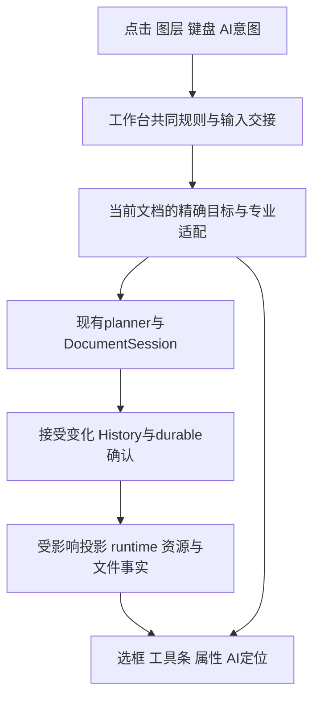

# 果铃统一编辑体验与性能收敛总方案

> 历史正文（2026-10-22 归档）：保留原调查、方案和当时措辞，不作为当前待执行指令。最新实现、未完成范围和证据见[当前状态](../development-plan/CURRENT_STATUS.md)及[结果记录](../development-plan/SOFTWARE_AUTHORING_RESULT.md)。

日期：2026-10-22。状态：深度复核后的推荐方案，尚未实施。

本次只生成本文件，保留三份输入文档及所有既有成果。不修改产品代码、工程、恢复稿、AGENTS、任务板、Skill 或构建产物，不执行产品测试、构建、产品供应商或收费创作调用、提交、推送或发行。

## 1. 结论：围绕一次真实操作，统一目标、变化和生命周期

**推荐保留现有组件模型、专业编辑引擎和 DocumentSession，把工作台收敛为“精确目标 → 专业输入与语义操作 → 一次正式接受 → 按真实变化更新 → 按实际生命周期释放”的完整链。**

操作体验与性能应在同一条链上解决。前者要求操作始终指向用户眼前的内容，后者要求只处理这次操作真正涉及的数据。两者共同缺口是：精确目标进入后续环节时丢失，局部变化被扩大为整实例、整正文、整工程、整历史和全运行世界处理。

这不是把全部模块搬进一个类，也不是把三份清单机械合并。最优边界是：共同规则只有一份，各文档和专业领域保持唯一事实源；一次已接受变化的事实被后续消费者复用，停止逐层重新捕获、解释和全量比较。

统一后的用户结果是：**眼前内容能直接改，包含它的整体能明确选；人工与 AI 可以持续接力；改动可以撤销、保存、冷开、运行和交付；局部操作的成本主要随此次变化增长。** 不以接口数量、清单全绿或“增加缓存”代替这些结果。

本方案中的“最优”指当前证据、既有能力和 Owner 约束下的推荐选择，不承诺没有现场测量支持的秒数、倍率或任意第三方程序的全能编辑。

## 2. 复核依据与三份方案的最终裁决

### 2.1 输入、当前基线与证据等级

本方案整合以下三份文件。它们继续保存原始定位和历史判断；后续如获实施授权，以本方案的统一决策、依赖与覆盖表为整合入口，不同时启动三套阶段计划。

| 输入 | 本次采用的内容 | 定位 |
|---|---|---|
| [原操作体验方案](统一操作体验与分层编辑整合方案-2026-10-21.md) | F01–F20、直接消费者、内容优先建议、T1/T2、精确交接与专业能力 | 问题和源码定位底稿 |
| [GPT 独立复核](统一操作体验与分层编辑-独立复核与收敛方案-2026-10-22.md) | 工作台协议与各文档 owner、HTML/GJS/Markdown、提交频率、连续正文边界、A01–A14 | 产品与架构纠偏 |
| [性能深度诊断方案](性能深度诊断与优化方案-2026-10-22.md) | 13 域 127 个定位条目、已有实机记录、方案比较、条件性与已接受成本 | 性能证据和叶子定位底稿 |

当前源码基线为 dirty 工作树，HEAD 为 `1af578e57c120210810d8e2996d072efdc50a365`；HEAD 不能代替未提交的有效实现。当前正式语义为 Project 11／Published 4／Component API 5。`container.presentation` 只属于 Slide；Flow 使用章节／标题和阅读位置，Spatial 使用镜头／路线。旧文件名中的 V10/V3 不代表当前 wire 版本。

此次复核包含三份全文、当前开发入口／状态／任务板、工作协议相关章节、架构合同 §0，以及下表关键直接源码。另由两个只读子智能体交叉核查体验覆盖和性能归并。没有重新操作用户窗口或采集现场 CPU／内存轨迹。

| 直接复核的链 | 当前源码事实 | 结论及证据边界 |
|---|---|---|
| `CourseV10DocumentBridge.captureTarget / selectInstances / publish` | 捕获 clone project/resources；同值选择仍进入 publish，派生多个文档视图 | 精确选择扩展时必须同时缩小高频读口；不能将 capture 作为 hover/caret 的前置 |
| `targets / FlowWorkspace / editorSession` | 子项直接命中偏 text；Flow 注册入口偏 string text；对象 mousedown 与局部输入存在接管交叉 | 原 F01–F07 的接线问题成立；具体错删或键盘双响应仍是待定向复现后果 |
| `SelectionContextController` | manual/pin 保存捕获；observe 读取文档；按完整目标 JSON 比较 | 保留 AI capture/pin，用轻量交互投影承接高频操作，不能借统一选择扩大复制 |
| `HtmlPreviewPane / HtmlStructureEditor / htmlGrapesProjection` | 预览与结构选择分持；结构 revision 变化会清选择，GJS 消费源码投影 | 独立 HTML 必须真实接入；稳定作者地址和视图 key 分开，不持久化 GJS 树 |
| `DocumentSession.apply / documentJournal.append / recordSaveIntent` | 正式操作保存 before/after，append 冻结完整 durable state；保存意图仍 load journal | 只改 journal 文件写法不足以解决内存和捕获放大；Session、持久表达与保存 head 要成套收敛 |
| `ComponentRuntimeWorld / ComponentRuntimeHost` | 全 targets 广播、资源物化和全实例处理仍可达；active update 使用 Promise 链 | 选择／内容／布局／资源需分别失效；只能合并确定可替代的显示工作 |
| API5 `resources.url(assetId)` | 仍为同步 URL 接口，程序可以动态计算 assetId | 资源按消费物化不能裁掉已授权动态资源，也不能擅自改为异步 API |

以上是源码确认。25.58MB HTML 首开约 14–15 秒、改字应用约 4 秒、保存 ACK 约 20.394 秒，以及 revision 6 单条 journal payload 约 564.5MB，属于性能方案引用的既有样本证据，此次没有重测。资源分析与 journal 的阶段耗时不直接相加为完整保存耗时，也不推广为所有作品的占比。

### 2.2 采纳、修正与不采用

| 议题 | 统一裁决 | 原因 |
|---|---|---|
| 原方案由 GLX Bridge 收拢选择 | GLX 内继续成立；工作台提供共同交互规则和窄接口，各文档持有自己的选择事实 | 采纳 GPT 修正，独立 HTML/Markdown 不能遗漏，也不能塞进 GLX 类 |
| 内容、布局、实现载体 | 三轴分开；能力从真实语义和绑定派生 | 消除按工作区／builtin 复制完整操作流程的根因 |
| 内容优先、父级可达 | 作为本方案推荐默认，尚不是 Owner 已确认的交互取舍 | 契合 AI 作品人工接手；文字区拖动选字，移动整体使用边框／把手 |
| 一套工具上下文 | 一个目标、一个输入接管者、同源命令；可保留固定格式区、浮动条和侧栏 | 只隐藏重复工具条不能消除后台双接管；不为统一而重新排整个工作台 |
| 统一输入与 History | 统一完成／拒绝保稿／撤销含义，按真实载体选择可靠提交边界 | 数据可增量提交；源码字段不能逐键整页改写并重载 |
| 连续正文与局部字段 | 均纳入目标，分别验收；先恢复能可靠定位的常用编辑，必要连续正文完成 T1 | 局部输入框不能冒充跨段文档；全部 group 重投影也不应成为一切修复前置 |
| 性能方案 A/B/C/D/E 批次 | 按本方案 U1–U8 重排，并入同一操作链 | 原包划分适合领域调查，却会让选择、提交与资源的共同根因分批重复修改 |
| 127 个条目 | 全部明确承接，但区分主线、专项、条件触发和保留成本 | 条目数不是缺陷数；覆盖不等于必须立即全部实施 |
| 增量 journal | Session 内存 History 与 durable codec 同步改为已接受状态效果及必要局部快照／引用 | 否则磁盘变小而全量 clone 和多版本内存仍在；恢复不得重执行业务命令 |
| 换编辑器、换存储引擎、通用平台 | 当前不采用 | 没有必须更换 PM/CM/GJS、引入 SQLite、全局缓存平台或第二事件总线的证据 |

### 2.3 本次补出的覆盖缺口

性能原方案 §5 的定位比 §7 工作包更完整。后者未明确承接 `FLOW-09/10`、`HTML-01/02/03/04/05/08/09/10/11`、`RUN-06/10`；`RUN-07` 仅通过媒体条目间接承接。本方案 §9 给这些条目明确归属。

GPT 的 A01–A14 可作为任务骨架，但不足以替代所有精确断言。本方案补回：真实图层树定位内部图片；相同焦点下菜单／键盘全选及剪切粘贴重复的一致性；自由表面 rich cell 的 Tab/Enter、公式与合并区；已选子图第二次拖缩不跳父级；真容器进入返回保目标／相机／滚动且不写内容 History。

这两项是规划覆盖缺口，不是新增实测软件故障。

## 3. 统一抽象：四个范围必须从头到尾保持

一次操作经过不同技术载体时，必须保持下面四种范围。它们是现有职责的共同约束，不新增持久格式或让模型填写的协议。

| 范围 | 必须保持的事实 | 同时解决的体验与性能问题 |
|---|---|---|
| 语义范围 | 文档／epoch、对象／字段／文字或单元格范围、真实编辑上下文、操作能力 | 用户选字段就改字段；不退成整组件，也不为读取字段捕获整工程 |
| 变化范围 | 本次读集、正式变化及逆变化、实际依赖和受影响布局范围 | 命令不误扩面；普通输入不重建全文、全资源和全部 runtime |
| 时间范围 | 输入中的草稿、一次明确交接、已接受事务、派生工作各自的顺序 | 不抢 IME、不重放点击；正式操作保序，可替代显示不积压 |
| 生命周期范围 | 文档／视图／realm／资产／任务／订阅的实际 owner 和释放时机 | 返回时保编辑位置和程序状态；真正关闭后退役句柄、全文和派生物 |

统一操作只需回答：**正在改谁、想做什么、实际接受了什么、谁必须更新、何时结束。** 目标和操作由当前文档／专业适配解释；已接受变化由正式 writer 给出；其余读取事实，不各自猜一遍。

### 3.1 责任划分

| 唯一事实／职责 | 落在现有哪里 | 必须退出的重复职责 |
|---|---|---|
| 活动文档、共同选择策略、输入交接、命令路由 | 现工作台 composition 与文档编辑适配接口 | 各 Surface、菜单、toolbar 分别决定同一输入的最终目标 |
| GLX 精确选择及编辑范围 | 现 GLX Bridge/kernel 的 per-document 临时状态 | `selectedSpotKey`、粗 IDs、局部 editing 标志作为并列权威 |
| HTML 精确选择、Markdown 专业选择 | 各自现有文档控制器／适配器 | 预览、GJS、源码各存一份最终选择并用 effect 相互纠正 |
| 专业输入状态与浏览器 Selection | 对应 PM/CM/plain/cell/formula 适配；共同宿主协调外壳 | 外层 PM、父组和内部编辑器同时响应同一轮输入 |
| 正式内容、资源、History、接受／拒绝 | 原 planner/driver → DocumentSession | GJS 私有正式 History、DOM 回序列化第二 writer、UI 自行接受 |
| 已接受变化及恢复表达 | 同次 apply 的结果，交原 journal owner 持久化 | 每个下游整工程 diff；journal 重跑命令或工具 |
| 目标几何、导航位置、运行现场 | 现视图／阅读／相机／runtime owner | 选框和临时视图位置写入作者工程；为统一另建导航存储 |
| 已发送 AI 目标和授权 | 现 capture/pin/Main 授权链 | 人工光标变化改投已发任务；AI 完成抢走当前输入 |

共同接口提供“当前目标／能力读口、接管／交接、语义命令、精确定位”；各文档适配器持有事实。工作台不复制所有格式的可写选择镜像，不建立巨型 EditorState 依赖，不把整个 Bridge/store 重新导出作为公共端口。

### 3.2 单向数据流

图中的连接是已有服务间的数据流，不要求新建一个消息中枢。选择／光标／相机等临时更新可以从 C 直接到 G，不通过正式写入与持久化。内容提交仍经 D/E，未 durable 的草稿不能显示成已提交或已保存。

## 4. 用户操作与输入交接的最终建议

### 4.1 统一日常规则，保留有意义的布局差异

| 用户动作 | 推荐结果与范围 |
|---|---|
| 单击普通可编辑文字 | 在所点位置放 caret；拖动选字，双击选词；plain 字段只提供真实格式能力 |
| 单击图片或形状 | 选中可可靠写回的眼前对象；图片不以 Alt 深选为隐藏前提 |
| 选整体 | 边框／名称标签／有意义祖先路径直接可达；技术 div/iframe 不成为必经层级 |
| 已选子对象再拖缩 | 保持同一精确目标；手柄承担几何操作，正文内部不同时搬动整体 |
| Flow 调布局 | 使用阅读顺序、宽度、列宽、间距等真实能力；不伪装自由坐标拖动 |
| 右键、属性、图层、快捷条、键盘、AI | 同一目标与能力；字段不支持独立复制／删除时说明并提供选父级，不静默升级 |
| 对象多选 | 建议 Shift+点击增减；文字态保留文字选择语义；父子排重，跨能力命令不静默部分执行 |
| Esc | IME／弹层先处理；普通有效文字沿原草稿提交链结束并退出，失败保稿；手势撤销本次预览；显式表单／源码草稿保留明确应用与取消 |
| Ctrl/Meta+A、剪贴板、Undo/Redo | 与菜单／右键共用语义命令，按当前文字／cell／对象焦点处理，保持一个正式 History |
| 编辑内部、结构、源码 | 沿当前目标进入同一文档的对应视图；真容器复用专业工作区，返回保位置与目标 |
| 编辑／试运行 | 编辑手势只编辑；运行手势交给作品。Published／离线作品保持正常运行 |

固定格式栏、对象条和属性侧栏可以同时存在，但必须共享目标、格式状态与命令。当前局部输入接管后，父组和外层 PM 的竞争命令退出激活；不能只把其中一条设为不可见。工具条可键盘进入并返回原选区，不把工具条点按当作一次错误 blur。

### 4.2 一次选择交接必须保留最初意图

流程为：初次按下捕获候选作者地址和局部 caret 意图 → 当前输入 owner 完成合法输入／composition → 原 flush/ACK → 按已接受变化映射并重新定位同一地址 → 一次进入新目标。

只保留最新一次明确接续意图，不排队重放任意 DOM 事件。Flow 重排后不能按旧屏幕坐标另选对象；目标删除、作用域变化或绑定不再可靠时保留可恢复输入并明确反馈，不退到父级或同文案对象。操作期间自身 ACK 可以推进当前编辑基线，外部冲突不能通过盲目抓取“最新值”掩盖；AI 已冻结目标另外保持原有版本和授权语义。

### 4.3 数据字段、源字段与源码编辑分别提交

| 输入类型 | 即时反馈和提交策略 | History／保存含义 |
|---|---|---|
| 原生 rich/plain/cell 和可热更新数据字段 | 专业引擎即时输入；按已有连续输入／格式／导航边界产生局部正式操作 | 传递 historyGroup；一次换图、格式操作、拖拽为可解释单元 |
| 需修改 source/records 的普通可视字段 | 使用现草稿和可用局部预览；按可靠输入批或完成边界提交，不逐键整页重载 | 普通离开不丢字；已接受批次进入同一 History，保存必须 drain 当前合法输入 |
| 明确应用／取消的代码、公式或参数表单 | 保留现有专业草稿与应用语义，不伪装成所有按键都已正式接受 | 未应用输入由现适配器处理；正式采用后进入原 History，不能创建影子正式撤销链 |

Pending 输入与 Undo/Redo 的先后由同一交接入口交给活动适配器：未提交输入不能被跳过而先撤掉另一个对象；组合输入未结束时不能全局抢键。不得另造一份自管文档 History 来模拟撤销手感，也不得为统一请求频率丢失原草稿保护。

### 4.4 受管 realm 内同步处理编辑手势

复用 `authoredDocumentBootstrap`、HTML preview agent 和现 sandbox 桥，在可控制且先于作者脚本的初始化位置安装本 realm 的输入仲裁。覆盖相关 pointer/mouse/click、焦点和键盘序列，编辑态阻止作者业务与浏览器默认动作，专业输入和 IME 交还其 owner。

父窗口收到 postMessage 后再 preventDefault 已经太晚。不能只阻止 click，留下 pointerdown 已执行业务；也不能在 ACK 后补放这次未知业务点击。模式与输入接管是轻量控制消息，不应再次发送完整 source/resources。

受管嵌套文档继续沿已有 scope、origin、source 与几何转换；未受管跨源内容只暴露实际支持的整体／源码入口。此项不承诺全局暂停程序，不引入任意运行现场快照，也不把作者编辑遮罩送进 Published。

## 5. 一次变化只解释一次：从输入贯通 History、投影与资源

### 5.1 轻量交互、窄捕获与正式变化

1. Hover、caret、选框和格式状态读取当前已加载投影及局部专业事实；同值选择早退，不 drain 全部文档、不 clone project/resources、不做 AI 冻结捕获。
2. 真正编辑／发命令／AI 发送时，捕获必要目标、版本、旧值和真实读集。范围要包含操作实际依赖，如祖先布局、共享定义或目标邻文，不简单等同一个字段。
3. 沿既有 driver/planner 的局部编辑产生候选，保未变子树与资源身份；普通改字／mark 不进入全正文结构 reconciliation。结构插入、拆分、重排及未知全量替换保留必要完整协调。
4. 同次正式 apply 产出接受变化、逆变化／必要局部快照和受影响对象事实，History、回执、ACK、投影、runtime 共用；不在后面逐层整工程 stringify/diff 再猜变化。
5. 保最终 CAS、epoch、操作幂等、权限和实际全局不变量。临时同值状态直接不发布；已经发出的正式同值操作保轻量幂等回执，不伪造成未执行请求。

不构造通用 patch DSL 或永久全局依赖图。GLX 字段、正文 steps/range、source splice 复用各自已有表达；暂时必须全量替换的真实操作可保完整快照，不能借此让日常局部输入继续全量化。

### 5.2 Flow：专业增量与连续正文一起设计、分别交付

PM mapping 用于位置推进和变化范围；身份修复仅处理新增、拆分、粘贴及受影响表格，普通输入不全文续号。DecorationSet 由 plugin 保留并映射；表格按版本一次布局／样式计算，选择变化不逐 cell 重排。对象按自身与真实依赖版本刷新，保现 NodeView/World host，无关程序和媒体不重挂。

段落 observer 长存，标脏后统一读几何再写样式；字体／宽度等真实全局变化才扩大测量。属性只转换当前需要的块；源码未展示时不每键制造完整 Markdown/HTML。CodeMirror 保留 Text/ChangeSet，同版本解析共用；长纯解析可沿现 worker 只采用最新结果，切视图与保存仍 drain。公式语法／描述／图面共享同次结果，组合态不重复计算整条预览。

连续正文按已有 section、正文 slot、阅读顺序识别；边框、底色、Flex/Grid 包裹不应天然切断文档，但自由标签、旋转构图和程序 UI 不能被自动合并。T1 若采用 contentDOM，PM 独占其中可编辑后代 DOM，React/World 只管理明确的外壳或原子节点；正式 childIds、身份、`.body.md/.body.html` 往返、布局和邻文同时保持。不得把一篇真正连续正文长期拆成多个局部框后宣布完成。

### 5.3 History、journal 与保存 head 成套改变

推荐在原 Session/journal 内采用**已接受状态效果＋checkpoint**，不是重建事件溯源系统：

- Session 不再为每次局改 clone 整个 durable 图并重复保所有 before/after；复用 driver 的变化／逆变化、不可变子树和现资源引用。History amend、undo/redo、receipts 与 continuation 从同一真实历史链派生。
- 每条 durable 追加保存 operation 身份／摘要、epoch/sequence/revision、状态变化、History push/amend/undo/redo、必要新资源及 binding/saved/stop 变化。结果无变化也保持必要查重事实。
- **恢复只应用已提交纯状态效果，不重新运行工具、脚本、网络、导入、测量或文件发布。** 未知保存结果继续由既有 intent/proof 查证。
- Checkpoint 覆盖 current、savedModel、past/future、分组 amend、receipt digest/result、binding/savedRevision、stop/disposition 及资源引用。保留全部承诺历史，不截短 Undo 或删除回执换速度。
- 追加完整持久化及所需刷盘后才正式 ACK。可重建索引合并维护；checkpoint 可后台准备，最终替换仍回原串行 owner，合并新后缀或放弃该次维护，不能覆盖其间新提交。
- 原 journal owner 维护已 durable 的轻量 head，普通保存归属不再反读全历史；首次加载、文件身份变化和未知发布仍真实重建／查证。binding 索引不能独自证明提交成功。
- 旧内部恢复 codec 只在读入边界转换，保留原件；这不要求升级 GLX/Published 作者格式，也不授权迁移真实用户 profile。

把现完整 state 序列化搬 worker 只减少前台冻结；如果每次仍编码全部保留历史，它不是本项完成。V8 编码字节不作为一般语义 digest；二进制操作摘要减少数字数组中间表示，仍保同 operation ID 不同请求的拒绝语义及旧摘要读入。

### 5.4 精确依赖失效，停止全世界同步

选择、内容、拓扑、布局、资源、导航、相机和状态分别失效。纯选择不触发内容 runtime.sync；对象版本包含其真实定义／数据／样式／资源依赖，别页变化不重算当前大 HTML 签名。不变 theme 不写 DOM，布局只测受影响对象；必要祖先变化仍履行原挂载／park 提交边界，只处理实际受影响后代。

Runtime targets 遵循现 RuntimeTargetProfile：轻引用不升级 full，真实 full 消费者也不能失去同步 target.read。Source 准备缓存位于依赖复制、key/base64、IPC 和 hash 之前；同输入共享准备 promise，结果只传消费者需要的 artifact。未发旧版本可退役，运行中共享编译只在没有其他消费者时取消。

缩略图按本页依赖与可见性更新，设计布局保持原尺寸，栅格只生成实际缩略像素。属性按真实输入 tuple 订阅，图层树只变受影响分支；大型树窗口化、空间索引、esbuild rebuild 和 Main bundle 仅由剩余热点决定。

### 5.5 资源保全授权地址，按消费准备表示

资源 owner 保全部已授权资产的轻量目录和同步可寻址能力；已知依赖先准备，动态 assetId 继续沿现授权资源端口取用。只扫描静态闭包就删掉其余资产不成立，不能把同步 `resources.url` 改成 Promise。

稳定地址通过现协议／租约读取 bytes；opaque realm 必须实际可读，不能照搬父窗口 Blob URL。无法等价满足同步动态读取的消费者保留原可用准备方式，先去其余确定重复，再用局部验证决定该消费者的替换，不以假设正确的新路径切断作品。

单资产替换只更换该资产条目和必要 URL，旧消费者退出后退役旧租约；资产身份／版本跨 IPC 保持有效，不能只靠同一进程的 JS 引用或 useMemo。Session/History/保存共享的 canonical bytes 不得 transfer/detach；只转移独立工作副本或明确归接收者的新产物。首次外来图片完整解码准入保留，可信不可变结果复用元数据／解码事实。

最终离线导出使用自己的完整资源包装，不能带入编辑短租约；保 file:// 双击能力、原图、透明度和已有媒体表达，不以减包体积静默取消备用交付字节。

## 6. HTML、文件、AI 与重任务共同遵守这条链

### 6.1 HTML：一个作者目标，多个可丢弃视图

预览轻编辑、GJS 结构和源码是同一 HTML Session 的视图。选中的 author address/source range 在可映射处互相定位；程序生成内容保作者字段地址，无法映射静态标签时明确说明，不序列化运行 DOM 覆盖源程序。每个 source revision 共用纯扫描／records／source 索引；外部 CSS/子页闭包另含 root、依赖版本，带 token 响应按 lease/load，动态 DOM 句柄按真实 realm 生命周期，不能统统只用 revision 缓存。

Mutation 标脏子树，scroll 主要更新可见／选中几何，祖先矩阵在同帧共享；避免全 body 扫描后再筛可见。模式／可见性用小消息，不随之广播所有 frame sources/data URI。发现、几何和同 identity reload 合并过时未发请求；正式修改和保存保序。

GJS 树和可视投影共用一次分析，源码 changes 能局部更新就不整份 setComponents/setStyle；保现有关闭的私有存储／History／快捷键。HTML 结构模块按实际打开加载。lease 释放清 Main 句柄；断开节点从强 Map 清理；软件创建 Blob URL 由 frame 导航 owner 管理。隐藏时停仅观察性扫描，返回合并刷新；不销毁用户程序现场。

### 6.2 文件与恢复列表：身份先定位，内容按需读

Registry／文件树先用轻量身份定位文档、路径和目录，命中后才 drain/capture。目录一次稳定快照供分页，watch 保相关路径／父目录脏范围，每目录复用在途刷新；展开不重扫无关树。watch 无 filename、网络盘不可靠、激活及必要补扫仍有 fallback。

普通文件未变时复用本进程保存基线、入口和依赖文件事实，避免隐藏 tab 每秒全量读/hash。外部正文、附件、CSS、子页变动必须仍被发现，保存前真实冲突检查保留。open/attach 共用同身份结果，晚到 open 不覆盖更晚 changed。恢复列表读原 binding index 的轻量描述符，点击才 recover 整模型和 History。

末 UI consumer 退出释放 watcher；授权根事实与活 watcher 租约分开。大复制的准备可移出排他区，最终发布／删除仍按原 owner；复制完整性、删除前源未变的必要检查不能机械删除。

### 6.3 AI：目标冻结，记录与显示增量

人工当前目标在发送时经原 capture 冻结版本／范围／授权；后续光标不改投任务，AI 结束不自动抢焦点。AI 结果按原精确字段／范围定位，用户主动查看时再选中。

流式工具参数首次识别时用已累计 raw 初始化一次，后续连续片段 push；缺片用 snapshot 恢复，finish 保完整校验。终态 EditSession／预览释放全文、模型和前缀，仅保迟到屏障与必要结果身份。不能一面把前缀解析改增量，一面仍永久保留所有前缀版本。

RunStore／EventStore 复用原 owner 做阶段去重、增量记录、文档关联索引和稳定消息估算；真实 pending bytes 包括已入队但未写完的数据。相邻显示 delta 有序合批并背压，终态／cursor／提交事实不能丢。不可变已提交前缀搜索不长期占追加锁；Loaded、时间线和卡片按活动／实际事实更新。无业务依赖的前缀诊断退出关键路径，保业务 payload／provenance 真实性。以上可用冻结会话与离线 delta 验证，不需要真实供应商重跑。

### 6.4 重计算、启动与媒体：复用现执行器和资源生命周期

先去重复 parse/解压/压缩/编码/准备，再将纯 JSON/HTML 分析、ZIP、Office parts、像素算法移入已有 worker；真实 DOM、字体、程序图面和打印留现隔离 renderer。异步 fs 不因“重任务”再包 worker，正式捕获／CAS／原子发布仍归现 Main/Session owner。

GUI 导出与工具导出在原 App drain 后冻结同一 revision，复用现 export executor；同次 PPTX/DOCX 共享解包和 XML 变换，最后一次压缩。一个导出可复用冻结 publication 的捕获 host，逐目标正确 reset 初态/scope/mask；无法可靠 reset 的目标保隔离方式。同任务 payload/resources 注册一次，小 token 取代巨型 base64 JS；取消沿 requestId 穿透 job，只销毁该 job 的 worker/window，不操作用户窗口。

PDF 按文件版本保一个 document，翻页/resize 只取消页 render；图像编辑复用已解码操作前缀，最终保存再编码，不引入累积有损失真。画笔保采样、按帧绘制，材料页与缩略图按可见消费，原件可随时取得。Python 结果逐项交付释放临时副本，不盲共享有未知全局状态的执行实例。

启动先切断完整 builtin 源码 JSON 和 GJS 的 eager import，组件库列表仅取 metadata，实际提炼才生成包。字体保完整声明，按本次 family/style/weight/text 在实际 Document 内准备；不能把父窗口 ready 或 mount 的一次 fonts.ready 当作后续新字符的永久保障。启动 bundle、外部大库扫描和额外 host 数量依剩余证据决定。

## 7. 调度与释放：统一判断，按语义实现

| 工作性质 | 推荐策略 | 保留边界 |
|---|---|---|
| Hover、选框、拖缩可视预览 | 每帧最新意图；精确 hit 一在途加一最新点；pointerup 按最终点确认 | 不丢画笔中间采样；旧 hover 不覆盖新点击 |
| HTML 发现、目录刷新、同 identity reload | 每现有 owner 合并 dirty／未发过时版本 | 最终最新内容必须进入视图 |
| 编译、源码解析、可重建派生准备 | 同输入复用 promise，未发旧任务退役，共享任务保其他 consumer | 不把共享取消变成另一文档失败 |
| 确定纯显示的 runtime update | 可合并可替代状态 | 自定义 Source update 的可观察副作用不得默认丢弃 |
| 普通输入 | 专业引擎即时显示，按载体可靠边界接受 | 不用全局 debounce 掩盖全量工作、牺牲 IME/History/草稿 |
| 正式事务、文件发布、工具副作用 | 原 owner 顺序接受和持久确认 | 不 latest 覆盖命令，不重放未知结果 |
| 生命周期退出 | 对实际文档/epoch/lease/run/job 退役引用与迟到任务 | 隐藏不是关闭；未知副作用保护和已 pin 目标按原语义保留 |

上述规则分别落实在现有 owner，不建设全局调度平台。清理看真实 retain/release：关闭文档清 manual/ticket/目标 DOM 锚点，关闭卡清对应稳定锚点，释放 lease 清 Main 表，运行终态清大预览；轻量 tombstone 保必要屏障后随所属代际退役。不以“cache.size 小”替代 retaining path，也不以 WeakRef 代替应有生命周期。

## 8. 统一实施路线：八个闭环包，按当前结果推进

以下仅供后续明确授权实施使用，不自动开工。U1–U6 承接共同根因和现有高价值链；U7 承接独立专项；U8 只由实际条件触发。每包可按完整用户任务分成候选，不能只落空接口等后续补全，也不要求八包全完才交付已独立成立的改善。

| 包 | 一起完成的工作 | 用户可见完成条件 | 真实依赖与单 writer |
|---|---|---|---|
| U1 精确目标与轻量交互闭环 | 工作台规则、各文档窄接口；GLX 精确目标与命令/属性/图层/AI接通；分开选择和内容通知；同值早退 | 字段 A→B 后所有控件同目标，文字/图片/父级可达；高频选择不全量捕获和同步 runtime | GLX Bridge／composition 由一个 writer 集成；先明确 HTML/Markdown 接口，不把实现硬塞 GLX |
| U2 常用编辑与 Flow 专业投影 | 共同输入宿主、rich/plain/slot/cell；T2 realm输入；局部输入窄捕获；PM身份/样式/NodeView增量；T1真正连续正文 | 改标题→换图→选整体→改属性→Undo→保存冷开；连续正文另证明 Enter/跨段选择；不逐键重载源码 | 接 U1 窄口；T1只约束连续投影支线，T2只约束编辑手势支线；与U3共享Session接口顺序整合 |
| U3 接受变化、History与大文件保存 | Session内存效果／资源身份、journal增量及完整checkpoint、保存head、状态轻通知、固定revision归档worker | 既有大HTML局改/保存不再反复编码全历史；UndoRedo、拒绝、恢复和固定版本保存正确；前台可继续响应 | 与U2共同apply/changes口单writer；不等所有体验叶子完成再启动设计，最终候选成套评审 |
| U4 Runtime、资源与手势消费 | 真实依赖失效、同步动态资源地址、Source准备前置缓存；hover/drag/吸附/缩略图；无关iframe不搬动 | 选择不内容sync，改一图不换全库URL，无关程序不重挂；最终几何、动态assetId与运行状态正确 | 依U1/U2/U3稳定读口，World/Host/resource实体单writer；不先建全局依赖图 |
| U5 HTML与文件多视图闭环 | HTML预览/GJS/source与Markdown实际接入；HTML局部扫描/消息/lease；watch/目录/恢复列表；源码输入与公式余项并入U2 | 同一目标跨视图可定位，大HTML输入/滚动/关闭可用；外部依赖变更仍发现；未变tab不重复全读 | 共同输入口稳定后接入；HTMLController与其lease生命周期同writer，journal轻描述符复用U3 |
| U6 AI与工具准备闭环 | 精确冻结/定位；流式解析/终态释放；Run/EventStore真实背压；按需project文件投影/批量候选/观察复用 | 不重parse增长前缀，不保全量结束预览；读小文件不制造全工程投影；AI不随光标改目标 | 复用U1/U3轻身份与变化；原执行/投影/观察owner各自单writer，不另建历史 |
| U7 启动、媒体与导入导出专项 | builtin/GJS按需加载、metadata库；字体/PDF/图像/材料；GUI导出复用执行器，PPTX/Office打包与capture任务取消 | 空启动无无关重依赖；受影响媒体/导出操作结果正确、可取消，编辑前台可用；可编辑和离线能力保持 | BOOT-01/02/03低耦合叶子可早于U2并行；后续字体/媒体/导出按真实用户路径选题，不等专项全齐 |
| U8 条件性剩余热点 | 大型树/空间图、复制锁、外部大库/Main require、网络/日志风暴、计算大输出与大缓存 | 有对应实际规模或轨迹才实施；保正确性和完整结果；无信息增益停止 | 不作为前七包签收前置；IO-08离线成本只保留，不擅自改变产品能力 |

建议开工顺序为：U1 与 U7 的明确 eager 依赖叶子先行；U2 和 U3 围绕同一 apply/变化接口衔接开发；随后 U4/U5，U6 可用已稳定窄口并行；U7 其余专项与 U8 按受影响路径和剩余热点推进。大 HTML 保存已有直接证据，U3 不应拖到所有 UI 领域优化之后。

当前任务板另有咖啡 active 任务。后续写入前核相关卡与实时写域，Root 统一共享实体集成，不能据此方案抢占其源码、重做作品或启动完整创作。重要 writer/History/生命周期候选按现协议独立 review；方案评审不替代实际 diff review。不机械拆 commit，也不自行 commit/push/发行。

## 9. 双向覆盖复核

“覆盖”表示每条已知问题有解决机制、承接包和验证去向；不表示代码已经修复，更不等于所有条件性项必须立即实施。

### 9.1 原方案 F01–F20 与 T1/T2

| 原问题 | 统一机制与承接 | 验证任务 |
|---|---|---|
| F01 语义命中受frame/text特例限制 | §4.1共同内容选择，§5.1窄目标；U1/U4 | V1/V3 |
| F02 Surface选择/后续拖缩分叉 | 同目标继续手势，保持Spatial专业几何；U1/U4 | V3 |
| F03 Flow父子抢选/焦点 | 单输入接管、明确NodeView事件owner；U2 | V1/V2 |
| F04 组内document-block/slot与正文不可达 | 专业slot适配＋真正连续投影；U2 | V1/V4 |
| F05 多编辑器/工具条竞争 | 共同宿主与同源命令，退出外层竞争；U2 | V1/V2 |
| F06 Flow内部图文入口不对称 | 同作者字段与painted命中端口；U1/U2/U4 | V1/V5 |
| F07 Spatial/Program内部字段断线 | 四工作区消费共同目标/输入能力；U1/U2 | V3/V5 |
| F08 字段选择退为instance | per-document精确目标，粗IDs只派生；U1 | V1/V3 |
| F09 属性/高亮范围不一致 | 同精确读口与操作capture；U1 | V1/V3 |
| F10 Flow图层缺内容入口 | 实际NodesTab内容树定位；保阅读顺序与浮层z-order；U1/U5 | V3 |
| F11 plain/rich与caret/外壳分叉 | 专业适配保语义，共同宿主和点击bookmark；U2 | V1/V2 |
| F12 输入撤销分组不同 | §4.3载体提交策略＋一个History；U2/U3 | V2/V6 |
| F13 Esc丢普通草稿 | 输入法优先，普通完成退出，拒绝保稿；U2 | V2 |
| F14 菜单/键盘与精度分叉 | 统一全选/剪切/复制/粘贴/删除/重复路由；U1/U2 | V3 |
| F15 AI结果粗回选 | 冻结目标与主动结果精确定位；U1/U6 | V7 |
| F16 容器路径与对象祖先混用 | 保专业编辑位置，对象祖先从正式树派生；U1 | V3 |
| F17 同实例字段A/B会话key不变 | 精确地址决定上下文，失效不回父级；U1 | V1/V3 |
| F18 自由表面cell偏plain | 共用rich cell能力与稳定cell地址；U2 | V2/V4 |
| F19 realm只异步上报未先拦业务 | §4.4本realm同步裁决，T2；U2/U5 | V5 |
| F20 ACK后按旧坐标选错 | §4.2捕获精确意图并按变化定位；U2 | V2 |
| T1 同DOM连续投影可行性 | 咖啡一个真实阅读组，DOM单owner与正式往返；U2 | V4 |
| T2 作者事件早期接管 | 同按钮/链接编辑与运行对照；U2/U5 | V5 |

### 9.2 GPT 复审意见和 A01–A14

五项主要修正分别落在 §3.1/§6.1（工作台与独立格式）、§2.1（Slide-only）、§4.3（提交策略）、§5.2（连续正文）、§8/§10（完整任务和旧路径退役）。三条正交轴用于能力解释，不创建三份模型。

| GPT验收 | 本方案任务 | 补足后的必要属性 |
|---|---|---|
| A01、A02 | V1 | 内容—图片—整体、字段A/B的真实完整消费者 |
| A03 | V3 | 不支持独立操作时不扩大到父级 |
| A04 | V3/V5 | 四工作区既有能力实际到达同一入口，布局语义分别保持 |
| A05、A06、A07 | V2/V6 | 真IME、初次意图、拒绝保稿、同History与保存交叉 |
| A08 | V5 | 包含pointerdown、浏览器默认动作及正常运行对照 |
| A09 | V5 | HTML预览/GJS/源码与Markdown的实际多视图输入 |
| A10 | V4 | 真跨段文档、cell专业语义与单DOM owner |
| A11 | V7 | AI冻结与人工当前输入分离，结果精确可定位 |
| A12 | V6/V9 | 保存/冷开/继续改与受影响最终carrier |
| A13 | V3 | 全局、Flow章节、Spatial镜头、Slide状态新基线 |
| A14 | V3 | 父子排重，hidden/locked，跨能力不静默部分执行 |

### 9.3 性能 127 项完整归属

表内每个 ID 只给一个主承接包；同根叶子可以在该包共同完成，不为条目另建机制。**主线**为共同根因的一部分；**专项**按已有受支持操作推进；**条件**需对应规模／轨迹；**保留**表示其当前能力成本不能擅自删除。原文中的 C 条件仍有效，归入主线不等于已经证实是所有作品热点。

| 运行域／项数 | 完整ID → 主承接包 | 范围处理 |
|---|---|---|
| DOC／10 | DOC-01、DOC-02、DOC-03、DOC-04、DOC-05、DOC-06、DOC-07、DOC-09、DOC-10 → U3；DOC-08 → U7 | 主线；DOC-03/06/07/09/10按历史或字节规模选反例 |
| FLOW／10 | FLOW-01、FLOW-02、FLOW-03、FLOW-04、FLOW-05、FLOW-06、FLOW-07、FLOW-08、FLOW-09、FLOW-10 → U2 | 主线；源码输入/公式不再漏包，按实际输入类型验 |
| UI／8 | UI-01 → U1；UI-02、UI-03、UI-04、UI-06、UI-08 → U4；UI-05、UI-07 → U8 | 主线；大型Spatial裁线/避让与大树窗口化为条件 |
| HTML／11 | HTML-01、HTML-02、HTML-03、HTML-04、HTML-05、HTML-06、HTML-07、HTML-08、HTML-09、HTML-10、HTML-11 → U5 | 主线；仅结构面板打开、换图、动态/隐藏DOM等触发其对应叶子 |
| RUN／11 | RUN-01、RUN-02、RUN-03、RUN-04、RUN-05、RUN-06、RUN-07、RUN-08、RUN-09、RUN-10、RUN-11 → U4 | 主线；RUN-10保自定义Source副作用，RUN-06保共享consumer |
| FILE／9 | FILE-01、FILE-02、FILE-04、FILE-05、FILE-06、FILE-09 → U5；FILE-03、FILE-07、FILE-08 → U8 | 主线＋条件；复制完整性/删源保护必须保留 |
| AI／12 | AI-01、AI-02、AI-03、AI-04、AI-05、AI-06、AI-07、AI-08、AI-09、AI-10、AI-11、AI-12 → U6 | 专项；先01/02/09和真实pending修复，长会话项用冻结规模定位 |
| MEDIA／12 | MEDIA-01、MEDIA-02 → U4；MEDIA-03、MEDIA-04、MEDIA-05、MEDIA-06、MEDIA-07、MEDIA-08、MEDIA-09、MEDIA-10、MEDIA-11、MEDIA-12 → U7 | 主线资源＋媒体/字体专项；外来准入、真实度量与原图保持 |
| IO／10 | IO-01、IO-02、IO-03、IO-04、IO-05、IO-06、IO-07、IO-09、IO-10 → U7；IO-08 → U8 | 专项；IO-08为保留成本，暂无取消离线fallback的实施项 |
| BOOT／8 | BOOT-01、BOOT-02、BOOT-03、BOOT-04、BOOT-05、BOOT-07 → U7；BOOT-06、BOOT-08 → U8 | 01/02/03可先行；外部大库/Main bundle以剩余热点为条件 |
| LIFE／7 | LIFE-01、LIFE-02 → U6；LIFE-04 → U5；LIFE-03、LIFE-05、LIFE-06、LIFE-07 → U8 | 01/02/04清真实关闭引用；其他依卡片/作业/制品实际规模 |
| TOOL／11 | TOOL-01、TOOL-02、TOOL-03、TOOL-04、TOOL-05、TOOL-06、TOOL-07、TOOL-08、TOOL-09、TOOL-10、TOOL-X1 → U6 | 专项；05复用U4编译owner，08/09/10/X1复用U7捕获/测量host，不再复制 |
| SYS／8 | SYS-01、SYS-02、SYS-03、SYS-04、SYS-08 → U7；SYS-05、SYS-06、SYS-07 → U8 | 专项＋条件；取消/缺owner真实悬挂若复现则优先恢复核心操作，不因条件标签延后 |

域内数量合计为 127。§9.1 覆盖 20 个原问题和两个技术未知；§9.2 覆盖 14 项复审验收。数量只用于检查已知清单没有漏接，正确性由下面用户任务和源码责任判断，不以 ID 出现次数证明方案有效。

### 9.4 从实际入口反查，避免只从清单顺推

| 当前生产入口／消费者 | 必须消费的共同事实 | 承接 |
|---|---|---|
| Slide/Flow/Spatial Connector、Program root、InstanceView/World | 精确目标、输入接管、当前编辑范围与能力 | U1/U2/U4 |
| 固定/浮动工具、属性、NodesTab、App菜单/快捷键、clipboard | 同目标与命令；祖先、cell/range和能力不得丢精度 | U1/U2/U5 |
| HTML预览、GJS树/画布、HTML/Markdown源码与正文 | 一个文档目标、多种专业定位，原Session与源语义 | U2/U5 |
| 内置Agent、外部MCP、选择AI、结果卡、project文件工具 | 当前稿按需读取、发送冻结目标、同planner/Session与精确结果定位 | U1/U3/U6 |
| Session、History、恢复面板、保存/另存与文件外部变化 | 已接受变化、durable事实、binding与固定revision | U3/U5/U7 |
| Runtime/Published/compiled、GUI/工具导出、离线/Office | 当前正式内容、依赖资源与正确生命周期 | U4/U7 |
| 媒体/PDF/附件/材料、组件库/字体/启动、任务记录/网络 | 按消费准备、真实范围和退出生命周期 | U6/U7/U8 |

每一种迁移目标的旧分支在同一候选中退出独立决定权，只能保无写权的派生兼容视图。未完成独立HTML/Markdown接入不能报告整个工作台已统一；未完成连续正文不能以常见局改完成替签；未完成History内存表达不能以journal文件减小替签。

## 10. 最小充分验收：体验与成本在同一任务内观察

本次不运行下面检查。后续按实际改动选取相关任务，用现有作品副本、facts、测试和执行 seam；不重建完整咖啡作品、不调用供应商、不跑内容类型×所有表面的机械矩阵。纯文档链接/覆盖检查不是产品测试。

| 任务 | 实际操作与完成条件 | 对应成本证据 |
|---|---|---|
| V1 内容—整体连续作业 | 真实Flow组：按位置改标题/段落→换内部图→选父级调间距→回文字；同实例字段A/B；工具/属性/高亮始终一致 | 选择不capture全工程，局改不刷新无关对象/媒体/库提炼；同次转换与准备复用 |
| V2 输入、交接、Undo与失败 | 真中文IME、格式工具/键盘、Esc、pending输入UndoRedo/保存；一次延迟ACK引发Flow重排仍到初次目标；拒绝/冲突保稿 | 队列无持续过时输入；普通打字不全树续号/全表layout；源字段不逐键重载；拒绝不提前ACK |
| V3 精确命令、层级和四工作区 | 相同焦点菜单/键盘CtrlA；cut/copy/paste/delete/duplicate；真实图层定位内部图；已选子图再拖缩；父子多选；真container进入返回保目标/相机/滚动且不写History；全局/锁定/状态基线 | 手势每帧最新显示，hit不积压，吸附静态事实不逐move重算；选择与导航不触发内容sync |
| V4 连续正文与rich cell | T1一真实阅读组：Enter/Backspace、跨段选区/粘贴/IME、身份/邻文/布局及body文件往返；两类表面cell保rich、Tab/Enter、合并/公式 | PM单DOM owner、表格按版本复用，光标不触发全文转换；不重挂无关NodeView |
| V5 Runtime与HTML多视图 | T2按钮文案/链接编辑不执行业务，pointerdown对照与run正常；嵌套遮挡/缩放一个反例；Spatial/Program字段；HTML预览→GJS→源码→预览；Markdown现有输入 | 一个revision共用分析；小模式消息不发全source；精确hit可达；目标/lease退出真实清理 |
| V6 保存、恢复、长历史 | 现25.58MB HTML和代表GLX副本：未blur保存→新进程新profile冷开→继续改；History分组/amend/UndoRedo、停止、查重、一次未知保存/追加失败相关反例 | 追加量随变化不随全历史；保存不反读整journal；内存不每次clone完整durable图；归档阶段前台仍响应；旧journal原件保留 |
| V7 人工与AI/长会话 | 人工改A，冻结AI改B，再手工继续；主动定位结果；离线Unicode/转义/首次累计前缀/缺片/迟到delta和受控慢写 | 累计parse接近输入量，真实pending有背压，终态全文释放，时间线仅更新相关事实；不重跑真实provider |
| V8 文件与空闲 | 多未变tab、大目录分页、外部正文/附件/CSS/子页修改、关闭恢复面板再打开 | 目录一次快照、相关目录刷新；未变不重复全读；轻量恢复列表；末consumer清watch |
| V9 资源、媒体与最终交付 | 同步动态assetId、换一图；PDF换页；按改动选图像/材料/Office/离线导出；冻结revision导出期间继续编辑/取消 | 单资产URL稳定；PDF只一document；不重复全图历史重放/多次解包；job取消退役；像素/alpha/可编辑/离线互动正确 |
| V10 启动与字体 | 空启动、首次打开结构/源码功能、同Document新增字符/字族、代表固定frame/自然Flow | 无完整builtin/GJS eager依赖，首次按需功能成功；实际所需face就绪和度量正确；不以内部ready替代可交互首帧 |

有变化才选对应可信失败反例；既有未受影响证据继续有效。每任务分别记录用户可见反馈、正式提交ACK、保存ACK／落盘、冷开与导出，不能把内部compile时间当端到端准备。阶段重叠不相加，单次波动不写稳定倍率。

优先用“调用次数／处理范围已收敛＋用户结果正确”证明根因消除，必要时对同输入/构建/环境保一次分阶段前后对照。性能主导项含混才扩大trace；不将全套profile变成可明确修复热点的新门。约16.7ms可作60Hz拖动诊断参照，不是所有设备的硬承诺。验收通过即停，不以审查者变化或上下文恢复重跑。

退役核查与行为检查同批完成：旧选择裁决、重复输入宿主、GJS私有正式写入、整实例命令兜底、无关全量刷新分支不能继续作为第二owner。候选实现、真实UI、保存恢复、最终carrier、Owner接受分别报告；方案审查通过只证明建议，不证明这些层已通过。

## 11. 已排除、必须保留与仍需决定

### 11.1 不重新登记的旧问题

已有 parse5 长文本链／资源 backing 修复、HTML资源worker/snapshot single-flight、按需CodeMirror挂载、GLX容器化、全局范围隐藏与Flow挂载停用、咖啡host/自然尺寸与保存回放继续有效。不能用旧OOM或旧截图断言当前同因仍失败。

现有Source编译LRU/pending去重、runtime离屏保活/activity、AI SSE decoder/显示缓冲/分页、日志轮转、原生文字测量window复用和多数dispose路径确实存在。问题是缓存前准备、失效精度、特定强引用或重复冷启动，不能改写成“全无缓存”“所有timer都后台运行”“全部窗口泄漏”或“所有IPC同步”。小组件catalog不是当前普遍卡顿的既证根因；源码JSON大依赖是另一事实。

### 11.2 必须保留的产品和正确性成本

- 临时离屏保持实例／程序状态；黑盒作者后台活动不保证停止。先消除软件放大，剩余特定程序再按现场定位，不默认淘汰／重挂／重播。
- 单writer、最终CAS、epoch、授权根、绑定/旧值、停止屏障、幂等、未知副作用查证和durable ACK。范围缩小不等于移除必要约束。
- 首次外来图片完整解码、真实DOM/字体度量、复制完整性、删除前源未变及离线file://包装。可消除重复，不能省掉待证明属性。
- 真实plain/rich/cell/formula、专业代码草稿、自由/阅读/空间布局差异；不强制一个跨iframe文本Range，不承诺任意Canvas像素可编辑。
- Source update可能有副作用、同步动态资源访问、opaque realm隔离和canonical bytes所有权；异步接口不等于零复制。

### 11.3 真正的产品取舍与技术未知

产品建议已给出，不逐文件索要决定：采用内容优先及边框/路径选整体；普通文字Esc完成离开、Undo撤回；不增加常驻轻/深编辑模式。这两项交互默认仍需在未来实施授权中作为明确方案接受，不能把 GPT 推荐写成 Owner 已确认。本次不要求回答，不影响本方案交付。

技术未知只约束相关支线：T1 的连续正文DOM所有权与Flex/Grid往返；T2在实际受管realm中早于作者监听的接管位置；同步动态资源地址在实际opaque realm中的等价访问；journal内部codec版本和完整History效果落地。用对应真实局部样本/消费者决定细化，不设一次全产品前置探索门。

用户当前窗口的构建/profile、真实最常用作品的主耗时、磁盘/安全扫描/GPU/网络额外等待尚未现场核实；它们不能作为确定根因。空间索引、更多host、树窗口化、Main bundle和编译context由后续剩余证据决定。

新增费用/凭据、迁移真实用户数据、改变离线输出或教师能力、扩大权限、最终发布仍按Owner决定。本方案不解除发行暂停，不启动完整创作，不改写旧作品质量/总耗时未达事实。

## 12. 研究依据与覆盖结论

本次重新打开的一手资料只用于核实机制：PM steps/mapping可提供变化与位置映射；Selection属于各Document；Electron建议减少无关初始化和前台阻塞；背压依据真实生产消费进度。它们不证明本软件收益或要求升级依赖。

- [ProseMirror 官方 transforms/mapping](https://raw.githubusercontent.com/ProseMirror/website/master/markdown/guide/transform.md)：用于§4.2、§5.1–5.2，局部PM事实仍需映射为现有正式组件操作，不直接引入另一History。
- [W3C Selection API 草案](https://w3c.github.io/selection-api/)：用于§3–4的多专业输入和跨Document边界。
- [Electron Performance](https://www.electronjs.org/docs/latest/tutorial/performance)：用于§5.4、§6.4及按实际操作测量，不从指南推导提速倍率。
- [Node.js Backpressure](https://nodejs.org/learn/modules/backpressuring-in-streams)：用于§6.3、§7的真实待写与有序背压，不引入累计内容拒绝门。

其他领域的细项来源沿三份底稿保留；没有重新检索全部旧参考，也没有将其记为此次实测。

**覆盖复核结论：三份输入中所有已知问题均已在方案层有明确去向：F01–F20、T1/T2、A01–A14与13域127个性能定位条目无规划遗漏；实际生产入口也已反向核对。** 这包含已确认主线、条件专项与必须保留的成本，不能简写成“全部软件问题已经解决”。

整合稿另经一位未参与草拟的子智能体集中独立复核，未发现影响方案交付的实质问题；其核对了语义覆盖、唯一主归属、技术边界、产品取舍和只方案授权。Root 的文档检查亦确认主归属127项唯一、无遗漏/额外/重复，三份本地底稿链接可达。检查仅针对方案，不替代未来实现、现场性能与Owner验收。

后续应围绕同一操作的目标精度、变化范围、提交事实和生命周期推进，每个闭环同时检验可用性与成本。无证据的未来扩展不加入实施范围；出现新的现场问题时，按它影响的用户目标和现有owner接续，不再复制第四套方案或第二套工程真相。
