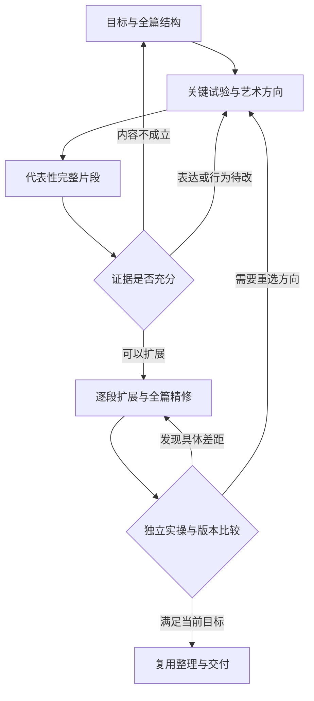

# 果铃作品建设方法论与生产框架

日期：2026-10-20  
用途：指导后续精品参考作品的策划、长程生成、精修，以及可复用能力与资产的沉淀  
当前阶段：方法论建设；架构方案由 Claude 审查，后续由 Codex 实施  
适用对象：人类创作负责人、创作模型、素材与交互执行者、质量审查者

## 0 本文的定位与使用方式

本轮建立作品建设的方法与工作框架，不进入任何具体作品的内容策划、页面生成、图片生成或代码实施。此前提出的参考作品组合保持候选状态，后续仍逐件策划、逐件完成。

本文承接《果铃 GLX 通用作品承载与三表面组件化修改方案》。该方案提出的通用 Web 作品入口、可组合的 Flow／Slide／Spatial 容器、共用状态与镜头能力、正式源码深改和资产复用路径，仍须以最终实施与验收结果为准。本文不把架构愿景写成已交付的软件能力，也不替代上一份架构实施方案。

研究分为三类依据：

- **果铃自身依据**：本次对话中的用户目标、此前创作与编辑复盘、上一份架构方案所记录的已核实基线。历史故障用来识别生产风险，不代表它们在当前版本仍然全部存在。
- **外部事实依据**：创作工具官方文档、互动作品作者的一手制作复盘，以及模型开发者公布的实验。引用编号对应文末来源。产品机制与作者经验有不同的适用边界，不能直接当成果铃的效果证明。
- **本文建议**：结合上述依据提出的创作原则、执行流程和评审方式，其有效性仍待后续果铃作品实践检验。

实际使用时，创作负责人先读第 1、3、4、11、12 节；具体执行者再按工作读取内容研究、视觉素材、行为设计或资产复用章节。附录工作卡可合并到一份项目蓝图，不要求逐张建文件、填满所有字段或增加新的管理平台。

## 1 总体判断：让每一轮工作都能积累到最终作品

果铃这次需要形成一种能持续积累质量的制作方式。作品的内容判断、艺术方向、真实行为和可编辑来源，应围绕同一个工程推进；精修后留下的成果，应能被下一轮修改和下一件作品继续使用。

这一目标包含两个相互关联的结果。

**观看者得到完整、鲜明、有价值的体验。** 作品需要有值得投入注意力的内容，清楚的推进方式，匹配主题的视觉与声音，能够理解和使用的交互，以及细节稳定的完成度。

**创作者得到可理解、可修改、可迁移的实现。** 后续能找到内容、状态、素材、布局与算法的实际来源，改动其中一处时保留其他已完成的判断，并将有价值的部分用于新作品。

这两项结果需要同时检查。精美截图不能证明行为有效；完整运行不能证明作品有表达价值；用了很多原生组件不能证明编辑方便；把素材放进库里也不能证明它已经能够复用。

### 1.1 六项长期原则

1. **从观众将获得什么出发。** 先明确理解、情绪、判断、探索或实际任务的变化，再选择内容形式和技术。
2. **以体验段落组织生产。** 页面、场景、镜头、组件和程序是承载手段；一次有意义的体验可以横跨这些边界。
3. **先检验整篇是否成立，再把代表性片段做到接近终稿。** 全局内容闭环与局部工艺上限都需要早期证据。
4. **保留正式可编辑来源。** 图片、预览、故事板和评审材料必须能回到当前工程；它们不成为另一份持续双写的内容真相。
5. **让复用保留表达自由。** 复用布局规律、交互机制、状态组织和素材能力，同时允许作品形成独立的视觉语言、节奏和结构。
6. **以实际体验和具体改动判断进步。** 保留最佳中间版本，独立操作作品，核实修改和交付结果，不用轮数、截图数或组件数代替质量。

### 1.2 需要避免的两种生产偏差

一种偏差是过早铺开：先把所有页、所有场景或所有候选作品生成出来，再期待统一精修能补齐薄弱内容和错误结构。另一种偏差是过早局部定稿：花大量时间打磨开场，却没有证明全篇的论证、情节或任务链条能够完成。

建议在早期同时保留两种尺度：**低成本检查全篇，集中投资代表性片段。** 前者控制方向错误，后者验证作品上限以及后续可持续的制作方法。

## 2 外部体系研究：吸收机制，明确适用范围

本次研究覆盖视觉建站、组件系统、动画状态、互动叙事、可视化编辑和长程模型协作。下表概括值得吸收的具体机制。它不构成产品排名，也不表示果铃应安装或照搬这些工具。

| 体系 | 一手资料确认的机制 | 对果铃作品建设的启发 | 迁移时的边界 |
| --- | --- | --- | --- |
| Framer | 组件变体组织不同呈现；近期 Skills 将设计指导与实际画布、组件和样式连接。[R01][R02] | 方法应能指向可编辑对象；变体承载有设计意图的差异 | 官方功能介绍不能证明生成质量或 token 收益；网页模板的常见结构不适用于所有作品 |
| Webflow | 属性、插槽和变体承担不同定制职责；组件可在独立画布与作品上下文中编辑。[R03][R04] | 参数、结构和情境需分别考虑；组件既要单独成立，也要融入作品 | 不为实现灵活性制造大量布尔开关；不把主组件修改与实例修改混为一谈 |
| Webflow 动效 | 组件作用域的交互可随组件迁移；页面实例作用域的交互具有不同迁移范围。[R05] | 可复用动效应携带触发、目标、作用域和结束语义 | 保存关键帧不等于保存完整行为；果铃仍使用自己的实际执行者 |
| Rive | 数据模型与视觉层级可分离；数据实例供预览和运行；转换包含条件与执行语义。[R06][R07][R08] | 将有意义的值和结果与视觉、状态及动效协同设计；用真实数据变化检查组件 | 不将 Rive 的完整模型或绑定解析规则搬成果铃第二套状态系统 |
| Readymag | 不同设备布局可以共享内容并分别调整布局；可局部整理所选内容。[R09][R10] | 响应式需保留语义、人工编排和局部修改能力 | 不采用复制多套内容再隐藏的方式解决果铃作者结构问题 |
| GrapesJS | 组件模型是导出与内容表达的依据，画布视图承担呈现。[R11] | 编辑应回到正式结构与来源，运行 DOM 不能替代工程内容 | HTML 能解析成组件，不代表任意复杂程序都能无损反推为原生对象 |
| Onlook | 公开项目描述通过代码关联支持视觉编辑与源码修改，目前实现有明确技术栈范围。[R12] | 视觉定位应能回到实际源码位置；修改路径需要连续 | 不据此推断任意 HTML、游戏或图形程序均可自动可视化编辑 |
| Storybook | Story 表达组件在参数和上下文中的具体状态；交互场景可执行操作并检查结果。[R13][R14] | 有用的资产示例应展示真实情境、操作和结果 | 用现有预览与验证能力承载即可，不必为样例另建完整平台 |
| Figma Code Connect | 可向模型提供真实组件的属性、导入方式、使用片段与本地说明。[R15] | 从作品参考区域连接到真实实现，减少只学截图和名称的模糊复用 | 映射需要维护；不能承诺设计与任意源码自动持续同步 |
| The Pudding | 制作过程重视中心问题、内容推进、视觉探索及响应式呈现；分页、滚动等均有适用情境。[R16][R17][R18] | 优先解决内容如何推进，静态设计稿可以参与高水平互动创作 | 作者经验具有体裁和年代背景；滚动叙事本身不保证内容质量 |
| Nicky Case／ink | 可探索解释将操作与理解联系；ink 支持分支汇合及历史影响后续内容。[R19][R20] | 交互产生可感知后果；分支可以回到共同结构，同时保留选择意义 | 并非每部作品都需要教学探索或多结局，也不因此要求接入 ink |
| Godot 制作复盘 | 区分验证核心体验的原型与展示最终质量的代表性片段。[R21] | 先分别回答“是否值得做”和“能否做到目标质量” | 商业游戏的融资、团队阶段和美术投入顺序不能照搬到短篇视觉作品 |
| Anthropic | 长程实验强调上下文交接、独立评估和实际操作；最后一轮未必优于中间版本。[R22][R23][R24] | 保留最佳版本，用有依据的反馈驱动修改，按需读取上下文 | 其模型、任务与实验条件不同，不能推出果铃应固定循环若干轮或必然节省成本 |

这些机制共同支持一个判断：**高质量生产需要连接意图、具体情境、可运行实现和可修改来源。** 单独增加组件数量、自由代码能力、图像生成次数或评审代理，都不足以完成这种连接。以下方法是对此的果铃化设计。

## 3 把果铃历史问题转化为生产决策

本节归纳此前多轮复盘的定性问题，不重复历史页数、耗时和错误比例，也不把旧问题当作本轮复测结果。每个问题都区分创作侧处理与软件侧前提，防止用更多提示词掩盖产品缺陷。

| 历史问题或反复出现的风险 | 生产侧需要改变的决策 | 软件侧需要成立的前提 | 以后怎样判断真的改善 |
| --- | --- | --- | --- |
| 采访、偏好和策划结论没有稳定传递到后续生成 | 把关键决定写成当前创作依据，并连接到具体体验段落 | 当前项目与任务能定位相关依据 | 后续生成和修改能解释自己遵循了哪些当前决定；不用重新询问已明确的偏好 |
| 大量页面采用少量原生文字加整页程序，局部修改成本高 | 根据内容独立性、状态所有权和修改需求划分边界 | 局部程序、普通可编辑内容和完整程序均有正式路径 | 一项真实局部修改能直接完成，保留其他区域和行为 |
| 作品有按钮、计算或记录，仍有明显“PPT 感” | 重建信息推进和交互后果，检查操作是否改变理解、路径或结果 | 跨区域状态能够可靠传递 | 局部演示帮助当前理解，需要延续的结果进入后续表达；阅读段落也有内容张力 |
| 文本卡片成为默认素材替代，图像、音频和场景生产不足 | 在策划时为重要素材明确作用、生产方式、负责人和完成条件 | 素材能够正式归档、引用、加载和编辑 | 实际运行时重要素材已经融入内容与节奏，交付物不存在未处理的关键占位 |
| 接入后源文件巨大，修改依赖整页读取或整段替换 | 保持有意义的组件边界、局部入口和有界上下文 | 定位、局部读取、正式变更和准确回执有效 | 常见改动只读取并修改相关范围；必要的整体算法修改仍可进行 |
| 原生内容、代码程序、背景和镜头各自维护状态 | 先确定谁拥有值，谁订阅结果，谁负责呈现 | 原生操作与 runtime 能调用同一实际负责人 | 同一操作从不同入口发起时得到一致结果，局部修改不产生第二份状态 |
| 某一预览修好，冷开或发布又不一致 | 将代表性实际交付链放进早期样段和最终确认 | 当前工程、保存、冷开、发布沿正式链路消费相同语义 | 最终产物与最终验证版本一致；声明未完成项准确 |
| 组件库条目少，或者只有窄参数的演示组件 | 已知通用能力先补，作品中继续形成深度变体 | 参数、结构、源码深改和实例隔离可用 | 新内容能复用机制并形成明显不同的表达，修改不会污染其他实例 |
| 动效只是装饰，或者触发、返回、离开时断裂 | 先写清动效表达什么及其状态归属，再制作细节 | 转场、镜头和背景正确使用作用域与生命周期 | 快速操作、返回和进入重要状态时仍可理解、可继续 |
| 自我评审乐观，最后一版未必更好 | 分离创作与实操评审，比较候选版本，保留最佳版本 | 能恢复已验证工程及对应素材版本 | 最终选择有具体比较依据；修复没有牺牲已成立的体验 |
| 多代理产出看似丰富，整合后结构、样式和状态冲突 | 按清楚的输出边界分工，共享关键约定，集中正式整合 | 身份、资源、变更和回执可靠 | 并行产出可以直接接入，整合成本和返工被计入实际收益 |
| 一次能力演示通过，被扩展为作品质量或效率已经达标 | 分开记录技术可用、作品好用和成本实测 | 能力交接报告描述真实覆盖范围 | 不以技术载体冒充精品，不以调用次数减少代替总成本降低 |

### 3.1 先确定问题属于哪一层

发现问题后，先作一次简短归因。

- **内容问题**：中心问题无价值、事实不足、叙事失去推进、操作没有意义。回到内容与体验设计。
- **表达问题**：视觉方向、密度、节奏、图像或反馈不匹配。回到艺术指导、布局和行为呈现。
- **实现问题**：已有能力使用错误、局部代码错误、资源没有接入。修正当前作品实现。
- **软件问题**：正式修改无法持久、状态负责人冲突、身份或资源引用丢失、工具回执失真。提交最小复现与影响范围，由软件修复闭环处理。

一种问题可能同时包含两层，处理时分别记录。若平台缺陷阻断核心表达，应等待对应修复或明确调整作品范围；不要为维持表面进度再写一套全局导航、资源仓库或状态同步系统。

## 4 作品的基本组织单位：体验段落

### 4.1 定义

一个体验段落，是观众在某个上下文中，通过阅读、观察、探索、操作或选择，获得一个足够完整的理解、感受或结果的过程。

它通常需要说明六件事：

1. 观众从什么认知、位置或任务状态进入。
2. 这一段为什么值得看，准备带来什么变化。
3. 观众接触什么内容、证据、人物、物件或环境。
4. 观众可以做什么；如果只需要阅读或观察，也明确这一点。
5. 作品给出什么可感知的回应、新信息或体验结果。
6. 观众如何继续、返回、结束或将结果用于后续。

体验段落可以跨越多页、多状态或多个局部容器，也可以与其他段落共处于一个流式布局。它是内容与制作的组织单位，不要求新增一种 GLX 节点、运行时协议或强制元数据结构。

对于连续模拟、自由探索和工具，不必人为切出段落；可以使用核心循环、探索区域、用户任务或状态关系组织工作。本文后续使用“体验段落”作为便于阅读的统称，具体单位服从作品性质，不要求相同长度、固定顺序或统一内部结构。

### 4.2 页面与交互数量都不决定作品是否高级

分页适合清楚的构图、节奏控制和逐步揭示；流式布局适合阅读推进和不同密度的连续内容；空间容器适合关系、尺度、位置和自由探索。作品也可以主要由完整 Web 程序构成。

“PPT 感”的诊断重点是：每段是否只是一个主题标题加若干解释，段落之间是否没有新的发现，翻页是否缺少有意义的节奏与内容推进，局部演示是否未帮助当前理解，确实需要影响后续体验的结果是否丢失。把这类内容改成滚动、空间移动或全屏 HTML，问题仍可能保留。

The Pudding 的叙事方法讨论了多种导航方式及内容编排，并未把分页排除在有价值的互动叙事之外。[R16] 对果铃更有用的检验是：**观众经过这一段后，发生了什么值得保留的变化？** 阅读所获得的理解、观察产生的情绪、声音营造的沉浸，都可以是充分的答案。

### 4.3 不同体裁采用不同的体验判断

| 作品主要体裁 | 核心组织问题 | 早期最需要验证的内容 | 容易出现的误判 |
| --- | --- | --- | --- |
| 编辑型专题、视觉长文 | 问题、证据和洞见怎样推进 | 全篇论证、资料质量、信息密度与图文关系 | 用页面数量和漂亮标题代替内容研究 |
| 可探索解释、模拟 | 观众通过改变什么理解什么 | 操作与因果结果、模型适用范围、解释是否跟得上 | 能拖动参数就认为已经帮助理解 |
| 空间探索、数字展览 | 位置、尺度与视线为何有意义 | 导向、发现顺序、观察距离、关键内容可达性 | 把二维卡片散放在空间中就认为表达成立 |
| 互动叙事、影游 | 选择、信息与情绪如何影响进程 | 故事闭环、选择后果、节奏与返回逻辑 | 分支越多越好，或所有选择立即汇合且没有后续影响 |
| 游戏、实时互动 | 规则、反馈、挑战或探索如何持续有趣 | 核心循环、控制感、反馈、失败与恢复 | 初始画面精美就当作可玩的作品 |
| 实用工具、工作流 | 用户如何完成真实任务并带走结果 | 输入、计算或处理、异常状态、结果使用 | 只展示理想输入与演示数据，未验证完成任务 |
| 氛围型、艺术型体验 | 感知、时间和参与如何形成表达 | 视听一致性、观众理解参与方式、体验长度 | 强加教学结论、任务按钮或解释文字破坏表达 |

这些体裁可以混合。确定主导判断标准，是为了分配研究与制作精力；GLX 继续保留通用作品的承载能力。

## 5 使用果铃能力与直接写 runtime 的取舍

### 5.1 从完整体验需要出发选择实现层次

对每项机制先问：它承担的是内容独有的算法，还是多个内容共同需要的布局、观看、状态、媒体或编辑职责？然后查看当前实际能力与可定制程度。

| 情况 | 优先路径 | 选择成立的条件 |
| --- | --- | --- |
| 常规文字、图片、说明、控制、局部布局 | 原生内容与现有组件 | 对应编辑与样式能力可以达到所需效果 |
| 已有机制基本符合，但视觉或内容结构不同 | 参数适配、结构改造或独立深度变体 | 能定位真实来源；修改保留实例隔离与正式编辑路径 |
| 状态、镜头、导航、转场、媒体等已有共同能力 | 调用实际负责人，补必要适配 | 能力作用域、目标和行为确实满足体验需求 |
| 局部模拟、生成视觉或具有自身内部逻辑的小型程序 | 局部 runtime／source 组件 | 它的边界由语义、状态和修改需求决定，能与外围内容协作 |
| 完整游戏、影游或深度应用需要统一内部循环 | 完整程序入口，按需调用果铃能力 | 内部算法由程序管理，资源与正式源码仍进入作品工程 |
| 多件作品确定需要、当前尚缺的基础机制 | 补齐现有能力或新增可复用基础资产 | 需求明确，能给出最小有用边界和实际使用情境 |
| 只有当前表达需要的特殊算法或艺术效果 | 保留作品专用实现，记录有价值的修改入口 | 不为入库制造失真的通用抽象，也不复制平台已有职责 |

这里的“优先”包含质量判断。复用如果明显限制核心表达，需要评估深改、扩展或专用实现。不能仅因为代码更短，就接受更差的内容效果或修改体验。

### 5.2 合理边界来自内容关系

应考虑把一个区域独立出来的信号包括：它有独立的编辑意图、可单独替换的数据或素材、清楚的输入输出、独立状态或可重复使用的机制。将多个区域保留在同一程序中的理由包括：它们共同构成一个模拟、同一游戏世界、一个紧密协同的渲染过程，拆开后反而需要大量状态和坐标同步。

因此，不按“是否包含 JavaScript”决定整页程序，也不按原生节点比例评价架构。对于完整应用，程序可以就是作品主体；对于内容专题，标题、论证、图像和局部探索通常有各自明确的修改需求，应依据实际关系组织。

### 5.3 复用收益需要完整计算

已有能力可能减少重复描述、代码生成、状态协调和后续修改工作；资产不易发现、参数过窄、文档过长或深改路径不可靠，也可能增加成本。

后续应观察从意图到可交付修改的总工作：能力查找、内容生成、素材生产、接入、纠错、精修和验证。一次 API 调用变短、源码行数减少或原生组件数增加，都不能单独证明模型负担降低。本文不预测节省比例。

## 6 内容蓝图：在生成前具体，在生成后保持正确职责

### 6.1 生成前的蓝图应包含真实内容

蓝图应帮助创作负责人和模型判断作品能否成立。只有“这里放一张图”“这里做交互”“高级视觉”不足以指导高质量生产。

在对应体验段落中，应逐步形成：

- 核心文字、关键对白或任务说明，必要时包括备选表达。
- 中心事实、证据来源、数据口径，以及哪些内容属于推测、简化模型或虚构设定。
- 观众接触内容的顺序，保留哪些悬念、何时给出解释。
- 有意义的动作、可观察的结果，以及结果如何参与后续。
- 图像、声音、图表和环境的实际角色；重要素材的来源与制作路径。
- 主要状态、视觉重点、节奏和继续方式。
- 当前最不确定、必须通过素材或实际运行验证的判断。

蓝图是可迭代的。内容研究、视觉小样和行为试验可能证明初始方案不成立，应及时修改。无需在第一次搭建前逐字冻结全篇，但主要论证、情节或任务结果必须能够讲通，关键素材不能只寄希望于后期补齐。

### 6.2 同一内容在不同阶段的权威位置

| 阶段 | 内容的权威位置 | 蓝图的职责 | 预览与图像的职责 |
| --- | --- | --- | --- |
| 尚未建立工程 | 当前确认的内容蓝图与实际素材来源 | 承载内容、意图、结构与待验证问题 | 比较方向，验证构图、节奏和可行性 |
| 工程已建立 | GLX 正式作者结构、关联资源及正式源码 | 保留设计意图、研究依据、未完成范围和关键决定 | 反映当前工程或明确标注候选版本 |
| 后续修改 | 对当前工程进行正式修改 | 对影响目标和方法的重要变化补充记录 | 用于比较修改结果，不反向覆盖工程 |
| 提取资产与交付 | 实际交付工程和对应的资产版本 | 说明使用条件、决定及已知限制 | 展示该版本可重现的效果与操作情境 |

不要让 Markdown 蓝图、独立 HTML、原生树和截图各自积累修改，再期待模型凭记忆合并。需要从旧蓝图取回内容时，应把它当作一次明确的当前工程修改，核实差异后提交。

工程记录当前实际内容，用户要求与已确定的创作目标仍决定作品应当完成什么。尚未落实的要求继续保留为待办，不能因为工程里没有生成，就从目标中消失。坚持工程的修改权威，不等于以当前实现冒充完成。

### 6.3 蓝图只保存会影响创作的决定

不记录每次小幅移动或每个调试动作。需要保留的是：目标变化、重要删改、艺术方向选择、素材替换原因、状态或交互含义变化、能力限制与未完成项。当前版本、最佳版本与下一步范围应容易找到，不要求额外生成大量同步文档。

## 7 内容研究与材料判断

### 7.1 研究应支持体验中的关键判断

研究围绕需要回答的问题展开，使取得的材料能够参与内容判断。对于事实型作品，标出中心结论依赖哪些证据；对于故事或艺术作品，标出世界设定、人物动机、感知逻辑或风格一致性依赖什么。

事实研究优先使用直接相关的一手资料、可核查的数据与当事方材料。遇到时效性、争议、专业不确定性时进一步查证；互相转载不能当成多份独立证据。来源应能定位到支持该项事实的位置，图像与数据也保留出处和使用条件。

这并不要求每个装饰元素都附一段研究说明。对观众有意义的依据在作品内以合适方式可达；制作过程中的资料索引留在工作材料中。

### 7.2 内容推进需要一次完整的早期检查

在投入大规模精修前，用压缩提纲、故事板、关键状态串联或可读的粗稿完整走一遍：观众为什么进入，如何获得新信息，哪里产生转折，最终得到什么，前面引出的重要问题是否有回应。

这次检查不要求最终图片和精细动效。它应足以暴露以下问题：

- 后半篇缺少新证据，只能重复前半篇。
- 中心结论先被写死，材料却只能支持更窄的结论。
- 选择看似影响重大，后续没有对应变化。
- 工具流程输入完整，却没有可使用的结果。
- 氛围与世界观很强，但观众不知道怎样参与或何时结束。

如果全篇不成立，先调整内容、规模或表达方向。局部视觉精修不会解决这些问题。

### 7.3 保留解释、简化与虚构的边界

互动模型通常需要简化，但必须知道省略了什么、是否会改变主要结论。不能让漂亮的实时变化制造并不存在的因果证据。事实材料中的艺术化重建、示意图与实拍资料应能被正确理解；虚构作品则需要内部规则、人物行为和前后状态保持一致。

这项检查应与内容研究同步。后期发现核心事实不成立或模拟含义错误，往往需要重写体验，而不只是添加一个角落说明。

## 8 视觉与素材：建立艺术方向，同时证明它能承载内容

### 8.1 一部作品形成自己的视觉规则

艺术方向需要回答：观众会把它理解为什么样的作品，它的主题、情绪与材料有何关系，哪些视觉决定让它具有辨识度。色板和字体清单只能表达其中一部分。

建议用少量真正不同的候选方向检验关键选择。区别应体现于构图、密度、材质、图像语言、空间感或叙事方式；只更换主色的三张同构图不构成有效探索。确定方向后，在作品内部维持规律，再为内容需要设计有意的变化。

需要逐渐落实的规则包括：

- **文字与阅读**：中文实际字长、标题层级、正文行宽、注释和数字表达，长标题与信息密集段落怎样处理。
- **布局与关系**：哪些元素组成一个信息整体，哪里适合自由构图，哪里依赖内容增长与规则布局，重点与留白怎样分配。
- **图像与材质**：写实、纪实、插画、拼贴或抽象语言如何服务主题；人物、物件、光线和视角怎样保持一致。
- **色彩与对比**：内容层级、状态反馈与情绪角色；不要让同一个颜色同时承担互相冲突的含义。
- **节奏与变化**：密集与安静、远景与细节、观察与操作如何交替，哪些重复帮助建立理解，哪些重复已经疲劳。
- **功能表达**：导航、焦点、可操作暗示与结果反馈怎样融入艺术方向，并保持可用。

跨作品可以复用这些设计问题和底层能力，每部作品仍可拥有不同答案。作品内部也不必每段更换字体、配色或交互习惯来证明丰富。

### 8.2 用真实负担验证视觉系统

不要只用短标题、一句话正文和理想比例的图片评审版式。首个视觉样段应包含接近真实长度的内容，并适当加入一类最容易出问题的负担：长图注、较密证据、重要结果态、正文与交互共处、移动端触摸，或素材比例变化。

评审至少看三个尺度：全作的主要画面与节奏、单个完整体验、局部字体与间距。全景缩略图帮助判断重复和密度；实际尺寸帮助判断可读性；细节放大帮助发现工艺问题。静态对照解决视觉判断，运行中的操作与内容变化仍要另行观察。

Webflow 的组件画布提供独立比较与作品上下文中的编辑方式。[R04] 果铃可吸收这种“双处观察”的方法：资产单独看成立，插入真实内容后也成立。无需先开发同款多画布界面。

### 8.3 图片先行、布局先行、行为先行的选择

| 制作路径 | 更适用的情况 | 首轮需要产出的证据 | 容易失效的地方 |
| --- | --- | --- | --- |
| 图片与艺术方向先行 | 场景、人物、环境、材质和构图构成核心表达 | 具有辨识度、可延展的视觉方向与关键素材 | 图中文字、功能暗示、比例和响应式关系无法落地 |
| 内容与布局先行 | 长文、信息密集、精确图表、工具、真实数据变化 | 用真实内容检验的结构、层级和尺寸行为 | 只把内容放进默认卡片，艺术方向投入不足 |
| 核心行为先行 | 模拟、游戏、可探索解释、复杂输入与反馈 | 操作有意义、反馈可理解、循环或任务成立 | 原型界面被沿用为终稿，视觉与素材一直后置 |

同一作品甚至同一段落可以组合这些路径。路径选择取决于最昂贵的不确定性，不表示其他方面可以长期缺席。

### 8.4 对重度“逐页成品图再实现”方案的具体建议

这条路径值得保留，但应经过选择后使用。

**先做少量能区分方向的关键画面。** 选择有代表性的构图、材质和内容负担，比较艺术方向是否成立。不要在方向尚未证明时一次生成全篇。

**方向明确后，建立视觉连续性。** 对角色、物件、建筑、光照、色彩和画面比例保留必要参考，持续使用已确认的关键资产。需要连贯动作时，关键帧可说明状态与镜头意图，但真实运动仍要在运行中判断。

**只有构图价值高的页面或场景才制作整页参考图。** 信息密集和动态变化区域通常更适合真实排版；精确图表、地图标注、公式与数据图形使用准确的图形或代码工具。背景、人物、环境与材质可以使用生成素材。

**进入实现前，分清三类视觉决定。** 一类必须保留，例如主要构图关系、人物姿态和情绪；一类要用真实内容重新排版，例如正文和数字；一类必须随设备、状态或用户输入变化，例如控制区、反馈和空间视口。

**素材进入工程，正文与行为保留正式来源。** 整页图片可以作为对照，不承担可搜索正文、实际控制、计算结果或全部可编辑内容。必要时提取背景、人物与前景等有复用价值的素材；不能仅用透明热点覆盖整张图就声称完成可编辑作品。

**用实际体验决定终稿。** 忠实保留艺术判断，同时允许文字换行、触摸区域、裁切和局部布局改进。逐像素复刻一张静态图不应压倒内容、响应式和使用体验。

### 8.5 素材是一项需要完成的制作任务

对决定作品质量的重要素材，至少明确它回答什么内容需要、来源策略、展示条件和是否已经正式接入。简单图片无需复杂档案；承担世界观、关键证据或主要情绪的素材需要更明确的控制。

| 素材作用 | 选择来源时优先考虑 | 完成时需要观察 |
| --- | --- | --- |
| 事实、人物、事件、实物证据 | 用户相关材料、可靠原始来源、身份与时间准确性 | 画面与说明一致，裁切不改变关键信息，来源可追溯 |
| 虚构场景、角色、世界观 | 风格和身份连续性、叙事需要、生成或制作可控性 | 相邻场景关系成立，视角与光线有意图，关键物件保持一致 |
| 精确解释、图表、空间或流程关系 | 数据和几何准确性、可读性、必要的可编辑性 | 编码与结论正确，关键尺寸可读，交互不暗示错误关系 |
| 氛围、纹理、背景 | 主题适配、前景可读性、运动与性能成本 | 没有抢夺内容焦点，状态变化时仍协调 |
| 声音、音乐、对白 | 内容节奏、人物表达、空间与情绪、实际播放条件 | 能在真实路径中被听见，强弱和进出合适，有必要的控制或文字替代 |

不存在普遍适用的“检索优于生成”或“生成优于检索”排序。判断依据是素材在这部作品里的作用、真实性要求、质量和一致性。也不把手绘 SVG 或文字卡片作为缺少素材时的惯性替代。

素材状态可简单区分为待取得、可用于试验、已选择、已接入和已验证。状态应反映实际进展：文件存在不等于它在作品中加载成功，音频标签存在不等于观众听到了，生成完成不等于构图已经适合目标区域。

### 8.6 响应式保持意义与人工意图

为目标观看环境确定主要路径，再检查有实际价值的另一类尺寸或输入方式。窄屏优先决定信息顺序、主操作位置、图像裁切和空间观察方式；不要仅把整个桌面画面缩小。

共享内容与设备布局差异可以分开处理，Readymag 的相关机制提供了明确参照。[R09][R10] 果铃的作者工程应保持内容身份，不靠多套复制文本维持视觉。局部修改尽量作用于相关范围，保留已经完成的人工编排。

## 9 行为、状态、镜头与动效的设计方法

### 9.1 先描述语义变化，再确定可视状态

交互设计首先说明：观众的动作改变了什么，为什么值得观察，以及结果如何被理解。按钮、拖动、滚动和键盘只是输入方式。

可以通过一个简单问题检验交互价值：假如这一操作被移除，观众失去的是哪一种理解、选择权、感知或任务能力？如果只能回答“少一个可点击元素”，应重新考虑其必要性。相反，一段完整阅读或观看能够完成表达时，无需为了互动密度增加输入。

可探索解释的作者方法把具体操作与认知推进联系起来。[R19] 果铃可以借鉴这种设计问题；它不要求所有作品都转化为教学游戏。

### 9.2 区分值、呈现和瞬时过程

| 内容 | 典型职责 | 制作时的要求 |
| --- | --- | --- |
| 作者设定 | 正文、规则参数、初始设置、素材引用 | 进入正式可编辑工程，修改有明确来源 |
| 观看状态 | 当前步骤、选中对象、展开与聚焦位置 | 作用域清楚，导航或返回语义明确 |
| 业务或游戏状态 | 用户输入、计算结果、剧情变量、模拟世界 | 由真正的逻辑负责人维护，按需要提供给其他区域 |
| 瞬时表现 | 每帧位置、粒子、过渡进度、惯性 | 留在合适的执行系统，避免把所有帧数据写回作者文档 |

内容里的某个重要结果可以映射到多个视觉区域。Rive 的数据绑定展示了数据结构与视觉层级分离的价值。[R06] 果铃应沿实际状态能力做同类分工，避免每个区域各算一次或复制一份值；自主管理的游戏内部状态仍可以保留在程序中。

### 9.3 用小型状态表说明关键行为

对重要交互保留最少的状态说明：进入条件、触发动作、权威值的变化、可见回应、后续或返回方式、作用范围。表格描述创作意图并引用实际配置，不再维护第二份运行状态机。

重点观察三类情况：首次进入是否可理解；结果状态是否说明发生了什么；离开、返回或再次操作是否仍然成立。仅检查两张静态端点图无法证明转换正确。Rive 的状态转换本身包含条件和转换执行语义，可作为这种检查方式的参照。[R08]

对于叙事分支，先区分选择改变的是眼前信息、后续态度、路线还是结局。可以汇合路径并保留历史影响，避免为每个选择克隆后面所有场景；ink 的 weave 与条件内容提供了成熟的表达例子。[R20] 对确实没有后续影响的装饰性选择，也应避免暗示它会产生重大后果。

### 9.4 多表面混合应有可解释的进入和返回

局部混合的价值可以是从阅读进入一个可操作的空间，从总览进入聚焦解释，或在完整程序外保留有用的编辑与内容结构。选择的依据是观看与任务关系。

每个边界需要知道：输入焦点交给谁，局部视口有多大，何时消费滚动或拖动，哪些结果反馈给外围，退出后回到哪里。仅有“可以嵌套”的技术证明，不足以证明实际混合体验值得使用。

无需每部作品集齐三类容器，也不为了展示平台能力强行加入空间段落。作品内真正有用的组合应精修到自然、清楚且可返回。

### 9.5 镜头与背景分别承担清楚的表达任务

镜头可以用于揭示关系、改变尺度、引导注意、跟随动作或调节情绪。应先确定它要帮助观众看懂什么，再安排移动轨迹。每次移动有明确目标状态，关键内容在到达后可以独立理解。

背景可分为氛围环境、解释性环境和参与交互的环境。前者主要服务整体感知；后两者可能需要订阅内容状态或参与输入。CSS 背景绘制与可执行背景 runtime 是不同职责，使用时以实际接入能力为准。

可复用背景应允许有意义的深改，例如材质、空间分布、运动规则或与内容的联动。也应知道自己处于作品全局还是某个局部容器，避免捕获错误输入、重复运行或在离开后继续占用不必要资源。

### 9.6 转场与动画承载连续性

每项主要动效至少能够解释一种作用：对象如何保持身份，时间如何经过，空间关系怎样变化，反馈对应哪个动作，或氛围如何延续。装饰性运动可以存在，但需要值得其注意力和性能成本。

制作时优先确定触发条件、目标状态、作用范围、完成或被新动作打断后的结果。具体时长、缓动和层次用实际文字长度、声音和操作节奏调试，不设所有作品通用的“高级动效参数”。

Webflow 区分可以随组件迁移的作用域交互，提示我们动效资产还需要保存它与目标和触发的关系。[R05] 果铃应复用导航、镜头和转场的实际执行链，避免资产自行创建第二个导航负责人。

跳过、快速操作或返回时，应得到清楚的当前状态。The Pudding 对滚动叙事提出各步骤明确自身状态，以应对用户跳步的建议，适合转化为这种局部检查。[R16] 这不要求开发全局回放系统、所有动画通用暂停能力，或同时维持两份完整活跃场景。

### 9.7 声音、输入与等待同样属于体验

声音应有可解释的进入、强弱、结束或延续关系。需要用户操作才能开始的媒体，在实际首次进入路径中确认；不要只在制作环境中播放成功就认为交付成立。关键信息依赖声音时，依据目标受众提供必要的文字或其他可达表达。

主操作应能被发现，不能把重要信息仅放在悬停状态。复杂拖动要评估可替代的点击或选择方式；键盘使用、焦点和退出路径应与实际交互相匹配。W3C 关于键盘和拖动替代的说明可作为对应问题的检查依据。[R25][R26] 这里关注作品的真实使用，不扩张为与任务无关的全面合规项目。

素材加载、计算等待和程序初始化会影响内容节奏。让观众知道正在发生什么，优先取得当前需要的资源，等待完成后可以继续。若选择加载、质量或动效降级，必须保留核心信息和操作；不要用固定倒计时或无关加载动画掩盖实际准备状态。

## 10 从作品沉淀可复用能力与参考知识

### 10.1 参考作品需要同时教会“为什么这样做”和“怎样改”

一个有用的参考局部，至少应让后续创作者找到它的实际组成。它可能是组件，也可能是几个原生对象的布局关系、一组状态和镜头配置、素材组合，或程序中的局部算法。

建议建立以下连接，尽量使用工程和现有资产系统已经拥有的信息：

**实际效果 → 所在体验与适用理由 → 正式对象或源码 → 当前实例配置与依赖 → 可以怎样修改 → 已验证的使用情境。**

这些问题可以在现有工程与一个简明说明中回答。静态素材只需要与其复杂度匹配的信息；有状态资产才需要关键初态、操作和结果。源文件、版本、绑定与宿主尽量从正式工程取得，短说明补充设计意图和无法直接推导的限制。

Figma Code Connect 将设计使用场景连接到真实代码及属性说明；Framer Skills 将方法与画布中的实际设计资源连接。[R15][R01] 果铃可以通过这种可定位关系，让模型从参考效果找到实际可用的能力。

### 10.2 四类可复用成果各有用途

| 成果 | 解决的问题 | 合适的交付内容 |
| --- | --- | --- |
| 视觉与内容参考 | 什么判断使这个局部成立 | 对应实际版本的画面或运行入口、简短设计理由、适用与不适用情境 |
| 可运行示例 | 机制实际怎样工作 | 最小有用宿主、重要初态、操作与结果、实际能力和来源引用 |
| 可复用资产 | 新作品可以直接取得什么 | 组件、布局片段、素材、背景、转场、配置或源码模块，以及必要依赖 |
| 制作方法 | 面对相似问题怎样作决定和推进 | 触发条件、工作顺序、判断依据、常见失败与修改方式 |

这四类是用途上的区分，可以共用同一库条目和项目说明，不要求新增四个仓库或四种产品界面。一个优秀作品也不必将每个艺术细节都抽成可插入组件。

### 10.3 基础资产与深度变体并行建设

对已确认需要的基础能力，可以在作品之前补齐，不设“至少复用两次才允许提取”的门槛。基础范围应对应明确职责与可观察结果，避免从一个镜头聚焦需求扩展成万能相机和时间轴平台。

承接现有架构方向，后续重点资产家族包括：

- 可作为主体或局部使用的三类容器，以及完整程序的正式承载模板。
- 常用内容、控制和反馈组件，并包含长内容、变化数据和复杂状态的适配。
- 局部状态、共享结果与相关控制组合。
- 镜头聚焦、导向与状态呈现的基础组合。
- 有明确宿主与联动方式的背景 runtime 基础层。
- 有明确目标和生命周期的转场、动效基础层。
- 具有实际内容价值的混合组织模板。
- 能展示参数、结构和源码深改后仍可编辑的原生或组合组件。

基础资产以最小有用边界进入现有体系，在作品中逐渐形成真正的设计变体。库存数量可以增长，但不以数量评定作品质量，也不让每件作品承担所有能力的展示任务。

### 10.4 深改要保留可靠来源

参数修改适合文字、数据、颜色、尺寸和有明确含义的行为选项；结构修改适合增加、替换或重排内容部分；源码修改适合改变算法、绘制方式或原有组件没有暴露的表达。

应能看出实例使用哪个定义、保留了哪些局部改动、源码来自哪里，以及后续通过哪个入口继续修改。深改后的资产需要准确说明仍然有效的专业编辑能力，不能保留一个名义上的“可编辑”按钮，却无法真正消费改过的来源。

更新基础定义时，应明确决定接收哪些变化并保留局部创作。不承诺任意结构和源码改动都能自动无冲突合并，也不以重新套入默认组件覆盖已经完成的表达。

### 10.5 用真实差异验证复用

一个资产在原作品里运行，只能证明当前使用成立。对最值得复用的部分，选择少量能暴露依赖的变化：换一组合理内容、改变尺寸或背景、插入另一个实例或位置，或再次触发并返回。

Storybook 用具体参数、上下文和操作描述组件情境的做法，可用于这种验证。[R13][R14] 果铃可以使用现有预览、技术工程和正式操作完成，不需要对每个参数排列组合。

验证结果区分三个结论：**可以继续修改；可以在已说明条件下复用；适合作为默认推荐基础。** 入库本身不自动赋予后三项结论。某个新资产可以立即保存，但尚未验证的使用范围应准确表达。

### 10.6 示例宿主与资产本体分清

演示为了说明功能可能包含控制面板、解释文字、导航或数据切换器。插入背景、转场或一个组件时，应取得实际所需部分和依赖，避免把整套演示工程一起带入。

同样，资产中的操作提示和模型说明应出现在合适的制作入口。最终作品只展示帮助观众理解和使用的内容，不把 runtime、组件来源或实施笔记塞进面向观众的流程。

## 11 逐轮建设流程：每轮回答一个关键问题

### 11.1 轮次是组织工具，问题与证据决定推进

以下是一种默认生产顺序，可以依据体裁合并、拆分或回到前面的决定。它不要求固定次数，也不在每轮结束时强制请求用户批准。创作负责人在授权范围内根据证据继续，只有目标发生实质变化或存在真正需要用户决定的取舍时再提出问题。

每轮开始只需明确：当前最重要的问题是什么，这一轮准备改变什么，怎样知道它改善了，哪些决定暂时保留弹性。轮次结束时留下当前工程、选择依据、关键缺口和下一步范围。

| 轮次 | 主要问题 | 本轮实际产出 | 推进依据 |
| --- | --- | --- | --- |
| 准备 | 当前能力能承载所需工作吗 | 最新交接依据、命中能力的使用条件、少量关键未知 | 关键依赖处于已验证范围，或已有明确试验／软件处理路径 |
| 第 1 轮：目标与全篇结构 | 为什么值得做，整篇能否兑现承诺 | 观众与目标、内容研究骨架、压缩全篇结构、质量参照 | 主要论证、情节或任务闭环讲得通，关键材料缺口可见 |
| 第 2 轮：关键试验与艺术探索 | 最大风险是内容、素材、行为还是表现 | 相关证据、小型行为原型、视觉方向或素材试样 | 关键机制有价值、重要素材可达到目标，艺术方向能承载真实内容 |
| 第 3 轮：代表性完整片段 | 这些判断能在同一段实际体验中协同吗 | 接近目标完成度的片段，包括普通内容负担、进入与结果 | 独立初次使用基本成立；一次代表性修改可保留；实际链路没有阻断性问题 |
| 第 4 轮：逐段扩展 | 制作方法能否支撑其余内容 | 按关系完成的段落、任务或区域，持续接入真实素材 | 每个部分在全作中有用，风格与状态衔接自然，关键占位持续减少 |
| 第 5 轮：全篇重组与内容精修 | 连起来后是否仍有推进、节奏与完成感 | 删除重复、补足因果、调整节奏与素材分量、修正结果表达 | 全作可完整体验，主要承诺已兑现，普通段落同样站得住 |
| 第 6 轮：视觉、声音与行为精修 | 工艺能否达到预定参照水平 | 对真实内容、状态、尺寸与声音完成细节修改 | 修改产生可观察收益，关键状态无明显粗糙区域，艺术方向一致 |
| 第 7 轮：独立实操与必要返修 | 初次使用者实际会遇到什么 | 具体问题、版本比较、对应修正及必要复查 | 重要错误和目标差距处理完成，最终候选优于其他满足当前目标的候选 |
| 第 8 轮：复用与交付整理 | 哪些成果可以被持续修改和用于新内容 | 当前工程、必要素材、真实复用片段、简明方法说明与验证范围 | 交付与证据对应同一最终版本，修改入口可靠，未完成与未知边界准确 |

素材生产、基础资产完善和内容研究贯穿这些轮次。它们不被推迟到某一轮统一处理。第 3 轮也不需要先达到不可再改的完美；相邻内容和全作节奏可能要求它继续调整。

### 11.2 先选对代表性片段

代表性片段应能同时体现作品的辨识度和可持续制作方法。它通常包含一个核心表达，以及一类常见但容易做差的负担；不一定从开场开始，也不必是最华丽的部分。

选片时，应考虑有真实长度正文与图注的画面、会因输入改变的结果、需要触摸操作的局部内容，或者必须与相邻段落衔接的状态。这些标准在后续具体策划时落实。

原型与代表性完成片段承担不同问题：前者便宜地判断机制是否成立，后者检查综合质量能否达到目标。这一区分可参考 Godot 作者的制作经验；其商业项目阶段和美术后置建议不直接套用。[R21]

### 11.3 在样段阶段提前做两种检查

**第一次独立试用。** 让未参与该片段制作的审查者先操作，再看作者解释，观察其能否理解处境、发现主要路径、理解结果。有条件时使用接近目标受众的真实使用者；模型代理能提供补充审查，不能代表真实受众验证已经完成。

**第一次真实修改。** 改一个有代表性的正文、素材、关键参数或布局，并沿实际链路保存、重新打开或查看对应产物。选择最能证明制作方式可持续的路径，不对每个简单改动重复整套检查。

这两种检查越晚发生，已完成内容需要返工的代价越高。提前观察理解与修改方面的问题，可以直接支持后续扩展。

### 11.4 允许回到真正需要修改的层次



每次回退解决一个明确问题，并保留有价值的已完成内容。不要因为某个局部困难就整篇重生成，也不要用无止境的颜色、阴影和动效微调回避内容或构图方向错误。

## 12 质量评审、精修与完成标准

### 12.1 质量是多个方面的协同

| 判断面向 | 需要回答的问题 | 合适的证据 |
| --- | --- | --- |
| 内容价值与完整性 | 值得投入注意力吗，主要承诺兑现了吗 | 资料、全篇体验、核心结果与关键内容条件 |
| 表达与辨识度 | 视觉、结构、语言和声音是否服务同一个作品 | 真实内容中的整体表现，以及与所选参照的有理由比较 |
| 交互与理解 | 主要动作能被发现吗，反馈与结果能被理解吗 | 初次使用路径、观察记录、重要状态和分支 |
| 工艺完成度 | 排版、裁切、密度、细节与运动是否稳定 | 实际尺寸观察、关键状态、局部细节和连贯播放 |
| 使用体验 | 输入、等待、返回、声音与观看环境是否合理 | 对应设备与输入方式下的真实任务 |
| 可修改性 | 一项有意义的改动是否可靠保存且保留其他成果 | 实际修改、正式来源、必要的冷开或产物确认 |
| 复用价值 | 有价值的部分能否离开原例继续发挥作用 | 换内容、换位置或换实例的针对性验证 |

不把这些维度简单平均成一个“精品分”。错误事实、核心操作失效或编辑丢失，不能靠画面漂亮抵消；其余取舍应依据体裁、观众和艺术方向判断。

### 12.2 用具体参照校准品味

每件作品选择少量真正相关的优秀参照，分别说明参考它的哪些方面：信息推进、图文关系、角色一致性、控制反馈、空间感或声音节奏。不同方面可以来自不同作品，但整件作品需要自己的统一判断。

参照的作用是把“更好”变得可讨论，不要求模仿完整风格或默认商业网页结构。负面参照也可以使用，但只描述具体问题，例如层级混乱、内容过薄或动效遮挡阅读，避免将某一种颜色、字体或布局本身视为绝对错误。

Anthropic 的前端实验通过示例和设计标准校准独立评估者，同时观察到模型对自身作品的判断容易过于宽松。[R22] 对果铃的建议是：让审查者拥有当前目标和相关参照，再用实际作品判断；同一个模型换一个角色并不能自动产生可靠品味。

### 12.3 评审先体验，再看说明

独立审查者先按照观众可能采用的路径观看或使用，不先阅读作者对“亮点”的解释。之后再结合蓝图、事实依据和目标判断漏项与取舍。

有效意见包含位置或状态、实际观察、对目标的影响和可执行的修改方向。“不够高级”“再丰富一点”“增加互动”都不足以直接指导工作。

| 意见类型 | 处理方式 |
| --- | --- |
| 明确错误、阻碍或内容失真 | 修复并核实相关结果 |
| 与当前目标有具体差距 | 提出修改方向，比较改前改后 |
| 有潜在收益的新方案 | 估计收益与替换范围，选择性试验，不自动扩大作品 |
| 风格偏好或等价方案 | 与既定方向对照；无明确收益时保留当前判断 |

### 12.4 精修按影响排序，并追到原因

先处理影响内容意义、主路径和整体方向的问题，再处理显著影响观感与使用的局部问题，最后完成必要的工艺细节。这个顺序不会禁止艺术投入；它避免在内容即将重写的位置反复精调。

同一问题连续几轮只能得到微弱改善时，重新检查问题层次。密度不佳可能来自内容没有主次，画面平淡可能来自缺少有效素材，操作困惑可能来自任务本身不清楚。此时应调整相应决定，不继续添加装饰性层次。

### 12.5 保留满足当前目标的最佳候选

最佳版本需要对应实际工程、源码、素材和必要配置，截图只是对照证据。尽量使用现有归档或版本能力，不另建运行时快照体系。

候选比较应使用相近的观看条件和同一关键状态；动态内容只固定确实影响比较的条件。记录候选在哪些方面更好，以及下一次修改准备改善什么。

较早版本如果缺少后来新增的用户要求、事实修正或核心功能，不能整体回退成为终稿。可以吸收它更好的局部表达，最终交付仍须满足当前要求。Anthropic 的实验发现迭代到最后未必得到最好结果，因此保留候选和明确选择依据很有价值。[R22]

### 12.6 验证围绕真实风险控制范围

默认覆盖完整主路径、重要差异化分支、一组能暴露问题的内容变化，以及目标环境中的关键输入方式。对可复用部分补一次最有价值的迁移；对修改链补一次代表性的耐久性检查。

技术侧测试用于核实核心计算、状态逻辑或已知回归风险。静态视觉的小幅可逆修改通常直接观察即可。新改动触及哪个边界，就补对应检查；不要为每件作品建立所有浏览器、尺寸、状态和容器组合的笛卡尔积。

发布产物需要实际使用时，应检查实际产物，不能仅以编辑器预览代替。若最终整理又改动了行为、资源或关键结构，补查受影响的路径；验证记录与交付版本不一致时，不能沿用旧的“全部通过”。

### 12.7 什么情况下可以定稿

可以定稿的证据包括：主要目标和用户要求已经实现；核心内容条件正确；全篇和重要路径完整；最明显的视觉、内容与交互差距已经处理；普通段落没有被精彩开场掩盖；重要修改可以保留；关键素材实际接入；值得复用的成果有真实来源和适用说明。

在这些条件满足后，若新建议无法说明它会改善哪个目标，或者只是另一个同样成立的风格选择，可以结束本轮。若仍有明确质量差距，即使已经迭代很多次，也不应仅以轮数够多为由完成。

“追求最高上限”意味着愿意重新研究、制作重要素材、调整结构和打磨难点，同时知道何时继续修改已经不再产生实质收益。它不等于无限工时或声称得到客观完美。

## 13 长程生成与多代理协作

### 13.1 角色先于代理数量

复杂作品通常需要创作统筹、内容研究、视觉素材、交互实现和独立审查这些职责。职责可以合并或分时承担，不强制每种角色对应一个独立代理。此前偏好的 3–5 个协作者可以作为复杂任务的组织参考，实际并发按平台能力、任务依赖和整合成本决定；更高可配置上限也不构成开满的理由。

| 职责 | 应拥有的判断与产出 | 不宜独自改变的内容 |
| --- | --- | --- |
| 创作负责人 | 整体目标、艺术方向、内容取舍、当前最佳候选、最终整合决定 | 不绕过已经明确的用户要求或正式写入链 |
| 内容研究与编辑 | 证据、正文或情节、含义检查、内容缺口 | 不擅自改变已协调的交互与全篇结构 |
| 视觉与素材 | 关键视觉、素材、排版与运动意图 | 不以静态构图覆盖真实内容、状态和使用条件 |
| 交互与实现 | 机制、能力适配、实际运行、修改路径 | 不为省事重新搭建平台已有的全局职责 |
| 独立审查 | 真实体验中的问题、目标差距、候选比较 | 不把个人偏好升级为所有作品必须遵循的规则 |

### 13.2 什么工作适合并行

已经有清楚目标的资料核查、独立素材生产、边界明确的局部实现，以及独立审查通常适合并行。互相依赖的状态设计、统一艺术方向和同一作者对象的结构修改，应先协调关系或分时执行。

任务交接说明预期产物、工作范围、当前基线、必须共享的决定、可自行判断的范围和需要返回的证据。执行者交付实际文件或资产引用及简明说明，不把所有中间内容重新粘回主会话。

正式修改沿现有事务与写入链整合。“一个正式整合入口”约束持久真相，不要求主代理手工搬运每个字节。可以为明确的子范围指定负责人，但不能让多个执行者在未知基线下互相覆盖。

Anthropic 的多代理研究经验说明任务边界、输出和上下文分配的重要性。[R27] 研究任务的收益不能直接当成创作任务的加速证明；高耦合视觉与交互工作需要计算额外整合成本。

### 13.3 上下文按工作需要提供

长期保留简明的能力地图、当前项目入口、重要约定与来源索引。执行具体任务时，读取相关能力的完整说明、当前对象与必要源码，而非每次同时装入所有工具、完整历史、全部资产与整部工程。

任务需要哪一族工具，就提供可完成该任务的完整相关工具，而非只给出一个窄入口迫使模型绕行；无关工具族按需发现。API 的事实以当前软件声明和文档为准，制作方法说明决策与流程，项目状态记录当前完成情况，研究材料保留来源。它们不必扩张成四份人工重复维护的资料。

按需取得细节、使用简明引用和当前任务状态，与 Anthropic 的上下文工程建议方向一致。[R24] 是否降低了总成本，仍须在实际任务中测量。

### 13.4 留下能接续的工作状态

在有意义的里程碑或上下文交接时，保留以下信息即可：

- 当前工程与满足当前目标的最佳候选在哪里。
- 哪些部分真实完成，证据对应哪个版本与使用条件。
- 哪些内容、素材、行为或能力仍有缺口。
- 哪些关键决定需要保留，哪些仍可试验。
- 下一轮准备解决什么，修改哪个范围，需要读取哪些引用。

在里程碑保留交接信息即可，是否调整上下文组织由实际工作需要决定。长程工作记录应让下一位执行者直接接续并改进现有工程。Anthropic 对长程任务的复盘也强调可接续的进度与增量完成。[R23]

若正式写入已经成功，后续观察或截图失败，应补足观察，不能无判断地重放写入；重复提交可能引入重复内容或覆盖。软件应继续提供准确、有界的回执，模型不应靠猜测操作是否生效。

## 14 与后续软件交付衔接

### 14.1 方法论现在可以确定，实现条件等待实际交接

目标与受众、内容价值、视觉探索、体验组织、素材角色、独立评审和最佳版本原则，可以现在确定。通用入口、局部混合、作用域状态、深度编辑和资产插入能否按计划使用，需要读取最终软件交接。

对本件作品实际命中的关键能力，使用三种状态即可：

| 状态 | 准确含义 | 创作时的处理 |
| --- | --- | --- |
| 已验证 | 当前版本与关键宿主条件、实际路径在已有证据范围内 | 直接使用，检查作品中的内容与体验适配 |
| 需试验 | 能力或接口存在，但重要使用条件尚未覆盖 | 做最小相关试验，再决定实现方式 |
| 待软件交付 | 必要实现缺失、已知阻断或尚未完成对应修改 | 保留真实依赖；推进不依赖它的工作，核心范围不静默缩水 |

“已验证”至少能追溯到能力版本、影响结论的宿主条件与实际通过路径。独立 Slide 上一次成功不能自动推到嵌套容器、完整程序、冷开与发布所有情境。也无需手写全组合支持表；优先引用现有真实能力声明和验收记录。

### 14.2 能力交接应回答创作所需的问题

交接入口最好能直接回答：可以使用什么，怎样找到一个真实示例，怎样插入，怎样修改，已验证什么，哪些条件有限制。具体字段与组织由现有软件体系承载，本方法论不规定新的能力协议。

针对后续精品生产，最重要的是：

- 普通原生内容、局部程序和完整程序入口各自怎样持续编辑。
- 容器的布局、状态、镜头与输入如何明确定位。
- 原生操作和代码怎样调用相同的实际能力。
- 图像、音频、字体和源码等资源如何被正式保存与实际消费。
- 背景、转场和常用组件有哪些基础实现，如何深度定制。
- 保存、冷开、实际发布产物与库插入的代表性结果。

接口名称和路径从交接读取，创作模型不依据本文臆造 API。架构审查若调整实现方式，只要上述创作职责继续成立，方法论通常无需整体改写。

### 14.3 缺口反馈保持小而具体

反馈描述当前目标、实际观察、最小复现、影响范围和已有临时处理。分清内容专用需求与平台共有问题，交给对应的软件工作处理。

不在每个作品内建立一个补丁版平台，也不把所有新颖表达都推给软件内置。软件负责已经确定的共同职责和可靠编辑基础，作品保留自己的内容判断、艺术设计及特殊算法。

## 15 多件参考作品如何形成体系

### 15.1 先定义覆盖意图，后逐件深度策划

此前的候选作品组合可以承载不同内容、视觉和交互范式。此阶段只确定组合原则，不补写具体选题、页面目录或场景内容。

整体组合应在以下方面形成有意义的差异：观众目的、信息或叙事推进、视觉材料、参与方式、观看组织、状态复杂度，以及可复用资产家族。差异需要服务每件作品自己的价值，不能只换主题名和配色。

在组合层面看能力覆盖，可以避免所有作品都重复简单控件，也可以避免把全部基础能力塞进第一件。每件作品选择少量主导能力做深，同时允许没有技术亮点却对完整体验必要的普通段落。

### 15.2 一件完成后再进入下一件的详细策划

本轮不批量生成六套内容。后续先围绕第一件作品取得真实经验：哪些机制帮助表达，哪些素材投入值得，哪些基础资产仍不够深改，哪类审查最能发现问题。

下一件的深度策划吸收这些发现，更新其能力重点与制作路径。可以并行建设已知共用基础和独立素材能力，但不让第二、第三件在未经验证的同一套路上批量铺开。

### 15.3 让模型从实际作品中学习可迁移的决定

每完成一件，选择少量确实有价值的局部说明：当时要解决什么，采用了什么结构与能力，为什么这样安排，怎样继续修改，在什么情境下不宜照搬。

参考入口应指向当前有效资产版本、实际配置和深改位置。失效接口、已弃用实现和不能重现的截图不应作为默认推荐。更新使用方法时，保留对已有实例有用的版本信息，避免新说明让旧工程失去可解释性。

长期希望形成的是模型能够识别适用条件并调整的范例，而非固定文字和固定画面的集合。模板应提供可用起点，保留将内容、结构、视觉乃至算法改造成新表达的空间。

## 16 验证方法本身是否有用

### 16.1 不以过程活跃度替代作品进步

以下数字可以反映工作量，但不能单独证明方法有效：生成轮数、子代理数、截图数、工具调用数、组件数、素材数、原生节点占比、总页数和自动评分。

更有用的观察包括：主要内容是否成立，初次使用者能否完成预期体验，普通部分是否同样精致，一次真实修改是否保留成果，复用后能否适配不同内容，以及同类错误是否减少。

### 16.2 效率评价保留质量与范围条件

若以后评估 token 与成本，至少区分主代理上下文、全部代理输入输出、缓存与实际费用、素材与图像调用成本、工具等待、总历时、返工和验证。只测到了其中一层，就只报告这一层。

比较应说明模型、能力版本、任务规模、素材起点和达到的质量。不能把一个缺少关键素材的粗稿，与一个经过完整视觉制作的成品当作等价成本样本；也不能只计算最终提交前的生成而忽略搜索、废稿和整合。

先用少量真实、可比较的任务观察即可，不为证明方法建立庞大评测平台。本次没有运行创作成本实验，不宣称已经测得收益。

### 16.3 定期删减无用流程

如果一项记录没有帮助后续决策、一次审查持续不能发现具体问题、某个抽象让资产更难使用，应缩减或更换。模型与软件能力变化后，原先有用的流程也可能不再必要。

需要保护的是有价值的研究、素材、实现和精修投入，减少的是重复读取、无效搬运、失真回执、反复重生成和没有判断依据的改动。质量上限提高时，总投入可能合理增加；方法的责任是让新增投入真正进入作品。

## 17 下一阶段的使用顺序

在 Claude 审查与 Codex 软件交付完成后，先读取最终能力交接与已知限制，定位第一件作品可能需要的能力。对已验证条件直接复用，对真正关键的未知做少量试验，然后开始第一件作品的详细内容蓝图和全篇结构。

接着以这件作品的主要不确定性安排内容研究、视觉方向与行为试验，完成代表性片段，经过早期独立试用和一次真实修改，再逐段扩展。作品制作过程中继续补足已知基础资产，并把新发现的有价值变体沉淀到现有体系。

本文件作为方法参考使用。执行者无需每轮重读全文，只读取当前职责相关部分、当前项目和真实能力说明。下面的工作卡提供可直接采用的最小记录结构，不包含任何具体作品内容。

## 附录 A 可复用工作卡

各卡可以是同一份蓝图中的小节，也可以映射到现有任务与项目说明。已经能从工程读取的信息只保留引用，不重复人工维护。没有意义的字段可以省略。

### A1 作品总纲

```text
作品与当前目标：
主要观众、进入情境与预计投入：
观众应获得的理解、感受、判断或任务结果：
核心内容或世界设定，以及主要依据：
全篇怎样开始、推进、兑现承诺与结束：
主导的参与方式与观看组织：
艺术方向、质量参照及参考的具体方面：
最昂贵的未知与早期验证方式：
当前实际工程、关键资料与素材入口：
尚未完成但必须保留的要求：
```

### A2 体验段落／用户任务／核心循环

```text
名称与所在上下文：
进入时观众知道什么、持有什么状态：
本单元的目的与关键内容：
观众阅读、观察或操作什么：
结果如何被看见、听见或使用：
继续、返回、再次尝试或结束方式：
关键素材与表达关系：
状态或算法由谁负责，与外围交换什么：
对应当前对象、资源、配置或正式源码的引用：
尚待验证的内容、视觉或使用问题：
```

### A3 重要素材制作条目

```text
素材要承担的内容或情绪作用：
事实、示意、艺术重建或虚构属性：
拟用来源或制作方式及选择理由：
关键构图、风格、身份连续性与展示条件：
生产负责人或明确执行任务：
当前资源引用与状态：
实际接入后的观察结果、待改问题：
必要的来源、使用条件或后续复用说明：
```

### A4 一轮工作与接续记录

```text
当前满足目标的最佳候选与工程入口：
这一轮要回答的问题：
计划修改的范围及需要保留的决定：
必要能力、材料与当前来源：
本轮实际完成内容：
改前改后的关键观察：
决定采用哪个结果，以及理由：
未完成项、下一步范围与所需引用：
```

### A5 独立审查与修改记录

```text
实际检查的版本、环境、入口与路径：
位置或状态：
观察到的现象：
它影响哪个目标或使用结果：
类型：错误／目标差距／新方案／偏好：
建议采取的具体改变：
处理决定与理由：
需要复查的范围与结果：
```

### A6 可复用成果说明

```text
它解决什么问题，适用于什么情境：
实际效果与所在作品版本：
资产本体、正式来源与必要依赖：
参数、结构或源码的实际修改入口：
哪些内容属于示例宿主，插入时不必带入：
已验证的内容变化、宿主条件或操作情境：
已知限制、未验证范围与局部改动处理方式：
值得后续模型吸收的设计决定：
```

### A7 关键能力缺口

```text
当前创作需要实现的效果或修改：
相关能力与现有交接依据：
状态：已验证／需试验／待软件交付：
实际观察与最小复现：
影响的是内容、体验、编辑还是交付：
可继续推进的范围与被阻断的范围：
处理决定、对应任务或后续证据入口：
```

## 附录 B 研究来源与使用边界

检索与核查日期：2026-10-20。以下均为工具方官方文档、官方项目说明或作者一手文章。本文采用其相关机制或经验，不将市场宣传、个案结果或旧技术建议扩展为普遍结论。网页可能继续更新，后续实现需再读取当时的实际文档。

| 编号 | 一手来源 | 本文使用范围 |
| --- | --- | --- |
| R01 | [Framer：Introducing Skills for the Framer Agent](https://www.framer.com/blog/skills/) | 2026-09-22 发布的产品机制；方法与实际画布资源的连接，不作为质量或成本独立证据 |
| R02 | [Framer：Component variants in Framer](https://www.framer.com/academy/lessons/component-variants-in-framer) | 变体与共同部分、显式差异的组织 |
| R03 | [Webflow：Slots](https://help.webflow.com/hc/en-us/articles/33961195339923-Slots) | 结构性定制与插槽；本表不将其归属 Framer |
| R04 | [Webflow：Component canvas](https://help.webflow.com/hc/en-us/articles/49505240420755-Component-canvas) | 独立组件与作品上下文中的编辑、比较 |
| R05 | [Webflow：Intro to Interactions with GSAP](https://help.webflow.com/hc/en-us/articles/42832301823635-Intro-to-Interactions-with-GSAP) | 触发、目标与交互作用域及其迁移边界 |
| R06 | [Rive：Data Binding Overview](https://rive.app/docs/editor/data-binding/overview) | 数据模型与视觉层级的分离 |
| R07 | [Rive：View Models](https://rive.app/docs/editor/data-binding/view-models) | 数据实例、不同内容与设计预览 |
| R08 | [Rive：Transitions](https://rive.app/docs/editor/state-machine/transitions) | 转换条件、执行属性和相关行为语义 |
| R09 | [Readymag：Widgets in different layouts](https://help.readymag.com/hc/en-us/articles/360017434772-Widgets-in-different-layouts) | 共享内容与布局属性差异；不采用复制隐藏树作为果铃方案 |
| R10 | [Readymag：Designing for mobile and tablet devices](https://help.readymag.com/hc/en-us/articles/15149524826651-Designing-for-mobile-and-tablet-devices) | 局部排列与设备布局调整的制作思路 |
| R11 | [GrapesJS：Component Manager](https://grapesjs.com/docs/modules/Components.html) | 组件模型、画布视图和导出来源的职责 |
| R12 | [Onlook：官方开源项目](https://github.com/onlook-dev/onlook) | 代码关联与视觉编辑方向；公开实现的技术栈范围，不采信排名宣传 |
| R13 | [Storybook：How to write stories](https://storybook.js.org/docs/writing-stories) | 参数、上下文与具体组件状态 |
| R14 | [Storybook：Interaction tests](https://storybook.js.org/docs/writing-tests/interaction-testing) | 场景中的用户操作与结果检查 |
| R15 | [Figma：Code Connect integration](https://developers.figma.com/docs/figma-mcp-server/code-connect-integration/) | 真实组件、属性、用法与模型上下文的连接 |
| R16 | [The Pudding：Making Internet Things, part 3 — Storytelling](https://pudding.cool/process/how-to-make-dope-shit-part-3/) | 内容推进、导航方式与跳步时的明确状态 |
| R17 | [The Pudding：Making Internet Things, part 2 — Design](https://pudding.cool/process/how-to-make-dope-shit-part-2/) | 静态视觉探索、参考与设计迭代 |
| R18 | [The Pudding：Responsive Scrollytelling Best Practices](https://pudding.cool/process/responsive-scrollytelling/) | 内容连续性与响应式叙事方法；不照搬旧实现细节 |
| R19 | [Nicky Case：How I Make An Explorable Explanation](https://blog.ncase.me/how-i-make-an-explorable-explanation/) | 操作、具体体验、理解与实际用户测试的作者经验 |
| R20 | [inkle：Writing with ink](https://github.com/inkle/ink/blob/master/Documentation/WritingWithInk.md) | 分支汇合、条件与历史相关内容；不要求新增技术依赖 |
| R21 | [Godot：How to actually make your dream game](https://godotengine.org/article/how-actually-make-your-dream-game/) | 原型与代表性完成片段的区别；不移植商业制作的全部阶段 |
| R22 | [Anthropic：Harness design for long-running application development](https://www.anthropic.com/engineering/harness-design-long-running-apps) | 2026-03-24 实验中的独立评估、参照校准和迭代候选；不预测果铃效果 |
| R23 | [Anthropic：Effective harnesses for long-running agents](https://www.anthropic.com/engineering/effective-harnesses-for-long-running-agents) | 长程工作接续、增量完成与实际检查 |
| R24 | [Anthropic：Effective context engineering for AI agents](https://www.anthropic.com/engineering/effective-context-engineering-for-ai-agents) | 简明上下文、引用和按需取得细节 |
| R25 | [W3C：Understanding Keyboard](https://www.w3.org/WAI/WCAG22/Understanding/keyboard) | 与实际键盘交互相关的可用性检查 |
| R26 | [W3C：Understanding Dragging Movements](https://www.w3.org/WAI/WCAG22/Understanding/dragging-movements) | 拖动之外的单指针操作替代，不能仅用键盘替代混同此项要求 |
| R27 | [Anthropic：How we built our multi-agent research system](https://www.anthropic.com/engineering/multi-agent-research-system) | 任务分工、上下文边界与结果整合；不移植研究任务的效率数字 |

果铃内部依据为本次对话及同日《果铃 GLX 通用作品承载与三表面组件化修改方案》。该方案保留了当时的源码与交接来源索引。本文未重新运行软件验收，也未将架构待实施部分计为当前可用成果。


