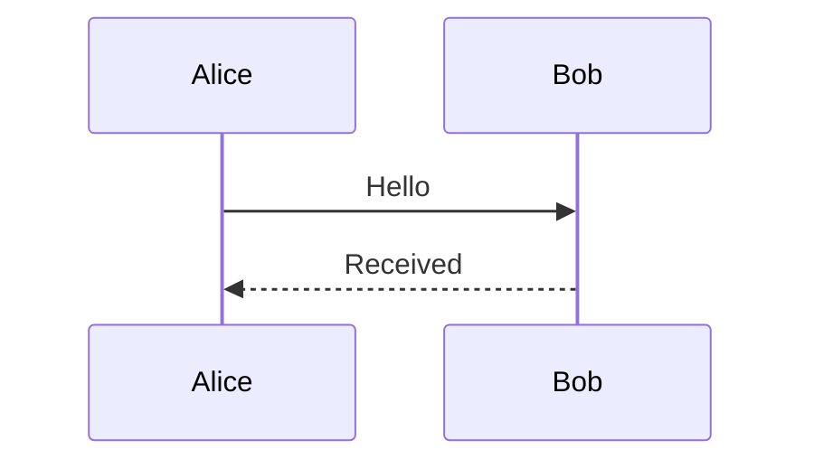
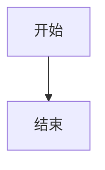

# 果铃工作台统一实施方案

> **2026-10-12 本范围更新：** 创作/导航/素材/动画/播放修复改按根目录[独立修复方案 v2](../../../创作与播放链路独立修复方案-2026-10-12.md)及[Codex提示词](../../../创作与播放链路修复-Codex执行提示词-2026-10-12.md)。当前仅文档交接，后续收到指令才实施；本页以下是旧包及其历史授权，不能重启旧 §14/§15 或用冲突规则覆盖 v2。其他原范围/证据保留；本轮 AGENTS 同步已获明确授权，不把旧“不改AGENTS”延续为本次禁止。

日期：2026-10-10。
范围：目标与执行可靠性、主会话与临时卡、AI-native 能力、固定设计比例的原生创作、资源和本机 MCP。
核对基线：ghostairship-debug/ittoedu，HEAD df21debdde2a86e7108a1af41b7aa4df62746b67。实施时以真实工作树及有效未提交成果为准。
状态：W1—W4、Portable 与本地增量的实施事实见 IMPLEMENTATION_RESULT.md 和 Portable 修复记录；下文原规格保留为历史。§14.8 已获实施授权，本机实际验收接近收口；当前补页面新建菜单去重与模型设置常驻关闭按钮。全部本机验证通过后再生成新 EXE，最终制品补启动及受影响冷开。§15 仍仅规划。

**当前接续入口：[§14.8「界面纠偏与剩余原生验收」](#workbench-ui-correction)。** 本批从当前有效未提交成果及已有 §14 候选接续实施与实际验收。§1—13 不自动重启；冲突取舍以 §14.8 的本次 Owner 决定为准。原 §13 的 unpackDirName:false 建议已在后续修复中勘误，实际配置为 true，不因本批规划回退。

## 执行说明

本文件是本批唯一执行规格，包含产品规则、当前机制、具体工作包、旧路径清理、验收输入和完成条件。[包入口](README.md)负责导航，[启动指令](START_PROMPT.md)供实施者接续；[审查事实](evidence/REVIEW_FACTS.md)和[Portable 诊断](PORTABLE_SHARP_DIAGNOSIS.md)是证据。原 GPT Pro 稿只作为历史材料，不再决定当前行为。执行无需阅读此前聊天或访问临时附件目录。

用户最终决定：**放弃跨画布比例自动重排；可视作品按固定设计比例展示，视觉布局与编辑视图一致。MCP 默认权限与内置 AI 相同，用户可在连接中选择完全访问。** 临时卡完成仅高亮，点击后选中；自动引用跟随当前页面，保留 A 应固定引用；删除当前元素引用同步取消选择；本机 MCP 默认关闭，主动开启后免令牌。

“生成方案包”不等于“开始开发”。收到按本包实施的明确指令后，按 §10 接续；普通实现细化不用再次询问用户。Portable 修复仍遵守本轮仅诊断的限制，需另获明确执行授权。新的付费渠道、真实用户数据迁移、扩大远程访问以及最终发行不因本方案自动获准。

先核对真实 HEAD、未提交改动及直接受影响链；已满足规则且证据仍有效的内容复用，不重复实现或跑无关测试。保全用户文件、人工布局、恢复稿及旧发行证据，不启动旧 queued，不改 AGENTS，不把本包标为已实施。

## 1. 方案结论与优化目标

果铃应围绕**同一份真实作品**提供两种 AI 工作方式：主会话承载连续、可追溯的工作；临时卡承载局部、快速、可并行的操作。两者共享目标定位、能力描述、正式写入和运行输出，分别管理自己的上下文与界面生命周期。

模型使用熟悉的内容、样式、布局和程序表达，决定创作意图与设计。软件将这些表达可靠地作用到目标上，负责身份、属性映射、资源、布局执行、版本依据、事务、撤销、保存与运行管理。普通新作品保持原生、可持续编辑；局部程序不吞掉整页。

优化按照以下顺序取舍：

1. 用户能完成创作和修改，作品、人工调整与持续编辑能力不回退。
2. 模型保留有价值的判断与设计自由，机械步骤由软件执行。
3. 在相同任务质量下，减少模型依赖往返、无关输入与错误恢复，改善实际应用速度。
4. 降低开发和维护复杂度：复用现有业务 owner，删除被替代的公开路径和旧规则。

不以工具数量、最小代码差异、节点数量或一次截图作为优化目标。不预先承诺任意 HTML/JS 无损原生化、弱模型审美自动提升或固定百分比的性能收益。

### 1.1 实施重点

先修正真实错写和结果串轮，再打通目标到语义操作的共同链路。对象锁与同文档多预览需一起闭合，不能只放宽 Gateway 而留下单预览消费者。

原生创作沿现有自由 frame、正式对象及固定设计视口接续。AI 的 HTML/CSS 用于表达设计和续改；软件求值、装配、维护身份并回投当前作品。放弃跨比例响应式系统后，不再新建持久 Flex/Grid 容器引擎，也不把合法自由 frame 判成失败的像素快照。

能力与上下文共同组织。普通正文、格式和外观首轮可用；长尾可发现并真实调用。资料准备、资源绑定、等待、路径、版本和事务由软件承担，保留模型的内容、设计、研究与判断自由。

## 2. 已确认产品规则

| 项目 | 最终规则 |
|---|---|
| 主会话 | 工作空间归属，每个会话内部串行；保留可选文件夹分类与历史，分类不隐式决定操作目标或相对路径。 |
| 临时卡 | 独立临时上下文，不进入主会话历史；固定原空间与目标；不同、不冲突目标可并行，同文档也应支持。 |
| 默认引用 | 自动项跟随当前页面/文档与实际选择；开始输入不冻结；需要持续关注 A 就固定 A。 |
| 固定引用 | 可同时固定多个文件、页面和元素；固定身份，后续任务读取当前内容；发送后保留。 |
| 删除引用 | 删除当前元素引用同步取消当前选择；不在眼前的固定元素删除不影响眼前选择。旧焦点不立即补回已删除引用。 |
| 卡片存续 | 无未结束任务时，用户取消选择才关闭；准备/等待/运行中取消选择保留，完成不追溯执行旧取消。 |
| 卡片显示 | 随真实目标和裁切显示；离开视野隐藏，返回恢复；不夹在窗口边缘。完成只高亮结果，点击后定位和选中，不抢焦点。 |
| 过程与回答 | 两通道展示真实活动与自然语言；只显示本轮真实最终输出，不套摘要、不以进度或旧回答代替。 |
| 全表面 | 目标、引用、停止、卡片与结果规则贯通 MD、TXT、HTML、原生工程；格式能力以实际格式为准。 |
| 修改 | 单一正式作者数据和事务；生成锁作品、局部修改锁实际目标、结构重做锁相应页面/文档，参考项不全锁。 |
| 编辑布局 | 人工自由拖拽；自由文字使用文本框；拖动不默认改排序，也不被 CSS 自动弹回。 |
| 创作表达 | AI 可用 HTML/CSS、Flex/Grid；在固定设计视口装为正式对象和自由几何；当前作品可回投给 AI 持续修改。 |
| 展示布局 | 放弃跨比例自动重排；窗口/设备变化只整体等比适配、留白、镜头或滚动，不改作者排布。 |
| Flow | “流式布局（Flow）”；正文保阅读顺序，固定逻辑排版宽度、自然内容高度和滚动；自由浮层/文本框不支配正文邻居。 |
| 结束 | 普通模型任务自然结束，退役公开强制 task.finish；保留内部 run.end、停止屏障和未知副作用查询。 |
| 保存 | 普通编辑进当前作品/恢复稿；原格式保存、指定导出与独立成果写盘分别表达，不自动混为存盘。 |
| MCP | 默认关闭、主动开启后免令牌；默认与内置 AI 共用四档及 DEFAULT_PERMISSION_MODE，当前为 workspace；连接可直接调整为 full。 |
| Portable | 已完成只读诊断；底层原因待证，修复候选与取证单独管理，未授权自动修复或替换发行件。 |

固定比例约束可视作品的作者构图，不把 TXT 虚构成有字体颜色的画布。Flow 正文的内容增长、文本框内部换行、表格/图表及局部程序内部排版继续按自身属性工作；宿主窗口变化不得改变页面邻居的位置。比较视觉时使用相同页/状态、设计尺寸、字体素材和观察矩阵，编辑选框等 UI 装饰不属于作品画面。

## 3. 统一实现的核心：目标、操作和副作用各归其位

### 3.1 必须分开的概念

| 概念 | 含义 | 不能代替什么 |
|---|---|---|
| 工作空间 | 文件组织、会话归档和默认执行环境 | 不是当前页面，也不是一次操作的实际修改范围 |
| 引用集合 | 用户希望本次任务关注的内容身份 | 不自动决定读写角色，不自动锁全部引用 |
| 操作目标 | 当前指令／调用具体作用的内容 | 不等于当前浏览焦点；不能因可读成字符串就决定使用正文替换 |
| 操作语义 | 读取、改正文、改格式、改布局、创建、导出等 | 不等于内部模块或文件格式 |
| 授权范围 | 本任务允许接触或修改的边界 | 不等于模型必然会修改的集合 |
| 实际写入范围 | 本次已确定操作会改变的对象／结构 | 决定互斥与提交检查；不能拿诊断用 effectTargets 直接充当授权 |
| 观察依据 | 模型作出这次修改时依据的内容版本 | 不能用提交前临时重读的版本替代 |
| 视图状态 | 页面、滚动、选择、试运行现场 | 不控制运行存续，不改变在途任务目标 |

这是对既有字段和职责的归位，不要求建立八套管理系统。

### 3.2 推荐的共同处理链

```text
主会话／临时卡／人工操作
        ↓
逻辑目标 + 当前内容 + 实际能力
        ↓
模型表达语义操作，或人工控件表达相同操作
        ↓
软件解析真实目标、参数与必要写入范围
        ↓
既有专业编辑函数／内容装配服务
        ↓
正式 DocumentSession 事务、History、资源与回执
        ↓
最新目标映射 + 操作事实 + 活动／模型回答
        ↓
各表面显示、定位与继续编辑
```

人工操作不经过模型；“共同处理链”指相同的业务语义与正式修改 owner。不能只在末端共用 writer，而在前面分别维护两套“改颜色／转换图表／调整布局”的算法。

### 3.3 目标描述与能力来自现有真实实现

沿 `SelectionCapture`、`ToolTarget`、组件定义、表面适配器和 `ToolRegistration` 补齐紧凑的目标描述：内容身份、类型、相关正文／属性、所属页面和布局上下文、当前展示状态、可操作范围。

属性面板已经知道的专业属性，应尽量直接成为 AI 可用的语义参数。模型不必判断颜色存于 `data.appearance` 还是 `style`，也不必维护表格行列 ID、图片资源 ID 或新节点身份。自定义组件只声明真实支持的公开参数与源码能力。

后台可以保留很多专用函数。模型侧应有稳定、清楚的动作，不建设一个接受任意 JSON 的万能 `execute`，也不把每个内部函数都暴露为工具。

### 3.4 单一作者数据不等于所有格式统一转原生

MD/TXT 和单独 HTML 的正式源文可以继续是作者数据，结构和选区是其编辑投影；原生工程以正式对象与布局关系为作者数据，HTML 风格源文可以是输入或可生成的编辑投影。

各文档只有一个正式修改依据。不要同时保存一份权威 HTML 和一份权威节点树，再让 AI 或同步层猜哪份正确。也不要为了“全表面一致”把 TXT 自动转成富文本工程。


---

## 4. 双通道、引用与临时卡

### 4.1 主会话归属与组织

当前会话 home 已是工作空间内的可选组织位置，不是另一套会话归属。保留可选分类和“显示全部”，不删除历史或用户文件。取消 home 对默认引用、在途任务环境和文件默认根的隐式控制；普通切文件不更换会话，切空间不停止原任务。

临时卡复用现有隐藏会话和执行器，不另建轻量 harness。创建/首次接受任务时固定卡的工作空间与逻辑目标，后续发送、追问、草稿和查询都使用卡自身上下文；全局当前空间变化不能迁移旧卡。卡默认只带局部目标与必要环境，不继承主会话全部固定引用。

卡打开时可连续追问；按规则关闭后再打开属于新的临时交互，不增加跨重启长期历史恢复。内部回执、停止所需状态和作品 History 继续按已有机制保留。

### 4.2 引用集合的具体规则

引用集合放在现有会话草稿状态中。每项携带逻辑目标和固定状态，显示可读名称；固定不需要复制正文。

- **自动跟随项**：下一条草稿随着实际导航或主动选择更新，包括上一任务仍在运行时。开始输入文字本身不再冻结整组引用；需要保留就固定。
- **固定项**：跨页面、跨文件保留，发送后仍保留，可逐项删除。固定的是身份，不冻结内容版本或编辑权限。
- **提交快照**：发送时将本次引用、目标和执行环境固定下来。任务运行期间的浏览变化不改变该快照。

浏览变化不改变已提交消息及在途任务快照；输入框准备下一条任务时，草稿自动引用仍跟随当前页面，固定项保持。发送时另建本次快照。

删除元素引用须同步取消当前元素选择；删除不在眼前的固定元素，不影响眼前其他选择。独立固定的元素不依赖父页面标签是否保留。没有任何引用才回到工作空间上下文。

删除自动页面／文档引用时，同时取消依附它的未固定元素引用与点选；独立固定项仍保留。

同一目标只留一项：再次点选已固定目标不产生副本。区分页面整体引用与页面内元素引用，它们不是重复身份。取消固定保留当前项直到下次正常自动更新，不额外增加一种引用类型。目标身份须包含必要的页面／展示状态／字段或文本范围信息，同一实例的不同明确状态或范围不能误去重。

**后端接线**：同一文档的多个引用聚合为一份文档下的目标集合，再交给既有授权接口。不能把 A1、A2 做成重复 documentId；也不能让按 documentId 建立的 Map 丢掉后一项。默认目标必须来自本次明确焦点／调用，多个工程时不以“第一个文档”猜测。

### 4.3 引用的角色由操作表达

同一个集合可以支持“比较 A 与 B”“把 A 的样式应用到 B”“同时修改 A、B、C”。界面不强制区分参考与目标，运行器仍按实际操作识别读来源和写目标。

固定 A、B 不等于同时锁 A、B。复制 A 的颜色到 B 时，A 是读取来源，B 是写入目标；联合修改则分别处理各目标。读取时保存观察依据，提交时检查实际写入范围。

### 4.4 临时卡按事件关闭并随目标显示

| 情形 | 行为 |
|---|---|
| 用户取消选择，卡没有未结束任务 | 关闭该临时交互 |
| 准备、运行、等待回答或停止收拢时取消选择 | 保留卡和任务控制入口 |
| 滚动、切页、切标签或镜头使目标离开视野 | 隐藏，不销毁、不吸附屏幕边缘 |
| 任务完成 | 保留过程与本轮真实输出，高亮结果；不自动选中、跳页、滚动或聚焦 |
| 回到目标视野 | 恢复原卡和结果高亮，保持当前人工选区与键盘焦点 |
| 点击结果高亮/定位入口 | 由用户动作定位并选中修改后的逻辑目标 |
| 多张卡完成 | 各保留卡和高亮；用户点击哪一项才激活哪一目标 |
| 点击卡输入或滚动其内容 | 操作卡本身，不算取消选择 |

不得以持续条件 !running && !selected 自动销毁，也不得用挂载 focus() 在后台完成或恢复显示时抢输入。任务状态、存续、可见性、结果高亮和作者选择分别由现有状态管理维护，不新建任务平台。

卡以逻辑身份重解析当前锚点，判定活动文档/页、局部裁切和变换，不只判断应用窗口边界。文本替换跟随新范围；对象转换跟随正式身份关联；HTML 重建使用作者目标映射。目标被删除时保留结果和删除位置提示，不造新对象供选择。

已有运行列表/会话入口应可返回原任务；目标外的提示可显示“完成/定位”，但卡本体不常驻前台。显式关闭文档或应用仍沿现有停止和草稿保全；普通切页不等于关闭。

### 4.5 工作过程与最后回答

主会话和临时卡复用现有事件投影：真实自然语言流、当前活动、工具批次、等待／失败／需回答事项。普通工具详情折叠，避免一条工具占一张大卡。未提供公开进度文字时显示实际等待状态，不生成虚假思考或百分比。

最终区域直接渲染 AI 最后输出。软件不总结、不改写、不限定字数和内容格式；复用相应文本／Markdown 渲染能力，不能把回答塞进工具详情或被 `run.end` 覆盖。

`src/main/workbench/execution/ExecutionDesktopService.ts` 的 `collectReply` 当前取最后一条非空 assistant 文本，但该文本也可能是中途进度。需要将正常最终答复和过程文字正确关联到本轮运行，而非另建结果存储。

用户向上阅读时不抢滚动；最新文字或活动变化时能够跟随。卡片事件追赶复用主助手已有的合并思路，只刷新变化的运行，避免每个增量触发完整历史查询。

---

## 5. 写入、观察依据与自然结束

### 5.1 锁实际作者修改范围

生成期锁作品，局部编辑锁目标，结构重做锁页面/文档；不锁整个工作空间，也不把全部引用锁起来。暂停策划/框架确认时开放其内容编辑。

复用对象、内容块、整体文本范围等稳定单元，不建设逐字符/逐属性协作锁。同目标明确冲突，不冲突目标并行；主会话、临时卡、人工输入、属性、删除、撤销、源码和外部正式调用共用规则。不能用支持整文档单预览的现状削减已定同文档并行目标。

自由画布上改长正文不自动推开邻居；文本框内部排版和既有自动高度按正式属性处理。Flow 正文增长推移后文是文档流结果，不等同于对所有后文的作者写入。真正改变多个对象、归属或整体排布时，按实际修改范围扩锁。

### 5.2 先明确真实操作，再锁实际范围

局部“修改这里”任务目标已明确，可在准备阶段占用该目标。主会话可能只是讨论或比较，不预先锁所有引用；当操作范围确定后，沿现有写入 owner 获取相应互斥并进行提交检查。

权限、操作目标和实际影响范围必须在同一调用中衔接。正常授权内动作不增加一次额外批准；会影响局部任务之外的对象、共享定义或内容格式时，不无声扩大范围。模型改用文件／源码工具也不能绕过这一限制。

### 5.3 原观察依据持续到正式提交

模型读 r0，人工随后改到 r1，软件不能临提交重新签发 r1 句柄，把依据 r0 的 AI 内容作为 r1 的修改提交。最终 CAS 和显式 expectedVersion 必须核对原观察快照，不能在版本检查后重读而失去依据。

当前已用真实 DocumentSession/Gateway 的受控交错复现 AgentFileText.write 和 patch：r0 版本检查后，人提交 HUMAN! 到 r1，commit 经 attachRunDocument → issueTarget 捕获 r1，旧 AI draft 被接受到 r2。回执 beforeVersion 仍为 r0，beforeRevision 却是 1。这不是历史用户数据损失或 GUI 端到端证据，但已证明真实核心错写机制。

让观察的 documentId/epoch/baseRevision、绑定版本和范围持续传至事务；无关局部变更沿现有历史映射接续，真正重叠则冲突/重新读取。文件、源码兜底不能刷新依据或扩大目标。新建或明确完整替换无需无意义的前置 read，但已拿到的版本条件及并发提交检查不能被豁免。

### 5.4 停止并接手

停止后撤销后续写入权，等待已在提交的必要边界收拢，再释放锁。已应用内容保留，未提交草稿按现有规则处理，迟到结果不能覆盖人接手后的内容。继续时读取当前作品，不恢复过期内存状态。

现有 lease、停止屏障与文档关闭屏障应复用；它们并不等于产品对象锁已经实现，也不应因“精简”被无差别删除。

### 5.5 正常工具循环自然结束

```text
模型请求动作 → 软件执行并返回事实 → 模型继续或正常回答
    → 本轮无待执行调用且正常结束 → 软件收拢运行并发送 run.end
```

普通路径取消 `task.finish` 的公开要求，同时清理局部系统提示、工具目录、同轮提前 break、默认继续修复指令和相关旧测试期望。保存／导出能力回到已有作品操作中。

`run.end` 保留为内部通知，负责状态与清理，不需要模型调用，不产生一段代替 AI 回答的机械文案，也不关闭临时卡。

正常答复属于同一个模型循环，不新增摘要 Agent 或必填结束字段。确实只有工具调用而缺最终答复的路径会需要正常后续回复请求；已有最终答复的路径不再额外调用一次。

### 5.6 运行结束与作品结果独立表达

软件记录实际应用、保存、导出、失败和未知结果；模型负责解释与回应。明确修改任务没有目标提交时，不标“已修改”；普通讨论不要求制造一次写入。某个不相干文件已写入也不能证明用户选中对象已改好。

失败后已恢复的中间错误保留在详情中，不永久污染最终状态。已知失败或暂时未满足项允许模型如实说明后结束，不再要求取得“准许结束”的回执。软件也不建设一个通用目标达成判官。

必须区分自然 stop、输出截断、网络中断和用户停止。没有收到最终文字时显示真实缺失状态，不拿进度文字／软件模板冒充，也不重放已有修改来补回答。

### 5.7 自然结束不留下无主的后台写入

任务内尚有会继续写入的作业时，由现有运行器等待、收拢或明确取消其写入；不能先发结束、释放锁，再让旧作业继续应用结果。无独立工作时软件等待实际作业事件，有独立工作时模型可继续处理。

纯候选图/只读委派虽不写正式作品，仍属于本轮要求返回的成果时，也不能被 finally 无差别取消。软件等待并返回资源，或明确说明取消/失败；用户明确要求后台进行的独立任务复用已有入口和作业 owner，不建永久任务平台。

这是在途操作的生命周期管理，不是以“内容质量还不够”为由强迫模型继续。未知副作用保留原身份查询，不能为了拿到成功标记换新调用重试付费生成。


---

## 6. AI-native 能力体系

### 6.1 能力按用户动作组织

以下是模型接口的逻辑划分，不要求创建同名新工具或把全仓工具统一改名。

| 语义方向 | 模型决定 | 软件接管 |
|---|---|---|
| 寻找与读取 | 来源、问题、范围、需要什么信息 | 定位、当前稿、必要提取、分页、索引与相关表示 |
| 正文与数据 | 改写内容、专业数据与关系 | 范围、格式保留、字段映射与专业数据结构 |
| 格式与外观 | 风格、属性值、匹配来源 | 文本范围格式、对象外观、专业属性的实际存储与应用 |
| 布局与结构 | 排布关系、组合、移动、复制、转换 | 坐标／约束计算、父子关系、顺序、专业转换与身份 |
| 创作与装配 | 布局框架、内容、素材意图、局部程序 | 建立原生结构、资源绑定、持续更新与事务 |
| 行为与观察 | 互动逻辑、检查内容、视觉判断 | 运行／截图／日志；区分作者修改与运行时操作 |
| 外部执行与交付 | 搜索、生成、计算、委派、保存和导出的真实目的 | 连接、输入准备、作业等待、文件路径、资源、生产器与回执 |

### 6.2 彻底解除“选中文字＝text.replace”

入口捕获目标，不预选输出动作。`prepareExecutionContentOutput` 的默认目标便利性可以保留，其“读得出文字就标 replace-text”的定性需要取消。

正文改写、范围格式、对象外观、布局、行为与源码是不同动作。同样选中标题，既可能要求润色，也可能加粗两个词、匹配阴影或移到图片上方。模型依据意图选择实际可用动作，不需要先调用另一个分类模型。

`text.replace` 保留为明确的正文替换原语。它已有的合法富文本表达能力不全局禁用；但不能靠允许任意 HTML 注入来补对象样式工具。对象范围与正文范围需要真实支持，不能把范围文字为了改颜色自动扩大为整对象。

目标格式确实不支持某属性时给出原因和可行选择。TXT 不支持持久化颜色，不能悄悄写入 span；Markdown 的可表达范围按实际序列化与渲染能力说明。跨表面统一的是行为与接口职责，不是虚构格式能力。

### 6.3 语义操作共享真实业务函数

通过现有注册和专业处理函数提供目标可编辑属性。简单的颜色、字体、阴影、大小有明确类型和适用范围；表格单元格、图表系列、图片裁剪等保留专业语义，不强行抹平成 CSS。

“把 A 的颜色和阴影应用到 B”可以由模型指定来源、目标和属性；软件读取真实样式并映射应用。模型不必复制大段 CSS。需要创造新视觉方案时仍由模型设计，不由软件模板替代审美。

模型错误调用时，返回具体不支持项、未应用事实和当前可用的相关操作。自动规范化只做语义等价处理，不能自动升级成整页重写、跨目标修改或新付费调用。

### 6.4 工具与上下文共同渐进披露

**稳定核心**提供普通读／查、基本文件工作和真实能力发现。**当前目标动作**在首轮直接提供正文、实际支持的格式／外观等常见能力。**专业和长尾能力**在实际需要时展开，包括复杂表格／图表、音视频、代码、外部 MCP 和委派。

同一任务的工具簇尽量稳定，复用已有 `describeRun` 缓存。浏览焦点变化不重算在途工具目录。发现返回真实可调用 schema，并由软件接到后续模型请求；不能只给说明却让模型仍调用不到。

从现有注册项派生可用性、配置状态、授权和本轮可见性，不另建镜像白名单。低置信度路由用于增加候选，不能凭“文字”等关键词永久排除样式或结构能力。创建新内容的能力不能因为当前还没有对应原生对象而被永久过滤。

单项工具与 batch 不总是全量双重暴露。常见单项保留直接路径，同类型多对象可用目标列表；复杂混合变更使用适当批量装配。同文档批量可以是一笔事务，跨文档则分别报告结果，不虚构全局原子提交，也不合并独立临时卡的撤销。

### 6.5 上下文分工

| 时点／持有方 | 内容 |
|---|---|
| 首轮直接给模型 | 用户原话、紧凑目标描述、小型完整选区、常用相关样式与布局信息、页面／文档结构概要、固定引用的必要片段 |
| 需要时再读取 | 父容器／邻近内容、复杂专业数据、源码、真实画面、材料其他页段和历史取舍 |
| 软件本地维护 | 版本与范围映射、权限根、资源字节、派生表示、操作身份、完整事务、作业与停止状态 |
| 返回模型的回执 | 是否应用、实际目标、可继续使用的资源／定位、必要保存状态与具体错误 |

结构概要优先来自既有标题、对象标签、类型与索引，不为每次点选额外调用摘要模型。大材料允许分页回读；不得因为未注入全文就断言不存在信息。

固定引用在后续新任务中重新读取当前内容；不把很久以前的固定快照当当前作品。已有上下文压缩、归档、笔记与 `context.read` 继续使用，先减少重复输入，再依据真实成本调整压缩策略。不要因旧记录出现大上下文就再建一套记忆系统。

### 6.6 冗余与整合处置

| 能力／路径 | 处置 | 保留的能力边界 |
|---|---|---|
| `task.finish` | 普通模型入口退役，交付脱钩 | 内部 `run.end`、真实停止／恢复事实保留 |
| 当前 `load_tools` | 去除对现有八族无增量的加载仪式，转为真实按需发现 | 常用核心直出；完整授权能力仍可达 |
| `read / inspect / listChildren` | 统一目标、观察依据和返回形态；常用读取无需模型先猜内部表示 | 不强行把正文、结构、画面三类结果每次全量返回 |
| `object.update / object.author` 等 | 按目标投射语义属性和专业动作 | 复用既有表格／图表／图片算法，保留高级数据与源码 |
| 对齐、分布、转换 | 保留并增强 | 软件计算机械布局、数据和身份 |
| 默认 `teacher.ensure` | 适用作品在创建时由宿主准备 | 主动恢复／定制控制台保留，不给所有格式强加控制台 |
| 材料提取／表示切换 | 普通读／查内部自动准备必要表示 | 原件、页段、来源、诊断及高级提取控制保留 |
| `job.* / image.status / delegate.read` | 统一模型观察，等待与结果接续由软件管理 | 资源结果、取消、日志和未知原操作查询不能丢 |
| `file.save / project.save / finish.delivery` | 用现有通用保存能力作为常规入口，重复项目入口降为内部适配 | 原格式保存、导出、独立成果物化仍区分 |
| `artifact.save` | 保留独立成果写盘；不作为所有资源应用前的固定步骤 | 已有资源可直接应用，无需先导出到磁盘再导入 |
| `task.note` | 长任务按需保留取舍理由 | 不要求短任务维护计划、状态、摘要三份账 |
| `ask_user` | 保留真正的任务内决策／作品确认 | 普通聊天可以自然提问；权限批准仍由软件负责 |
| `compute / local / delegate / MCP` | 真实能力保留，按需展开 | 计算、外部进程、模型委派不混成同一信任范围 |
| 源码／文件兜底 | 保留，承接原目标、原观察依据和授权 | 不默认升级为整页替换，不能成为第二 writer |

基线中的 `visibleRunToolNames` 将现有八个工具族全部列为默认可见，加载不会增加这些族的可见工具；这与权限筛选是否有效是两回事。`image.fetch` 的资源获取分支则被原生工程写条件过滤。分别在W1、W4调整，不能用删除权限检查来解决暴露错误。

---

## 7. 固定比例原生创作与 AI 人工双向续改

### 7.1 正式布局事实与设计视口

复用 V10 的自由 frame、对象/编组/顺序和 Flow 正文模型。自由 frame 是合法作者布局事实，不再要求持久化响应式 Flex/Grid 容器、保存跨比例重排规则或新建布局权威。设计尺寸取作品/页/场景的正式值；Spatial 还保留世界与镜头。

软件在固定设计视口和真实字体/资源下求值 AI 输入；frame 进入正式结构后由人工/AI 显式几何修改更新。测量 DOM 不持久为第二作者树。HTML/CSS 可读写投影由当前正式结构生成，不与节点树分别保留两份权威内容。

编辑、试运行、播放及适用画面导出使用同一设计尺寸与对象布局；窗口、侧栏、设备宽高比和观察 zoom/pan 只改变适配矩阵、留白或滚动。不得用不同入口的物理面板宽度触发媒体查询或二次布局。

Flow 保固定逻辑阅读宽度、自然高度和滚动；正文收展沿阅读流，浮层保持自由几何。不能为了固定比例把长文压成固定高度页，也不能因“编辑自由拖拽”把普通正文改成一堆文本框。需要自由定位的文字使用文本框。MD/TXT 等原格式按其真实内容语义工作，视觉一致性只针对声称支持的可视作品/输出。

### 7.2 AI 用熟悉表达构造原生作品

AI 可用普通 HTML/CSS、Flex/Grid 表达初稿和明确重做的布局，使用专业内容表达与局部程序。软件经现有 ContentApply/project.apply 在固定尺寸求值、识别内容、分配身份、装配资源和正式对象；不要求模型逐节点填写 frame、抄 ID 或学习完整内部 schema。

标题、文本框/正文、图片、表格、图表等尽量装为独立可编辑对象。普通 p 的 line-height: normal、figure/figcaption、布局 wrapper 不应因识别窄门而自动吞为整页 Web。组内关系在正式编组和对象结构中保留，几何按设计尺寸落地；不要把不需要的响应式引擎作为原生化前置。

一个局部按钮/实验的 script 不应把整页标题、正文和图片都变成程序。程序保持明确局部边界；未知外部程序无法可靠拆分时保留原件和具体诊断，不承诺任意 JS 自动原生化，也不静默截图或丢内容。

### 7.3 人工自由拖拽与当前作品投影

人工拖动/缩放直接改变正式自由几何，默认精确保留落点；不解释为自动改顺序，不在后续 CSS 求值时回弹。主动编组、排序、移入/移出或重做布局用明确现有动作表达；不让用户为每次拖动选择映射策略。

AI 续改读取从最新正式结构生成的内容/HTML/CSS，其中含当前位置、尺寸、文字样式、素材与对象身份。不得把初始输入 HTML 当当前作品，再叠一层 AI 看不到的人工覆盖。固定布局的 CSS 可以包含定位和尺寸，AI 仍使用熟悉语法；软件负责投影身份与差异映射。

局部改正文、颜色、题注或程序源码仅改变真实差异，保护未涉及对象和人工几何；不把“提交了一段 HTML”当作整页重导入。明确移动、调整大小或重做时，才更新对应 frame。文本框内部自动高度/固定高度/缩小适配继续由已有策略处理，不能由宿主视口偷偷改变。保持一手势一历史、事务/ACK 不重复提交。

### 7.4 框架 内容 素材 状态与程序

复杂作品可先建立正式框架再填内容/素材/互动；简单区块可一批创建，不强制空壳与逐节点工具序列。框架和后续续改操作同一作品与身份。

软件分配素材占位身份；结果返回后沿原目标登记/应用。步骤、命名状态和连续模拟分别用现有能力，按作品需要使用，不规定每页数量。教师控制台仅在适用作品创建时准备，主动恢复/定制继续可用。

局部实验/游戏可作为有身份、frame、源码和公开参数的程序组件。第三方 HTML 保真路径及边界继续保留；不得借固定比例要求静默改写用户原始网页、迁移旧作品或关闭已有高级编辑能力。

### 7.5 视觉一致性与输出闭环

“与编辑视图一致”包含实际文本换行/字体、对象几何、样式、图片裁切/方向、层次、组变换和同一展示状态；对象坐标相同不足以证明一致。编辑选框、快捷条等 UI 不进入作品输出；合法运行交互可改变运行状态，比较时对齐场景/状态。

优先复用现有浏览器、组件渲染和文本布局实现，消除重复缩放、不同字体 fallback 与设计尺寸来源分叉。缺字体/素材或不支持的导出能力应明确诊断，不用整页截图或静态化掩盖新作品原生生产缺口。

用一个连续作品贯通 AI 创建 → 人工拖动/缩放 → AI 只改另一对象 → 保存重开 → 编辑/试运行/播放 → HTML 与声称支持的其他画面导出，再改变窗口比例确认只整体适配、不重排。不建设跨比例响应式验收。

## 8. 材料、资源、文件和作业：下沉没有新判断的步骤

### 8.1 材料读取

普通“读取这个章节／查找这个问题”由现有材料服务自动准备必要表示、复用缓存并返回所需页段。模型负责信息选择与解读，不负责搬运 attachmentId、派生 ID 和 representationId 的固定流程。

保留原件、页码、来源、未提取范围和诊断。按需求取文本或页面图像，不默认全件 OCR、全量截图或新的付费解析。高级提取控制仍可按需使用。

### 8.2 资源获取与应用分别判断

搜图、下载、生成资源不天然依赖已有可写原生工程；应用到某个对象才检查目标的实际写能力。修正 `image.fetch` 的资源获取分支与原生类型的错误耦合，并检查同类音频、视频和附件链。

明确要求“生成并插到这里”时，生成、资源登记与目标绑定可以由软件组合。需要挑选候选或用户尚未决定时先返回资源，不提前写入作品。不要改变 `image.generate` 现有参数含义却不修改接口和消费方。

已有资源能直接进入正式对象时不先落临时文件再导入。只有实际要交付独立文件时才物化，并返回真实路径。资源失败不抹掉已经完成的独立内容，也不自动换付费模型或另起生成请求。

### 8.3 作业运行

统一对模型提供必要状态、结果与资源接续，底层复用原作业 owner。普通等待由软件事件或既有有界等待处理，模型只在新结果需要判断或有独立工作时继续。

保留取消、查询原作业、读相关日志、获取图片资源和委派结果。长任务能力不能因“减少工具”被删掉。作业等待不新增一份永久台账，结束与停止沿第5节规则。

### 8.4 路径和授权上下文

普通文件读、写、建目录、成果保存与 `from` 统一使用明确的默认目录语义。工作空间作为默认起点，临时目录通过明确返回值表示，不让模型猜会话目录或文件夹绑定规则。

preflight 与 execute 从同一个任务上下文取得已有绑定文件范围，补齐 Engine 普通文件路径丢失 `readOnlyRoots` 的断点。读取工作空间外的已绑定文件不等于开放整个桌面，也不自动扩大写权限。

工程虚拟路径与磁盘路径对用户／模型清楚说明；软件能够识别已有工程路径时复用其正式 owner，不能误走普通磁盘 file.read。暂不强行统一两者的数据存储。

### 8.5 保存、导出和恢复稿

沿用既有“普通编辑应用到当前作品／恢复稿，不默认保存磁盘”的约定。创建文件的写盘行为以实际文件操作回执为准，不能混成所有修改都自动存盘。

常规模型接口统一原格式保存；导出有清楚格式意图；独立作业成果物化保留实际含义。不得让省略参数在不同别名中既表示保存又表示 HTML 导出。已应用、已保存、已导出分别展示，但这份状态由软件维护，不要求模型记账，也不作为是否允许结束的统一资格。

---

## 9. 内容输入、导航、命名与接续

### 9.1 确认采用眼前当前内容

策划、框架或其他关联作品的确认绑定具体文档。确认时提交编辑器内尚未应用的草稿，取得当前正式内容，重新建立继续编辑的观察依据与必要写权，然后把最新内容交给模型。

人工修改与临时卡修改都应被采用。无需用户先保存磁盘，也不重新生成一份策划覆盖原文。提交草稿失败就呈现真实原因，不拿旧内容继续。普通不关联文档的问题不升级为审批文档流程。

### 9.2 Markdown、代码块和异步粘贴

修共享粘贴与序列化链。明确的 Markdown 围栏进入正式代码块；代码块内部和纯文本粘贴保持字面语义。已损坏旧片段可显式重新解释并可撤销，不做全局反转义。

已标记 `mermaid` 的非空块交由实际库解析／渲染，取消自写图类型前置白名单；错误显示真实诊断，保留原安全渲染和过期响应保护。`isMermaidSource` 对类型名后换行、前置注释等输入存在误拦；删除该前置门后仍须验证真实渲染与保存重开，不能只测试正则。

异步素材粘贴遇到原目标改变时保留防错写，但应告知未应用原因，不静默返回，也不追随新光标突然插入。Mermaid 加载失败后的缓存重置／重试是关联恢复优化，需代表用例确认，不作为已普遍发生的故障。

### 9.3 编辑、试运行、播放

对具备演示／运行语义的表面，取消独立“运行现场”提示条，在同一位置常驻编辑／试运行／上一步／下一步／回到初始画面。纯文本不为外观一致而新增虚假的播放能力。上一步／下一步使用真实页内步骤与页面推进，不给旧翻页按钮改名了事。

切换编辑／试运行保留当前场景位置；模式改变输入和执行状态，不默认回到初始页。上一步不是编辑撤销，运行时变量也不因进入编辑就全部固化到作者数据。

“回到初始画面”默认作用于当前页／场景；整份作品回起点使用页面导航。在同一导航 owner 内落实，不额外建设一套编辑模式导航。

### 9.4 Flow、Skill 与模型选择

模式相关界面、帮助和工具／Skill 说明统一“流式布局（Flow）”；实际教学讲义的内容用语保留。内部 `flow` 标识不因改名迁移。

Skill 负责创作方法、教学／研究策略和可选配方；工具描述和目标能力负责怎样使用软件。内置能力默认可用，外部同名 Skill 通过明确来源选择；不再要求必读若干 Skill 才能调用已授权工具。

修复旧提示对正文替换、整页 HTML、强制 finish、必经材料物化的错误引导。不能一边修改能力接口，一边保留另一份旧操作指南让模型继续走旧链。

模型切换近期先显示当前任务实际模型与后续提交模型。在途下一次请求切换模型不属于已定必做；不以该增强为借口重写执行器。

### 9.5 本机 MCP 与内置 AI 同源权限

默认关闭；用户主动开启后在回环地址免令牌连接。四档共用 executionPermission.ts 的 read-only/ask/workspace/full、默认常量及解释；当前默认为 workspace。full 保持“可读写任意文件，修改不再询问”的现有语义，用户可在已有连接界面直接选择，不新增批准、配对或令牌手续，也不要求手工重连。

连接绑定用户选择的工作空间。普通前台导航/切空间不重定向已连会话；连接明确切空间或改权限时，通过原 run/grant 和停止屏障使后续调用生效，保护已接受调用的冻结依据与已提交成果。旧 writable 句柄和未执行调用按新授权边界失效，迟到回复及原操作回执不能丢失到触发副作用重放。

默认权限相同还须同实际授权行为：普通文件、前台文档、明确绑定外部文件和 Office 使用同一冻结读取集合。“明确提供”指用户/宿主登记的实际授权，不是客户端自报文件参数。workbench.state 不可成为超出当前档位与实际授权集合的读取旁路；用户/宿主明确提供的空间外文档，应与内置任务一样可读，不能扩大到整个父目录。full 的空间外前台内容/文件读取和写入继续真实可用，不受工作空间根限制。

旧 enabled:true 不能被当作用户已主动开启新的免令牌模式。端口/权限等偏好保留，首次升级该模式从关闭开始；新明确启用事实由单一设置 owner 记录，主动选择后按既有偏好持久化，不每次启动清零。保留 Host/Origin、停止、正式事务和对象锁，不扩大到公网、远程监听或另一套外部 writer。

## 10. 实施任务、依赖与源码落点

### 10.1 启动与工作顺序

收到实施授权后先运行 git status --short、git rev-parse HEAD、git log -1 --oneline、git diff --stat，核对实际 package.json scripts 和工具可用性。读当前用户入口、AGENTS、相关合同及直接 producer/consumer，不重新展开全仓审计。

| 工作包 | 结果 | 前置/可交错部分 | 完成条件 |
|---|---|---|---|
| W1 | 语义目标、观察依据、最小互斥、自然终态及能力投射 | 先修错写和串轮；从标题颜色/阴影修改贯通 | 原依据不丢、不扩大范围，同文档并行可用；回答/状态真实 |
| W2 | 工作空间会话、多引用、卡片、确认、输入和导航 | 依赖 W1 共同目标/输出；独立 UI 小修可先做 | 各代表表面完整闭合，保留人工焦点和在途任务 |
| W3 | 固定比例原生创作、人工自由拖拽、当前源码投影及导出 | 从 W1 开始验证小作品；生产接入依赖目标/事务 | 人改与 AI 续改、保存/重开、运行和适用导出视觉一致 |
| W4 | 资料/资源/作业/文件减负及免令牌 MCP 同源权限 | 使用 W1 注册与 grant；非重叠项可交错 | 机械步骤内部衔接，已有高级能力与完整权限仍可达 |
| P1 | Portable 故障补证及局部修复候选 | 诊断已完成；运行需 Windows/原制品；修复需另行授权 | 每项事实/假设区分，未复现不冒称根治 |

推荐先闭合 W1.2 错写、W1.3 串轮，再接 W1.1 样式修改与 W3 固定视口往返。W2 卡片/引用使用同一目标与输出链；W4 路径、MCP和材料可依窄接口交错。Mermaid、命名等独立项不用等最大结构任务；W3 是本批必做，不静默延期。

单一主执行者实施与自检，确有独立收益时并行；共享实体单 writer，重要结构改动沿现行必要独审，不为每个小修建立子 Agent、卡或审批门。版本/权限/持久化改变只更新真实相关合同，不新增第二执行台账。

### 10.2 W1：可靠的语义修改与自然执行

#### W1.1 目标捕获、操作语义与专业参数

**现有断点**：`prepareExecutionContentOutput` 在能读取文字时直接定性为 `replace-text`；整对象属性接口拒绝文字字段／范围；HTML局部入口与原生对象属性接口不接续；专业外观字段的存储差异仍需要模型猜测。

**直接定位**：

| 路径 | 重点符号／内容 |
|---|---|
| `src/core/tools/ToolTargets.ts` | `prepareExecutionContentOutput`、`readEditableTargetContent`、`planTextSelectionReplacement`、HTML作者字段映射 |
| `src/core/tools/ToolRegistration.ts`、`src/core/tools/ToolCatalog.ts` | 目标支持条件、工具语义、targets/effects/handler |
| `src/core/tools/toolSchemas.ts` | `objectUpdatePropertiesInputSchema`、`objectAuthorInputSchema`及范围参数 |
| `src/core/tools/courseInstanceEdits.ts` | `courseInstancePropertyEdits`、`courseInstanceConversionEdits` |
| `src/core/course/componentDataEdits.ts`、`src/components/text/data.ts` | 专业属性与现有 formatTextComponentRange，共享人工/AI范围格式函数 |
| `src/renderer/workbench/SelectionContextController.ts` | 捕获、当前稿准备、目标引用 |

**执行**：

1. 保留宿主默认目标的便利性，移除从“能读成文字”到“必须正文替换”的定性。先提交本地输入，再捕获准确逻辑目标；小选区和必要属性直接进入首次请求。
2. 将正文改写、范围格式、对象外观、布局、结构和运行时操作明确区分。优先扩展现有语义handler；需要新增动作时使用清楚、窄而可组合的参数，不加万能任意JSON执行器。
3. 将人工属性面板使用的专业函数接到同一动作。模型使用专业属性名／可读定位，软件处理 `appearance/style/sizing/frame` 等存储差异、行列身份和资源编号。
4. 支持“来源A、目标B、指定属性”的确定性匹配。读取A与写B分别解析，复制已知样式不让模型抄整段CSS；需要创作新样式时保留模型表达。
5. 更新HTML轻编辑、MD、TXT和原生工程入口。用源码搜索定位 `HtmlLightEditOverlay`、`TextAiButton`、`ElementAiButton` 及其调用者，不能只修共用类型而不接表面。
6. 不支持的格式或范围返回未应用事实、具体原因和实际可用动作；只做语义等价的参数规范化。TXT不写入标记，窄选区不静默扩为整文档。

**清理**：删去入口、提示和测试中“所有选中文字只许替换正文”的假设；不删除真实的 `text.replace`、高级源码或专业编辑能力。

**验收**：V01、V02、V03、V06。以“B匹配A的颜色和阴影”为第一条闭环，再检查同一入口的改正文和范围加粗。

#### W1.2 观察依据、实际写范围、最小互斥与停止

**现有断点**：已有单writer、CAS、停止租约和文档关闭屏障，但这些不等于产品对象锁；文件 write/patch 已复现校验后重新签发句柄导致原观察依据丢失；源码／文件路径与局部目标范围需要连续传递。

**直接定位**：`src/core/tools/DocumentToolGateway.ts` 的 `beginRun`、`issueTarget`、目标映射、`effectTargets`、`effectWriteScopes`、`withWriteTaskBarrier`；`src/main/workbench/execution/AgentFileText.ts` 的 `write/replaceExisting/patch/commit`；`src/main/workbench/execution/EditSessionService.ts`；`src/main/workbench/execution/ExecutionEngine.ts` 的 `stop/drive/finally`；当前 `DocumentSession`、人工输入提交调用者及 `src/renderer/workbench/EditPreviewProjection.ts` 的多预览消费。

**执行**：

1. 基于已确定的逻辑操作取得实际作者写入范围；读取引用不加写锁。局部任务在准备时锁目标，新作品生成锁该作品，结构重做锁稳定页面／文档范围。
2. 沿已有正式写入owner实现任务级最小互斥；对象／内容块／整体文本选区为单位。接入人工输入、属性面板、键盘删除、撤销、源码、另一个AI任务及外部正式调用。
3. 保留软件捕获的原观察版本及字段／范围依据，复用已有映射。无关变化接续，重叠变化明确冲突；不得将临提交重读的新版本冒充模型编辑依据。
4. 明确整篇重做仍可整体提交；新建或意图完整的直接替换不新增仪式性前置read。对同文档batch保留真实原子事务；跨文档分别记录结果。
5. 在任务结束或停止时先收拢在途写入并撤销迟到写权，再释放产品锁；不合并独立临时任务的撤销组。
6. 原参考内容在一次任务内按已读取的观察依据使用；续作读取当前作品。无需建设实时参考依赖图或自动合并系统。
7. 同时移除 EditSessionService 的 documentId → 单 editId 限制及 EditPreviewProjection 的单快照假设。按既有目标/运行身份消费多个不冲突预览，停止/ACK/结束只清理对应任务；预览不是正式作者树。

**清理**：不能新增第二writer／History；现有停止、最终CAS、授权和未知副作用保护继续保留。组件内部排版和 Flow 文档流结果不等于对所有显示位移对象的作者写入；自由页面不自动重排。

**验收**：V04、V05、V06、V08。必须加入显式 expectedVersion 校验后人工提交的受控交错场景，分别验证 write 和 patch；不把核心复现说成历史用户数据损失。

#### W1.3 自然结束与AI最后输出

**现有断点**：局部系统提示要求同轮 `text.replace` 后 `task.finish`；该工具成功后循环提前break；当前自然 stop 仅 pending/unknown 会继续，已知失败可 partial；不得误写成现状普遍强迫修复已知失败。`runEndSummary` 是软件诊断，`collectReply` 已实证忽略本轮边界，旧回答、带工具的进度和截断文字均可能成为回复。

**直接定位**：`src/main/workbench/execution/ExecutionEngine.ts` 的系统消息、`runTools`、`drive`、`publishEnd`、恢复逻辑；`src/main/workbench/execution/executionOutcome.ts` 的 `executionExitDecision/executionCompletionIssues/runEndSummary`；`src/main/workbench/execution/ExecutionDesktopService.ts` 的 `collectReply/startSubmission`；`src/core/tools/TaskNoteTools.ts`；`src/shared/workbench/userQuestion.ts`；现有模型事件、消息落库与两通道展示消费者。

**执行**：

1. 普通模型目录不再暴露或要求 `task.finish`。保存／导出复用现有动作，移除其与结束资格的绑定。
2. 工具结果返回同一个模型；模型继续调用或正常答复后自然结束。没有在途副作用时，不因为已知失败或未满足项要求重复申请结束；也不创建新目标达成判官。
3. 以 initialMessageCount、本轮请求/消息身份、工具轮及 finishReason 区分最终回答、进度和截断，复用现有消息记录。失败/停止且没有本轮最终答复时，不复制上一轮文本，不为补回答重放已有修改。最终回答原样传到主会话和卡片，不重新总结、截成固定模板或塞进工具详情。
4. 保留内部 `run.end`，仅处理运行状态和清理，不覆盖模型文字、不关闭卡片。同步校正明确目标的应用事实，不能用无关写入证明目标已改。
5. 核对原 `task.finish` 提前break之后的流式能力观察、缓冲flush和清理，接回正常循环，不能在移除分支时漏掉必要逻辑。
6. 区分stop、截断、断连、用户停止。未收到最终答复时诚实显示缺失，不把进度当结论，不重放已有修改。已有最终回答不再额外请求一轮。
7. 历史运行读取可保留内部兼容；恢复已完成事实不重新调用模型或重做工具。真正开放中的作业由原运行器等待或取消写入后收拢。

**清理**：普通工具暴露、局部提示、Skill操作说明、提前结束分支、无必要的结束批准及其旧测试一起调整。保留 `task.note` 的长程取舍记忆和 `ask_user` 的任务内决策；普通主会话允许自然提问并结束等待下一条消息。

**验收**：V07、V08、V16。测试使用假provider先完成，无需为终态逻辑反复付费跑整课。

#### W1.4 真实按需暴露的基础接线

**现有断点**：八个工具族全部默认可见，`load_tools` 对这些族无可见性增量；工具available、configured、authorized与exposed的含义需要分别处理；单项与batch重复投射全量参数。

**直接定位**：`src/core/tools/ToolRegistration.ts`、`src/core/tools/ToolCatalog.ts` 的 `visibleRunToolNames/batchInputSchemaFor`；`src/core/tools/DocumentToolGateway.ts` 的 `describeRun/resolveRunTool/loadToolFamilies`；`src/main/workbench/execution/ExecutionEngine.ts` 的 `runTools/refreshTools`；`src/core/tools/modelToolResult.ts`。

**执行**：沿原注册表投射“稳定核心＋当前目标真实动作＋可发现长尾”，复用原schema、handler和缓存。替换现有无效加载时，在同一增量中接好发现后的可调用schema；不能先移除加载却令长尾不可达。复杂batch只含本轮相关变体，简单修改保留直达路径。复用已有回执精简和上下文压缩，不新建摘要器、路由模型或能力白名单。

**清理**：不再发送一套总已可见工具并要求再加载；不因关键词路由永久排除其他合理动作。长尾精调和资源能力条件在W4继续，但常用正文／样式必须在W1首轮可用。

**验收**：V09、V10；重点验证“未加载→可发现→同一任务真实执行”的可达性与权限一致性。

### 10.3 W2：双通道、引用和所有表面的交互

#### W2.1 工作空间会话与逐项固定引用

**现有断点**：文件／文件夹会话home影响默认上下文；输入会冻结整集合，添加引用替换集合，发送后清空；selection移除按全组处理，后端拒绝重复documentId并依赖唯一工程推断默认目标。

**直接定位**：`src/renderer/workbench/ExecutionAssistant.tsx` 的 `freezeDocuments/changeSelection/unpinSelection/removeDocumentReferences/applySendResult`、root effect、会话home处理；`src/renderer/workbench/SelectionContextController.ts` 的 `setPinned/captureDocumentReference`；`src/shared/workbench/conversations.ts`；`src/main/workbench/execution/ExecutionDesktopService.ts` 的 `prepareSubmission`；`DocumentToolGateway.beginRun`；现有会话管理和 `WorkbenchSessionPortal` 消费者。

**执行**：

1. 普通主会话统一归工作空间，保留工作空间内可选 home 分类/筛选与“显示全部”，取消其对自动目标和执行根的隐式控制。既有历史与组织信息保留，不因此删除会话或移动用户文件。
2. 在现有会话草稿中存引用身份、固定状态和必要显示信息；自动项随空闲焦点更新，固定项增量保留，发送后固定项不清空。输入文字不冻结全组。
3. 页面／文档与元素引用独立可删；删除当前元素同步取消点选，删除后不被旧焦点立刻补回。多选可批量固定，相同逻辑身份去重。
4. 提交前完成输入drain并按最新版本解析全部引用。前端标签逐项保留，后端按文档合并目标；同一文档多个页面或对象不重复授权、不相互覆盖。
5. 在提交中保留明确聚焦目标与各项身份；工具显式目标优先，歧义时返回候选，不能默认写向第一份工程。引用没有强制“参考／目标”角色。
6. 任务运行不随浏览变目标或空间。保留现有后台入口以返回原会话；无需新建跨空间任务平台。

**清理**：文件home自动重新绑定、整组输入冻结、单文档覆盖集合、发送清空固定项及其旧测试期望。

**验收**：V11。固定A1、A2、B页后浏览C并联合操作；逐项删除和取消固定均要走一次。

#### W2.2 卡片存续 逻辑锚定 结果高亮与并行

**现有断点**：`dismissText` 只要有历史entries就拒绝关闭；不可见目标被 `cardPosition` 夹回窗口；卡片保留旧DOM锚点；发送时的全局工作空间可能重新解释存续卡片。

**直接定位**：`src/renderer/workbench/elementCards/elementCardController.ts` 的 `dismissText/openText/send/followText`；同目录 `ElementTextCards.tsx` 的 `cardPosition/textAnchors/TextCardPanel/ElementTextCardLayer`；`ElementAiCard.tsx`；`src/renderer/editing/quickbar/SelectionQuickBar.tsx`；各表面真实选择／几何适配。

**执行**：

1. 关闭条件改为事件：用户在任务非运行期间取消点选。运行中取消、任务结束、UI卸载、目标离开视野均不自动关闭。准备、排队、等待回答和停止收拢属于未结束。
2. 存续卡根据逻辑目标重新取得当前位置和裁切区域；离开活动文档、页面或局部视口时隐藏，禁止屏幕边缘常驻fallback。
3. 文本替换用已有 `followText` 与ACK范围映射跟随；HTML作者目标和原生实例各走真实适配。返回视野时卡片和结果高亮恢复，不自动选中；用户点击后选中当前逻辑目标。
4. 完成只高亮并保留卡片；用户点击结果后才定位/选中。多卡分别保留结果，不抢当前作者选区/键盘焦点。去掉恢复挂载时的无条件 focus，点击卡片输入/滚动不关闭自身。
5. 卡片工作空间和目标随创建／首次任务固定，不因主会话切空间重建卡会话。可复用隐藏会话执行，不建第二harness。只在真实关闭时结束该临时交互，不建立永久聊天历史。
6. 不冲突卡并行，同目标遵守W1写锁；卡片消失不删除作品与正常撤销。显式关闭文档／应用仍沿现有停止及草稿机制，不将普通切页误作关闭。

**清理**：旧常驻前台fallback、提交过即不能关闭的entries判断、依赖当前全局workspace重定向旧卡、只依赖quickbar存续的卡生命周期。

**验收**：V04、V12、V13；MD、TXT、HTML、原生工程各跑一次完整返回链，不把共享类型测试当作表面接通。

#### W2.3 过程展示、最后回答与事件开销

**直接定位**：`src/renderer/workbench/ExecutionTimeline.tsx`、`executionTimelineModel.ts`、`ExecutionAssistant.tsx` 的事件追赶；`elementCardController.ts` 的 `catchUp/refresh/applySubmission/withReply`；`ElementAiCard.tsx`、相关CSS和共享执行事件投影。

**执行**：向卡片开放已存在的活动投影；两通道共用自然语言流、当前活动和紧凑工具批次，详情默认折叠。以W1最终消息原样渲染，不另写摘要。滚动跟随依赖文字／活动变化并尊重向上阅读。复用主会话catchingUp/catchUpPending合并追赶，每次只刷新变化运行；用现有身份/单调状态/请求序号防止旧 conversation、旧 run 或迟到 running 查询覆盖 completed；过期异步查询不能覆盖新状态，查询失败保留已有画面并给必要反馈。

**清理**：卡片仅“请求＋粗状态”的展示、按每个增量全量查询历史、一工具一大卡、仅entries数量驱动滚动。

**验收**：V07、V12、V17。性能改善以真实请求／IPC计数与耗时衡量，不宣称它就是长任务全部耗时来源。

#### W2.4 确认当前稿、Markdown粘贴与Mermaid

**直接定位**：`ExecutionEngine.ts` 的 `ask/answer`；`src/shared/workbench/userQuestion.ts`；`SelectionContextController.prepare`、Gateway的 `prepareInput` 和文档drain；`src/renderer/document/editorSession.ts` 的 `createDocumentDraftSession/handlePaste/pastePrepared`；`src/shared/document/markdown.ts`；`src/renderer/document/mermaidCodeBlockView.ts` 的 `isMermaidSource/loadMermaid/render`。

**执行**：ask_user 的作品确认明确携带文档/范围/候选身份；普通问题不绑定作品。关联作品的确认先通过已有 renderer input preparer settle/ACK，再 drain 当前正式稿并更新续作观察依据，包含人工与临时AI修改；失败不得继续旧稿。普通无文档问答不增加确认文档。共享可视粘贴识别明确Markdown围栏，保留纯文本粘贴与代码块内字面输入；已有受损片段只能显式重解释并可撤销。非空mermaid块直接交给实际库，移除图类型白名单；语法错有诊断，保留安全模式与过期结果保护。异步带资源粘贴因目标变化取消时给出未应用反馈，不能追到新光标。覆盖加载失败后失败缓存重置和显式重试，不扩展成完整新加载系统。

**清理**：确认只返回选项、不刷新作品的分支；以围栏普通正文转义代替代码结构；Mermaid前置静默empty；素材粘贴取消无反馈。

**验收**：V14、V15。

#### W2.5 导航、Flow名称、模型显示和内置方法

**直接定位**：`src/renderer/ui/workspaces/SlideLocationWorkspace.tsx`；通过符号搜索定位 `SlideWorkspaceConnector`、`CourseV10RuntimeView/resetPlayback`、`src/renderer/components/ComponentNavigationOwner.ts`；`ExecutionAssistant.tsx/switchConversationModel`；`src/shared/courseAgentSkills.ts`、实际内置Skill来源和生成打包入口。

**执行**：对有演示语义的表面复用已有现场保留/当前页 reset owner，落实常驻五动作；修正 scene.previous/next 绕过 step 的接线，并使编辑态真实导航在共同 owner 中可用，保持 step/page 推进和当前现场，移除独立live-scene-bar。Flow模式统一称流式布局，保留内容意义上的讲义和内部flow标识。显示当前任务实际模型与后续提交模型，不增加本轮在途热切换。Skill只负责创作方法，公共能力和授权不以读Skill为前置；内置随产品可用、外部同名通过显式来源选择。

**清理**：旧导航条、翻页按钮伪装页内步骤、模式名称残留、旧操作说明。生成的内置Skill文件用现有生成入口同步，避免只改源码说明而打包仍旧。

**验收**：V18、V19；纯TXT不凭空增加播放能力。

### 10.4 W3 固定比例原生创作与持续编辑

#### W3.1 固定设计视口与可编辑装配

现状：现有 htmlObjectStyle 的布局规则剥离、纯布局 wrapper 展开，在固定几何装配中可以继续使用；仅修造成实际画面偏差、必要编组/身份或可编辑语义丢失的分支。professionalHtml 对普通 p/normal line-height 与 figcaption 的识别存在落入 Web 的窄门；measurement 的 sourceScopes/document 程序标记可能保留完整 body，即使没有局部程序需求。现有自由 frame 与固定 stage fit 可复用，问题是装配对象的可编辑性/边界及当前投影的可靠往返，不是缺少响应式引擎。

直接定位：
- src/core/contentApply/assembly/htmlAssembly.ts：htmlObjectStyle、assembleMeasuredHtml、wrapper、flowCoupled、sourceProgramAssembly。
- src/main/workbench/contentApply/application/html.ts 与 professionalHtml.ts：专业内容/Flow 识别、原生对象与局部程序装配。
- src/main/workbench/contentApply/measurement/prepareMeasurementDocument.ts、ElectronHtmlDesignMeasurement.ts：固定设计视口、sourceScopes、程序边界和真实字体。
- src/core/projectFiles/componentPlatform/coordinator.ts、projection.ts：project.apply、当前正式作品的 HTML 投影与差异。
- src/components/web/authoringDom.ts、authoringRecords.ts：已有变换/尺寸作者记录与 data.set 事务，复用而非另建覆盖树。
- src/shared/slideCanvas.ts、src/player/surfaces/publishedStageFit.ts、各真实 Slide/Flow/Spatial 编辑/运行适配：设计尺寸、fit 与镜头；专业组件共享实现。

执行：
1. 用 §11.4 的普通文本/图片/局部互动作品先走一次固定尺寸装配，检查当前容器/编组和专业识别，沿真实 consumer 修缺口。不新增持久 Flex/Grid、断点/跨比例约束系统，不先改工程总版本。
2. 在新建/明确重做范围求值 AI 的 HTML/CSS；软件装成独立对象、内容和自由 frame，保存组/顺序/资源和专业数据。既有 frame 作为正式几何，测量记录只作装配依据。
3. 修普通 p、figcaption 与非程序 body 的不必要整块 Web fallback；布局 wrapper 仅在引起画面偏差或必要身份/编组/可编辑语义丢失时修正，求值后展开本身不是缺陷。程序局部保留，第三方整体保真路径不误退役；不以禁止 HTML/代码规避装配。
4. 统一设计 viewport、字体/素材与 fit；物理窗口/容器不触发页面重排。检查重复缩放、文本换行/line-height、裁切/层次与 Spatial 镜头。
5. 各表面点选、几何、卡锚点、拖拽、属性使用正式对象/范围；拖动默认提交精确 frame，不改顺序，不因下一轮 CSS 求值回弹。
6. Flow 正文在固定阅读宽度自然增长；自由浮层/文本框保 frame。对象内部自排版继续按专业实现工作，但不改其他页面对象。

清理：原方案新增响应式容器和跨比例重流任务、拖拽默认改排序、将合法 frame 视为不合格快照的要求。退出新作品不必要整页黑盒/重复作者树；保留旧人工布局与原格式能力。

验收：V20、V21、V26。必须从实际编辑、保存、运行及导出消费者验证，不仅检查“对象结构存在”。

#### W3.2 当前投影 人工几何保护与内容续装配

直接定位：W3.1 的 coordinator/projection/ContentApply；当前 canonicalComponentFileEdits 与正式事务；ProjectFileTools、presentation/interaction/teacher 能力、资源和源码组件；相关创作/续改 Skill 的实际打包源。

执行：
1. HTML/CSS 当前投影只从最新正式内容生成，含人工位置、尺寸、字体/外观、资源和可读身份。AI 不负责 ID、版本/映射或 frame 簿记，软件把投影差异映回同一正式目标。
2. 正文、题注、样式、源码的局部变化保护未涉及 frame；不能重导整个原 HTML。明确要求移动/调整/重做才改相应几何；同步核正文自动高度/固定框溢出和可撤销。
3. 框架、材料和图片续装配使用同一作品/对象；明确目标的生成/应用内部衔接，候选不提前改。步骤、命名状态、连续模拟与控制台复用现有能力。
4. 复杂互动/游戏是明确局部程序，不吞普通内容；任意未知 JS 不承诺拆解。同步 Skill/工具说明，允许熟悉输入，保留计算、SVG、局部源码和可选 recipe/remix。
5. 保存/重开、编辑/试运行/播放、HTML 和适用其他导出消费相同作者几何和资源。专业格式不能承载互动时按已有真实能力报告，不以整页图片/黑盒冒充原生可编辑作品。

清理：初始 HTML 被当当前源码、AI 看不到的永久人工覆盖、普通续改重导整页、已有素材先落盘再导入、运行状态误写作者数据。

验收：V20—V22、V26。AI 初创→人工任意拖动/缩放→AI 改另一对象→保存/重开→运行/导出全部完成后才能标 W3 通过。

### 10.5 W4：材料、资源、作业与交付减负

#### W4.1 文件路径、绑定范围与通用保存

**现有断点**：普通file preflight/execute重新拼任务上下文时漏掉已有绑定文件读取范围；mkdir与artifact.save默认根不同；现有 project.save 已转发 file.save，不是第二 writer；核对公开入口和省略参数是否真的不同，再退役纯同义暴露。

**直接定位**：`src/core/tools/AgentFileTools.ts`；`src/main/workbench/execution/AgentFileService.ts` 的 `startDirectory/preflightMutation`；`AgentFileText.ts`；`ExecutionEngine.ts` 的普通file上下文；`src/main/workbench/workbenchToolServices.ts`；`src/core/tools/DocumentDeliveryTools.ts` 的 `executeResolvedDocumentDelivery`；`src/core/tools/ProjectFileTools.ts`；`src/main/workbench/execution/HostArtifactDeliveryService.ts/preflight`。

**执行**：普通 file、Office preflight、execute、续作打开均复用同一任务冻结上下文、精确 boundPaths/readOnlyRoots 和读写边界；恢复已绑定外部文件的readOnlyRoots但不开放桌面全目录，不能把 dirname(binding.path) 机械复制成普通文件读取授权。普通相对路径默认工作空间，临时位置明确返回；工程虚拟路径仍由正式工程owner处理。`file.save` 作为常规原格式保存入口，复用现有交付实现；`project.save` 的同义公开入口退为内部适配，`document.export` 明确导出格式，`artifact.save`仅负责独立成果物化。

普通编辑不自动存盘；新建文件、保存和导出分别以真实回执判断。旧结束工具中的交付功能接回正式保存／导出，不能随结束工具一并删除。局部文件／源码兜底继续承接W1的目标与观察依据。

**清理**：经核实纯同义的公开保存暴露、实际存在的省略参数歧义、会话home暗中改变目录、必要资源应用前必须先落盘的流程。原格式保存、指定格式导出和成果物化继续区分；document.export 默认离线 HTML 是导出语义，不据此判为错误保存别名。

**验收**：V03、V06、V23。已知外部HTML读取和路径错误可在W1提前闭合，不等W4全包。

#### W4.2 按需材料读取与资源获取／应用

**直接定位**：`src/core/tools/MaterialTools.ts`；`src/main/workbench/attachments/`既有提取／快照服务；`src/core/tools/AssetSourceTools.ts` 的 `image.search/image.fetch/asset.save`；`src/core/tools/HostToolServices.ts` 的图片生成与状态；现有 `media.apply/media.insert`、资源注册和材料来源处理。

**执行**：普通material读／查内部自动准备必要页段和表示，复用缓存并保留来源、页码、未读范围和诊断。模型只提供材料、问题／范围和必要表示偏好，不搬派生ID。高级提取控制保留，禁止自动全量OCR或静默新增付费解析。

修 `image.fetch` 的resource-only分支，同时修 AssetSourceTools 的可见性/授权条件、Gateway image.fetch 的执行前置和 provideImage 的登记 owner，使 resource-only 只依赖来源服务与实际授权，不要求已有可写原生工程；取得独立资源接现有工作空间资源 owner；带目标应用再核其能力、写范围/版本/事务。覆盖无工程、MD 与只读工程，不新增临时资源仓库。按同一原则检查音视频与附件。明确“生成并插入这里”可由软件串起生成、登记和绑定；仅候选生成不提前应用，不悄悄改变现有target字段含义。没有新的判断就内部组合，有候选取舍则将结果交回模型／用户。

**清理**：列原件→提取→搬派生ID→列表示→读取的普通必经链；搜图可用却因无原生工程不能获取的条件；直接应用已有资源仍强制另存再读的往返。

**验收**：V10、V22、V24。

#### W4.3 统一作业观察、等待与上下文增量

**直接定位**：`src/core/tools/WorkbenchServiceTools.ts` 的 `job.* / delegate.* / compute.*`；`src/core/tools/HostToolServices.ts/image.status`；`src/main/workbench/jobs/`、图片与委派结果服务；`ExecutionEngine.ts/prepareContext/summarizeContext`；`modelToolResult.ts`；实际材料／资源回执消费者。

**执行**：复用原作业owner对模型提供必要状态、结果和资源，支持查询原未知操作、取消及读所需日志。有独立工作时模型继续，无独立工作时软件事件驱动等待；不要让模型重复生成例行wait调用。短任务无需全部后台化，长任务也不新建永久账本。最终写入和结束沿W1屏障收拢。

首轮提供足以完成常见任务的目标和内容；重复源码、完整事务、资源字节和派生簿记留在软件。复用原上下文压缩、task.note、context.read和回执精简，按真实成本调整；不另建记忆系统，不把每个工具结果交给总结模型。

**清理**：纯等待引发的模型轮询、状态查询却丢失可用资源的分裂接口、重复schema／上下文；高级代码、外部进程、委派和MCP保留其不同信任边界，不能合成一个任意执行口。

**验收**：V09、V16、V17、V24。

#### W4.4 默认关闭 免令牌与连接权限调整

现状：DEFAULT_EXTERNAL_MCP_SETTINGS.enabled 为 true；permission 已同源 DEFAULT_PERMISSION_MODE=workspace。settings/configure 只改变新会话，Panel 也明确旧会话不变；尚未兑现用户要求的连接中调权限。workbench.state 可签发空间外前台读取句柄，普通 file 却核根；token 贯穿启动/帮助脚本/配置，不能只删服务端校验。

直接定位：src/shared/workbench/executionPermission.ts、external.ts；src/main/workbench/external/ResidentMcpServer.ts、ResidentMcpSettings.ts、ExternalMcpService.ts、externalDesktopService.ts、installedMcpBootstrap.ts；src/renderer/workbench/ExternalMcpPanel.tsx；resources/mcp-bootstrap、相关客户端配置/启动帮助与现有 Gateway。

执行：
1. 默认不监听；主动开启后无需 Bearer。同批退出 token 创建/解密、握手依赖、token IPC/UI、ready 输出和客户端配置中的必填 token；保留精确 loopback、Host、Origin 和已有协议关闭行为。
2. 处理旧 enabled:true：免令牌模式首次从关闭开始，保留端口/权限/关闭行为偏好。用设置 owner 的最小明确启用事实持久化用户新选择，不搭迁移平台，不重复每次关回默认。
3. 共用内置四档、默认常量和实际授权语义，默认 workspace。已有连接在 UI 可直接选择 full，也可降回其他档；变更来自用户/宿主，客户端自报名称或参数不能提升权限，不新增 full 开通批准。
4. 调整连接权限时沿用其选择的工作空间，通过原 bind/run/grant 停止屏障切换授权。bind 的“未变化”判断包含 permission；目录、文件上下文、Gateway grant 与界面同一档，不只改可变 session.permission。
5. 接受调用时冻结 run、permission、root、绑定读取集合和操作身份。升级不追溯赋予在途动作更多权；降级/停止撤销旧未提交写权并收拢已提交边界，后续调用用新档。并发连接不能迟到挂上旧权限。
6. workbench.state 与 file/Office/内置 AI 使用共同读取规则：默认根、用户/宿主实际登记授权的精确文档、full 的真实空间外能力。客户端自报外部路径不构成授权。workspace 下明确引用外部文件可读，其外部修改沿现有审批；full 任意文件读写不再逐项询问，前台文件也不受工作空间根限制。不能复制父目录扩权，亦不能私加 full 文件限制。
7. 前台切 B 不改变连接 A；连接显式切空间/权限后旧句柄失效。原操作回执按原 run、原工作空间/根和原 operation/ticket 身份匹配；只有明确绑定原范围的重试或未交付调用接续才复用原事实，不再次执行。不能简单删除现有 run 条件做跨空间全局去重。切 A→B 后，同相对路径、同参数的新操作应在 B 执行；明确重试 A 的原动作才返回 A 的原事实。
8. 内置/外部共用语义 owner、事务、范围锁与停止；未授权供应商费用、运行外来程序的宿主边界及公网监听不因 full 自动扩大。不能将当前用户对 full 的允许转换为另一批准流程。

清理：必填令牌整条链、仅新连接可调权限的旧限制、可变 session 授权与冻结 grant 分叉、前台额外读取旁路。保留现有连接 UI、授权根 owner、操作回执和协议能力，不建另一套 writer/目录/配对系统。

验收：V25、V27。实际客户端无 Bearer 初始化并执行；当前连接 full 读写空间外测试文件；档位/根切换、撤权和已提交动作重试均覆盖。只开端口不算完成。

### 10.6 每个增量的统一收口

改动按业务链提交到当前工作树，先查并更新相关既有测试，再补最少缺失用例。源码路径以实际函数定位为准；文件改名只需跟随当前导入链，不重新审计整个仓库。

每个增量同时完成：行为接通、两端producer/consumer一致、相关旧分支退出、内置说明／生成资源同步、最小有效验证。旧记录必要读取兼容留在内部，不永久向模型暴露两套协议。

若实现发现具体结构问题影响范围，只在本文对应任务和现有状态入口记录事实与调整；不生成平行方案或新审计附件。不能以已有实现更方便为由取消多引用、卡片存续、原生布局或全表面规则。

---

## 11. 验证场景、测试输入与性能判断

### 11.1 验证方式

以下编号是可复用用例，不代表相同次数的付费模型任务，也不是每次修改都重跑的全矩阵。共享目标／状态／注册／事务逻辑优先使用离线单测与假provider；已有测试能表达新预期就修改原测试。UI需要验证的生命周期链在MD、TXT、HTML和原生工程各执行一次；其他场景选择最相关的表面，不做格式与场景的笛卡尔积。

真实模型只用于确定性测试不能证明的意图选择、设计表达或整体创作质量，使用少量固定题和既有授权连接。真实网络、MCP和保存重开分别给出实际结果；假服务或复制谓词通过不等于这些链路已通过。未变的有效验证直接复用，通过即停止增加无信息增益的检查。

### 11.2 可直接执行的验收场景

仅运行受变更影响的场景；新增代表用例用真实 user path 或最近层服务验证。下表是覆盖承诺，不要求每个增量全跑或新建测试框架。

| 编号 | 输入与操作 | 必须观察到的结果 |
|---|---|---|
| V01 正文与格式 | 同一标题分别润色、局部加粗/改色、匹配阴影 | 操作语义正确，范围外正文/样式保留，不将选中文字定死为正文替换 |
| V02 样式匹配 | A 黄字双阴影，B 原字号/位置；只复制颜色和阴影 | 软件读取/映射专业属性，B 正文、字号、位置保留；核实际画面 |
| V03 全表面语义 | MD/TXT/HTML/原生分别局部编辑；读取已绑定空间外 HTML | 各格式真实能力生效；TXT 不写 span；不超过当前档位及用户/宿主实际读写授权，不整页兜底 |
| V04 同文档并行 | 两卡改 A/B，人工操作 C；再使两任务指向 A | A/B 独立预览/提交/撤销，C 可编辑；A 冲突明确；后端和前端多预览均消费 |
| V05 写锁与接手 | 局部任务→人工改无关/重叠对象→等待确认→停止接手 | 只锁实际范围；等待可改稿；停止后迟到结果不写，无已应用内容丢失 |
| V06 原观察错写 | write/patch 带 r0 expectedVersion；校验后人工提交 r1；另测不相交 patch | 重叠旧稿不覆盖 r1；局部不相交按既有映射；回执观察依据一致；包含正式核心测试 |
| V07 本轮最终回答 | 新失败运行无 assistant；带工具进度；正常最终答复；截断 | 不串上一轮，不把进度/截断标普通最终回复；正常答复原样显示，无二次摘要 |
| V08 结束与停止 | 假 provider 走自然 stop、已知失败、pending/unknown、截断、用户停止 | 各终态真实；无强制 finish；未知副作用查原操作；不补回答重放修改 |
| V09 能力可达 | 首轮正文/格式；发现专业长尾后同任务调用；检查权限/配置 | 常用直接可用，发现能真实调用；不存在全量暴露后无效 load 仪式 |
| V10 独立资源 | 无工程、MD、只读工程分别 search/fetch，再明确应用 | 可获取独立资源；应用才核目标写权；可见性/执行/登记三层贯通 |
| V11 引用 | 输入中/上一任务运行中从 A 浏览 B；固定 A1/A2/B 后去 C；逐项删除/发送 | 下一草稿自动项跟随，在途快照不变；固定项保留且读最新内容；当前删除取消选区，旧焦点不补回；后端多引用不丢 |
| V12 卡生命周期 | 运行中取消选区、离开视野、完成、返回、点击结果、再取消 | 保留卡，离开仅隐藏，返回高亮；完成不抢选区/焦点，点击才选择；新取消才关闭 |
| V13 卡跨空间 | A 开卡后去 B，再追问 A 卡；对象转换/文本替换/删除 | 卡任务仍在 A，目标身份跟随；删除提示诚实，不能造假目标 |
| V14 当前稿确认 | 策划/框架待确认；人工未 settle 的输入+另卡已改；确认 | 绑定正确稿，先 settle/ACK 再读最新内容，模型採用新稿；失败不继续旧稿，不要求保存 |
| V15 真实粘贴 | §11.3 围栏粘入可视 MD；Mermaid 换行/注释/错误/空块；异步资源目标变更 | 正式结构与真实渲染、保存重开；语法诊断；资源取消有反馈；代码块内保字面语义 |
| V16 作业 | 长图/委派等待，有独立任务；停止后结果到达；查询 unknown | 软件事件等待与可用资源接续，不例行模型轮询，不重复付费原操作，迟到无写权 |
| V17 增量 UI | 密集分片、多卡；迟到 running 刷新晚于 completed；用户上滚 | 过程可见、工具紧凑；只追变化运行；旧身份/状态不能覆盖新结果，不抢滚动 |
| V18 导航 | 当前页中间步骤，切编辑/试运行，前后步/页/回初始 | 同 owner 真实 step/page；保现场；默认 reset 当前页；编辑态接线可用 |
| V19 名称模型方法 | Flow 创建/工具/打包 Skill；运行中选择后续模型 | 模式名称一致，真实讲义用语保留；当前/后续模型准确；内置能力不依赖外装 Skill |
| V20 固定布局双向链 | §11.4 创作；人工拖动/缩放、扩写、AI 改另一对象、换图、保存重开/运行 | 正式独立对象、身份和人改保留；HTML 当前投影含新几何；不回弹、不重导整页 |
| V21 边界与保全 | 一个局部互动、普通 p/figcaption；既有自由页/Flow/第三方 HTML | 程序不吞普通内容；旧人工布局与阅读语义保留，外来 HTML 不静默改写 |
| V22 素材绑定 | 候选图与“生成并替换这里”；直接应用已有资源；停止后返回 | 候选不预写；明确目标自动登记/绑定；不强制先落盘再导入；停止不回写 |
| V23 路径保存 | home 在子目录；相对 mkdir→file.write→artifact.save；编辑未保存→原格式存/导出 | 默认根一致；文件/Office 预检与续作共享 boundPaths；应用/保存/导出分别真实 |
| V24 材料 | 首次指定页/节读查；重复读已准备范围；检查实际输入 | 按需准备和缓存，保来源/未读范围；不搬派生 ID，无默认全件 OCR/总结调用 |
| V25 MCP 同源权限 | 默认、主动开启、无 Bearer；同连接四档和 full；空间外绑定/前台文档 | 默认关闭，主动后可用；同档同实际 grant，full 空间外读写真实可用；保 Host/Origin |
| V26 视觉与导出 | V20 同作品，固定页/状态/素材；窗口宽窄/同与异屏比；HTML 与适用导出 | 只整体适配/镜头/滚动，无页面重排；相同设计空间的几何、换行、字体、裁切一致 |
| V27 MCP 升级与在途 | 旧 enabled:true；主动启用；连接改 full/降级/切根；A→B 同相对路径同参数的新操作；明确重试 A 已提交而回复丢失的原操作 | 旧状态不自动开免令牌；用户新选择持久；冻结/撤权/目录和句柄一致；新操作在 B 执行，绑定原身份的 A 重试仅返回 A 原事实，不重放副作用 |
| V28 Portable 专项 | 原同批 Portable+dir 实物，故障机各 5 次冷启动+同 PNG 解码 | 负载闭包/原生路径/结果可追；全部失败记录；缺环境标 blocked，不用开发机成功签根治 |

视觉验收在同一逻辑设计坐标和暂停展示状态下比较，排除选框/工具 UI；几何/文本行数/裁切为确定断言，截图是补充。环境造成的栅格边缘差异不替代布局判断；缺字体/资源及明显差异必须解决或明确报告，不降低为“坐标差不多”。各声称支持的画面输出须覆盖真实消费，不能只导出一个 HTML 字符串。

### 11.3 内置测试输入：文本、样式与Mermaid

**样式目标**：在测试文档中建立A、B两个有独立身份的标题。A设为黄色文字与双层阴影；B有不同颜色、不同位置和原有字号。要求“只把A的文字颜色和阴影应用到B，保留B的正文、字号和位置”。执行前后核对对象属性及实际画面；提交身份或字节一致不能代替视觉验证。

**Markdown围栏输入**：在可视Markdown编辑区粘贴以下完整片段，而不是只把里面的源码送给Mermaid。

````markdown



````

再测试 `classDiagram` 后换行的简单类关系、语法确有错误的源码、已标记mermaid但为空的代码块，以及代码块内粘贴字面反引号。期待由实际解析器判断，不维护另一份图类型白名单。测试暂时加载失败时，只重试加载／渲染，不改变正文，也不无限循环。

### 11.4 固定视口原生作品样例

用临时作品，在作品正式设计尺寸（如 1280×720）内提交普通 HTML/CSS 设计；素材使用预先提供的本地图片，不调用付费生成。下面是代表输入，不声称当前基线已完整装配：

~~~html
<section style="display:grid;grid-template-columns:1fr 1fr;gap:24px;padding:24px">
  <div style="display:flex;flex-direction:column;gap:12px">
    <h1>实验原理</h1>
    <p style="line-height:normal">这段说明应能独立选择、修改和自由摆放。</p>
  </div>
  <figure>
    
    <figcaption>更换图片后保留题注和人工位置。</figcaption>
  </figure>
</section>
~~~

软件在固定尺寸求值，生成可编辑对象、组和自由 frame；再加一个有开关/复位的局部互动。必须走一条连续流程：AI 创建 → 人工拖动文本框到原布局之外/与其他对象交叠 → 缩放图片 → 扩写文字 → AI 只改题注颜色 → 换图 → 保存重开 → 编辑/试运行/播放 → HTML 和适用其他导出。

检查实际正式对象、当前投影、图像方向/裁切、字号/换行、身份、人工几何和局部互动。改变宿主窗口宽高比只整体适配，1280×720 与 640×360 使用同一逻辑设计尺寸；竖屏窗口不触发两栏换行或改字号。不能为了通过而转成整页图片/程序。

再用固定逻辑宽度的 Flow 正文走扩写/滚动：自然高度/阅读顺序允许随内容变化，窗口宽窄不改变排版宽度；自由浮层保自身 frame。第三方 HTML 原件保真接入另沿既有契约，不把本批新创作规则强塞到所有外来网页。

### 11.5 成功、速度与成本

先确认任务正确、人工变化保留和持续编辑能力，再比较：

| 指标 | 记录方法与解释 |
|---|---|
| 首次实际应用时间 | 从提交到正式写入回执；与仅显示进度、预览首帧区分 |
| 最终完成时间 | 从提交到AI最后回答及运行收拢；记录长作业等待的独立耗时 |
| 模型依赖往返 | 记录必须等待前一结果才能发起的模型请求；不要只数工具总数 |
| 上下文负担 | 首次和累计工具定义／内容tokens、重复源码和材料范围；缺实际用量时标估算 |
| 错误恢复 | 同因工具误用、重复读取、例行轮询及无效加载的次数 |
| UI事件成本 | 合并前后查询／IPC数、已结束运行重复读取和可见更新时间 |
| 结果质量 | 同一任务是否成功、对象能否持续编辑、保存重开及互动是否保持 |

使用相同样例、模型、推理设置与可比环境，优先复用既有时序和回执。发现步骤若增加一次往返却几乎没有节省输入，应改为直接暴露。不能以换更强模型、减少高级能力、提前显示转圈或规定工具数量上限证明优化完成。

---

## 12. 完成核对与交付

### 12.1 唯一完成核对表

实施时在本表或仓库现有唯一状态入口记录真实状态。下表初始均为“待实施核对”，不是断言当前代码全部未做。实际已经完成的项目可用受影响范围内有效证据确认，避免重复劳动；不要再生成第三份任务台账。

| 工作项 | 所属包 | 关闭条件 | 状态 |
|---|---|---|---|
| 目标捕获不预设text.replace，正文／格式／外观语义接通 | W1.1 | V01—V03通过，相关工具／提示／入口一致 | 待实施核对 |
| 观察版本、实际范围与最小写锁 | W1.2 | V04—V06通过，人工／AI／外部正式写入共用规则 | 待实施核对 |
| 自然结束、AI最后输出与运行状态分开 | W1.3 | V07／V08通过，无强制结束或二次摘要路径 | 待实施核对 |
| 按需能力可达与schema投射 | W1.4、W4.3 | V09通过，权限不变，常用动作无发现前置 | 待实施核对 |
| 工作空间会话与多项固定引用 | W2.1 | V11通过，旧位置绑定不再干预任务 | 待实施核对 |
| 全表面卡片生命周期、结果高亮与并行 | W2.2 | V12／V13在各代表表面通过，不常驻前台 | 待实施核对 |
| 共享过程、最终回答与增量展示 | W2.3 | V07／V17通过，卡片有过程且保留原话 | 待实施核对 |
| 确认读取当前策划与人工／AI修改 | W2.4 | V14通过，不依赖磁盘保存、不继续旧稿 | 待实施核对 |
| Markdown粘贴、Mermaid与素材取消反馈 | W2.4 | V15通过，包括保存重开及真实渲染 | 待实施核对 |
| 导航、流式布局命名、模型与Skill显示 | W2.5 | V18／V19通过，打包内容已同步 | 待实施核对 |
| 固定视口装配、专业对象与自由布局 | W3.1 | V20／V21／V26通过，正式自由几何、人改和视觉/导出一致；无不必要整页黑盒 | 待实施核对 |
| 内容素材续装配、状态和局部程序 | W3.2 | V20—V22通过，局部程序不吞整页 | 待实施核对 |
| 路径与已绑定外部文件上下文 | W4.1 | V03／V23通过，不超出当前档位与用户/宿主实际读写授权；full 保持真实空间外能力 | 待实施核对 |
| 统一保存、导出与成果物化 | W1.3、W4.1 | V23通过，普通编辑不自动存盘 | 待实施核对 |
| 材料准备、资源获取和明确目标装配 | W4.2 | V10／V22／V24通过，不搬派生身份 | 待实施核对 |
| 作业软件等待、结果资源与上下文减负 | W4.3 | V16／V17／V24通过，没有迟到写入 | 待实施核对 |
| MCP 默认关闭、免令牌和连接权限 | W4.4 | V25／V27实际客户端通过 | 待实施核对 |
| 固定视图及适用导出 | W3.1、W3.2 | V26 连续往返与真实输出通过 | 待实施核对 |
| 旧配置升级、连接调权及回执接续 | W4.4 | V27 实际连接/在途/重试通过 | 待实施核对 |
| Portable 专项 | P1 | V28 原制品/故障机补证；修复另需授权，不阻塞 W1—W4 | 诊断完成，实物与故障机待证 |
| 被替代路径、说明与旧测试清理 | 各包同步 | 实际公开目录与提示仅保留新语义，无平行执行／作者状态 | 待实施核对 |

### 12.2 交付口径

每个已完成工作项记录实际改动范围、执行过的测试和观察结果；未通过项写具体表现、阻断和保留能力。离线单测、GUI、真实服务、真实模型分别标注，不能互相替代。无需单独写审计长报告，信息进入现有唯一结果入口即可。

W1／W2完成后可以交付对应改善，但不得宣称原生创作总目标已完成。四个包的核心结果均满足，且全表面代表链、原生持续编辑链和必要连接链通过，才将本批整体标为完成。发行／发布仍依用户授权，不将测试通过等同公开发行。

不要求每次差异都跑完整产品矩阵。只复验改动影响的行为和关键整合链；旧有效证据未受影响直接复用。

### 12.3 防止能力再次分叉

新增或修改能力沿现有注册项同时接上：真实目标支持、语义参数、必要上下文、实际副作用、正式handler和一个代表测试。人工与AI共享业务动作，不另写一份漂移的AI能力表。

确定性连续步骤进入既有软件服务；新的模型工具应承载新的操作、判断或必要信任边界。专业算法、布局表达、局部程序、研究、计算、委派等能力不因“精简”被取消。

卡片、引用、布局和终态不创建第二份作者内容、目标身份或成功账本。这些约束通过实际类型、handler和相关测试落实，不给用户每次创作增加新的门槛。

### 12.4 不纳入本批的扩展

不新增跨比例自动重排、持久响应式容器引擎、从任意拖拽反推 CSS 意图、同目标实时自动合并、字符级分布式协同、跨重启永久临时卡恢复、任意JS自动解耦、在途模型热切换或Office深度编辑。已有相关可用能力继续保留；本文未要求的扩展不得挤占核心工作。

不建设第二套harness、writer、History、目标树、布局树、能力白名单、记忆库或永久任务平台。不以新模板替代模型设计，不以整页runtime更名冒充原生，不用禁止HTML／代码／计算来躲避装配缺陷。

出现新的问题时，先判断是否属于本文现有目标的实现缺口；属于就并入相应工作项。需要改变用户已定产品边界时明确说明，不静默降级，也不自动重启已经关闭的历史任务。

---

## 13. P1 Portable 单文件启动专项

[完整专项诊断](PORTABLE_SHARP_DIAGNOSIS.md)在本包内，已确认的启动路径、NSIS 顺序、上游 Win64 文件和当前验收缺口无需重复全面排查。实际 EXE 未取得，开发机离线且正常，故障机未接入；底层原因待证，不把共用 Temp 目录、安全软件或 ABI 猜测写成结论。

本批已获准生成方案，未获准修复这一专项。需要修复时用户只须授权具体范围，不重做产品取舍。先保留旧 EXE/同批目录版、原验证记录及失败信息；不要重构打包系统、直接升级 Electron、重装依赖、关闭防护或清空 Temp。

最小候选：
1. 四条确认启动入口（admittedImageResource、ModelCapabilityProbe、imageFileEditing、OpenImageService）按功能首次调用加载 sharp，复用薄 CommonJS 加载和现有错误通道；这是启动隔离，不代表解决间歇失败。
2. 识别模块不可用与坏图片，修附件错误转换/跳过等直接消费者；首次/并发调用成功、失败不错误提交，不缓存永久失败或无限重试。非可达旧入口不自动扩面。
3. 复用现有验证补 Portable 自身 Main 的真实 PNG 解码、明确制品路径及同批负载/原生比对，各至少 5 次独立冷启动。追加证据，不覆盖旧 report，不跑整个发行工作流。
4. 只有重叠启动/清理干扰证据成立时，优先使用 builder 支持的 portable.unpackDirName:false；实物漏包/解析错只修对应依赖或规则。没有证据就不加 sleep/盲重试/系统 DLL 复制。

复现原制品阶段无需重新构建；授权实际修复后，候选包产出沿原流程但单独命名/目录，保留旧交付件，不自动替换/推送/发行。Windows/故障机不可用只阻断本专项运行验收，不阻断 W1—W4 独立工作。用户配合最多两项：保留完整错误与对应安全事件；对比原同批 Portable/dir 各 5 次启动与同 PNG 解码。

## 执行终点

用户在工作空间主会话中持续创作，在元素／文本临时卡中快速并行修改；多项引用可固定，操作目标与授权不漂移；卡片随目标显示和恢复；运行自然结束并展示AI最后输出。模型保留内容与布局设计自由，人工自由拖拽，展示保持编辑构图，软件承担对象、资源、固定视口布局装配、版本依据和正式写入。产物始终是可以由人继续编辑、再交给AI续改的同一份真实作品。

---

## 14. 坚果风铃品牌、统一编辑界面、可编辑 Flow 导入与本包诊断修复

更新：2026-10-11。**当前：收敛纠偏方案，不修改产品。** §14 已有诊断/生命周期、模型、导入/字号等代码候选及本机单 EXE 登录、附件、编辑、保存冷开的有效证据，见 IMPLEMENTATION_RESULT.md §7。最新截图与源码复核确认 B3/B4/B5 仍有顶栏/工具条、新建、Flow/Spatial、属性入口和模型配置简化偏差，不能以此前检查通过记为全部完成；独立 Windows/故障机及原生系统操作仍未验。最新规格唯一落点为 [§14.8](#workbench-ui-correction)，覆盖本节旧冲突设计及完成口径。Owner 当前只要求收敛方案，后续明确执行时只补相关修改与未完成验收，复用未变有效证据；不重启 §15、旧任务或自动提交/推送/公开发布。

### 14.1 已确认的结果与范围

本批先恢复首次使用的真实主流程，并完成以下已确认的交互优化，再生成独立的新单 EXE。不能以构建通过替代登录、附件、发送、编辑、保存和重开行为。

| 项目 | 本批最终规则 |
|---|---|
| 品牌 | 果铃意象为坚果风铃；暖白、胡桃棕、琥珀方向保持。每个现有应用级顶栏左上角显示“坚果风铃图标＋果铃｜”，编辑器与工作台共用视觉与公共操作次序，不另加品牌栏。品牌变更不改 appId、用户数据目录、文件格式或作品主题。 |
| 工具栏 | 顶栏与文字工具栏统一图标、尺寸、间距、分组和状态，按可用宽度成比例紧凑适配，同时保可读文字和可点击区域下限；优先完整显示，达到下限才让次要项进更多，不横向滚动。可识别操作图标化；“在编辑器中打开／返回工作台”“编辑／试运行”保留文字。快捷属性在工作台打开同一面板，只有明确进入动作切编辑器。具体次序和试运行位置见 §14.8，不建设完整 Word 工具栏。 |
| 字号 | 增大/减小从选区或光标处的实际有效字号开始，连续操作从最新结果继续；混合字号分别调整，不统一重置为固定值。直接输入字号仍统一设置选区。 |
| 标签与新建 | 标签右键重命名保留。资源新建严格按“新建文件夹 → 新建 MD 文档 → 新建 TXT 文档 → 新建果铃工程”一层排列；文档新建入口按相同文件项次序，保留其作用域。全部“从 PPT 新建”退出，PPT 统一内容区导入；普通新建无 HTML。两处入口保留，具体覆盖见 §14.8。 |
| 文件操作 | “移到回收站”改名“删除”，实际仍进入系统回收站；“在资源管理器中显示”打开 Windows 文件夹并选中文件。 |
| 模型配置 | 默认只露出主力、压缩、图片配置；独立视觉配置隐藏在高级项，默认跟随主力；图片生成和编辑共用一个可见配置。登录读取实际目录并填空白推荐项；全部模型无需收藏即可选择，收藏仅置顶。 |
| Flow | 内容纸面采用与 Slides 一致的设计宽度和窗口适配尺度，默认完整显示纸宽、纵向长文档随内容增长并滚动；软件容器中性暖色。不能只改逻辑宽度造成默认横滚，不能缩成 16:9 一页；原作品排版保留。 |
| Spatial | 整个编辑区承载无限世界，用户创建的虚线镜头框按 Slides 比例取景；不把编辑区限制成封闭 16:9 画框。取消“世界镜头”列表设计，新建默认无镜头；已有镜头、世界内容及新增/删除/排序/History 保留。 |
| 导入 | DOCX、MD、TXT 导入为原生、可持续编辑的 Flow；补齐现有 PPT、HTML 导入的可见入口。附件提取、原格式打开和导入为 Flow 各自明确，不互相冒充。 |
| 导出与 MCP | HTML 导出统一为“导出 HTML”，可打包资源照常打包，仍有在线依赖时提醒；外部入口改为“外部 AI 客户端接入（MCP）”，内部“AI 配置”保留。 |
| 会话与区域 | 落实工作空间内平行会话，去掉文件树选择对会话筛选/新建归属的隐式影响；保留现有布局，左侧资源在上/会话在下，默认各占一半、分隔线可上下拖动，保留上下独立折叠。Owner 最新决定暂缓左右边缘快捷收展及相关自动隐藏联动，整列继续沿现有入口，见 §14.6。 |
| 保留设计 | 两处新建入口和现有主要区域布局保留；新建次序、导入/导出邻接分组及顶栏按 §14.8 纠正。历史搜索、格式刷等不进入本批。 |

不增加任意格式无损转换、旧 DOC/RTF 导入、Word 分页/浮动排版复刻或新的收费渠道。复杂内容的局部缺口明确提示并保留原件，可编辑的内容先导入，不整份拒绝或静默变成截图。

### 14.2 当前基线与日志能证明的事情

本节以下是初次规划时的基线与旧诊断；最新实现及未闭合项分别见 IMPLEMENTATION_RESULT.md §7 与 §14.8，不将这些旧断点全部重新列为当前未实施。

- 当前本地主树为 main，HEAD 2d5b8c57；规划开始前已有 13 项未提交修改，包含启动脚本、组件构建、本地卡死修复、模型目录/默认配置、UI 草稿保全及对应测试/结果。它们属于本批基线，不能 reset、stash、clean 或覆盖回远端版本。
- 当前最新本地单 EXE：release/glx-20261010-model-simple/guoling-workbench-portable-0.0.1-model-simple-20261010.exe，242354327 bytes，文件时间 2026-10-10 22:12:36 +08:00。文件时间只用于排查顺序，不能证明第三方运行的就是这个包。
- 原始反馈与日志已只读保留副本：[用户反馈 PDF](evidence/20261010-user-feedback.pdf)、[第三方诊断 JSONL](evidence/20261010-third-party-diagnostics.jsonl)。PDF 是反馈材料，具体执行范围以 §14.1 的 Owner 最终决定为准。
- 20:06:55—20:07:10 的五次子进程崩溃，Owner 明确属于上一包，排除出本包回归依据。16:18 和 21:16 的记录也早于本地最终制品，缺少版本信息，不直接归到本包。
- 当前重点为 22:24:43、22:24:54、22:25:12 的三条错误：调用位置一致、指纹不同，说明同一调用链重复报错；缺少版本与正文，尚不能定位成附件故障或证明运行包身份。
- 诊断缺口已由源码证实：diagnosticPrivacy.ts 抹掉几乎全部错误正文及文件/函数名；child-process-gone 已提供的 type/serviceName/name 没有被保留；单条 JSONL 没有构建身份；很多 setError 可见错误只进入界面状态，没有关联诊断事件。
- 生命周期候选已由源码证实，但故障机因果尚未证实：LessonWorkspaceHost.prepareSend 将传入 ID 集合交给 prepareCourseDocuments；editorStore.drainAllCourseDocuments 对所有传入 ID 先调用课程输入 restore；capture 在课程 Bridge 中找不到 ID 就报“保全输入时文档已关闭”。prepare 内有归属过滤，restore/drainAll 路径不一致，需要复现非课程 ID 混入与关闭/重开交错。
- Spatial 当前领域 slice 已有删除镜头命令；先查当前入口接线，复用既有命令，不新建另一套镜头状态。字号需核对显式样式与继承样式的有效值读取，不仅修改数字输入框初始值。
- 会话改动没有贯通全部入口：WorkspaceResources 仍将文件树选择写入 SessionDock.scope；ExecutionAssistant 用 homeInScope 筛选会话，并在 createConversation 中传 conversationHomeInput，列表/标题仍显示文件或文件夹及“发送首条消息后固定”。AgentFileService.startDirectory 已返回 workspaceRoot，不能把“默认路径改了”称为整个会话已解绑。
- 当前开合机制同时持有 navCollapsed、contentClosed、chatClosed、explorerOpen、conversationsOpen，加上 editorFocus、proEditorRail 与窄屏 mobilePane。用户需要理解多个层级才能恢复一个区域；布局状态应只决定显示，不支配会话/输入/任务生命周期。
- 快捷工具条属性的隐式进入已定位：NativeSelectionContext.tsx 的“属性”动作先执行 chrome.setMode('deep')，再 setActiveTab('properties') / proEditorRailController.open('properties')；App.tsx 顶栏属性只切属性面板。两条路径不同，不是进入编辑器才支持属性的能力限制。

本轮结论：诊断信息丢失是已确认缺陷；跨文档类型准备、关闭/重开交错、附件提取退出和生产资源定位是待验证假设。不能把旧包 GPU/子进程崩溃当成本包根因，也不能凭本地构建正常排除故障机环境差异。

### 14.3 实施批次与直接落点

由一个主执行者负责，先 B1/B2，再完成 B3—B6，最后 B7。独立项可交错，不按每个按钮建任务卡或派一个智能体。涉及实际生命周期职责迁移、核心入口缩减的候选，按工作协议 §3.1 集中请一位未参与实现者审受影响范围；本次纯方案无需产品独审或跑测试。

#### B1：补齐可定位的诊断，确认本包错误链

**结果：**用户再次遇到错误时，一次本地导出即可确认构建、操作阶段、文档状态与具体失败，能够区分软件状态错误、附件提取、模型目录/请求和原生依赖加载。

复用 [diagnosticLog.ts](../../../src/main/diagnosticLog.ts)、[diagnosticPrivacy.ts](../../../src/main/diagnosticPrivacy.ts)、[Main 进程事件](../../../src/main/index.ts)、现有 Renderer 诊断 IPC、[editorShellSlice.ts](../../../src/renderer/store/slices/editorShellSlice.ts) 及附件/Provider 错误类型：

1. 在启动记录与导出报告中携带实际候选构建标识、应用/Electron/系统版本、是否打包及启动会话身份。构建标识由打包流程产生，不使用同一个 0.0.1 区分所有候选，也不混用模型目录协议版本。
2. 保留已知业务错误代码、脱敏的可读原因、应用内部文件/函数与行列、进程类型/用途、退出原因/码、HTTP 状态和必要 cause。当前“只剩数字位置”的日志不足以定位，不能继续全部删掉正文。
3. 在既有操作中记录必要阶段：附件选择/摄取/提取、发送准备/提交、恢复/输入提交/关闭、保存；关联现有 operation/run/documentId、epoch、revision 与文档类型。复用已有身份，不建立第二套生命周期账本或全量交互遥测。
4. 异常统一从发生处携带上下文进入既有诊断服务；界面错误有可读原因和对应诊断编号/时间，不能只弹红条。日志写入失败不得重放操作或使已完成的保存变成未保存。
5. 凭据、Cookie、授权头、请求/作品正文不进入默认报告；个人路径脱敏，但保留文件类型、资源角色与应用内部相对调用位置。导出脱敏再次处理后仍保留定位字段，不再二次抹掉；仍仅本地保存，不自动上传。
6. 按原错误链在相同制品/独立档复现，再用新字段定位。若第三方操作仍无法复现，明确未取得故障机根因；可交付具备诊断的新候选供复现，不能把它写成原故障已修复。

最低验证：一条已知文档状态错误和一条附件/进程失败能串起阶段并得到可读原因；脱敏前后不会泄漏凭据或丢掉关键代码。复用 diagnosticLog、现有 IPC/附件用例，只补真实缺口反例。

#### B2：统一文档输入准备与附件生命周期的实际归属

**结果：**添加附件、切换标签和发送不会把 MD/TXT/HTML 或附件 ID 当作课程文档恢复；在途处理不因界面卸载被错误销毁，关闭/重开不能把旧结果写入新文档。

直接落点：[LessonWorkspaceHost.tsx](../../../src/renderer/app/LessonWorkspaceHost.tsx)、[editorStore.ts](../../../src/renderer/store/editorStore.ts)、[courseDraftLifecycle.ts](../../../src/renderer/authoring/courseDraftLifecycle.ts)、DocumentHost/Close owner、[AttachmentComposer.tsx](../../../src/renderer/workbench/attachments/AttachmentComposer.tsx)、[SandboxedAttachmentExtraction.ts](../../../src/main/workbench/attachments/SandboxedAttachmentExtraction.ts) 与现有 Attachment 服务。

- 按真实文档类型由现有 owner 做一次必要的输入准备；普通文档与课程输入的 restore/drain/preserve 不分叉决定归属。合法非课程引用不进入 Course Bridge；已关闭的实际写目标不能静默跳过并返回发送成功。
- 保留已修好的“观察不 drain、显式发送才准备”边界，禁止恢复自动引用与输入提交的渲染反馈循环。
- 输入、附件内容及发送目标绑定原 documentId/epoch 和原操作；切页、切标签只改变下一次交互的焦点。提取任务的完成/取消由当前任务 owner 管理，不能跟随控件卸载任意关闭工作窗口。
- 先保全草稿，再正常关闭；真正已关闭或重开的目标给出具体诊断并保留原稿，不吞错、不写到当前活跃文档，不为错误创建永久“已通过”缓存。
- 附件提取异常保留 typed code、进程 reason 与 cause；已摄取原件保留、可重试，失败不能清空输入或全部附件。成功附件须可被实际发送和读取，不以文件名已显示判断完成。

最低验证：普通文档与课程混合引用发送；提取期间切标签/取消；输入未失焦时发送；关闭后重开同路径的旧结果隔离。只围绕复现失败扩大，不能机械扫描所有生命周期模块。

#### B3：整个前端视觉统一、坚果风铃品牌、工具栏与字号修复

**结果：**整个前端采用同一套经过视觉选定的设计，软件图标和界面语言统一，顶栏与正文工具风格一致，字号操作正确且不损伤选区。现有布局保留，具体视觉范围与先图后改的顺序见 §14.7。

直接落点：resources/icons、[build-icons.ts](../../../scripts/build-icons.ts)、现有全局 CSS/品牌常量、工作台/文档/专业编辑器的现有 UI、会话/AI/模型配置与共享菜单弹窗、[CourseLightToolbar.tsx](../../../src/renderer/documents/CourseLightToolbar.tsx)、[SharedDocumentEditor.tsx](../../../src/renderer/document/SharedDocumentEditor.tsx)、[FlowBlockContextToolbar.tsx](../../../src/renderer/ui/FlowBlockContextToolbar.tsx) 与现有格式命令。只统一现有前端，不另造 UI 平台或第二套业务入口。

- 修改前先使用文生图生成精美 UI 候选；基于实际产品截图并保留现有布局，选定方向后补齐关键页面与状态设计，再按图片实施。当前只生成设计图和方案，不能直接先改 CSS/组件。Canva/Figma 可按需要辅助精确设计，不是强制增加的前置流程。

- 图标为坚果壳悬铃、绳与铃舌的简化结构；检查 16/32/48/256 像素、任务栏、窗口与文件图标。候选色板：暖白 #F8F5EF、面板 #FFFCF7、胡桃棕 #684B38、正文 #352B24、琥珀 #C58A2B、边框 #E4DACE；属于实现起点，按实际呈现调整对比和层级。按钮/面板使用品牌色，作品内容的颜色与背景不变。
- 复用现有 Lucide 图标、命令和 toolbarHost，将公共操作和上下文文字格式放入同一视觉框架。根据编辑目标显示已有功能，窄窗口收起次要操作；不能复制两套命令或另建正文工具栏状态 owner。
- 点击工具栏保持原选区和原编辑目标；选中、禁用、焦点、悬停状态统一。正文/源码及必要格式字段保留明确文字；无名称的抽象图标不作为可用性改进。
- 快捷工具条“属性”沿顶栏既有属性 owner 在当前工作台展开面板，退出 chrome.setMode('deep') 的隐式路径；不得为了复用面板调用 enterEditor。核对 Flow/Slide/Spatial 的相关快捷入口，只修同因接线。工作台/编辑器模式只由用户明确进入/退出动作改变，打开属性、选择对象或恢复侧栏不能代替该动作。
- 字号读取解析显式样式及合法继承的实际有效值；增减从此值开始，采用现有步进规则，连续操作读取最新状态。混合字号按各文本段原值调整，非选中文字不变；光标处操作设置后续输入样式，直接输入数值则统一所选范围。空值不能被当作固定默认值起步。
- 字号、样式经现有正式编辑事务和 History 提交；统一检查 Flow、Slide/Spatial 中共享文字编辑入口及表格单元格，只有相关入口存在同因时修。MD/TXT 不承诺其格式无法保存的字号语义，不借此自动转换原文件。

最低验证：一段 18 号和一段 36 号文字分别增减、混合选区增减、连续点击；实际选区保持，撤销/重做及保存重开正确。整个前端按 §14.7 的代表页面与选定图片做实际同状态视觉比较和必要点击，验证真实按钮开合与分隔拖动分别工作；不新增仅检查类名/图标存在的镜像测试。

#### B4：模型与小型文件交互收敛

**结果：**首次登录即可选择模型并看到默认配置，普通用户不再处理四五个重复角色；文件操作名称与实际行为相符。

直接落点：现有 ExecutionSettingsStore/service、[ExecutionSettingsPanel.tsx](../../../src/renderer/workbench/ExecutionSettingsPanel.tsx)、[ExecutionAssistant.tsx](../../../src/renderer/workbench/ExecutionAssistant.tsx)、[WorkspaceDocumentTabs.tsx](../../../src/renderer/lessonWorkspace/view/WorkspaceDocumentTabs.tsx)、[explorerCommands.ts](../../../src/renderer/lessonWorkspace/view/explorerCommands.ts)、现有 FileService/reveal 链和导出 owner。

- 复用当前模型目录修复、缓存保留、重试、OAuth 推荐及未保存草稿保全。默认页面只显示主力、压缩、图片；视觉跟随主力，独立覆盖藏到高级项；图片一个选择用于生成和编辑。已有不同角色/高级参数不在界面简化时静默改写。
- 登录目录成功时填未配置项，目录失败时显示登录已完成与具体目录错误、允许重试。目录中的轻量候选可推荐压缩，不能虚构便宜模型或实时价格；没有轻量候选时说明现有可用方案，不阻塞整个登录。收藏仍只置顶。
- 去掉默认页面重复的“尚未验证”说明和显式能力验证前置；目录发现与真实调用成功仍分开记录。主力不支持图片时明确限制，有可用文字则可继续，不能假称已理解图片。真实权限/网络错误在使用时报告，不自动换收费账号。
- 重命名通过既有文件/文档 owner 更新路径、标签及当前目标；未保存文档通过既有命名保存流程处理，不在 UI 自造路径。文件树与标签复用同一个重命名操作。
- 新建菜单及对话框使用明确 MD/TXT 名称，移除普通新建 HTML 选项，保留 HTML 打开/编辑/导入；两处新建不合并。
- 删除只换名称，仍用系统回收站；资源管理器显示走既有 Main 文件服务的 Windows shell 定位，文件不存在或未保存时给出准确原因。
- HTML 单入口沿既有资源打包/export service，实际仍有在线 URL 的制品才列出依赖并提醒，不另造“在线/离线”作者状态，不把所有资源改成在线引用。
- 外部 MCP 入口改名，内部 AI 配置与两处新建入口保留；新建内容/排序及默认模型页面按 §14.8 纠偏。工作空间平行会话与区域开合按 §14.6 贯通，不能继续保留旧的文件归属交互。

最低验证：首次默认配置与已有手工/未保存配置保全、目录失败后重试；实际标签重命名、删除测试文件可恢复、Windows 文件夹选中；带在线依赖和可打包资源各检查一次真实 HTML 输出。已有效且未受影响的模型协议测试复用。

#### B5：Flow 长文档与 Spatial 镜头/世界显示

**结果：**三种 Surface 语义与作者设计一致，Flow 有可见的长纸面，Spatial 的镜头与世界分离。

直接落点：[FlowWorkspace.tsx](../../../src/renderer/ui/FlowWorkspace.tsx)、FlowLocationWorkspace/Connector、共用 designSize/Flow 排版与观察适配、[SpatialLocationWorkspace.tsx](../../../src/renderer/ui/workspaces/SpatialLocationWorkspace.tsx)、SpatialWorkspaceConnector、[spatialAuthoringSlice.ts](../../../src/renderer/store/slices/spatialAuthoringSlice.ts) 及对应 Player/输出投影。

- 新建 Flow 纸面的设计宽度取工程采用的 Slides 宽度，固定逻辑排版宽度，整体适配窗口；空稿显示纵向长纸面，内容自然增加高度，滚动可到末尾。不能用窗口变宽重新排版或把正文缩成 16:9 一页。
- 软件外层背景改为中性暖色；作品自定义背景、正文阅读宽度/浮层位置不在换皮时写回。当前投影若错误裁切设计宽度，修投影；不能重写既有工程的人工数据来制造“显示正常”。
- Spatial 镜头按照同一工程设计比例取景，平移/缩放后仍可在原视野外添加与编辑内容；不把无限画布实现成一个巨大、持久化的空白图片或新建世界边界字段。
- 当前镜头列表接通新增、删除、排序的既有命令；删除当前镜头后合理选择邻近镜头，保留世界内容、撤销/重做、保存/重开。核对最后一个镜头的现有运行合同后支持操作，不保留无依据的禁止删除门。
- 编辑、试运行、观察、Player/HTML 使用相同设计宽度/镜头几何。只核对本次改动命中的消费者，不恢复跨比例重排目标。

最低验证：相同设计宽度下 Slides/Flow/Spatial 的实际呈现；Flow 末尾可编辑、滚动、保存重开；Spatial 移出初始视野放置对象、删当前镜头、撤销恢复和重开。使用工程副本，不改原作品布局。

#### B6：DOCX、MD、TXT 导入为可编辑 Flow

**结果：**用户从实际导入入口选择文档后得到原生 Flow，正文/表格等能够继续编辑，资源随工程保存，原件保持不变。不是仅添加附件，也不是整页截图/HTML Runtime。

复用 [OfficePackage/XML 读取](../../../src/main/workbench/office/officePackage.ts)、现有正文/Markdown parser、V10 工厂、Flow 编辑命令、Resource/FileService 和 DocumentSession；新增范围仅为必要的格式解析与 Flow 应用 planner。不要接入旧 V9 createFlowCourseProject 工厂，不要求安装 Office、Python、外部 CLI 或系统转换软件。

**入口与目标：**统一导入菜单提供“导入 DOCX/Markdown/TXT 为流式布局…”，文件树选中文件时提供同一业务操作；现有 PPT/HTML 入口同样明确可达。默认在当前果铃工程增加一个独立 Flow 场景，无当前工程时创建新果铃工程；不覆盖当前页或原文件。有未完成输入先由原 owner 准备，目标在点击时冻结，读文件期间切标签不能改写另一个工程。

| 输入 | 第一阶段保留和转换 | 不伪造的能力 |
|---|---|---|
| DOCX | 阅读顺序、标题/正文、基础行内格式与字号、列表、超链接、内嵌图片、普通表格及当前表格组件可承载的合并；资源复制入工程，专业正文/表格可继续编辑 | 不承诺 Word 分页、分栏、浮动锚定、域或复杂图形的版式复刻；已有公式转换能力可复用，局部不能转换处保留原件并说明 |
| MD | 标题、段落、列表、链接、代码块、表格和图片；数学/Mermaid 沿已有受支持 adapter；相对图片路径由文件/资源 owner 解析并摄取 | 未知扩展保留可读源内容和局部提示，不能因单块不认识把整文档静态化或丢掉可编辑正文 |
| TXT | 原文、段落/换行与阅读顺序；按纯文本导入，不猜测 Markdown 语法 | 不凭空生成标题/粗体；编码异常明确报告并保留原件，复用既有编码处理，必要时提供常见中文编码选择 |

- 一条明确链：读取原件 → 格式解析 → Flow 内容/资源计划 → 现有 V10 事务应用 → 编辑 → .glx 保存/冷重开 → Player/导出。IDs、资源登记与顺序由软件维护，不要求用户或模型提供专用标记。
- 新导入场景内容及资源一起提交，局部可用内容优先承载；缺图、复杂内容及不支持结构的说明定位到原内容，而不是“导入成功”后静默丢失。
- 源文件保留原处；支持的图片/资源进入工程，保存后不依赖原 DOCX、开发仓库或本机绝对路径。重名输出沿 FileService 的既有策略处理，不覆盖同名作品。
- 解析不收费、不经过模型，不建立原 DOCX 与 Flow 的双向自动同步。导入后 Flow/.glx 是可编辑作品，原文件是来源。

最低验证：一个带标题、两种字号、图片、列表与可编辑表格的 DOCX；一个带相对图片和表格的 MD；一个中文多段 TXT。三者通过真实入口导入、局部编辑、撤销/重做、保存和冷重开；隐藏/移走测试源目录后支持内容仍可用。复杂内容局部缺口在同一 DOCX 样例中核对，不另跑全格式矩阵。

#### B7：打包依赖核查、最终单 EXE 主流程与交付

**结果：**最终交付制品确实包含运行依赖，并在独立环境通过本批核心操作；原包、原作品和本地成果保留。

复用 [electron-builder.yml](../../../electron-builder.yml)、现有构建/Portable 专项脚本及正式启动入口：

- 生产启动、附件提取页面/worker、DOCX/MD/TXT 解析、图片解码、字体、内置组件和文件 helper 只依赖随包资源或明确的系统能力。核对实际制品中的路径/文件，不以开发目录中的文件存在替代；不默认升级 Electron、重装依赖或复制系统 DLL。
- 当前 unpackDirName:true 和已修 sharp 延迟加载/错误分类保持，除非新复现证明需改。没有当前证据不重复旧各五次冷启动矩阵，不禁用 GPU/沙箱、不清空第三方 Temp/用户数据来掩盖失败。
- 候选在新的 release 子目录输出单 EXE，带可见版本/构建身份；旧 EXE 和目录保留。构建通过后实际启动该 EXE，不能只测试开发模式或解压目录；测试使用独立 userData 与工程副本。
- 先在本地独立档验证，再用没有仓库、Node/Python/Office 的独立 Windows 环境（沙箱/VM/第三方电脑）跑同一制品。缺少独立 Windows 环境就明确未验证，不用 fresh profile 冒充没有本机环境依赖。
- 真实 OAuth、目录与发送沿已有授权账号/计费路径；记录实际模型、账号类型及真实结果。一次代表性附件任务验证服务确实收到可用材料。图片统一配置若影响实际路由，在既有 GPT OAuth 授权下做一次生成/编辑闭环；不自动开新收费 API 或反复重试未知副作用。

### 14.4 最终制品必须实际通过的旅程

下表是本批有限验收范围，不是全产品测试矩阵。能在一条真实旅程中覆盖就合并操作；有效证据未受相关变化影响则复用。最终 EXE 重新构建后，只补受变化影响的制品行为，不以旧包 GUI 验证替代新增能力。

| 旅程 | 实际观察与完成条件 |
|---|---|
| 首次启动/登录 | 新独立档启动最终 EXE → 正式 OAuth 登录 → 无额外配置即可出现实际模型与推荐项；无目录时有具体错误/重试，登录状态保留 |
| 模型配置 | 全部可用目录项可选，收藏只置顶；默认三项清楚，视觉高级项隐藏，图片统一选择；已有手工与未保存设置保全 |
| 附件与发送 | 实际选取 DOCX/图片等代表性材料 → 等待提取期间切标签 → 发送；没有错误的课程输入恢复，服务得到材料，失败时原件/输入仍在且可诊断 |
| 字号与编辑 | 从 18/36 号各自起点调整、混合选区增减、连续操作；选区不丢、只改选中内容；编辑/撤销/重做/保存/重开一致 |
| 导入 Flow | DOCX、MD、TXT 三个样例实际导入，正文/图片/表格按 §14.3 可用；修改单元格与段落，保存后脱离源目录冷重开仍可编辑 |
| Flow/Spatial | Flow 同设计宽度、长内容可到末尾；Spatial 取景比例正确、可扩展世界、删除/排序镜头不丢内容，保存重开保留 |
| 文件与输出 | 标签重命名更新文件和标签；测试文件删除可从系统回收站恢复；实际打开 Windows 文件夹选中文件；真实 HTML 导出与在线依赖提醒符合制品内容 |
| 会话与区域 | 同一空间下会话 A/B/C 平级；点选目录/文件、重命名/删除测试文件不筛掉会话；A 运行时可切 B，草稿/固定引用/附件各自保留，A 结果留在 A；左侧半高分隔可拖动、上下区按指定方向收起/展开、均收起仍保留标题/恢复按钮，现有整列开合入口可用且不丢状态；左右边缘新增快捷收展暂缓，不作本批验收项；快捷条/顶栏属性均在工作台打开，只有明确进入操作切到编辑器 |
| 冷重开/独立环境 | 正常关闭最终 EXE，再启动同一 EXE 重开测试 .glx，文字、资源、镜头及编辑能力保留；干净 Windows 环境同包完成核心路径，无开发机依赖 |
| 故障诊断 | 代表性失败包含构建身份、阶段、owner/epoch、可读原因、必要进程/HTTP/code 信息，导出后仍可定位；不泄漏凭据、不自动上传 |

### 14.5 保全、完成和交付口径

- Owner 先前授权 §14 B1—B7 实施与候选单 EXE，已有成果保留；最新“先讨论/收敛方案”阶段仅更新规格，产品纠偏与后续验收待明确执行。范围仍限 §14，不提交/推送/公开发行，不重启旧任务。参考图不是产品合同或验收事实。
- 实施前用实际工作树核对既有未提交成果及受影响基线；测试仅操作新建样例或工程副本，测试输出与既有 output/release 分开命名。真实用户数据不做批量迁移、恢复、覆盖或清理。
- 实施事实继续写本目录 IMPLEMENTATION_RESULT.md 的一个续批段落，不另建永久总台账；每项区分待实施、源码/测试候选、最终 EXE 实测、独立环境实测与未完成。失败报告和旧材料原样保留。
- B1 应明确原故障是否真正定位。仅补诊断或修了可复现的候选问题时，交付说清实际修复、不能归因的旧记录及故障机剩余证据；不能宣称所有第三方错误已根治。
- 最终交付包含新单 EXE 路径/版本、实际可用能力、真实验收结果、未验证边界及本地诊断导出方式。构建、受控目录/假 provider 与本机 UI 不能代替首次真实登录和第三方运行。
- 收到“按 §14 实施”的指令后再开始开发；这些已确认产品取舍不重复询问。新的账号、收费渠道、真实数据迁移或扩大访问权限仍按既有 Owner 边界处理，发行/推送不因生成候选包自动获准。

### 14.6 工作空间平行会话与区域开合补充设计

Owner 追加指出：会话仍绑定文件夹/文件，工作区域的隐藏与展开过于复杂。当前最终决定：**现有布局不动，左侧资源在上/会话在下，默认各占一半、分隔可上下调整，保留有方向的上下局部收展；左右两侧新增边缘快捷收展先不做，整列继续用现有入口；快捷条属性不得隐式进入编辑器。** 本节按最新决定收敛，当前只补方案，不修改产品或用户会话记录。上一版文件/会话及 AI/属性/图层标签切换建议退出，不作为实施目标。原 §4.1 对“文件夹/文件 home 分类”的保留，在本次用户可见会话设计中退出；历史记录保全，不继续影响使用。

#### 会话：平行列表，文件只作为本次引用

1. 主会话只归属 workspaceId，同一工作空间内的 A/B/C 为平级列表，按最近活动显示，可搜索、重命名、删除及查看运行状态。列表不按当前文件或文件夹自动筛选，也不在点击文件时自动创建、切换或绑定会话。不新增文件夹分类/标签管理平台。
2. 新建会话只指定工作空间，不附带当前文件树路径。标题区显示会话名与工作空间，不显示“所属文件”“首条消息后固定”等旧提示。当前文档/页面只在输入区“本次引用”中表达，仍可明确固定。
3. 每个会话分别保留草稿、附件、固定引用、提交队列和运行结果。切换文件改变下一条草稿的自动引用，不改变会话；切换会话不清空原草稿或把 A 的回复显示到 B。A 在运行时可正常查看/使用 B，不使用全局“忙碌”阻断所有会话。
4. 同一会话内部沿既有串行队列，不同会话可独立运行；实际写同一个目标的冲突沿现有锁/事务处理，不为实现“平行会话”另造调度器。提交后的目标、空间、权限和模型选择继续冻结，浏览与布局变化不偷换在途任务。
5. 默认文件工具起点仍为工作空间根目录。用户明确引用/指令和文件操作自身的目标决定实际文件；文件树选择可用于新建文件/保存位置，但不能借此决定会话归属或隐式改变 Agent 的工作目录。
6. 已有 home 字段、旧标题、消息、附件、外部运行、草稿与回执原样保留。使用时按记录自身 workspaceId 加载全部正常主会话，忽略旧 home 的筛选/归属效果；不批量改数据库、不搬用户文件、不删除会话或复制一套历史。元素临时卡的内部会话仍不混入主列表。
7. 切换工作空间才切换主会话列表；返回时恢复原空间上次选中的会话。原空间任务继续归原空间运行，不能因为列表消失而停止或迁移。

**直接落点：**WorkspaceResources、WorkbenchSessionPortal、ExecutionAssistant 与既有 ConversationStore/ExecutionDesktopService。退役文件树 onScope → 会话筛选/默认 home 的接线、new home 参数、所属位置条和旧 UI 断言；保留文件选择、保存目录、显式引用与正常历史读取。任务上下文仍消费 home 的地方只核对实际语义，清掉被替代的归属决定，不因字段残留进行无关 Schema 重构。

#### 区域：保留现有布局，按方向直接收起与展开

不改变现有左侧资源/会话上下分区、中央内容、右侧 AI 结构，不增加面板标签切换。按 Owner 后续决定，布局菜单补“标准工作台／专注内容／内容＋果铃AI”一键显示组合与文字开合命令，复用现有 ViewState，不增加编辑模式或第二套布局状态。补上下区域的局部开合按钮，保留上下分隔与已有调宽能力。左右新增边缘快捷收展及“两区都收起后整列自动隐藏/边缘恢复”的联动暂缓，现有 AI/布局入口及整列开合能力保留。

| 区域/状态 | 按钮与实际行为 |
|---|---|
| 左侧两区均展开 | 资源管理器在上、会话在下。首次/恢复默认时各占可用高度的一半；拖动中间分隔线上下调整两区高度，记住有效人工调整。这里调整的是高度分界，不交换两个区域的上下顺序。 |
| 会话区展开 | 会话标题栏快捷按钮向下收起内容；收起后保留标题/恢复按钮，按钮变为向上展开。资源区占用释放的高度。 |
| 资源区展开 | 资源标题栏快捷按钮向上收起内容；收起后保留标题/恢复按钮，按钮变为向下展开。会话区占用释放的高度。 |
| 上下两区均收起 | 保留两个最小标题栏及各自展开按钮，不新增整列自动隐藏，避免暂缓边缘入口后失去局部恢复操作。 |
| 左侧整体与 AI 整列 | 保留现有开合入口与偏好恢复，不新增左收右展/右收左展的边缘快捷按钮。具体新快捷设计暂缓。 |

- 两区重新同时展开时恢复最近人工分隔，不能每次局部展开都重置 50:50；窗口高度变化时合理保持分隔比例，避免固定默认 260px 只在某个窗口高度正常。原有有效偏好保全，不强制重置全部用户布局。
- 局部按钮方向与动作一致，悬停显示“收起资源管理器”“展开会话列表”等准确名称，按钮在对应标题栏。整列仍通过现有入口恢复，不另设计边缘把手或快捷按钮。
- 分隔线只负责上下比例/左右宽度拖动，不兼任开合动作；点击局部按钮不能触发拖动，拖动分隔不能触发收起。局部开合是具有清晰按钮外形和点击区域的真实按钮。此前对边缘按钮的外形讨论仅作历史方向，最新决定暂缓该能力，不据此继续设计或实现。
- 开合只改变既有 layout ViewState；局部和现有整列显示由同一 owner 推导，不能增加独立状态造成按钮已展开但区域仍隐藏。现有恢复入口在区域隐藏后仍须正常可用。
- 隐藏不关闭文档、释放输入、切换 workspaceId 或停止任务；恢复不重挂整个工作台、不触发自动 drain。AI 在后台继续运行，必要状态沿现有入口/会话列表显示，不自动展开抢焦点。
- 点“新建会话”或主动定位会话后显示原右侧 AI；软件内部文件定位需要时恢复左侧资源区。“在资源管理器中显示”仍打开 Windows 文件夹，两者不混用。
- 现有中央内容、属性/图层位置及专业编辑布局保留；不以本次开合改造删除内容区原功能，也不将右侧 AI 与属性/图层改成标签面板。窄屏沿既有显示规则接入同一开合操作，不另建一套开合状态。

**直接落点：**WorkspaceResources 的标题栏/上下分隔、useWorkbenchLayoutPrefs 的局部开合与高度偏好；WorkspaceChrome/Grid 仅保全已有显示/开合能力，不新增左右边缘入口。复用现有布局容器和 mounted region identity，不整体替换工作台。

#### 快捷条属性：在工作台打开，进入编辑器必须主动

- 已知直接断点为 NativeSelectionContext 的属性动作先执行 chrome.setMode('deep')；顶栏属性只设置属性页并打开既有 panel。修复将快捷条接到同一工作台属性入口，不能先切模式再显示面板。
- 在工作台选对象后点击快捷条属性，打开当前对象的现有属性面板，保留当前文档、选区、AI、左侧布局和编辑模式；顶栏与快捷条展示同一属性内容，不另造弹窗或第二 writer。
- 核对 Flow 相关 openProperties 回调及 Slide/Spatial 快捷条，去掉同因隐式模式切换。打开属性、图层、选择对象、展开侧栏或处理任务结果不能自动进入编辑器。
- 进入编辑器唯一来源为用户明确点击已有“在编辑器中打开”等主动进入动作；主动进入后，属性操作沿当前编辑器模式正常显示，不强制返回工作台。

**直接落点：**NativeSelectionContext、FlowBlockQuickActions 的 openProperties 调用者、App/CourseLightToolbar 既有属性动作，以及 CourseEditorChromeContext/useContentEditorMode 的显式模式入口。复用 proEditorRailController 与属性 owner，不建设第二套模式控制器。

#### 纳入现有批次与最低验证

- B2：会话之间的草稿、附件、目标和在途运行隔离，以及显示切换不触发文档关闭/输入释放。
- B3：保留现有布局与功能层级，补左侧默认半高分隔和上下局部方向开合按钮，并修快捷条属性入口；按视觉风格 3 美化整个前端，左右新增边缘快捷收展暂缓，不引入标签布局。布局菜单按后续决定补常用一键显示组合，切换不进入编辑器、不关闭文档或停止任务。
- B4：平级主会话列表、新建不带 home、删除旧位置条/自动筛选，并保持历史记录可读。
- B7：最终单 EXE 同一空间创建 A/B，点选文件夹和两个文件，A 运行时切 B，再返回 A；验证各自输入和结果，旧有 home 会话仍能正常访问。实际拖动上下分隔；分别收起资源/会话；两区都收起后由标题栏按钮恢复；现有整列开合入口和状态恢复正常。左右新增边缘快捷收展暂缓，无须实现/验收。工作台中点击快捷条与顶栏属性仍留在工作台，明确主动进入编辑器才切换；保存冷重开保全作品/输入/运行。

先用代表性历史会话副本与定向用例验证，再在最终 GUI 操作；不批量改真实会话，不把旧 home 记录被过滤掉当成“没有旧数据”。本节按 Owner 明确方向实施，现有布局保留，会话解绑不退回仅修改提示文案。

<a id="frontend-visual-design"></a>
### 14.7 整个前端美化：先生成 UI 图片，再按选定设计实施

日期：2026-10-11。Owner 明确要求这一轮覆盖整个前端；修改前先用文生图生成精美 UI 图片，然后根据图片修改，必要时可用 Canva/Figma。**已选择聊天中第三张“胡桃案台”的视觉风格：胡桃棕顶栏、暖白面板、琥珀强调与坚果风铃；左右新增边缘快捷收展先不做。** 后续纠正：美化以现有布局和功能层级为基线，不能删状态或全局层、用通用缩略图列表替换专业编辑器组织；若调整布局，必须有明显视觉改善且保留全部功能。多数动作按钮只用图标，Slides 不增独立顶栏。本轮按原布局重做关键设计图，产品开发尚未开始。本节扩充 B3 的视觉范围，B4/B5/B6 中相关界面遵循同一设计；诊断与文档生命周期职责不因换皮重新划分。

#### 固定的交互与布局约束

- 保留左侧资源在上/会话在下、中央内容、右侧 AI，以及现有文档/属性/专业编辑器布局；左侧默认各半、分隔可拖，实际用户偏好保全。视觉设计不能以漂亮为由回到标签布局或交换区域。
- 按 §14.6 保留上下局部方向开合、分隔拖动与现有整列开合入口；**左右新增边缘快捷收展暂缓，设计图和实现都去掉该新增入口及相关自动隐藏联动。** 局部按钮和拖动分隔的形态、命中区域及行为分开。
- 坚果风铃是悬挂的坚果壳与绳/铃舌的结构，不是水果、普通金属铃铛或仅一个文字图标。暖白/胡桃棕/琥珀为品牌方向；作品的原颜色、字体、布局和素材不因应用主题被改写。
- 会话是工作空间内平级会话；属性在工作台打开；只有主动进入动作才切编辑器。图中不能把旧绑定提示、隐式进入或多余模式重新设计回来。

#### 关键层级与命令：以实际页面为准，不能被效果图替换

本轮直接核对当前源码，并在既有 `release/glx-20261010-model-simple/win-unpacked/guoling-workbench.exe` 中使用独立 userData、`capture-sample.glx` 副本取图。副本中实际新增、改名、切换并保存“讲解／答案”状态，主动进入编辑器、打开属性、新增 Flow/Spatial 与镜头；只用于观察现有结构，不是修复后最终 EXE 的功能验收。原作品和默认用户配置没有接入这次截图会话，未重新构建。

| 表面 | 不可丢失的现有组织与操作 |
|---|---|
| Slides 工作台 | `BottomSceneNavigator` 的每个页卡同时保留页身份/缩略图和该页的 `SceneStateButtons`：母版、命名状态、当前选中状态与新增/状态操作/删除。页顺序、页右键、新建入口和水平滚动保留；不能只剩页缩略图，也不能把状态混成新的页面。 |
| Slides 专业编辑器 | 左侧 `ScenePanel` 固定“课程共享 → 全局层（整课）”，下面为课程结构树，保留页面/场景等实际缩进、拖动、改名、删除及混合页面。中央画布下为 `SceneStateStrip`，保留母版/命名状态、覆盖值提示、初始/缩略图状态标记，以及新增、复制、改名、设初始、设缩略图、清除覆盖、删除。页结构与呈现状态是不同层级。全局层不参与单页状态切换。 |
| Flow/Spatial 专业编辑器 | 继续共用课程共享与全局层、课程结构和右侧工具；Flow 页下保留标题/章节，Spatial 页下保留镜头分组/顺序与操作。Flow 不机械添加 Slides 状态条；Spatial 世界不变成一组封闭幻灯片。宽度/镜头几何仍按 B5，生成图标注和像素比例不能代替正式几何。 |
| 右侧属性和工具 | 现有元素、组件、图层、属性、互动与动画、开发，以及资源/会话/果铃AI入口全部可达。属性保留当前表面/当前状态的编辑目标、继承/自有值及实际对象字段；不能用简化面板删掉能力，不将 AI 与属性强制合并为新标签。 |
| 顶栏与文字工具 | 保留模式原有命令宿主：工作台的品牌/文件标签/工具条，专业模式现有工具条。不同时叠加工作台和专业工具条，不给 Slides 增加独立文字顶栏。字体、字号、段落等上下文项在现有工具条内组织，窄窗口用已有可达菜单/溢出，不删除动作。保存、另存为、撤销/重做、导入、插入、属性、页面操作、整课预览、导出、更多及主动进入/返回仍可用。 |

- 多数动作采用图标按钮，准确 tooltip、可访问名称、选中/禁用状态和点击区域必须保留。页面/状态/对象/连接名称、字号/字体/数值字段、菜单项及重要确认/错误说明仍用文字，不把识别内容图标化。保存与另存为、整课预览与当前位置试运行、导入与导出必须可区分，不能复制一个模糊图标。
- 公共壳移除额外白色系统标题条，在现有应用顶部右侧接入 Windows 最小化、最大化/还原、关闭；专业模式沿现有工具条合并窗口控制，不因此新增一条品牌栏。已核对 `createWindow.ts` 与安装的 Electron 声明支持 `titleBarStyle/titleBarOverlay`，后续实现优先保留原生控制和现有关闭保全过程，拖动区与按钮区分开，保留系统缩放/Snap/窗口还原行为。当前只证明设计落点可用，未实现或实测新的窗口壳。
- 名称统一“果铃AI”；公共顶部 AI 和布局快捷入口只显示图标。布局菜单顶部为“标准工作台／专注内容／内容＋果铃AI”，下方文字命令按当前可见状态显示收起/展开资源管理器、会话列表、果铃AI、内容区，以及恢复默认布局。专注内容只改变区域显示，不自动进入专业编辑器；不丢人工尺寸偏好或产生第二 layout owner。
- 模型配置保留已授权三项默认模型和高级入口；收藏只置顶、不筛掉其余目录模型。加载/无连接/真实空目录/筛选无匹配/读取失败按实际原因反馈，失败正文、环节、错误及诊断/日志入口可读，不能只有“暂无匹配”。图中账号、数量、模型占位名和超时错误均为设计示例，不是当前账号目录、能力证明或本包根因。

直接结构依据：`src/renderer/ui/ScenePanel.tsx`、`course/courseTreeView.ts`、`ui/BottomSceneNavigator.tsx`、`ui/SceneStateStrip.tsx`、`ui/TopToolbar.tsx`、`ui/workspaces/CourseNavigationControls.tsx`、`App.tsx` 和 `lessonWorkspace/view/WorkspaceChrome.tsx`。复用既有 owner；本节不启动生命周期、模型登录或真实作品修改。

#### 全前端的视觉覆盖

| 现有表面 | 统一内容与应保留的用户操作 |
|---|---|
| 工作台与公共外壳 | 品牌、顶栏、工作空间切换、文件标签、工具栏、状态栏、上下标题/局部按钮与拖动分隔；保留当前区域位置及现有整列入口，不新增左右边缘按钮 |
| 资源与会话 | 文件树、搜索、会话行/运行状态、选择/悬停/右键菜单、新建与重命名；列表保持轻量，不把每行变成卡片 |
| AI 与附件 | 消息排版、工具过程/最终回复、输入/固定引用/附件、发送/停止、模型选择、权限/连接；隐藏不丢输入或停止任务 |
| 普通文档与格式工具 | MD/TXT/HTML 的当前内容/源码视图、共用正文工具、上下文快捷条、选区和必要格式字段；顶栏与文字工具统一视觉 |
| 原生工程与专业编辑器 | Slides/Flow/Spatial、页/镜头缩略图、缩放/运行、对象选择、属性/图层与现有编辑器；Flow 长纸面与 Spatial 几何仍按 B5 |
| 配置与登录 | 模型/连接、默认三项配置、收藏置顶、OAuth 登录/加载/失败、外部 AI 客户端接入（MCP）及现有设置；不凭效果图虚构模型目录或能力 |
| 通用操作与反馈 | 导入/导出、菜单、弹窗、确认、提示、进度、空状态、禁用与可读错误/诊断入口；用同一套文字层级、尺寸、图标和颜色 |

统一现有主题与共享组件，再补实际局部偏差；不重造命令、编辑器、路由或状态 owner。只美化这些现有表面及本批已批准入口，不借全前端美化增加新功能。错误不能只剩红色标记而丢掉排查文字，禁用状态应可识别，图标有准确 tooltip/可访问名称。常用动作可图标化，必要语义和数值字段保留文字。

#### 先图后改的执行顺序

1. 从当前实际截图与已确认交互出发，文生图生成三个独立主界面候选；同一布局、同一品牌方向，只比较留白、密度、层级、按钮与表面处理。当前参考为已生成的单 EXE 冷重开截图，不将它冒称当前实时窗口。
2. Owner 已选风格 3 并暂缓左右边缘快捷收展，先生成去掉该按钮的修订图；再沿相同风格补普通文档/Flow、专业编辑器/属性、AI 附件/模型配置和代表性弹窗/错误状态的关键图片，同步明确局部按钮与分隔、字号/图标/圆角/间距。无需重新询问主风格，按需用 Canva/Figma 精确整理关键尺寸与组件状态，不为用工具而新建整个设计平台。
3. 按选定图片和固定行为约束修改整个前端。图片负责视觉，实际功能/文案/目录以现有能力和本方案为准；示例课件、聊天正文或图中偶发多余元素不写入真实作品/业务。图片中的坚果风铃若退化为水果/普通铃铛、区域比例偏差或出现重复文字，选定后先修设计，不照抄失真。
4. 用真实应用在对应尺寸/状态截图，与选定参考并置比较；实际点击上下局部按钮与既有整列入口、拖动分隔、选中文字使用工具栏、工作台打开属性、添加附件/选择模型，并检查常用弹窗和滚动。复用已经通过且未受影响的行为证据，最终 EXE 验证沿 B7，不以静态效果图或构建通过代替。

优先让工作台、编辑、AI 和配置这些核心表面一致，再完成共享菜单/弹窗/状态；“整个前端”不能收口成仅换 logo、顶栏颜色与两个按钮。视觉验证用代表页面和真实失败状态，至少核对常用 1366×768 与较大窗口；不机械跑每个页面/分辨率矩阵。若小窗口出现工具遮挡或开合按钮不可达，修对应布局消费，不重排作品内容。

#### 本轮视觉候选与后续状态

- 三张初始候选使用内置文生图生成，按聊天中实际展示顺序编号：[候选 1](evidence/ui-design-20261011/concept-1.png)、[候选 2](evidence/ui-design-20261011/concept-2.png)、[候选 3](evidence/ui-design-20261011/concept-3.png)。Owner 已选择第三张的视觉风格；原图保留作历史候选，不照搬其中已暂缓的左右按钮。
- [风格 3 去边缘按钮修订图](evidence/ui-design-20261011/selected-3-no-edge-buttons.png)继续作为色彩/表面参考；其页卡缺状态，不能作为功能结构依据。Owner 指出的第一轮工作台/编辑器/Flow图保全为 `superseded-*.png`，专业编辑器漏全局层、状态和改变组织的方案不采用。新图按实际源码/截图重做，仍是设计稿，未获产品验收。
- [参考截图](evidence/ui-design-20261011/current-workbench-reference.png)来自已有单 EXE 冷重开记录；[完整生成提示词](evidence/ui-design-20261011/PROMPTS.md)记录尺寸意图、布局和交互硬约束，便于后续修订。实际出图以生成文件为准，不把提示词目标尺寸当成返回分辨率。
- 关键页面修订图： [工作台页/状态](evidence/ui-design-20261011/workbench-states-v2.png)、[Slides 专业编辑器/全局层/状态](evidence/ui-design-20261011/slides-editor-states-v2.png)、[Flow 专业编辑器](evidence/ui-design-20261011/flow-editor-v2.png)、[Spatial 世界/镜头](evidence/ui-design-20261011/spatial-editor-v2.png)、[模型配置](evidence/ui-design-20261011/models-settings-v2.png)、[果铃AI/模型选择](evidence/ui-design-20261011/ai-model-picker-v2.png)、[布局菜单](evidence/ui-design-20261011/layout-menu-v2.png)、[目录失败/诊断](evidence/ui-design-20261011/model-catalog-error-v2.png)。实际结构截图为同目录 `actual-*.png`，逐图输入和局部偏差记录在 PROMPTS.md。
- 本轮只新增设计图片、提示词、结构观察和方案修订；只修改隔离工程副本，未修改产品代码、原作品、默认用户设置或既有 EXE。图片补齐不等于全部状态定稿或已实施；少量文字/图标失真、缺失入口和比例偏差按本节纠正后才能接入，不能照图删功能。实际代码实施及最终包验收仍未开始；事实只续写原 IMPLEMENTATION_RESULT.md，不另建平行执行计划。

---

<a id="workbench-ui-correction"></a>
### 14.8 本轮界面、聊天交互纠偏与剩余原生验收：最终收敛规格

更新：2026-10-11。Owner 2026-10-11 已明确“好的，开始按照方案执行”，本节进入实施；只执行 §14.8，保全作品/默认设置/旧EXE及本地改动，不启动 §15或旧任务，不提交/推送/公开发行。下述规格覆盖 §14 旧冲突句，Owner 已补充标签按钮对齐、整个果铃AI聊天窗重设计、窄引用条与滚动下拉，并确认 `/` 菜单为“Skill＋常用操作”，`@` 用于工作空间文件和当前文档/选区。已有登录、模型目录、附件、导入/字号、保存冷开及必要独审证据仍有效；仅新增交互或受影响链路补证，不全部重跑。执行与结果仍分别只落本文件和 IMPLEMENTATION_RESULT.md，不另建总方案或永久台账。

本轮用户原截图已保存在现有设计证据目录：[导入/导出](evidence/ui-design-20261011/feedback-import-export-20261011.png)、[试运行条](evidence/ui-design-20261011/feedback-run-strip-20261011.png)、[布局菜单](evidence/ui-design-20261011/feedback-layout-menu-20261011.png)、[新建菜单](evidence/ui-design-20261011/feedback-new-menu-20261011.png)、[编辑器顶栏](evidence/ui-design-20261011/feedback-editor-topbar-20261011.png)、[标签关闭按钮](evidence/ui-design-20261011/feedback-tab-close-20261011.png)、[聊天输入区](evidence/ui-design-20261011/feedback-chat-composer-20261011.png)。它们是用户提供的反馈画面，不冒充本轮已执行的 GUI 验收。

#### 已确认偏差及实施范围

| 用户操作与结果 | 当前直接证据／修改落点 | 最终要求 |
|---|---|---|
| 识别品牌与公共操作 | WorkspaceChrome、TopToolbar、CourseLightToolbar；用户提供的工作台与编辑器截图 | 每个现有应用级顶栏左上角为“坚果风铃图标＋果铃｜”。工作台与编辑器统一底色、栏高、基线、公共操作次序及原生窗口控制；专业层级和既有命令保留，不叠加新品牌栏/Slides 顶栏。 |
| 找到导入/导出及进入编辑器 | CourseImportMenu 使用 FileUp，ExportMenu 使用 FileDown；两种 trigger 样式不同、被其他操作隔开；CourseLightToolbar 的进入按钮只剩 PanelTop 图标 | 导入/导出相邻成组，统一尺寸、横向下拉箭头与菜单；用“箭头进入托盘／离开托盘”的相反动作图标，悬停名称准确。“在编辑器中打开／返回工作台”保留文字，放在一致的模式切换位置。 |
| 切编辑/试运行且能看清文字工具 | CourseNavigationControls 五个长文字按钮 absolute 悬浮；globals.css 的 Flow toolbar-host right:260px 与正文工具 nowrap/overflow-x:auto | 在现有工具区预留“编辑｜试运行｜上一步图标｜下一步图标｜复位图标”，退出画布浮层覆盖。所有表面复用现有运行/导航 owner；取消硬留 260px，完整利用工具区宽度。 |
| 默认看到完整 Flow 纸宽，编辑长正文 | createCourseSurface 只改新 Flow 逻辑宽度；FlowWorkspace 纸宽固定而 PlaybackViewSession 的 Flow fit 为 scale(1) | 与 Slides 同设计宽度、同窗口适配尺度的完整纸面，长内容纵向延展与滚动，默认适配不横滚；修共同投影/几何消费，保留作者排版与资源。 |
| 在无限世界中编辑并添加镜头 | SpatialLocationWorkspace 把 canvas-viewport fittedViewport 限制为 16:9 且 overflow:hidden；BottomSceneNavigator 合成“世界”子项；新建正式 frames 已为空 | 编辑区承载开放世界，始终显示与同窗口 Slides 视口同尺寸的当前镜头示意框；添加将当前示意框固定为正式镜头。示意框不是“世界镜头”列表项，新建默认没有正式镜头，框外可编辑，原镜头操作保留。Owner 2026-10-11最新说明覆盖此前“只有用户创建的框”的表述。 |
| 读懂布局菜单 | 顶栏 button 浅字规则影响嵌套 presets，弹窗深字只覆盖直接子按钮 | 暖白底、深胡桃文字，当前预设琥珀强调，普通/选中/禁用/悬停均可辨。仅修样式和必要可见状态，不重建布局 owner。 |
| 按确定顺序创建及导入 PPT | explorerNewCommands、WorkspaceDocumentTabs、WorkspaceContentHost；PPT 资源右键还走独立新工程落盘路径 | 资源新建一层四项：文件夹→MD 文档→TXT 文档→果铃工程。文档入口采用 MD→TXT→果铃工程，保留其作用域、不增文件夹副作用。全部“从 PPT 新建”退出；PPT 统一内容区导入。 |
| 工作台属性不跳编辑器、模型配置简单 | FlowWorkspace 媒体 openProperties 和 SpatialWorkspaceConnector onEditContent 仍 setMode('deep')；ExecutionSettingsPanel 默认主力区仍重复验证说明/按钮 | 两条漏接均接已有工作台属性 owner；属性/双击内容/侧栏恢复不替用户进入编辑器。默认配置仅主力/压缩/图片，验证记录及主动探测归高级/诊断，实际目录失败/重试仍清晰可见。 |
| 标签关闭按钮与相关小控件对齐 | WorkspaceDocumentTabs 用两个独立按钮拼标签；lessonWorkspaceShell.css 的旧分段边框/圆角与新主题外框叠加；用户截图出现错位与接缝 | 单一标签外框负责高度、边框、圆角、选中背景，名称/未保存点/关闭按钮同基线；不形成第二胶囊。保留选中、重命名、长名称区分、关闭及未保存保全；同类错位按实际呈现修。 |
| 果铃AI聊天、引用与快捷输入 | ExecutionAssistant 引用多行 chip、独立大＋、长模型串与发送区抢宽，Enter 目前只处理发送；AttachmentComposer 已有工作区材料来源，Skill目录无Renderer入口 | 保留右侧栏位置，统一整个聊天窗及输入容器；已选引用显式紧凑展示，较多时滚动，候选用下拉。新增 / 的Skill＋已有常用操作及 @ 的真实文件/Session引用；复用摄入、草稿、发送和Skill读取owner，不造新引用协议或静态Skill名单。 |

新建截图中缺 MD 与当前源码不同；黑框可能是 trigger 的 title 提示遮住首项。后续实际核对所运行构建与展开菜单，去掉展开时多余遮挡；不据此认定用户误解或直接归因旧包。

#### 顶栏与紧凑工具区

- **相对顺序：**品牌与空间/文件身份 → 原有进入/返回位置及公共文件/编辑工具 → 上下文工具 → 编辑/试运行与三个导航图标 → 预览、相邻导入/导出等交付操作 → 系统窗口控制。实际分组在既有宿主内组织，公共命令在两种模式的位置尽量一致；文件名/未保存/页状态信息有可用空间，不能覆盖按钮。此顺序是功能分区，不要求全部挤成一条不可用的长行。
- **自适应密度：**按容器可用宽度成比例调整组间距、内边距、图标及字体/字号字段宽度；先减浪费，再适度缩小控件。保留可读文字及独立命中区，不能整栏 transform 缩小、裁掉命令或缩作品文字。实施调参起点为图标 16—18px、独立按钮约 32px；紧凑时图标约 14px、按钮约 28px，辅助文字约 12px为下限参考；这些不是新增像素测试门，最终按实际清晰可点、无误触验收。
- **优先展示：**常用字体/字号及增减、粗斜下划线、颜色和已有常用正文格式直接可见，字段保留文字/数值；次要格式才进入更多。普通窗口尽量全部展示，窄到可操作下限时在既有工具区合理分行或更多，不出现横向滑条、不增加 Slides 独立顶栏。正文/源码、编辑/试运行、主动进入/返回保留文字，其余可识别动作图标化且有 tooltip。
- **统一视觉：**沿风格3暖白/胡桃/琥珀及既有 Lucide 图标，顶栏按钮共用对齐、边框、选中/焦点/禁用规则；“最近”“创作工具”等下拉 trigger 避免上下叠字。窗口控制保留原生关闭/拖动/Snap owner，并统一周围背景和预留区。旧效果图只取视觉参考，必要时补一张局部图，不重生成全部设计或照图丢功能。

#### Flow、Spatial 与单一几何 owner

- Flow 的宽度是**内容纸面**宽度，长度自然增长；窗口变化只整体适配固定排版，不重新排正文。共同 viewSession/Flow 投影维护缩放、滚动、选区、光标、拖拽和观察坐标，不能另加一层只缩图片的样式补丁。已有工程的自定义阅读宽度/浮层位置不批量改写；新 Flow 取本工程 Slides 设计宽度。
- Spatial 的无限性属于**世界**，设计比例属于**镜头**。用整个可用编辑区平移/缩放和框外编辑；镜头虚线按工程设计比例绘制，试运行/播放按同一镜头语义取景。移除的是 synthetic 世界镜头入口；内部自由视图 pose 和必要 HUD 几何保留，不能把“无镜头”实现成无法编辑或无法试运行。
- 新建 Spatial frames=[]，既有用户镜头不清空、不转换；无镜头时显示可理解的空状态及添加入口。保留新增/更新/改名/删除/排序、世界内容、撤销及保存重开。删除镜头不删对象，删除最后一镜头仍回到可编辑的无镜头状态。

#### 新建、PPT 与剩余简化

- 资源管理器新建下拉与右键共用文件夹→MD→TXT→果铃工程顺序；标签栏和内容区文档新建只按其已有文件能力排列 MD→TXT→果铃工程。两处入口保持各自语义，不合并；普通 MD/TXT 创建继续使用其原格式，与“导入为可编辑 Flow”区分。普通新建无 HTML。
- 资源新建、标签＋及空内容欢迎页所有“从 PPT 新建果铃工程”退出。PPT 由内容区统一导入菜单进入，已有工程新增演示内容；空内容/无工程也有导入入口，目标与新工程建立沿现有正式导入 owner。PPT 资源右键不再独立按目录生成工程，若保留快捷动作只转到该同一内容导入链；复用解析器/资源/事务，不取消 PPT 能力、不新增第二 importer。
- 工作空间平行会话已经去掉文件树筛选和新建 home，旧历史字段保全；不因字段残留再次迁移数据库。默认模型配置把重复“尚未验证”和主动能力探测收进高级，保留真实目录错误、重试和原手工/未保存设置。图片服务统一和视觉默认跟随主力继续有效。
- Owner最新生图默认性价比决定：新登录/空角色优先GPT Image 2.5 Flare（快速优质日常生图），目录不提供时次选Sunburst、再Image2；仅文本目录时使用项目Flare候选。既有手工/分别配置不自动迁移或覆盖，统一生成编辑入口保留。官方2026-10-11 token单价相同不代表每张图或订阅实际消耗相同；推荐/目录不冒称账号出图验证。
- Owner 2026-10-11补充：页导航及专业编辑器使用单一“新建页面”入口，菜单只列演示页、流式页面、无限画布；“在此页后新建演示页”保留为页面右键的位置操作，不与类型菜单重复。模型设置右上角关闭键常驻，标题区不参与长表单滚动，内容区单独滚动；默认三项模型与高级连接功能保留。
- 工作台顶栏/快捷条/Flow 媒体属性/Spatial 内容入口使用同一属性面板。只有明确“在编辑器中打开”或“返回工作台”改变模式；已主动处于专业模式时正常切文档保持既有行为，不另增加强制退出。

#### 标签细节与果铃AI完整聊天窗

- **标签和按钮几何：**标签外框统一高度、边框与圆角；名称、未保存点、关闭图标沿同一基线，关闭有独立可点区域而没有独立外轮廓。保留长名省略/同名路径提示、选中、重命名、焦点和未保存关闭保全。与顶栏/弹窗共用对齐、箭头和图标规则，按发现的真实错位修正，不扩大成全按钮检查矩阵。
- **整个聊天窗：**保持既有果铃AI右侧位置与伸缩布局，统一标题动作、消息文字/Markdown、工具进度/结果、错误与输入区。消息区为主体滚动区，输入区稳定在底部；新会话/设置等常见动作优先图标并有名称提示。保留真实最终答复、队列、提问/审批、停止/恢复和真实失败状态，不因美化删功能或伪造过程。
- **输入容器：**将添加、正文与底部操作合在一块暖白输入框内。正文随内容增高，到可用高度后在框内滚动；底部是紧凑＋、权限简称、模型简称及发送/停止等当前状态动作，避免独立大圆按钮和长供应商/计费串挤压输入。完整模型/账户信息在现有选择菜单及提示中可读；发送/排队/停止行为仍沿原owner，不能以图标化丢掉运行中入口。
- **窄引用条与滚动下拉：**Owner实施中追加“已有引用不要隐藏”：已选文件、文档/选区直接显示为紧凑标签，名称/范围与移除入口可见；数量多时引用区有限高滚动，不默认折为引用数量。下拉在侧栏/窗口边界内限定高度并纵向滚动，列表显示文件名、必要的相对路径/来源、文档或选区范围与实际摄入状态；长名省略且可查看全名，同名文件可区分。固定/取消固定与移除图标保持可读命中区，固定只用于现有支持的文档/选区引用；外部图片/文件保留实际预览/状态，不伪装成实时文档。
- **复用引用身份：**工作区文件继续走现有 workspaceFiles 身份解析/授权→AttachmentService 摄入→inputAttachments，利用现有 AttachmentSnapshot.source.kind=workspace 区分来源；未保存文档与当前选区继续走 documents/DocumentSession 引用。窄条、下拉、＋与 @ 消费同一组真实引用，不能另建 workspaceFileRefs 协议、writer或按文件名错误合并。保留原自动跟随、固定、移除和发送刷新/冻结语义，添加引用不绑定会话目录；移除不删除文件或作品。
- **来源及失败可理解：**引用列表可区分自动当前上下文、已固定文档/选区、工作区文件和上传/粘贴附件。提取中、缺失/失效或不可读要有具体原因及可用的重试/重引/移除操作；不静默吞掉材料。附件提取owner继续随原会话存活，切到另一会话不释放提取或把晚到结果写入新会话；草稿、固定引用、附件、当前工作空间与发送冻结目标保全。
- **`/` 范围（Owner已确认）：**菜单按Skill与常用操作分组，条目有易读名称/短说明并可搜索。常用操作只接已有回调，例如添加附件、模型/权限选择、新建会话；选择新会话先保留原草稿，模型/权限只改变后续任务。没有真实能力的命令不出现，不添加假压缩/执行操作。自然语言仍可使用，不强迫记Skill名称。
- **Skill目录与选择：**目录复用 ScopedSkillService/BundledSkillService 的同源发现/元数据，补窄的只读Renderer投影，复用当前已授权工作空间和既有Skill根规则。当前无runId的catalog只含内置项，UI不能造假run或发模型请求来发现用户/工作区项，也不能复制静态名单。选择准确条目身份，将“使用该Skill”的可编辑意图加入原草稿，保留其他文字；发送后由现有 skills.list/read 链读取方法，选择本身不调用模型或执行脚本。目录失败显示原因与重试，实际读取失败也不能冒充已使用。
- **`@` 范围：**候选为工作空间文件及当前文档/选区，用名称/路径过滤，并沿现有文件目录服务按需加载。选择工作区文件转入同一已授权选取/摄入链，选择当前上下文转入同一Session引用；窄条立即显示真实目标/状态。替换当前触发片段并保留其余草稿和光标，不能仅把 @文件名 当成装饰性文本发送。无有效目标时显示具体原因，保留正常文字输入；不逐按键全盘递归，也不从其他工作空间偷带目标。
- **候选与键盘：**候选浮层锚定输入位置，边界内自适应、可滚动；上下键选项，Enter/Tab确认，Escape关闭并回到输入。打开候选时Enter选择，不误发送；中文输入法确认不选候选/不发送，Shift+Enter换行保留。只在合适的起始/词边界触发，邮件地址、URL/路径中的字符和普通 /、@ 仍可输入；点击其他区域关闭后保留焦点/草稿，不遮住发送、模型和权限操作。
- **实施前局部图：**沿已选风格3，使用文生图补一张聊天窗参考，包含常态输入、窄引用条展开及 /、@ 候选的独立状态；不在一个实际界面同时叠开互斥弹窗。先据真实可用宽度检查布局与功能，再实施。图片只指导视觉，源码/真实状态决定功能；不重开三套风格选择，不按图片失真删入口。

#### 后续执行次序与最低充分验收

1. 明确实施后先补上述聊天局部参考图，修共同顶栏、工具条、标签对齐、导入/导出/进入文字、新建/PPT及弹窗可读性；同批完成果铃AI聊天窗、窄引用条与 /、@ 的真实入口，补 Flow/Spatial 属性漏接与模型默认页面简化。复用现有命令、文件/导入/引用与Skill服务及 UI 宿主，只补已确认快捷入口和只读目录投影，不按每个按钮造任务或重写全前端。
2. 再修 Flow 整体适配、Spatial 开放世界与镜头呈现，穿过直接编辑/试运行/观察/Player 消费；涉及共同几何职责变化时按工作协议做一次受影响范围独审，不重复此前未变生命周期 review。
3. Owner 2026-10-11追加：全部本机验证通过前不生成新 EXE。先用生产构建的未打包运行目录完成下表 GUI/原生操作、真实连接和保存冷开，已有未变有效制品证据复用；全部通过后才打包，随后核最终制品启动与受影响冷开。只用隔离 userData 与新样例/工程副本，旧 EXE、原作品、恢复稿和本地改动保全。实际进展记同目录 IMPLEMENTATION_RESULT.md §7.6；此前已经生成的候选不称已通过或交付。

| 待证明结果 | 最低有效操作与完成条件 |
|---|---|
| 顶栏一致、工具可读可点 | 常用1366×768与一个大窗口，工作台/专业模式同状态实际呈现；品牌、公共工具、页/状态/全局层均可见，工具无重叠/横滚，最紧凑时可读可点；打开导入/导出/新建/布局，验证实际入口和模式切换。分隔拖动与局部折叠继续可用，左右新增边缘按钮仍暂缓。 |
| 标签及聊天交互 | 实际打开长名/同名及未保存标签，点击关闭不误选，改名/未保存保全可用；同现有两种窗口宽度核对聊天滚动、底部操作、窄条及下拉不重叠。通过＋与 @ 引同一工作区样例和未保存文档/选区，可区分身份/来源、固定及移除；提取中切会话再返回，草稿和材料仍属于原会话。 |
| /、@实际生效 | 实际用键盘与中文输入法选择、关闭候选、换行及普通字符；原文字不丢、确认不误发送。Skill目录来自实际服务、所选准确身份进入草稿；@选取形成真实引用，提交冻结后接到同一 skills.read/材料读取回执，不以菜单或徽章可见冒充生效。先用受影响输入/读取链最低有效检查；如提交集成仍需真实请求，仅沿既有GPT授权用一条小代表请求合验，不重跑登录/模型全矩阵。 |
| 属性及模型简化 | Flow 图片属性、Spatial 非直接文本对象双击、顶栏/快捷属性均在工作台打开；主动进入/返回正常。模型默认三项可读、高级项可达、目录错误可重试，手工/未保存配置不被改写；未变真实登录/模型调用证据复用，不再为视觉改动请求付费模型。 |
| 正确 Flow/Spatial 几何 | 同一工程与窗口下核对 Slides/Flow 纸宽及适配；长 Flow 到末尾编辑，选区/光标位置和滚动正确。新 Spatial 无正式镜头但始终有 Slides 同尺寸的当前示意框；平移到原视野外加/编辑对象，添加将当前框固定为镜头，框外可编辑；删最后镜头仍有示意框、撤销恢复，保存冷开内容/镜头保留。 |
| 原生选择/另存为 | 从内容区导入真实 DOCX/MD/TXT/PPT 代表文件，实际操作系统对话框选择/取消；至少一次原生另存为后改动保存并重开，取消不丢输入或覆盖原文件。此前文件树右键导入不能替此证明，不能绕过 dialog IPC 宣称已验。 |
| 导出落盘与运行 | 实际使用各受影响的独立生成链输出可用格式（HTML/网页包/PPTX/PDF/Flow DOCX），保存/目录对话框共用部分只补必要选择及取消。HTML/网页包实际打开并操作页面/状态/互动/资源；一份真实在线依赖触发准确提醒。Office/PDF结果至少确认生成文件可打开和代表内容，不将菜单打开当落盘成功，不启动 §15 新发布编译。 |
| 系统文件和窗口 | “在资源管理器中显示”实际打开 Windows 文件夹并定位测试文件；删除新测试文件并从回收站恢复。实际点最小化、最大化/还原、拖动和关闭按钮，原生关闭未保存保全可用；只操作本轮隔离窗口，不关闭用户原窗口。 |
| 最终冷开与环境边界 | 正常关闭并从新单 EXE 重开测试作品，资源/编辑/会话草稿保留；受影响路径通过即停。独立 Windows/故障机仍是独立待验证项，fresh profile、本机 GUI和依赖清单都不冒充故障机已修复。 |

本节已获Owner授权实施，产品候选与实际验收分别记录，不以规格收敛代替完成。旧有效证据按受影响关系保留，不能继续称 B3/B4/B5 或 B7 全部完成；不 reset/stash/clean，不提交/推送/公开发行，不更改 AGENTS。

---

<a id="html-publish-authoring"></a>
## 15. 最终 HTML 编译合成与创作 Skill 设计提升

> 2026-10-12 接续：H1—H6 的原目标、授权历史、源码细节和有效证据保留；本轮重叠残余统一纳入[软件方案第 21—28 节](../../../联网搜索解耦与多后端接入方案-2026-10-12.md)及[互动演示创作方案](../../../互动演示创作方案-2026-10-12.md)，按[新执行提示词](../../../果铃软件与创作修复-Codex执行提示词-2026-10-12.md)的 goal 推进。本节不另行派发一套相交任务，也不作为新增范围的排他规格。下方原阶段状态是历史记录，不倒填为本轮通过。

> 2026-10-12：本节 H4/H5 方法中与导航、分素材、图片选路及教师话术有关的冲突要求，转由根修复方案 v2 的 R03/R07 维护；旧证据保持原日期与范围。H1—H3/H6 未被本次自动启动，修复普通过渡不等于启动全量发布编译重构。

日期：2026-10-11。状态：**仅规划，未开始开发。** 本节是这两条链路的唯一实施规格，收到明确实施指令后再执行；不因本节生成而启动 §14、原 W1—W4 或旧 blocked/queued。实施事实以后续写本目录 IMPLEMENTATION_RESULT.md 的一个对应段落为准，不另建总计划或永久台账。

2026-10-12 Owner追加授权：持续推进创作链路速度与质量至北京时间当日09:00，先调用果铃真实生成互动课件，再和互联网优质互动课例比较，依据实际差距优化Skill，并防止固定课例模板过拟合。本轮执行本节方法侧H4/H5及实际创作链路的已证实瓶颈，保策划、同工程框架、分素材装配和模型设计判断；H1—H3发布编译及H6完整联合交付仍不因此启动或关闭。自动推进无需休息中的Owner阶段确认，原手动产品验收继续待确认，不打包/提交/推送。原始生成、官方案例观察和方法对照在output/authoring-quality-20261012，唯一完成事实续写IMPLEMENTATION_RESULT.md §9.8。

### 15.1 目标、已定边界与证据

用户目标是：生成的课件有具体、有教学作用的视觉与互动，最终 HTML 流畅运行。两条链路在同一原生工程与一次真实交付上收口。

- **可编辑性属于原生工程。** 正式 Project V10、人工布局、专业数据、源码、资源、History、保存和重开沿现有 owner 保持。最终 HTML 是运行制品，按性能与行为保真进行发布编译，不为继续编辑保留作者投影、编辑观察、逐组件协议或原始源码副本。
- **最终 HTML 真正合成。** 本课及产品自身可编译的普通 Web、局部程序、自定义组件和教师控制器合成到一个浏览器文档；不以每实例 iframe 为默认发布边界，不把整课数据加完整 Player bundle 的包装称为编译完成。CSS/DOM 作用域、脚本模块、资源和实例状态由编译器处理，模型不承担平台编号或兼容簿记。
- **保留行为而不是保留昂贵载体。** 页面、步骤、状态、Flow 阅读流、Spatial 镜头、媒体、教师控制和真实互动继续可用。不能以截图、删程序、强制所有内容静态化、少做内容或更换强模型来证明提速或设计改善。
- **一个作品、一个发布编译 owner。** 模型继续在正式工程内创作；HTML 与 Web 资源包消费同一编译结果，只在资源物化方式上不同。不另让模型重写整课 HTML，不创建第二 writer/作者数据/History，不为本批改变 .glx 或恢复旧格式兼容。
- **设计方法留在内容 Skill。** 通用执行器和系统提示词不写教学策略；软件承担确定的装配与运行职责。Skill 引导模型作内容与设计判断，不强制模板、互动数量、技术栈或重复审批。
- **既有边界继续有效。** 发布代码不继承工作台文件、登录、Node 或 privileged preload 权限，凭据不进入工程与导出。复用现有内容运行边界，不把组件 iframe 当作唯一权限保障，也不借本批扩建安全平台。

先前诊断和来源比较在 `output/playwright/han-jing-diagnosis/DIAGNOSIS.md`；该目录是本地诊断输出，实施不能只依赖其长期存在。关键事实在此保留：

| 已确认事实 | 本次影响 |
|---|---|
| 用户的 Han Jing 离线 HTML 有10页、100实例，其中45个 Web、2个源码互动、1个控制器 | 以同一内容检验逐组件载体成本，不能用重新精简的课件作性能对照 |
| 首次依次访问后累计47个 iframe；末页 go 调用约881ms；随后翻页632—688ms | 已复现随访问页数增加的操作成本，验证需覆盖访问后回访，而不是只测首屏 |
| 一次插桩翻页记录53046次 navigation.read；共享部分导航快照的临时实验明显降低耗时 | 重复读取和通知放大有直接证据；实验不是可直接提交的修复，也不替代发布编译 |
| Web 源约980286字节，976417字节为内联 style，41369条声明 | 全量计算样式持久展开是另一项成本，应在实际装配/序列化 owner 消除 |
| 阅读页先呈现事件、情绪和答案再要求找证据；实际页面有裁切和控制区遮挡 | 设计验收检查发现过程、材料关系与真实呈现，不能只看封面或按钮能否点击 |
| 无原生工程、完整教材原文、原始生成提示词与模型日志 | 不能宣称旧稿由某个 Skill/模型生成，不能由 Published 反向制造“原工程”；新验证需记录真实输入与执行者 |

上述时间来自此前 Chromium 经本地 HTTP 运行的 go 调用，不是用户设备上的 file 冷开或输入到画面的延迟。新旧性能比较必须用同一环境、同一定义重新采样，不能直接把不同指标相减。当前源码核对 HEAD 为 2d5b8c5736c23c429c1c9c46944f429dcdf5c655，并包含有效未提交成果；接手时再看实际工作树，不回退到这个提交。

### 15.2 必要 producer、consumer 与修改位置

以下路径相对仓库根。只修改实际承担本节职责的文件；“按需”不是预授权扫描或重写全仓。新增文件名是明确职责落点，实施可按现有组织调整，不创建新平台。

| 修改域 | 现有直接落点 | 计划改变与必须接通的消费者 |
|---|---|---|
| 发布准备与编译 | `src/core/publish/componentPlatform/buildPublishedCourseV3.ts`、`dependencies.ts`、`index.ts`；拟新增同目录 `compileCourseHtml.ts` | 复用已有源码编译与资源闭包；在 Published 准备结果后生成真正的页面、样式、模块与播放数据。内部编译结果不成为新作者格式。原始源码可保留在工程和诊断输入中，不再随最终 HTML 附带全部作者数据 |
| 组件与 Web 程序 | `src/core/components/compilation/InMemoryComponentCompilation.ts`、`componentCompilationInput.ts`；`src/main/workbench/contentApply/compilation/esbuildComponentCompiler.ts`；`src/components/web/moduleGraph.ts`、`contentRealmImplementation.ts`、`resources.ts`；专业节点 `src/components/*/runtime.ts` | 复用模块编译、组件 mount(context) 与专业绘制；同文档挂载实例。仅迁移依赖整份 document/head/body 的部分；整段耦合程序保留一个作用域，不猜测拆解任意 JS，也不要求模型改写所有源码 |
| 轻量播放运行 | `src/player/componentPlatform/entry.ts`、`publishedPlayer.ts`、`modelProjection.ts`；拟新增 `compiledPlayback.ts`；`src/renderer/components/ComponentNavigationOwner.ts` 与现有 navigation/motion/state/media 语义 | 导出入口接收编译结果，不再恢复 course-v10 作者投影、SandboxComponentImplementation 和全对象观察。复用或提取已有导航/状态语义，编译载体只提供它需要的只读数据与直接 DOM 端口，不复制第二套动作规则 |
| HTML 与资源包物化 | `src/core/publish/componentPlatform/buildSingleHtml.ts`；`src/renderer/export/componentPlatform/buildHtml.ts`、`delivery.ts`、`bundledFontEmbedding.ts`；`loadPlayerBundle.ts`；`vite.player.config.ts`、`vite.renderer.config.ts` | single-html 与 web-package 一起接入同一编译 owner；构建和 virtual bundle 真正加载轻量入口。保留字体、资源、诊断、取消与现有导出回执。最终导出不提供“旧隔离播放器/新编译器”永久双路线 |
| 观察与其他输出 | `src/main/workbench/observation/ViewObservationDesktopService.ts`、`src/renderer/authoring/generation/observationWorker.ts`、`src/renderer/export/componentPlatform/delivery.ts` 的 capture 分支 | 核查发布准备/播放器入口改动的直接影响。原生实时观察和 Office 语义输出保留现有职责；若共享入口变化，接上正确 consumer 并做受影响检查，不把原生预览也强改为最终 HTML，不顺带重做全部 Office |
| 装配样式 | `src/main/workbench/contentApply/measurement/browserCapture.ts`、`src/core/contentApply/assembly/htmlAssembly.ts`、`src/main/workbench/contentApply/application/html.ts` | 区分临时测量事实与持久内容；保留实际需要的继承、绘制与状态语义，退役把全部计算样式抄进每个 Web 子节点的写入。旧有效工程也要可编译，不能要求先重新创作才能享受改善 |
| 创作方法 | `.agents/skills/orchestrate-courseware/SKILL.md`、`references/teaching-design-quality.md`、`interaction-design.md`、`web-composition-examples.md`；拟新增 `references/visual-design.md` 与 `references/examples/` | 主入口补内容/视觉/互动共同设计和代表页方法，按任务读取细节与完整范例；保留工程内逐页创作、人工变化和自动推进规则。技术小片段继续作为技术参考，不冒充完整设计范例 |
| Skill 分发与实际读取 | `scripts/generate-ai-capabilities.ts`、`src/shared/courseAgentSkills.ts`、`src/main/workbench/skills/BundledSkillService.ts`/`ScopedSkillService.ts`、`scripts/install-courseware-skills.ps1`；生成的 `src/shared/generated/bundledSkills.json` 与 `artifacts/ai-capabilities/skills/` | 单一仓库源生成内置/外部资源。当前打包器只收 md/mjs/py/ps1，HTML 范例不会入包；按真实范例仅补必要文本后缀，验证 skills.read 返回完整可用内容。安装器仅在确有缺口时改，保留用户改过的安装副本 |

§14 已规划统一“导出 HTML”入口、在线依赖提示、品牌/字体与 Flow/Spatial 改善。本节负责其背后的编译与创作方法，不另建一个出口，不强制所有课件套软件品牌色。若两节实施相遇，共享 `buildHtml.ts`、`delivery.ts`、生成器与发布 bundle 单 writer，接纳已有效改动；本节不以完成 §14 全批为启动前置，也不宣称完成 §14 的 Windows/第三方验收。

### 15.3 工作包与实施顺序

一个主执行者接续与自检，不按每个文件派任务。**H1→H2 先完成一条旧内容编译播放路径；H3 消除装配负担；H4→H5 完成方法与范例；H6 联合验收。** H4/H5 的文档与范例可在编译实现间隙推进，不等待全部软件完成，也不以文字更新宣布总目标完成。

| 包 | 要交付的结果 | 依赖 | 当前状态 |
|---|---|---|---|
| H1 发布编译与合成 | 正式快照准备一次依赖，生成单文档页面/样式/程序；HTML/ZIP 共用结果 | 接手核对现有快照、源码模块和资源 | 待实施 |
| H2 同文档播放与生命周期 | 自有内容无逐组件 iframe，导航与互动直接运行，回访不放大工作 | H1 的真实编译页面 | 待实施 |
| H3 装配样式与稳定绘制 | 新内容不再全量抄写默认样式；旧内容也能去重编译且视觉不损坏 | 沿现有测量/装配与 H1 消费者 | 待实施 |
| H4 视觉与互动创作方法 | 在既有策划/框架中形成具体视觉主张与核心体验 | 已读用户材料及现有 Skill | 进行中：2026-10-12已授权方法优化及真实生成，见§9.8 |
| H5 完整范例与分发 | 代表性范例真实运行，内置与外部方法能读取同一新版内容 | H4；软件承载不足时在 H1/H2 原边界修复 | 进行中：浮力与原创阅读工程/内置曝光已执行，完整范围尚未关闭 |
| H6 效果归因与交付闭环 | 同内容性能对照、同模型方法对照、一次原生工程与导出联合验证 | H1—H5 相关结果 | 待实施 |

#### H1：真正生成可播放制品

1. 沿当前 CourseDeliverySnapshot 的 drain/capture 取得一次正式快照，使用现有 Published 准备、源码缓存/模块图、资源/字体服务。全课编译做在导出阶段；组件定义和共同依赖编译一次，实例只带自己的数据与状态，不逐实例重新打包。
2. 静态文字、图像、背景、专业图形及普通 Web 在发布时形成直接 DOM/SVG 与共用 CSS。采用正式 frame、编组、顺序、裁切、状态与变换；Slide 保固定设计尺寸，Flow 保阅读顺序与自然高度，Spatial 保世界与镜头。不得从窗口宽高重新排作者布局。
3. 内联和模块程序合并至实际可执行脚本；保留执行顺序、资源引用、初始状态与依赖。Component API 5 的 root/scope/resources/media/interactions/teacherController 端口用同文档实现，不装配隔离消息协议或 authoring 注册。
4. 作用域处理必须包括实际会冲突的 DOM ID/label/ARIA/URL 引用、CSS 选择器与动画名、表单归属、脚本变量和实例状态。作用域来自软件身份，不要求模型登记。整段程序的跨块关联保持，不能仅删 iframe 标签、拼 srcdoc 或用正则全量重命名。
5. 对依赖全局 document/window 的已有 Web 程序，复用已有模块与完整程序范围，处理实际使用的根节点访问与启动/事件语义。真实不兼容行为就在该程序编译边界定位、修复和诊断；不默默恢复每实例 iframe，不以静态图替代，也不在没有证据时建设任意 JS 虚拟浏览器。某段支持行为尚未保真时，该项标未完成，原源和其他可用内容保留。
6. HTML 与资源包只区别内嵌/相对资源。资源包在 file 下不能靠 fetch 读取本地字节，使用已有浏览器可消费的 URL/必要经典资源脚本；不能为每种输出维护另一个运行算法。按真实用途避免 `course-assets.js` 与二进制全量重复，而不是盲删已有离线消费能力。
7. 输出按实际依赖裁剪运行代码和编辑信息；不嵌原始作者工程、编辑观察和全部源码，不加载 GJS/作者 Host。取消和局部资源诊断继续进原导出链，保留可用结果和真实未完成说明。

最便宜的有效验证：一份含普通文字、Web/SVG、两个具有重复内部 ID/类名的互动实例及全局控制器的正式小工程，分别生成 HTML/ZIP。实际操作证明两个实例互不串扰、标签与状态样式正确、依赖只装配一次、两个输出行为相同。编译类型/结构检查不能替代这条行为验证。

#### H2：只执行实际播放所需的工作

1. 编译时生成实际使用的页面/步骤索引、目标连接、资源和初始呈现关系；运行时直接定位，翻页不遍历整课父链、不重解析未变 HTML、不为所有实例重新生成控制器能力结果。
2. 导航、教师控制、键盘/翻页笔、自定义推进消费同一语义 owner。一次位置/状态变化计算一次必要结果；只有相关消费方更新。不复制一套与原生试运行不同的动作规则。
3. 局部互动状态与活跃工作分开：离页暂停该局部模拟的帧循环、计时与监听，回页依设计恢复状态；全局音乐等原本需持续的行为保留。复位/重播按原语义重置，不为了省 DOM 丢失学习进度。
4. 布局稳定后不反复移除/重写整个 style。窗口只整体适配固定画面；Flow 内容变化只更新相应阅读流/自然高度；Spatial 镜头只改变对应变换。实际动画与交互改变样式时正常更新。
5. 原生预览也会遇到已证实的无变化 resize 和广播放大；只在既有 `modelProjection.ts`、`playbackViewSession.ts`、`ComponentNavigationOwner.ts` 与 `SandboxComponentImplementation.ts` 的相关 owner 修复变化判断和共享读取。这是预览修复，不能作为最终 HTML 仍运行原隔离投影的理由。

最低验证：访问完 Han Jing 全部10页再回访；在一个有连续模拟的局部页操作、离开、返回、复位；同时验证控制器与键盘位置一致。重复计数和主线程 profile 应证明旧的整课 clone/归属扫描/组件广播不再是最终 HTML 的翻页路径，而不仅是把耗时隐藏到异步任务里。

#### H3：去掉无意义的样式展开，保全真实绘制

1. 临时测量可以读取计算值，正式内容只保存实现视觉与状态所需的事实。专业节点用已有专业数据/外观 adapter；保留的 Web 尽量保留有效源结构、共同样式、必要继承与伪元素，不把每个子节点所有浏览器默认属性固化到 style。
2. 原生几何、人工 drag/resize 与稳定 frame 仍由正式 owner 持有。共同上下文、表单、伪类、动画或脚本耦合需要完整内容范围时保留，不强拆成更多可编辑对象。
3. 已有大样式 Web 无需迁移用户工程才能导出：编译时去重稳定样式/实现，缓存本次编译的解析结果。删除声明必须有真实语义依据，不能机械删“默认值”、丢自定义属性/继承/important，或把 hover/checked 等活状态拍成初始静态效果。

最低验证：以已知默认样式密集片段和一个含继承、伪元素/checked 的真实片段，对照原生与编译后的实际状态画面。记录新持久输出与导出中的声明/重复规模；数量减少只是成本证据，视觉和操作保真才证明正确。已有装配检查通过即停止，不泛化全浏览器 CSS 优化平台。

#### H4：补齐内容、构图与核心体验的方法

1. 主 Skill 保持短入口，明确在策划时共同设计教学主线、视觉与互动。把“教学难点不明确时才考虑质量”调整为策划需作必要质量判断；细节按任务读取，不默认通读全部参考或加载十个外部 Skill。
2. 在既有 `01-教学策划.md` 写具体视觉主张：题材提供什么形象/空间/材料，主要画面与信息焦点是什么，颜色和图形表达什么关系，正文、图示和素材怎样共同布局。不新增固定 JSON 字段、设计登记表或全课模板。
3. 新 visual-design 参考给出从关系到构图的推理和完整正例：时序/变化、原文与证据、结构/路径、对照/尺度、场景/表达。统一视觉语言允许不同构图；不要求每页都卡片或每页都独创一种风格。
4. interaction-design 扩充材料取证、表征联动、流程追踪、情境决策与表达创作，写清初始可见信息、可操作对象、可见变化、解释与教师收束。保留现有选择/排序配方，但不能把“题目＋判定”当作全部互动；也不强制每页互动、相邻类型不同或固定数量。
5. 框架阶段先做最能检验教学困难的一页，素材/图形/互动共同参与构图，再展开整课。方向不明确时可作少量真实内容对照；已有方向或自动推进授权时模型自行选定、真实预览，不增加每课必选三方案或新确认门。
6. 精修具体检查材料是否可读、关系是否看得见、学生是否有发现空间、操作是否产生证据、反馈是否解释变化及教师是否能接管。避免先公布任务答案；逐步揭示不等于把所有关键知识藏在答案里。动效服务注意与变化，不默认堆粒子/3D/连续背景动画。
7. 在现有短组件参考中说明：作者阶段的逻辑模块和可选嵌入不决定最终浏览器文档数量；发布合成由软件处理。不得因此要求模型取消局部组件、破坏原生可编辑性或另写最终导出整课。

方法参考使用已核读的上游来源：[frontend-design](https://github.com/anthropics/skills/blob/main/skills/frontend-design/SKILL.md)、[html-explainer](https://github.com/ds-vibe/html-explainer/blob/main/SKILL.md)、[deep-interactive](https://github.com/THU-MAIC/OpenMAIC/blob/main/skills/agent-runtime/deep-interactive/SKILL.md)、[frontend-slides](https://github.com/zarazhangrui/frontend-slides/blob/main/SKILL.md)、[interaction-design](https://github.com/rastian/interaction-design-skills/blob/main/SKILL.md)、[taste](https://github.com/senlindesign/taste-skill/blob/main/SKILL.md)。来源于2026-10-10核读；借鉴方法而非原文整份复制，不执行其安装/收费/默认编辑覆盖层指令，也不把作者自评当成效果证明。

#### H5：完整范例确实可用、可读、可运行

1. 优先补少量代表范例：`references/examples/text-evidence.html` 展示原文取证与时间/判断联动；`variable-relation.html` 展示预测、控制变量、图形变化和解释。每例有完整画面、初始/操作/反馈/复位状态，不只是一段抽象原则或计数按钮。
2. 教学目的、构图选择、状态与教师动作写在对应参考 Markdown；运行范例只承载实际内容与体验，不把内部开发说明显示给学生。例子是可借鉴表达，不是必须套用的模板或组件注册目录。
3. 范例采用普通 HTML/CSS/SVG/必要 JS，可直接预览，又能由实际作者工具放入测试工程；不能仅证明独立浏览器中好看而忽略产品承载。发现真实装配/组件缺口，在 H1—H3 对应边界修复，不给模型加绕路提示掩盖。
4. 按实际范例补打包器对 HTML 等必要文本资源的收录；沿既有生成器更新 bundledSkills 和外部能力资源。校验相对引用闭合、内置 skills.read 与隔离安装目录可实际读取。不要手改生成 JSON、盲覆写用户安装 Skill 或为图片建立新二进制 Skill 平台。
5. 在一次真实创作的现有运行记录中核对默认请求命中新版 orchestrate-courseware，以及关键参考实际读取/使用。不要把 Skill 正文存在、生成文件更新或手工把方法全文塞进提示词说成自动路由验证；若路由仍不命中，先修实际描述/分发/消费者，不把教学策略注入通用 Agent。

最低验证：范例各操作一条核心路径与重试/复位；一条真实读取返回新入口和所需范例；既有安装/包资源合同检查只覆盖受影响部分。文档字符串检查只能证明分发/引用，不能证明视觉与教学质量。

### 15.4 怎样验证性能、质量与联合结果

三项验证分开归因，最终在同一新版原生作品上联合收口。不机械展开模型×入口×导出×Surface 的全矩阵。

#### V-H1：同一作品，证明发布编译改善性能

- 输入优先使用旧诊断副本 `original.html` 中的 `course-data.json`：保留其页面、内容、状态和互动，只作为运行输入编译对照，不将它伪装为用户原生工程。有原工程时直接用其冻结快照。诊断目录缺失时从用户原 HTML 重新提取运行数据，原件不修改。
- 原文件：[Han Jing 离线 HTML](<D:/wechat/xwechat_files/wxid_4z7guv5gs8p321_e1b7/msg/file/2026-10/Han Jing's World-离线查看(1).html>)。在需要新的正式工程行为时使用新建测试工程，不反向迁移用户原件。
- 同一设备、浏览器、设计尺寸、字体、资源与网络条件，比较旧制品与新编译制品。首开分别记录解析/准备、首次实际呈现与首次可交互；翻页记录真实导航输入到目标页稳定呈现，并保留 go 调用时间作辅助，不拿隐藏函数提前 resolve 当提速。
- 首次依次访问10页，再做相同的回访短序列；每个制品初始最多三轮短采样用于观察自然波动，记录中位数、P95、长任务、实际 iframe 数、解析/导航读取次数及活跃局部任务。数据已清楚则停止；只有新变化、失败或归因不明才加一次聚焦 profile。
- 成功要求：本课自身内容逐组件 iframe 为0，内容/状态/互动保真；重复翻页不再走整课 HTML 解析、作者投影恢复或每组件导航广播；耗时改善超出同环境采样波动，回访不再因曾访问的页数出现原来的增长。若仍停留原600—900ms量级或只是把工作后移，该项不能关闭。不预先承诺所有设备的“最高性能”、固定提速百分比或用人为内容预算裁掉功能。
- 单文件还需真实 file 冷开并断网操作；ZIP 解包后打开 index.html 核一条互动与字体/素材路径。在线依赖只对实际需要联网的内容诊断，离线测试不误报在线能力已经离线化。

#### V-H2：同材料、同模型，证明方法改善设计

- 使用同一已核对材料、目标、受众、设计尺寸、素材条件、模型与推理设置。沿当前已授权作者设置优先 `gpt-6-luna/medium` 与既有可用连接，记录真实请求与返回模型，不升级模型掩盖方法问题，不新开收费路径。本轮仅规划，不发真实请求。
- 先作一个小范围方法对照：旧/新 Skill 各由独立、相同设置的作者会话创作相同的代表页，限于“原文证据与情绪变化”和“礼貌表达”这类足以暴露设计问题的内容。保留首次结果，采用相同的必要预览/局部修订机会；不挑选多次重生成中最好的一稿。两个方法版本实际被读到，不能用伪 provider/固定回放证明效果。
- 两份结果通过同一编译器、同尺寸真实运行。比较初始画面、一次核心操作、错误/替代选择、揭示/复位状态，附实际截图与操作说明；对照目的和已知缺陷作判断，不只数互动按钮、图片或页面。
- 旧用户作品另作可见问题参考，但其模型/提示/Skill 未知，不算严格的旧 Skill 对照。小范围结果只证明本次样本的改善，不声称所有学科/模型自动高质。

| 质量属性 | 可观察的改善/失败依据 |
|---|---|
| 题材与主视觉 | 原文、校园日记情境与时间/证据关系共同构图；不是换个标题仍完全通用的同一组卡片。没有图片也可通过真正表达关系的图形达成 |
| 信息层次与画面 | 重点、材料与任务的视觉关系清楚，同尺寸正文可读；原有裁切/遮挡已针对实际状态解决。不强制全课预留控制台安全区 |
| 发现过程 | 初始保留真实阅读材料与必要支持，推断/任务结论由操作和教学逐步形成；没有一开始把待找答案全列出 |
| 互动机制 | 选择/标记证据会改变联动对象或支持/冲突说明；措辞选择会改变场景回应；操作产生可解释的内容变化，不只高亮/加分 |
| 反馈与教师路径 | 反馈回应实际选择并有依据，能重试、揭示和收束；新知识有获得路径，不首次只出现在答案判定中 |
| 内容可靠性 | 原文、教材解释与扩展情境区分；无依据的情绪数值和伪造语义评分不进入成品；未知教材内容不补写成“原文” |

新方法若仍产生原有同质卡片、先给答案或无意义反馈，回到 H4/H5 具体修订，不通过变更验收文字宣布改善。只有明确软件承载失真才回 H1—H3。设计判断依据实际画面与体验，自动化不能替代；实现候选可交付但不冒称 Owner accepted。

#### V-H3：一次完整作品，证明两条链路一起成立

新版方法产生一次正式工程，做真实关键页预览，然后沿同一作品完成：

```text
正常创作入口自动选 Skill → 策划/代表页 → 工程内逐页完成
→ 人工移动一个文本/图像对象并局部 AI 续改
→ 保存 .glx → 关闭并冷重开 → 实际互动/复位
→ 正常“导出 HTML” → file 离线冷开 → 同页同状态视觉/互动核对
```

原生文字、专业对象与人工位置仍可继续编辑；局部程序在原生工程内按其实际源码/参数能力修改，不要求其每个内部 DOM 都单独拖拽。最终 HTML 不承担回导编辑要求。对新完整作品还记录相同翻页短序列，确认丰富设计未重新引入已知运行放大。

核心创作默认走一条当前可用的正式内置路线；外部 Skill 做必要分发/读取检查。只有直接消费者变化或真实失败才补外部创作，不自动重跑此前三路全部整课/生图矩阵，也不以本次验证替签旧 blocked 目标。图像按设计需要使用已有授权资产/图像连接；不为方法对照机械重复生图。

Han Jing 教案可从[用户 Markdown](<D:/wechat/xwechat_files/wxid_4z7guv5gs8p321_e1b7/msg/file/2026-10/Han_Jings_World_教案.md>)读取；完整教材原文目前未取得，课件摘要不能自动充当原文。先用实际可核材料完成代表机制；完整作品的教材保真验收需有完整可信原文，缺此输入时明确这一项未完成，不阻塞编译、分发与已可验证的机制。

### 15.5 最小检查、退役路径与完成口径

| 变化 | 优先复用的检查/实际载体 | 仅补必要缺口 |
|---|---|---|
| 编译/物化与字体资源 | `tests/unit/componentDeliveryFormats.test.ts`、`tests/e2e/componentDeliveryFormats.spec.ts`；真实 HTML 与 ZIP | 新增或扩充重复 ID/CSS/实例状态、实际同文档挂载与 file 资源路径用例，不仅断言字符串“不含 iframe” |
| 导航/步骤/互动与表面 | `tests/unit/publishedComponentNavigationContract.test.ts`、`tests/e2e/publishedComponentRuntime.spec.ts` 的当前V10核心行为 | 保留指针/键盘/复位/Slide—Flow—Spatial语义，替换“隔离载体”为已批准的合成载体预期；不删除正确动作断言或跑遗留 API4 矩阵 |
| 测量/装配 | 当前 htmlAssembly/contentApply 直接测试、`tests/integration/g20HtmlImportDesktop.test.ts` 受影响分支 | 继承/伪元素/表单状态与人工 frame 的针对性往返，不把专业数据转换成整页黑盒来过关 |
| Skill 生成/分发 | `tests/unit/coursewareSkillsContract.test.ts`、`g20BundledSkillService.test.ts`、必要 `coursewareSkillsInstaller.test.ts` | 实际引用读取、HTML范例收录与隔离安装保全；不以措辞存在或字节一致证明教学质量 |
| 联合正确性 | V-H1—V-H3 的真实工程、产物、截图与运行记录 | 只验证本节受影响路径；工程编辑性、导出保真、视觉质量和性能分别记录，不能互相替代 |

执行命令按实际候选选过滤，使用项目现有脚本。生成器与 `build:player` 只在相关输入改变后准备一次；`npm test` 自带 pretest、E2E 自带较大准备链，执行前核对钩子，不为了选一个测试机械跑整个构建/fixture矩阵。若需直接 `vitest`/`playwright -g`，核对测试确实执行，零匹配/skip不算通过。本次纯计划不运行生成、构建或产品测试。

实现须同批退出：最终 HTML 的 Published→course-v10→完整 ModelPlayer 挂载、普通组件逐 iframe/重复导航快照、未变源文每次翻页解析/样式全量重写，以及新内容持久化的全量计算样式展开。原生工程仍确实需要的编辑投影/隔离组件、实时观察、专业输出不因名称相似盲删；明确其剩余 consumer，不保留一个可选旧 HTML 出口作为永久兼容。

本批属于核心发布入口与运行职责替换，候选合入前按 WORKING_PROTOCOL §3.1 做一次必要独立技术评审，复用有效评审、只复审相关增量。评审核对真实消费者、程序作用域/状态、受影响保留行为、旧职责退出和原样本结果；不是另加审美评分或产品审批阶段。主执行者不能将作者自检称为独审；当前写计划不派智能体、不启动评审。

完成时在原 IMPLEMENTATION_RESULT.md 留一个本节结果段：实际源码/Skill/生成资源变化，原生工程与两个 HTML 载体，性能定义与原始数值，方法对照的真实模型/输入/画面与局限，执行过的检查及未执行项。公开发行、EXE打包、提交/推送、部署和真实数据迁移均不由本节自动授权。

关闭本节需要 H1—H6 对应结果成立：**同内容变快且行为保持；新版方法在实际创作中产生可见、可操作的改善；同一原生作品能继续编辑、保存冷重开并交付正确的合成 HTML。** 只完成缓存、只改 Skill 文字、只有漂亮封面或只有自动化绿灯，都不得记为整体完成。

未来接续指令：执行本文件 §15（H1—H6），从真实工作树与有效未提交成果接续，不启动 §14 或旧任务；按本节检查并续写原结果，不重写总计划。**当前用户明确“先不要开发”，以上指令尚未执行。**
