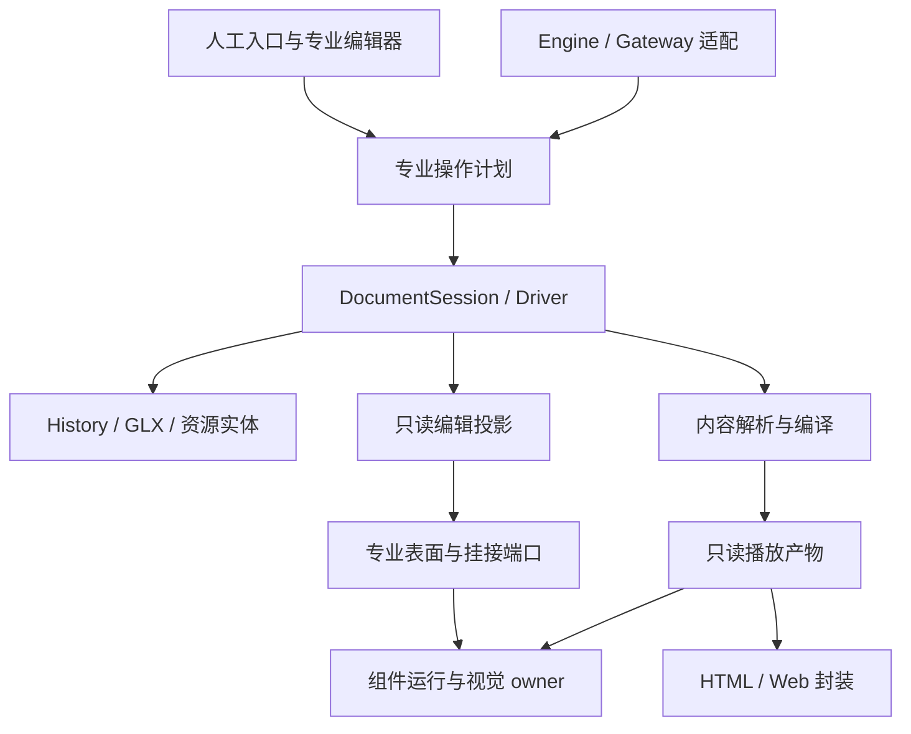

# 可实施的目标架构、迁移工作包与退出条件

本文件保留原研究包的实施规划与逐包验收。正式基线保持 Project 11 / Published 4 / Component API 5；DocumentSession、CAS、History、保存与冷开机制为保全对象。

原架构优化批次已按[§15](IMPLEMENTATION_PLAN.md#architecture-batch-closeout)收口，并提交推送为 `7952cc24`；未选方向仍按原条件暂缓。Claude审查后的本轮实施与当前失败归类见[后续维护结果](../../docs/development-plan/20261024-architecture-review-followup/RESULT.md)。原审计数据及各轮“本次／下一轮／未提交”为历史时点，不回写旧统计；原方案§9—§14保留原位和锚点。Owner本次授权将原有全部未提交成果一并commit并push，发行／Portable／部署仍暂停。

## 1. 从能力反推最小职责

保留果铃现有能力后，内部只需要六类明确责任：

1. **文档事务**：保存作者事实、对象身份、资源引用及历史，检查当前版本与写入资格，原子提交。
2. **专业编辑用例**：知道“改文字、插表格、移对象、改变Flow归属、修改Source”意味着什么，输出正式操作计划。
3. **表面呈现与交互**：把作者布局意图呈现为屏幕几何，处理当前表面的输入；不创造第二套内容语义。
4. **组件运行**：根据定义和实例提供画面/行为；一个耦合动态域拥有自己的时间与视觉状态。
5. **内容编译与交付**：确定实际内容、依赖与资源闭包，生成只读播放事实，再按宿主封装。
6. **任务执行**：模型负责提出和选择动作；软件负责权限、准确目标、执行、查证、停止、恢复与完成状态。

这六类是责任边界，不要求新建六个框架、六个 npm 包或六个“大服务”。优先使用现有实现，将越界决策搬回真正 owner，并删除被替代分支。

### 1.1 目标依赖图

依赖方向的关键限制：

- 专业 planner 不能读取 React Store、Engine ActiveRun 或直接保存文件；它获取确定的当前基线和必要能力。
- Gateway 不再知道表格行合并、图表数据、Flow分栏、文本片段等具体算法；它保留授权、句柄、批处理、CAS、回执查证。
- 表面与 Runtime 不向编译层写入运行事实；编译不依赖当前编辑选区或视口。
- 资源传输表示不能反过来定义作者对象身份；URL 只是一种可失效的交付能力。
- Component Runtime 不获得正式文档任意写入权；可持久参数修改经正式操作入口，阅读状态留运行作用域。

## 2. 核心数据与最小协议

### 2.1 内容模型无需再大一统

现有 instance/definition 是可保留的共同核心。每个实例只需要稳定身份、内容/数据、关系/布局意图、有效实现及可编辑能力。专业数据结构保留差异：

| 内容 | 合理作者事实 | 合理呈现 | 不应强加的能力 |
|---|---|---|---|
| 原生文字/图片 | 文本/样式/资源引用/布局 | 直接DOM或现有轻量专业实现 | 不必为简单静态内容启动完整Source沙箱 |
| 表格/图表等专业内容 | 结构化专业数据与作者配置 | 专业renderer和专业编辑器 | 不必把专业模型摊平为万能JSON属性编辑 |
| Source/HTML程序 | 源文件、入口、依赖、明确可编辑参数/记录 | 程序自己的Runtime或受支持的同文档实现 | 不要求拆开所有动态图层成为原生节点 |
| 复合容器 | childIds/容器布局政策与内容关系 | 对应表面/容器专业布局 | 不同时维护另一份持久对象树 |
| 动态场景 | 一组共同时间线/遮挡/几何的程序内容 | 一个视觉owner，源码可多文件 | 不以多个宿主桥逐帧争夺同一属性 |

“可编辑”不应等于“任意内部DOM都可无损还原为原生对象”。对程序内容保留四类明确编辑能力：已声明参数、结构化内容字段、稳定作者记录、源码编辑。没有声明且无法稳定定位的内部节点，不伪装为持久作者目标。

### 2.2 专业用例的公共边界

复用当前 operation / mutation / planner 合同。下表是职责定义，不要求新增另一套公开 wire schema。

| 阶段 | 输入与输出 | owner |
|---|---|---|
| 解析目标 | 正式文档、对象/字段/正文范围、有效编辑层级 | 现有统一目标入口；AI句柄在Gateway解析 |
| 获取基线 | 文档epoch/revision、实际读取的目标及必要资源事实 | Session/Driver；不全量搬运所有内容到每层 |
| 专业规划 | 内容意图→现有mutation、read expectations、目标续接映射、必要资源变化 | 对应专业模块 |
| 批处理 | 在同一working model顺序规划，必要时合并关系结算 | 现有planning batch，不新增writer |
| 正式提交 | 最终CAS/lease/stop检查→日志→accept→一次History | DocumentSession |
| 结果呈现 | 内部完整事实→GUI进度或Agent紧凑回执 | 原receipt投影，不把公共结果变成巨型快照 |

首个用例确定为`object.insert`。当前GUI与Gateway已经共同调用`prepareCourseElementEdits`，Flow分栏也已经共用`prepareCourseFlowColumns`；不能以“新增共用planner”为名再包装一层同样的实现。P2-A应沿现有专业模块收回插入相关的内容组装与计划生成，Gateway保留句柄、授权和批处理/提交，GUI保留手势、测量及前台选择适配。专业语义变更无需再修改Gateway中央专业分支，才继续迁移下一项。抽函数却继续传整个Gateway、Store或ActiveRun，不算完成。

### 2.3 几何语义统一，布局算法保持独立

共用的是以下问题的答案：

- 测的是哪个正式目标、哪个挂接实例？
- 值属于作者空间、表面空间、viewport还是程序内部空间？
- 观察是否来自同一帧/同一几何批次？
- 从屏幕输入映射回作者命令时，使用的是哪份正逆变换？
- 宿主切换后，这份观察还有没有资格生效？

Slide 保留自由 frame；Flow 使用浏览器正常流、读序和组件自然高度；Spatial 保留世界坐标与相机；程序内部布局归组件。跨表面不以一组无语义的 x/y/width/height 强行互换。

复用已经成立的 `resolveGlobalViewportLayout`、layoutPort 与同批 `scope.measure`。测量结果保持只读投影。除非明确进行“采用当前尺寸为作者布局”的用户操作，否则不将 DOM 尺寸每帧写回作者模型/History。

### 2.4 生命周期协议只保留一个执行者

当前 Flow 对象跨 PM NodeView、React root、World retained root 迁移，外部调用者要了解延迟unmount、parking、expected root和beforeProjectionRemoval顺序。

目标是在**现有 ComponentRuntimeWorld**的挂接入口集中执行这些规则。外部提供目标与释放凭据，表示：

- 申请把现有实例挂接到指定投影；
- 更新这个投影的容器/布局输入；
- 释放这一次挂接；
- 投影detach与实例retire分离。普通导航、React临时卸载或Flow归属迁移导致暂时没有可见投影时，保留既有运行实例与必要parking；只有正式内容删除、实现替换、显式重播/重置或运行作用域结束等既有条件，才由实例owner退役实例。

这些语义可沿现有generation、expected root、scope和cleanup实现，不再叠加一层全局lease框架。迟到释放只能释放自己的挂接，不能销毁后来重用的实例；源码替换允许有明确的重新创建行为，不承诺任意代码热改都保留运行状态。

**World的责任止于运行实例和运行根的挂接。** PM NodeView继续拥有可复用正文宿主及其恢复，React继续拥有自己的root、渲染和卸载，表面继续计算布局和处理输入。World不导入PM/React，不接管编辑器DOM壳或手势；外层退出的是对retained runtime root、parking和迟到释放的重复决定，不是删除所有清理代码。投影暂时detach与运行作用域结束必须区分：前者保活，后者按既有合同释放。

## 3. 具体模块裁决

下表为目标职责裁决，不是同时开工清单。已存在的共用planner、增量通知、精确导航guard、同批measure、资源lease与已修依赖继续复用。P1/P2/P3/P5对应范围见§5；没有当前重复决策、错误依赖或明确重复工作的条目，只保留方向，不据此拆文件或新增抽象。

| 当前模块/机制 | 裁决 | 目标与删除对象 |
|---|---|---|
| DocumentSession / DocumentRegistry / Driver | **保留核心** | 保留单writer、CAS、stop、原子日志/History/保存；减少上游不必要read/drain，不绕过提交 |
| CourseV10DocumentBridge / DocumentProjection | **按实测收敛投影职责（P2-B）** | 保留草稿/已提交/运行投影差别；只迁移已定位的重复准备/过宽通知，不重新建设增量机制 |
| 各 renderer Store | **逐字段裁决** | view/session态可留；正式数据副本只读派生；只有证据证明相互回写的字段才合并owner |
| DocumentToolGateway.applyCanonicalMutations | **拆出专业规划** | Gateway保授权/目标/提交；规划回到现有domain；删迁移用例的中央专业分支 |
| ToolRegistration / ToolCatalog | **保留并补全使用** | 不建新注册表；专业handler接专业planner；family/profile继续渐进发现 |
| ExecutionEngine | **分用例收窄运行owner（P2-D）** | 保留一个循环/journal；相关红例先裁定，专业preflight/结果解析归能力owner；上下文事实归既有Projection/PayloadCompiler |
| ExecutionContextProjection / PayloadCompiler | **作为既有收敛点** | 删除Engine重复拼专业正文/观察；保持原协议、来源与权限 |
| NativeTaskRunner | **保留隔离与正式采用** | 子任务候选不带父writer；父采用走原事务；没有新增失败证据时不设单独重构包 |
| App / FlowWorkspace / SlideLocationWorkspace / SharedDocumentEditor | **拆职责而非只拆文件** | UI组合根接线；专业操作通过窄端口；选择意图、编辑与生命周期各有owner |
| Flow NodeView / React / retained runtime手动交接 | **收回运行根挂接责任（P3）** | World负责retained root与parking；PM/React保留各自视图树及清理，删除外层重复运行根决定 |
| ComponentRuntimeWorld | **保留并明确边界** | 实例、作用域、挂接、精确state订阅/导航guard；不负责作品内部逐帧视觉控制 |
| SandboxComponentRuntime | **隔离职责保留，作者桥候选拆分** | 必需运行桥保留；量化后将仅作者发现/输入扩展与播放引导分开；不删离线override/资源/clip |
| ComponentNavigationOwner / 共享运行算法 | **职责归位** | 纯运行逻辑不必留renderer；禁止反向依赖作者Store。先消除坏依赖，非全仓搬目录 |
| courseV10Operations ↔ componentTextRelationshipEdits | **断开纯helper反向边** | equalComponentValue等值算法下沉到现有中性位置；不新增协调器 |
| courseObjectEdits ↔ courseElementInsertion | **明确placement算法归属** | 纯frame/placement规则一个owner；高层组装单向调用 |
| ExecutionDesktopService及文件/附件服务动态环 | **条件性职责收敛** | 动态环本身不证明运行故障；P2-D触及对应服务装配且存在实际跨责时再注入窄端口，不引入DI框架 |
| projectFiles/componentPlatform/coordinator | **保留观察/CAS，拆文件投影成本** | Source代码候选与正式作者模型转换分清；缓存基于已读基线，不能用最新revision盲认领未读人改 |
| buildComponentPublished / compileCoursePlayback / compiledScript | **统一语义解析与资源闭包** | 显式输入revision与环境；交付封装不重复识别内容；不先加长期第三IR |
| Published Player / compiled Player | **保留正当不同用途** | 共用运行语义；消除误依赖，不强求立即删其中一个 |
| resourceContent / runtime资源lease | **保留实体去重，收拢传输能力判断** | content共享；logicalId/version和URL有效期独立；realm消费适配由一个资源边界负责 |
| npm prehooks / source-launch | **优先删重复工作** | 一次任务图一次生成/构建；复用现有指纹；明确所测产物身份 |

“合并owner”不一定物理合并类。例如 World 与 Sandbox 分别负责课程运行对象和隔离realm，二者并非天然重复。只有两边都能决定同一实例创建/销毁或同一属性的最终值时，才需要收回决策权。

## 4. 三条路线比较

以下为工程判断，不是已经测出的工期/收益。尚无可比较的开发事件账，因此不提供虚构人日或提速百分比。

| 路线 | 保守收敛 | 核心模块重构 | 更高层职责调整 |
|---|---|---|---|
| 做什么 | 删重复构建/生成、坏依赖、无效转换，完善现有缓存/订阅 | 重分专业planner、Gateway/Engine、编辑挂接和投影owner | 以强耦合动态域、专业编辑能力与统一编译事实替代底层大量协调 |
| 初始成本 | 低到中；可窄范围逐项做 | 中到高；需先明确公共语义与消费者 | 单个试点中等，全系统推广高；须验证表达能力 |
| 复杂度减少 | 明确但有上限，不能解决中央专业分支 | 对跨模块修改成本最直接 | 在合适场景可直接删除整段同步机制 |
| 回退风险 | 较低；缓存/打包仍需对应边界测试 | 中等；事务/编辑入口/生命周期必须保全 | 试点可控；全局套用会损伤可编辑性、复用与布局自由 |
| 性能潜力 | 重复构建、过宽通知、误引入闭包有直接证据 | 少投影/少全量扫描/少挂接重建；幅度需实测 | 减少跨realm/跨对象逐帧协调；不能保证艺术质量或所有FPS |
| 未来能力 | 接近现状 | 新专业能力不必触碰授权与运行中央分支 | 更适合复杂连续动态内容；静态/独立内容仍需专业实现 |
| 本项目建议 | 立即采用 | 主体路线 | 对Runtime-first和交付责任局部采用 |

不建议全仓重写或先升级正式格式。近期真实问题主要不在Project11能否表达内容，而在读取、编辑、运行和交付对这些内容如何分工。

## 5. 工作包、执行顺序与验收

### 5.1 首轮与后续的边界

P编号表示工作方向，不是缺陷等级，也不是所有包必须串行执行的阶段号。本方案修订完成后仍未启动软件实施。后续获得实施授权时，按下表选取；不把候选研究、代码完成、行为通过和Owner接受混写。

| 顺序/资格 | 工作包 | 实际依赖 | 何时停止或转下一包 |
|---|---|---|---|
| 随包准备 | P0：相关基线与红例裁定 | 即将改变的职责、消费者和已有证据 | 能解释该包基线与必要失败，立即进入该包；无关红例不阻塞 |
| 首先实施 | P1-A：构建/生成去重；P1-B：两组纯helper环 | 各自的P0，不依赖Engine红例全部转绿 | 重复节点/错误依赖退出且受影响行为保留，即可分别收口 |
| 首个专业用例 | P2-A：object.insert | 插入目标与批处理合同、相关回执基线明确；不硬依赖整个P1完成 | 共用专业决策并删除中央对应分支后，才决定是否继续迁移其他操作 |
| 首轮重点 | P3：Flow运行根挂接 | 仅需挂接身份、有效期和detach/retire边界明确 | 不等待全部P2；同一FlowWorkspace由单writer实施，避免与P2-A接线冲突 |
| 选择性后续 | P2-B～E：投影、Source观察、Engine和发现 | 每切片自己的证据与红例，不互相捆绑 | 找不到剩余重复决定/准备或真实成本时，保留现状 |
| 条件性后续 | P1-C：增量类型；P5-A～D：编译/资源 | 对应的小测量或直接重复规则证据成立 | 不存在重复、收益不成立或会增加长期双轨时停止该候选 |
| 独立条件试点 | P4：单视觉owner | 已定位一个实际可删除的跨对象视觉协调机制 | 无可删机制就不建新样例，不以重做作品充当软件优化 |
| 随包收口 | P6：退出旧路径与记录收益 | 每个实际实施包 | 不留到最后统一清理，不要求先完成其他候选 |

推荐默认顺序为：**P1-A → P1-B → P2-A → P3**。P2-A的短合同确认可与P1进行；P3的生命周期边界确认可独立准备。只有文件与职责确实不相交且有收益时才并行，具体见§6。

### 5.2 P0：只补齐本包所需的基线

**进入与范围：** 后续实施某包前，简短确认目标行为、当前工作树中有效dirty成果、直接producer/consumer，以及本包会使哪些现有证据失效。已有有效检查、审计原始结果和真实作品记录继续复用，不默认重跑99项或重做全系统统计。

复用现有`prepare-source-launch`输入/输出指纹、`build-info`、Git/dirty事实和实际产物路径说明所测版本；只有这些信息不足以分辨当前候选时才补必要来源事实。源码、生成物、运行产物需要区分，但不建设新登记平台，不把全仓Hash、前后全文件字节一致或每任务生成新fingerprint设为正确性门。

原审计14红例保留在[VALIDATION.md](VALIDATION.md)，按下表处理；这不是本次修订重新执行所得：

| 原审计分类 | 数量 | 影响的工作包 | 必须处理到什么程度 |
|---|---:|---|---|
| 公开回执仍按value.html读取，而当前精确路径值为字符串 | 4 | P2-A涉及的回执验证、P2-C及其他改变回执的切片 | 对照路径与真实值确认测试语义；保留内部完整事实、公共小回执、幂等和Undo断言 |
| Engine消息过滤和“未完成”泛用词假阳性 | 2 | P2-D及确实复用这些断言的切片 | 只修与合同不符的识别条件，不删除原工具轮、授权和未执行残缺payload的断言 |
| 取消错误码、steer后的任务终态合同分歧 | 2 | P2-D；其他包只有实际触及该协议才纳入 | 技术Reviewer核现行对外合同与消费者，保留取消拒绝、steer后零新写入；不以改状态掩盖效果 |
| Gateway回执高度疑似相同形状问题，尚缺实证 | 1 | P2-A或其他改变Gateway回执的切片 | 用原操作/lookup及精确路径值核实，不因“疑似”直接改断言或标为已修 |
| Source files列表缺失，根因未定 | 1 | P2-C、改变Source文件投影/采用回执的切片 | 读实际diagnostics与已读/采用事实；区分展示列表、采用失败和持久化失败 |
| Engine等待/ACK、并发预览、cooldown停止、OAuth归档未收敛 | 4 | P2-D中对应的调用/上下文生命周期 | 定位真实等待与效果、确定预期后修；不只延长timeout，不将全部推成旧fixture |

**验收与退出：** 对本包相关红例能说明合同、实际行为、处理方式和未决限制；不会因未解释失败而失去验证本次修改的能力。可以认定旧断言漂移，但必须有当前合同及行为依据。无关项保留原记录，不要求全部清零。已红且属于本包要恢复的行为必须解决，不能用“基线已红”豁免。

### 5.3 P1：先删除确定的开发等待与错误依赖

**P1-A 构建/生成去重（首轮）。** 范围为`package.json`、既有build scripts、`prepare-source-launch.mjs`及必要的直接调用入口。将Player构建和默认组件源码生成纳入现有任务依赖顺序，同一组合任务内每个必要节点只执行一次；纯领域测试不承担无关Player预构建。单独调用renderer/electron/相关测试时仍能得到真实必需的生成物，不能靠假设调用者已经执行前置来省步骤。

- 必要消费者：`build`、`verify`、`build:desktop`、相关测试前置、独立构建入口与`start:quick`；按共同子链验证，入口逐项核对不等于逐个运行整套流程。
- 验收：任务调用图/执行记录证明重复节点消失、必要生成发生在首个真实消费者之前；完成一条受影响的代表生产链和实际受影响的独立入口检查。源码相关变化后不会启动旧产物，无改复用仍成立，必要检查没有被删除或过滤掉。
- 收益记录：本次受影响链的生成/构建次数和同条件耗时即可，不附加四类开发任务或真实模型对照。仅脚本变短、退出码为0或跳过必要产物不算完成。
- 不做：新构建平台、全仓缓存系统、为去重顺便改变产品功能或发行；移除正确测试前置时必须给出其消费者已被等效覆盖的依据。

**P1-B 两组纯helper依赖收敛（首轮，可独立收口）。** 只处理`courseV10Operations ↔ componentTextRelationshipEdits`的等值算法反向边，以及`courseObjectEdits ↔ courseElementInsertion`的frame/placement归属。纯规则进入已有中性专业位置，直接调用者改为单向引用；不增加协调器，不全仓搬Player/renderer目录，不进行V9/V10批量改名。

验收为两组目标值依赖环退出、专业层不反向依赖Driver来获取纯算法、受影响的关系结算/插入/移动行为保持。使用目标import关系和已有最近层行为检查；不要求全仓SCC为零。已经修好的`publishedProjection`纯helper依赖不重复处理。

**P1-C 增量类型检查（条件性后续）。** 先在隔离输出/副本试现有TypeScript增量：首次、无改、一个真实叶子变化各测一次，确认相关类型错误仍能被发现、诊断范围未缩小。收益明确才采用；只有真实稳定依赖边界要求时再引入project references。无稳定收益即停止，不以减少配置数量、删除正确检查或拆成大量包为目标。P1-A/B不等待此实验。

### 5.4 P2：按专业用例迁移，不捆绑三类生命周期

**P2-A object.insert贯通（首轮）。**

进入时只需在本包交接中说明短合同：已解析正式目标/展示状态、已读基线、宿主提供的插入位置、专业意图，以及现有edits/read expectations/结果目标。GUI的手势/测量与Agent的句柄/授权来源允许不同，不把GUI改造成Agent工具调用，也不新建command bus或公开wire schema。

范围为现有`prepareCourseElementEdits`及必要的插入专业组装、GUI插入入口、ToolRegistration/Gateway插入适配和现有planning batch。迁出Gateway内与插入相关的内容准备、正文切分/插入计划及所需外观/点击语义组装；句柄解析、写入资格、授权范围判断、批处理中间模型和Session最终CAS/stop仍在原边界。跨领域规则调用原owner，不复制进一个万能插入服务。共用的`teacher.ensure`基础或其他直接调用者仅作必要接线，不扩大成全部工具迁移。

必须保留当前支持的`index/after/at`、Flow读序/段落切分、展示状态、专业默认、外观及点击行为、关系结算、目标续接与人工布局；不缩减为“整页末尾能插一个对象”。

验收：

1. GUI与Gateway真实调用同一专业规则；已迁移的插入专业决策从Gateway中央分支退出，只留协议、授权与通用提交编排。其他尚未迁移操作保留，不能宣称全部Gateway已收敛。
2. 代表GUI插入与Gateway调用都到达原Session；直接调用和混合batch保持同一working model顺序规划、最终一次commit/Undo，Undo/Redo正确恢复对象、正文关系和原布局。
3. 覆盖实际存在差异的正文光标、对象相邻/容器位置及展示状态，不机械枚举每类对象×每表面；拒绝越权/过期目标时零误写，返回目标可继续编辑，相关公开回执可lookup且不携带大正文。
4. 代表GLX保存重开后内容和资源可继续编辑；仅在修改了发布字段/消费者语义时扩展到对应导出。无需为planner迁移调用真实付费模型或重做整课创作。

P0先核本包相关回执旧形状与Gateway疑似项。专业规则维护位置没有减少，或只是把整个Gateway/Store传给新helper时，先修边界，不批量迁移`object.update/layout`。

**P2-B～E是分别选择的后续切片，不是P2-A的附带范围：**

| 切片 | 进入条件与修改边界 | 直接消费者及验收 | 停止/不做 |
|---|---|---|---|
| P2-B：Bridge投影准备/通知 | 定位一次真实输入或切选中仍重复的全域准备/过宽通知；在Bridge/DocumentProjection及实际订阅者内缩小范围 | 文档/选区/展示状态的订阅收到正确变化；草稿、正式与runtime投影各保语义，迟ACK/切目标/原稿恢复不抢前台、不丢输入；重复准备或无关通知实际减少 | 已有publishSelection和effect增量不重建；不按字段名合并project/editingProject/runtimeProject，不重做统一选择/IME系统 |
| P2-C：Source观察与ACK投影 | 先裁定Source files缺失；确认Coordinator对不同已读快照的Driver重放/整份文件重投影可以由accepted changes等现有事实替代 | `projectFiles/componentPlatform/coordinator`及文件读取/正式采用消费者；未读人改隔离、并行不同字段、Source fork/COW、别名冲突、文件发现与CAS仍成立，实际重复重放/准备退出 | 不用最新revision盲认领未读值；不改变Source正式采用/保存语义，不设跨会话持久缓存 |
| P2-D：Engine专业事实/能力接点 | 先裁定即将触及的Engine红例；每次选择一个重复正文/观察投影或专业preflight用例，归回现有Projection/PayloadCompiler/能力owner | 真实wire/上下文、execute/lookup、停止/unknown/续接的对应消费者；输入输出事实与来源不丢，旧专业分支退出，仍只有一个循环/journal；涉及服务装配时只注入必要窄端口 | 不一次重写execute/drive，不传整个ActiveRun伪拆分，不新建重试/状态机；动态服务环本身不自动成为重构任务 |
| P2-E：默认工具暴露 | 在现有profile/family中明确低频维护项和发现路径，保留常用编辑/保存/观察的实际可达性 | 初始投影及按需展开的支持/授权不扩大；目录探针与代表常用任务的真实工具分发通过，必要能力不会因收窄而消失 | 字节变小不等于模型更快；未做真实采用对照不签token/费用收益，不引入第二注册表或资产平台 |

这些切片各自收口，不要求P2-A先完成后才允许分析；实际代码重叠时顺序采用。Source观察不作为普通插入迁移前置，Engine生命周期不作为Bridge通知优化前置。异步完成是否能改变当前界面继续由现有scope/ticket/generation裁决；原有效修复只在相关路径改变时复验。

### 5.5 P3：Flow运行根挂接收敛（首轮重点）

**进入条件：** 在现有World/Flow接口上明确正式实例、所属World/作用域、这一次投影挂接身份与释放资格；明确detach保活和retire条件。复用已有identity/generation/expected root即可，不要求P2-A或其他planner迁移全部完成，不依赖新增lease框架。

**范围与责任：**

- 首条闭环为Flow正文↔浮层迁移、旧NodeView/React延迟卸载以及关闭/重开。World决定retained运行根的移动、parking、释放资格和实例退役；Flow/PM/React只提供挂接目标及自身视图清理，保留可复用宿主恢复。具体边界沿§2.4。
- 直接接线包括`FlowWorkspace`、`CourseV10RuntimeView`和World的投影入口。若改变公共bind/target/mutation接口，同批接通`ModelPlayer/modelProjection`、`compiledPlayer`、输出捕获及其他实际调用者；先复用现有接口，不为形式统一强制全部换API。
- 保留`placeRoot`的存活iframe搬移、parking、精确导航guard和`scope.measure`；不重写三表面布局、输入系统、Sandbox状态协议或源码热替换合同。Runtime state、几何观察不写作者History。

**验收：**

1. 外层不再自行决定retained root的parking/归还与旧释放资格，World不新增对React/PM或编辑器Store的依赖；不是单纯把清理代码藏进通用helper。
2. 在真实浏览器/必要Electron载体中，运行中的Source从正文转浮层再返回、撤销重做和普通布局/视口变化保留原实例及其临时进度；NodeView可继续复用，PM文字输入与对象拖拽、双击编辑仍正确。
3. 旧ref、旧挂接释放和相关迟到消息不能解绑后来挂接或夺回前台；临时detach不销毁实例，正式删除/实现替换/显式复位/作用域关闭按原合同退役并释放资源。
4. 代表GLX保存后在新会话重开，作者内容/归属/资源正确，运行瞬态按原合同重建；如改变Player/捕获接口，再覆盖其受影响的真实consumer，不机械重验全部作品。

若发现必须重写PM/React视图树或让World承担编辑器输入才能完成，先缩回挂接职责；不得以丢失运行状态、移除parking或每次重挂代替收敛。浏览器回调测试和保存冷开只证明各自属性，不冒充物理IME或Owner整体接受。

### 5.6 P4：单视觉owner是条件性试点

**进入条件：** 已在一个具体动态域找到宿主和多个对象共同控制同一时间/坐标/显隐的机制，并能指出候选完成后哪段生产协调及其消费者会退出。咖啡既有结果作为证据复用；不为了证明原则再创作整课或强制寻找新作品。

若需要试点，优先用已有代表内容副本；只有现有样本不能验证已定位的机制时才补最小不同样例。宿主保留身份、外部尺寸、生命周期、资源和导航，组件负责内部连续画面，稳定图文与可独立编辑/重排内容保留原生表达。

**验收：** 实际逐帧坐标/显隐重复控制退出，进度正反与互动正确，正式参数修改、Undo/Redo、保存冷开和相关离线交付保持；不能以把桥代码换位置、把内容整页程序化或增加宿主动画编排来验收。

找不到可删机制、跨内容价值不足、独立编辑能力下降或维护成本上升，就停止该试点并保留结论；不阻塞P1/P2/P3/P5。Sandbox作者桥分包是P5-C的独立条件候选，不附带进入本包。

### 5.7 P5：编译与资源按可证明的切片推进

共用现有`buildComponentPublished/compileCoursePlayback/compiledScript`和资源lease。当前builtin按key共享、web/static signature去重、native路由、资源身份分离和按需portable bytes已经存在；不重建一套“统一编译/资源平台”。本包不默认进入首轮产品修改，可先做一个能改变决定的小测量。

| 切片 | 进入条件与范围 | 验收与停止条件 |
|---|---|---|
| P5-A：同次Source编译复用，优先核实 | 记录一次真实编译内相同Source override输入的重复次数/耗时；只有实现、资源环境、选项相同且重复确实存在，才在现有编译生命周期复用 | 重复调用实际减少；不同override/资源环境/选项不误复用，诊断/取消保持，受影响Source实际可运行；没有重复或复用不划算即停止，不加全局/持久缓存 |
| P5-B：资源消费归属 | 定位消费者仍各自推测URL/字节/字体/Canvas能力的具体规则，在既有lease或交付适配收回决定；先明确受影响的logical ID、content和realm能力 | 同内容不同逻辑ID独立编辑/历史/反查，按需解码与释放正确；按实际变化覆盖opaque字体、Canvas读像素、HTTP或file离线等消费者。不能以image onload代替像素可读性，也不强求每包验证未受影响的载体 |
| P5-C：依赖闭包/作者桥裁剪 | metafile和真实调用证明某依赖或初始化无消费者；作者桥分包另需测实际桥字节、初始化成本和运行必需分支 | 实际无用引用/初始化退出，导航/媒体/iframe、持久作者override、clip和资源仍可用；没有足够收益就停止分包，不按authoring字样删除，不新增第三套轻Player |
| P5-D：有效实现/内容解释收敛 | 先指出两个实际消费者对同一规则的重复解释及差异，将该规则归回直接共用owner；保持编辑模型与compiled适配的正当不同 | 迁移规则只有一个决定者，全部直接消费者同批采用、旧解释删除；同输入的definition/override/导航/资源语义一致，不新建长期第三IR |

P5各切片不要求先做完整P2/P3；只有实际修改同一公共合同或消费其新接口时建立依赖。P5-B先明确消费能力再改封装；P5-A不以无关的Source文件列表红例作为全局门，但若实际触及该投影则纳入P0。GLX ZIP、单HTML、HTTP Web与file/opaque保留必要传输差别；1.9MB与5.13MB差额不预设全部可删，字体和Player更小也不自动证明冷开/长帧改善。

### 5.8 P6：随包退出旧路径并收口

每个实际实施包在原任务交接/结果中简短留下：新的唯一决策owner、删除的旧分支/重复节点、直接消费者与行为证据、该包的实际收益或尚未证明的收益。P6不是最后一批工程，也不是新增评分卡或永久登记系统。

同一用例在同一时刻只走一条实现，不双写作者状态；无需切换开关时不加开关。确需短期切换时明确用例和旧路径退出条件，在本包候选采用阶段退出旧专业决定；不能把“新路径能跑”作为长期保留双轨的理由。其他尚未迁移操作保留，不能借本包删除其受支持入口。

候选失败时只撤回本包明确的软件增量，恢复单一路径；保全其他dirty成果、原件、用户工程、恢复稿和新产生作者数据，不用reset/clean或回滚用户工程来获得绿色。若涉及作者字段变化，必须先明确可读回结果，不能假设旧候选能无损重开新数据。

停止追加的条件是本包职责迁移/重复删除和受影响行为已有充分证据；技术修复完成与普遍提速、整作质量、Owner接受分别报告。没有减少真实协调或等待时，不继续推广同一抽象。

## 6. 依赖、并行与候选采用

默认主执行者直接实施和自检；只有收益明确的不重叠叶子才并行。Gateway、World、FlowWorkspace、构建入口各自保持单writer；独审按§7触发，不设每包固定多角色。

| 可独立准备/实施 | 必须协调的共享边界 |
|---|---|
| P1-A构建图与P1-B纯算法归属 | P1-A若改变生成输入/指纹分组，由同一集成者采用，避免多个候选覆盖package/build入口 |
| P2-A短合同、P3挂接边界确认、P5-A局部计量 | 不等于同时改FlowWorkspace；P2-A/P3实际接线重叠时顺序实施，后者基于已采用候选 |
| 首例通过后的不同专业planner | 首先复用P2-A已证明的必要返回语义，各改各的专业规则；中央Gateway接线由一个writer采用，不各造协议 |
| P5-B资源规则与P5-C无用闭包分析 | 公共资源/消息合同先定一份，按组合候选验证；不能各验各的接口版本后直接拼接 |
| P2-B投影、P2-C文件观察、P2-D上下文的独立定位 | 公共Session/回执/Bridge实际变更有依赖时才串联；不把原研究的领域划分当作天然无冲突 |

本轮不启动任何候选或任务卡。后续实施按当前任务板和实际写锁登记，不将本方案所有候选都记成active；planned、运行、候选通过和完成分别记录。重要结构候选由未参与实现的另一执行者集中核实际diff和保留行为；有效未变评审继续复用，不逐文件审批。

## 7. 验收标准与最低充分验证

先核已有有效证据，只有本次变化会使其失效或暴露新的失败模式时才执行对应检查。以下是选择依据，不是每包全矩阵命令表；零匹配、skip、未到行为断言和只报告退出码不算通过。

| 变化属性 | 最近层证据与已有入口示例 | 何时扩大 |
|---|---|---|
| P1构建任务/依赖方向 | 任务图与调用记录、目标import/SCC、必要类型与相关行为；可参考`windowsSourceLaunchContract.test.ts` | 改变实际产物准备/启动路径时覆盖代表真实产物消费者，不为纯helper移动跑全部构建 |
| P2-A插入与原子操作 | `flowBodyInsertion20261023.test.tsx`、`glxFlowCanonicalOwnerInsert20261020.test.ts`等实际相关部分；GUI/Gateway直接路径、混合batch、Undo/Redo、回执和代表保存重开 | 位置/展示状态/资源或发布语义确实有不同分支时补相应消费者，不按工具数×表面机械展开 |
| P2-B/C输入、投影、Source已读基线 | `flowLateAckOwnership20261023.test.tsx`、`projectionFeedbackLifetime20261023.test.ts`、`projectFileObservation.test.ts`及实际Source交错用例 | 输入路径变化看实际交互；Main恢复/文件保存变化才覆盖真实宿主和新会话重开 |
| P2-D/E执行与发现 | 原Engine/公开回执中相关用例、`g20ContextProjection.test.ts`及现有profile/分发检查，fixture provider可验证软件语义 | 涉及实际wire、停止/unknown或上下文档案时覆盖对应边界；真实模型采用/费用结论才需要已授权的模型证据 |
| P3运行挂接 | 针对挂接身份/迟释放的最近层检查，加运行中Source的真实正文↔浮层、PM输入、Undo/Redo和重开 | 公共World接口影响Model/compiled/捕获时覆盖这些实际消费者；DOM mock不能证明iframe浏览上下文保留 |
| P5编译/资源 | `compiledResourceDemand20261024.test.ts`、`webResourceContentLease20261024.test.ts`和对应URL lease；真实字体/Canvas反例按变化复用或复验 | realm/交付能力改变才补对应HTTP、file、opaque消费者；保存逻辑身份变化才扩大到History/归档 |

所有实际实施包按影响保留：正式文档唯一writer与最终CAS/stop，原子History，未读人改与Source COW，草稿/composition输入，统一选区与前台归属，detach/retire生命周期，逻辑资产身份/资源有效期，以及保存重开/发布的相应合同。不要求普通包重新证明全部底座；也不能以“共用Session”省略本包真实消费者。

涉及writer/History/保存或资源归属迁移、跨进程/跨表面异步生命周期、核心入口替换、受支持consumer删除，以及正确断言/必需检查的实质变化时，按[工作协议§3.1](../../docs/development-plan/WORKING_PROTOCOL.md#independent-structural-review)进行独立评审。已批准的具体迁移可推进；尚未确定的重要结构选择实施前核边界，候选采用前集中审实际diff、旧职责退出、行为与证据缺口。普通等价接线不逐文件另设审批。

代码检查、真实浏览器/Electron、模型采用、保存冷开、离线交付和Owner接受分别签述。只在实际权限、费用、产品能力或用户数据处理方式改变时交Owner决定，不为普通已定实施细节增加确认门。发行、push、Portable和部署仍沿现行暂停边界。

## 8. 各包收益与整体提速的证据

包完成先看具体重复决定/等待是否退出，以及保留行为是否成立。收益按该包直接作用记录，不要求每包完成三个普通任务加一个跨交付任务，也不把收集模型用量作为所有重构的前置。

| 工作包 | 足以判断该包价值的指标 | 不能代替的结论 |
|---|---|---|
| P1-A/B | 必要构建/生成次数、受影响链耗时，错误依赖与重复维护位置退出 | 行数/文件数下降不等于开发提速 |
| P1-C | 首次、无改、叶子变化的类型检查耗时与诊断保持 | 不能靠漏检查获取增量收益 |
| P2-A/B/C/D | 专业决策维护位置、重复准备/重放/专业事实拼装实际减少；需要计时才对同口径路径计时 | 抽函数、增加共享层或少一次调用不自动证明总体更快 |
| P2-E | 初始暴露与按需发现可达性，真实请求定义量如有 | 定义字节数不是token/推理耗时/费用 |
| P3/P4 | 外层挂接清理决定或逐帧视觉协调真实退出，实例重建次数与实际交互保持 | 不从结构改动推断稳定60FPS或普遍作品质量 |
| P5 | 同次重复编译/解码次数、实际无用依赖字节、受影响产物/初始化耗时 | 文件更小不自动证明编辑冷开或长帧改善 |

只有需要宣称整体开发效率提升时，才从后续自然发生的工作中复用三个普通修改和一个跨交付任务的可比样本；分别记录模型等待、工具、构建、验证、集成返工，以及首次可用/最终验收时间和必须共同理解的职责。条件、任务或能力不同不计算统一改善比例，不为凑样本额外调用付费模型或重做整课。

测量结果含混时保留不确定性；某项收益缺少数据可以如实注明，不能因此无限追加验证。候选确实增加协调、没有可删除机制或损害表达/编辑能力时停止推广，返回具体问题与原owner，不另建管理层吸收成本。

## 9. 首轮后剩余包评估与下一轮选择（2026-10-24，仅方案）

### 9.1 本次判断所依据的事实

- **首轮已证明的边界：** 构建节点去重、两组helper依赖环退出、单一插入专业计划和World挂接资格均已成立；45项选中检查及相关类型／构建通过，有独立增量评审。它证明这些切片可独立迁移，不证明所有planner都应立即搬出Gateway，也不证明全局开发／运行提速。
- **本次静态核对的Bridge机会：** `CourseV10DocumentBridge.ts:204–254` 的 `publish`仍遍历全部projection、整理全部编辑上下文并重建documents／views和活动editingProject；`:340`的订阅未把变化所属documentId传入该准备过程。已有 `publishSelection` 和 `DocumentProjection.subscribeChanges` 必须复用，不能再作为新平台建设。这是可定位的准备范围问题，实际耗时／通知放大尚需下一轮用代表输入确认。
- **本次静态核对的Source边界：** `coordinator.ts:412–419`已在相同文档／epoch／revision中共享已读snapshot；`:427–470`已在单次ACK内按snapshot身份复用重放结果。剩余成本主要可能来自不同历史观察基线的重放和文件投影，这些基线不一定可以合并。不能再以“加一个Map”作为P2-C完成标准。
- **未裁定的Source反例：** `publicWriteReceipt20261020.test.ts:194–216`仍保留生成Source入口、revision和未读人改隔离的原失败。首轮只处理Gateway精确字段回执，未运行或解决本条；目前无法认定其是产品缺口、fixture简化或合同变化。
- **其他机会的证据强度：** `compileCoursePlayback.ts:27–51`仍可能对base／展示版本中的相同Source override重复解析，但尚未量到相同输入的实际重复成本；`toolCatalog.ts:220–230`仍有现成profile／family与按需展开。原compiled无用KaTeX／Babel依赖和资源／字体修复已完成，不重复列为待删收益。

上述源码核对不等于新增行为验证；首轮及原审计日志沿原条件复用。本次没有重新执行红例或性能测量。

### 9.2 剩余工作包的取舍

| 剩余包 | 当前评估与优先级 | 下一步及明确边界 |
|---|---|---|
| P2-B：Bridge投影准备／通知 | **下一轮主实施范围。** 已找到单文档变化进入全域准备的具体位置，最接近当前输入／多文档体验，也能验证首轮后专业操作与运行挂接的边界保持。 | 只收敛“一个文档变化如何更新Bridge”；先用一条实际输入定位重复准备，再改Bridge及必要直接订阅者。不合并三类project，不改Session，不重写选区／IME／Flow布局。 |
| P2-C：Source观察／ACK | **下一轮先做单条红例定性；实现按证据选择。** 文件发现与未读人改隔离具有直接可用性价值，但优化的安全替代还未证明。 | 修复已确认的Source结果／采用错误；只有找到可删除的重复重放／文件准备时，再收敛该条观察链。不得抹平不同已读基线，也不把所有ACK改为吸收最新快照。 |
| P1-C：增量类型检查 | **第一候补，先试验。** 原审计证明类型检查有明显等待，首轮未提供同条件增量收益。 | 后续单独选取现有编译器支持的增量输出，比较首次／无改／一个真实叶子变化及诊断；不以减少include或检查配置获益，不先上project references。若无稳定收益就结束试验。 |
| P5-A：同次Source编译复用 | **第二候补，先测重复。** 有具体版本枚举和编译调用点，暂无同输入重复次数／耗时。 | 在一次实际编译生命周期内计数、计时；确认相同实现、选项和资源环境才局部复用。无重复即停止，不加跨任务／持久缓存；不以Source文件红例作无关前置。 |
| P2-E：默认工具暴露 | **暂缓实施，排在上述候补之后。** 已有按需发现；原43项general投影是合成授权样本，定义字节不是实际模型成本。 | 先从真实常用任务确认哪类低频维护工具可延后及其发现入口，再沿现有registration／profile调整；不能默认把general改成text窄档。没有实际采用证据不承诺token／费用改善。 |
| P2-D：Engine专业事实／能力接点 | **暂缓结构迁移。** 未决ACK／停止／归档红例会干扰相关验收，目前没有必要重写执行循环。 | 每次只选一条重复事实／preflight链，并裁定其相关红例。确认真实停止失败、未知副作用重放或错误写入时，优先转为独立正确性修复；不得将8项全部归为夹具或要求它们全部清零才推进Bridge。 |
| P4：单视觉owner试点 | **本轮不选。** 咖啡已有采用结果，尚无新定位的分散逐帧协调需要删除。 | 仅在具体现有内容发现两个owner争夺同一时间／几何／显隐时重启该局部试点；不为验证原则再做整课或将可独立编辑正文程序化。 |
| P5-B：资源消费归属 | **本轮不选。** 资源身份、lease、opaque字体／Canvas已有修复；暂无新增反例。 | 新证据指出某一消费者重复推断或用错能力时，才在原lease／封装边界收敛该规则。保留逻辑ID、COW和URL反查，不重做资源平台。 |
| P5-C：闭包／作者桥裁剪 | **本轮不选。** 已确认的无用纯helper闭包已退出，作者桥是否值得拆仍缺实际成本和消费者证明。 | 新metafile／初始化数据定位真实无消费者依赖后逐项处理；不按authoring名称删除，不以正式HTML与独立HTML总字节差额作为可删预算。 |
| P5-D：有效实现／解释收敛 | **本轮不选。** 尚未列出两个当前消费者对同一条规则重复决定的具体差异。 | 先给同一输入及两处实际解释，再迁移这一条规则、同步直接消费者；不新增长期第三IR或大一统编译层。 |

P0继续是各包相关基线工作，P6继续随包清除旧职责并收口；二者不升级为独立平台。首轮P2-A不自动扩成 `object.update/layout` 全迁移，P3不自动扩成全部Player调用者换API。原14红例中Gateway相关1项已在首轮核实并通过，其余13项没有因此获得新的通过结论。

### 9.3 下一轮范围与执行顺序

**建议默认范围：P0中的Source单例定性 → P2-B主切片 → 有依据的P2-C修复／局部优化 → 各包P6收口。P1-C、P5-A为后续候补，不附带进本轮实施。**

1. **先做Source单例定性。** 读取该用例实际 `diagnostics`、`files`、commit／revision及fixture producer，区分“没有生成Source”“生成了但未列出”“入口合同不同”“采用／持久化失败”。只处理这一条及与之直接共用的精确回执断言，不重跑14项或修整个导出测试。
2. **若定性确认当前受支持的Source采用、保存或未读人改隔离错误，先修该正确性问题，再做P2-B。** 若只是列表／fixture／断言漂移，按真实合同等价维护后，默认先做P2-B；判断未明时保留该分支，不阻断独立Bridge工作。产品错误的顺序高于架构优化，不以包编号固化。
3. **P2-B完成一个完整输入链。** 在A／B两个打开文档的代表场景中，输入／确认、切文档、原操作迟ACK形成闭环；只让实际变化的文档进行必要内容投影准备，保留全局文档列表及错误／pending等必要反馈。证明准备范围收窄和输入行为保持后收口，不追加每个表面、每个编辑器的迁移。
4. **再决定P2-C局部优化。** 选择同一条Source“读取→修改／正式采用→回执→接着修改”链，确认哪些准备可由本操作接受事实复用、哪些必须保留各自历史观察。找到真实重复才实施；找不到可删机制时只记录定性／正确性修复结果，明确“P2-C优化未实施”，不得用新增抽象凑完成。
5. **按包结束。** 更新唯一结果，保留原失败和未验证属性。P1-C／P5-A不作凑满下一轮的替补；若上述范围已无有效优化，允许收口于调查结论，不自动追加工作包。

这是逻辑顺序，不代表P2-B依赖Source观察协议。实现仍由单writer按实际文件重叠顺序采用；相关重要职责迁移或正确断言维护按工作协议§3.1做集中独立评审，不新增逐文件审批。

### 9.4 P2-B的执行边界与验收

**允许范围：** `CourseV10DocumentBridge`、必要的 `DocumentProjection` 事件适配及直接界面订阅者。复用文档身份、现有状态／effect和订阅；既有统一subscribe因文档列表dirty等信息需要发通知时允许继续通知。目标是减少无关内容准备，不把“全部listener零回调”当作验收门。

**必须同时成立：**

1. A输入／ACK只重新准备A受影响的内容／展示投影；B的无关编辑上下文和内容投影不因A变化重做。纯选择变化继续沿已有选择路径，不触发正式内容重算；展示状态变化仍更新真正受影响的editingProject。对原场景记录前后准备调用范围／次数；只写“增加缓存”或总耗时一个数字不足以证明。
2. `project`、`editingProject`、`runtimeProject`继续分别保留正式／草稿、展示状态和保留草稿隔离语义。composition、pending、错误／恢复、切根容器和文档列表更新仍可达；不能只订阅accepted changes或只比较revision而漏掉输入态变化。
3. 连续输入B发生在旧A操作ACK到达前时，A回执不覆盖B；真正重叠外部修改保留冲突和原稿。切文档／切目标后，旧回执不抢当前前台，原文档可继续恢复／编辑。复用 `flowLateAckOwnership20261023`、`projectionFeedbackLifetime20261023` 等相关用例，并补最近层多文档准备反例；不机械重跑无关全文件。
4. 在真实浏览器的实际编辑组件中验证上述输入、切换、继续编辑和一次Undo/Redo。若改变runtime输入身份／挂接时序，复验首轮运行中正文↔浮层的相关用例；未变P3证据继续有效。代表保存重开必须保留作者内容，改到Main保存／恢复时才扩大到对应真实宿主或新会话路径。
5. 已被替代的全域准备分支在该用例退出；不另建第二Bridge、投影Store或事件总线。不宣称所有文档事件都无需全域处理，连接／开关文档等全域事件保留其实际需要。

### 9.5 P2-C的执行边界与验收

**允许范围：** `projectFiles/componentPlatform/coordinator`、必要的文件投影／回执文件选择及直接采用消费者。优先只做实例Source链，不迁移所有page／Flow／Spatial投影。Source采用与保存仍沿现有ContentApply／Session／资源owner；不改公开权限、不另建Source writer。

**必须同时成立：**

1. 原Source反例可明确解释：实际生成入口可通过当前路径发现、读取并继续修改，或已有合同证明应采用另一正式入口。正确的complete／revision／currentRevision／staleSnapshot与紧凑回执义务保留；不是仅让files非空。若采用失败，必须有明确diagnostics及可修输入，不能将其伪装为成功。
2. 提交发生后又有人改到revision r+1时，本任务只能确认本次提交／已读内容；不得返回或认领未读人改正文。对旧观察继续修改仍冲突或要求局部刷新，人改和其他字段不被回放覆盖。保留不同历史基线及同snapshot现有去重。
3. 实际触及共享Source fork／COW、别名／路径映射或资源准备时，覆盖该直接分支；不同字段可继续并行，文件改名／派生路径仍能找到正确实例，不把最新路径列表当作内容已经读过。
4. 优化采用时，记录一个实际ACK内／所选链中Driver重放与文件准备的前后次数，明确退出的是哪一次重复；复用条件包含本操作、文档／epoch、已读基线与所需资源事实。不能仅因revision相同或最终值相同就吸收其他人变化。不强制用accepted changes替换所有重放；无法等价替代时保留原路径。
5. 该Source继续修改、一次Undo/Redo、代表GLX保存并新Session重开后代码、资源、实例归属及人工内容正确；涉及运行实现时验证实际程序可运行。只有改到发布解释／封装才追加对应导出consumer；无需重做整课或调用付费模型。

如果只完成Source红例定性／正确性修复而未找到值得删除的重复，结果据实记录，不标记为完成整个P2-C优化。

### 9.6 下一轮不附带的工作与复用证据

首轮build准备、helper归属、插入专业规则和挂接资格的有效证据继续复用，只有相关实现／输入／验证定义变化才重验。`g20CourseDeliverySnapshot`的Image.decode缺口／时序红例不是Bridge或Source优化的全局前置；若选中其实际导出producer或断言才纳入，不能因候选通过而写成旧红例已修。

下一轮不含Engine整体拆分、默认工具全面收窄、资源／编译平台重建、作品重创作、物理IME全矩阵或发行验收。没有已确认的当前可用性错误时，以上候选属于性能／维护成本维度，不虚升为产品P0／P1。新的真实错写、数据损坏或受支持核心操作阻断出现时，只调整相关修复优先级，不重开整个架构计划。

本节是下一轮建议，并非实施授权；当前用户已限定先不改代码。本次到方案交付结束，保留现有dirty成果和所有原始验证记录。

## 10. 第二轮后剩余包评估与第三轮建议（2026-10-24，仅方案）

### 10.1 结论与证据等级

**P1-C和P5-A都具备进入小范围试验的条件；正式采用仍须各自的有效收益和保留行为证据。优先P1-C，随后P5-A，不将两包捆为大改。**

第二轮已证明P2-B准备范围收窄和Source回执懒加载缺口修复，原Source单例及相关消费者通过；没有新的错误写入、停止／恢复回退或必须先修的编译故障。广义P2-C重复重放优化缺少必要证据，继续暂缓。修复后的Source可发现／续改，不代表同次编译重复成本已测量。

本次仅静态核对当前配置、已安装编译器声明、直接producer／consumer和既有测试；没有运行编译器CLI、计时、Source编译或新的验证。

| 包 | 进入试验已具备的事实 | 正式采用还缺什么 | 本次裁决 |
|---|---|---|---|
| P1-C | 当前三套tsconfig均未启用incremental；`package.json`的typecheck依次运行三套完整noEmit。安装包为TypeScript7.0.2，CLI转发原生程序，API选项声明含incremental／tsBuildInfoFile。原审计主配置约31.30秒、Electron10.38秒、e2e10.18秒，构成实际等待成本的历史依据。 | 当前原生CLI对本配置的实际增量行为；同条件首次／无改／叶子变化耗时，缓存后确定类型错误仍被发现，恢复后不残留旧诊断。声明存在不等于CLI已验证。旧耗时不是第二轮后性能对照。 | **第一优先，先主配置隔离试验。** 不先升级TypeScript或引入project references。 |
| P5-A | `compileCoursePlayback.ts:27–51`枚举base与Slide状态版本，并对每个实例Source override调用 `compilePublishedScriptModule(code,{routing:true})`；当前没有针对这一步的局部复用。现有 `compiledEffectiveSource20261023` fixture的detail只改data，同一override代码会经过两个版本，已有合适的最近层输入。 | 实际调用／相同代码重复次数、解析转换耗时及其在整次交付中的占比；代表输入是否有足够重复；局部复用后行为与生命周期保持。尚未执行计量，不宣称节省多少。 | **第二优先，先量同次解析。** 重复存在且收益值得采用时才实现局部复用。 |

P1-C的历史耗时来自[原审计计时](typecheck-timings.json)。第二轮[最终主类型检查](../architecture-second-round-20261024/typecheck-final.log)证明候选通过，没有新增耗时数据。两者不能混成当前增量A/B。

P5-A明确区分两段：上游 `InMemoryComponentCompilation`已经缓存组件源文件→编译成品；下游 `compilePublishedScriptModule`将Published中的JavaScript解析／转换为播放factory或native路由事实。本包仅评估下游同一次 `compileCoursePlayback`中的重复，不再为上游建立第二套缓存。包体积、build:player耗时和定义字节数均不能代替这一步的测量。

### 10.2 下一轮允许范围和先后顺序

建议范围为 **P1-C主配置试验→有收益则最小采用→P5-A同次解析计量→有收益则局部采用→各包独审／P6收口**。

1. **复用第二轮基线，不重跑20项。** 在将来启动时记录实际编译器、配置与样本；原测试／产物按相关变化复用。不将旧Engine、公开回执或jsdom导出夹具红例作为本轮全局门。
2. **先P1-C主配置。** 保留三套原检查义务，先只让 `tsconfig.json` 对比原完整noEmit与原生增量；以独立tsBuildInfoFile输出到现有忽略目录，主树不制造类型错误。先确认实际CLI能力，再做首次／无改／一个真实叶子变化及诊断对照。
3. **P1-C有明确收益才采用主配置入口。** 可只改变现有typecheck的第一段或必要窄脚本，Electron／e2e仍用原完整检查；不得将此报告为三套配置均增量化。若试验不支持或收益不明显，保留原入口，收口该实验，继续评估P5-A，不顺带升级依赖／改module系统。
4. **P5-A先计数、后改。** 一条现有受支持fixture证明重复机制，加一条可得的实际代表Source输入判断价值；记录重复输入、真实解析次数和耗时。样本没有重复或成本很小就结束计量，不为凑收益创建大作品。
5. **P5-A有价值才局部采用。** 复用范围限于这一次编译调用的纯解析／转换结果；完成直接producer和真实播放消费者验证后收口。不受P1-C试验成功与否约束，也不要求P1-C扩展到所有配置才能推进。

这一区分避免把“可开始调查”写成“已证明应改产品”。未来获授权执行上述范围时，例行测量后可按条件自主采用或停止，不逐文件再请Owner审批；新费用、正式数据迁移、产品能力取舍仍按既有边界处理。

### 10.3 P1-C具体边界与验收

**边界：** 第一条采用线只覆盖主配置。不得缩减include／types、删除tests／scripts覆盖、加noCheck、降低strict或跳过其余两套检查；不迁移现有emit构建、不建立新的构建／缓存平台。当前原生TypeScript的选项能力若与声明不符，明确记录后停止，不以改工程结构适配一个未经证明的优化。

可试的最小形式为原主命令增加 `--incremental --tsBuildInfoFile output/typecheck-cache/main.tsbuildinfo`，仍带 `-p tsconfig.json --noEmit`；这是后续实验候选，不是本次已运行的命令。缓存位于现有忽略输出，不放进会被普通产物清理的dist目录，不共享给不同配置或emit任务。将来确实采用其他配置时再用其独立文件，不预建矩阵。

**采用时必须成立：**

1. **诊断与检查范围保持。** 在隔离副本的实际已纳入叶子制造一条确定类型错误，原完整检查与已预热的增量检查均返回失败并指向同一错误；修正后均恢复通过。源码／依赖／配置由编译器原生失效规则处理，不用脚本自判“无变化就成功”，不吞退出码。无需新增永久测试去复刻TypeScript。
2. **测量口径可比。** 在相同安装、配置、源基线与预热条件下串行比较首次、无改和一个真实叶子变更；记录墙钟、退出码及可用的compiler diagnostics，区分首次建立build-info成本和后续复用。不得用原31秒冷／旧样本直接减新暖缓存时间。没有相关变化不重跑；只有差异落在波动内时才补一次必要对照。
3. **收益足以支持复杂度。** 无改复用明确减少等待；叶子变更能检测新错且没有抵消收益的明显代价，首次成本和缓存文件写入可接受。不给任意百分比硬门，不因微小数字差异改一套工程；数据含混就保留原命令并结束实验。
4. **现有入口保持。** 原完整noEmit方式继续可直接执行；增量缓存缺失时仍完成真实检查，编译失败不能被视作cache miss统一忽略或改绿。若正式采用主配置，现有typecheck仍运行原Electron和e2e义务，不以主配置通过冒充全链通过。
5. **配置采用的最小复核。** 核对实际入口／参数和诊断对照，按测试／必需检查策略变化进行独立评审。只改变检查准备不触及产品语义时，不额外跑全部GUI、作品导出或Player构建。

结果可为“主配置已采用且其余保持原检查”，也可为“试验不支持／收益不足，未采用”；二者都必须有真实证据，不能把未支持当通过或为标完成扩大重构。

### 10.4 P5-A具体边界与验收

**优先测量边界：** 对 `compileCoursePlayback`内Source override调用记录 encounters、实际 `compilePublishedScriptModule`次数、相同 `compiled.code`及选项组合的重复次数和解析转换耗时；不把已有共享builtin、webProgram／staticView signature命中或上游编译cacheHit计成新的节省。

**可能的最小采用边界：** 只复用 `compilePublishedScriptModule(code,{routing:true})`的纯结果。当前该函数的直接输入是代码与routing／trustedBuiltin选项；若局部只处理同一固定选项，按代码复用即可，不为未来选项建统一key平台。跨到其他选项时必须区分其语义。

`source()`整体返回值、source key／instanceId、CSS、资源token化、native／factory选择和诊断归属不共用：相同JS可以复用解析，但不同CSS仍可能决定不同native路由，资源地址也继续按当前交付处理。`definition:*`／`instance:*`映射和有效实现选择仍归原producer；不缓存mounted runtime，不共享实例内部状态，不改Published格式或新增IR。

**采用时必须成立：**

1. **具体重复退出。** 在同一次编译中，相同代码／选项的重复实际解析减少，记录前后次数与该步骤时间；不同代码必须得到各自结果。整体交付时间只作该样本数据，不将纯解析节省等同整个导出提速。
2. **已有有效实现语义保持。** 复用 `compiledEffectiveSource20261023`的override／无compiled成品诊断，未消费的默认模板不被编译或错误诊断。新增必要反例只覆盖同输入复用、异输入隔离、相同JS不同CSS／路由；不机械枚举所有组件×表面。
3. **正式映射和诊断保持。** 每个consumer仍获得自己的source映射、样式及可定位诊断；不因为解析命中而丢失必要诊断或混合native／factory结果。当前版本枚举和呈现语义保持，不借本包重写展示状态或解释层。
4. **状态与生命周期保持。** 两个同实现实例在真实compiled消费者中可分别互动，改变一个实例的计数／状态不改变另一个；取消检查在命中复用时仍有效。复用只活在本次编译，后一次修改代码／资源后重新走当前输入，不留下跨任务旧结果。
5. **交付消费者最小覆盖。** 用代表Source通过既有producer生成真实compiled输出并运行；单HTML与Web封装均调用该编译器，若只改纯解析复用，验证一个实际封装及另一个未变调用点即可，不机械跑两套完整交付。触及CSS／URL封装或资源能力时才补受影响的HTTP／file／opaque消费者。原jsdom图片编码红例不作无关前置，也不能算作新通过。
6. **停止条件明确。** 仅最小fixture有重复而代表输入无收益，或查表／保留结果的成本抵消节省时，保留计量结果并不采用。不得顺势扩大为全局／磁盘缓存、依赖闭包裁剪或作者桥分包。测量与局部采用结束后移除不再需要的临时诊断分支，不建立常驻遥测系统。

代码解析、路由与实例状态在同一实际消费者验证；检查产物语义和执行结果，不以Hash／字节完全相同替代行为验收。涉及关键producer职责／直接consumer或必需检查改变时按既有工作协议集中独审，普通局部memo不额外发明审批门。

### 10.5 其他剩余包与本轮不做

| 范围 | 第二轮后的状态与顺序 |
|---|---|
| P2-C广义优化 | Source正确性已修；同版本／单ACK复用保留。无新的可删重复，不继续做历史基线合并或ACK改写。 |
| P2-D | 相关Engine状态／ACK／停止／归档未决项仍待具体选题，不在本轮重构执行循环。若出现已确认的核心可用性错误，单列修复并优先于优化。 |
| P2-E | 暂缓；默认工具字节和实际任务成本不同，先有低频工具与发现路径的实际采用证据，再决定profile调整。 |
| P4 | 暂缓；没有新的具体分散逐帧协调需要退出，不重做咖啡或将正文整页程序化。 |
| P5-B／C／D | 暂缓；现有资源／无用闭包修复不重复做。等待具体错误消费、无消费者依赖或重复解释差异；不附带进入P5-A。 |
| 首两轮及P0／P6 | 有效完成结果与证据继续复用；P0仅补本包必要基线，P6随本包退出旧路径并记录结果。未改的输入／挂接／History／Source隔离证据不重跑。 |

下一轮各包分别记录“试验／计量完成、采用或未采用、保留行为、实际收益及限制”。P1-C和P5-A都未达到采用条件时，可收口于测量结论，不追加未授权候补。它们目前属于开发等待／局部性能优化，不虚升为当前可用性P0／P1。

本次只更新方案和导航，保留现有dirty成果及历史结果；没有开始上述试验、修改软件或执行发布动作。

## 11. 第三轮后剩余包再评估与下一轮选择（2026-10-24，仅方案）

### 11.1 结论与证据边界

**不继续铺开架构优化。下一轮优先裁定两条尚未证明正确的执行链：冷却期间停止 → 正式提交后ACK丢失的查证与续接；按实际根因做必要修复，不预先启动P2-D整体迁移。** 没有产品缺陷时可以收口于定性，不必用新抽象填满一轮。

第三轮[唯一结果](../../docs/development-plan/20261024-architecture-third-round/RESULT.md)支持以下取舍：

- **P1-C主配置已达到采用目标。** 同条件暖完整12.06秒与无改增量1.37秒相比，主检查等待约减少89%；叶子错误两种方式均发现且修正后消失。实际三段入口及独审已通过。该收益不推广为叶子变更、Electron／e2e或全链提速；未改的有效证据继续复用。
- **P5-A计量已足够作当前不采用决定。** Slide fixture有1次约1.20ms的重复，咖啡实际输入3次解析均为不同代码，当前没有可省重复。它不证明所有多状态Slide都无重复，但足以停止本包当前实施；不反复测同一样本、不造大工程追求命中率。
- **优先价值转向未裁定的正确性链路。** 原Engine停止／ACK红例仍是历史未决证据，并非第三轮新发现的产品故障。原审计14红例中Gateway和Source各1项已在前两轮解决；其余8项Engine与4项公开回执没有因第三轮获得新通过结论，也不作为所有工作包的全局前置。

本次只核读结果、当前源码和既有用例，没有重跑红例或进行新计时。静态核对已发现需要先定性的具体分歧：当前Engine重试分支发出“等待重试”，而长冷却用例等待“等待服务冷却”；HTTP／ACK用例还按固定消息位置及中文分隔符提取引用。它们可能使夹具先于被测行为失败，**不能据此断言停止失效，也不能直接把两条用例改绿后宣布产品已修**。须在将来的执行中定位第一个真实断点。

### 11.2 剩余工作包的取舍

| 范围 | 当前裁决 | 继续／重启条件 |
|---|---|---|
| P1-A／B、P2-A首切片、P2-B、P3首切片及Source正确性 | **已有范围收口，复用证据。** 不按原包大标题重新做。 | 新的直接消费者反例或相关实现变化。P2-A不自动扩至全部update／layout，P3不自动迁移全部Player调用者。 |
| P1-C主配置 | **已采用，停止追加验证。** | 检查配置、编译器或增量诊断出现实际变化／反例才重开。 |
| P1-C Electron／e2e | **仍值得保留为后续条件候补，不附带进下一轮主范围。** 原完整检查义务保留。 | 实际分段等待仍值得优化时，一套配置一次隔离试验；复用§10.3的诊断、缓存缺失和失败传播标准。只采用该配置已证明的收益，不先建project references或配置矩阵。 |
| P2-D相关未决正确性 | **下一轮优先定性停止、丢ACK两条链。** 价值来自用户能否停止、写入是否只发生一次及结果是否可续接。 | 确认产品问题即修原owner；确认夹具／断言漂移则等价维护并保留行为断言。不得以历史红灯直接定产品P0／P1。 |
| P2-D结构迁移 | **暂缓。** 两条正确性裁定不自动授权拆Engine。 | 实际链路找到同一专业事实被Engine与既有Projection／PayloadCompiler或能力owner重复决定，且局部修复仍会保留根因时，才选这一条职责及全部直接消费者迁移。文件大或红例多均不足以进入。 |
| 广义P2-C | **暂缓。** Source正确性已修，同revision／同ACK的已有复用保留。 | 新证据量到同一已读基线的可删重复，并能保持未读人改隔离；不合并不同历史观察，不盲认领最新快照。 |
| P2-E | **暂缓。** 合成授权下的工具定义字节不足以证明真实任务成本。 | 真实常用任务证明某类低频工具默认暴露有成本、沿现有family／profile仍可发现且可完成任务，再做窄调整。 |
| P4 | **暂缓。** 没有新增的逐帧视觉owner争夺。 | 具体现有作品出现两个owner决定同一时间／几何／显隐，且局部收敛有实际收益。 |
| P5-A | **本次计量完成，停止当前优化，保留原实现。** 不再把它列作待实施项。 | 自然出现的代表工程有大量相同Source override／展示版本，并且重复解析成为明确成本时再打开；只测当前同次解析，不扩为全局缓存。 |
| P5-B／C／D | **暂缓。** 既有资源与无用闭包修复不重复申报收益。 | 分别需要具体错误消费／重复能力推断、实际无消费者依赖成本、或同一规则的两个解释差异。满足哪一条只开哪一条，不重建资源或编译平台。 |
| P0／P6 | **随选中链路进行，不独立扩张。** | P0只补能决定该链路的证据；P6退出本次替代分支并记录采用／未采用及限制。 |

剩余项不要求全部最终实施；“证据不足暂缓”和“计量后停止”是有效裁决。只有新增的用户结果错误、明显性能退化或可删除的重复职责才能改变上述顺序。

### 11.3 下一轮范围与顺序

**默认范围：P0停止定性及必要修复 → P0丢ACK定性及必要修复 → 受本次变化影响的直接消费者 → P6收口。** P1-C其他配置、P2-E、P4、P5各包均不作为自动替补。

1. **先停止链。** 聚焦 `g20ExecutionEngine` 中短／长冷却停止用例，按实际请求、retry事件、abort、Gateway停止屏障及终态定位失败。先排除等待了失效文案的夹具阻塞，再判断真实等待能否被停止。不得先加长timeout或改状态期望掩盖断点。
2. **再丢ACK链。** 聚焦同文件HTTP流式预览／lost ACK用例，先确认真实wire中的引用和工具参数被夹具正确消费，再推进到预览、正式提交、ACK丢失、查证、模型续接。第一次未到正式提交时，不提前归因于Gateway幂等／History。
3. **每条按证据分支。** 产品错误在实际负责的Engine重试／停止、Gateway查证或EditSession预览边界修复；夹具漂移只在对应测试适配当前正式合同，保留预览隔离、一次提交、History及原生消息等正确断言；含混则记录卡点和下一项最低成本证据，不重写整个循环。无需真实付费模型，优先复用现有fixture provider和本地HTTP／SSE服务。
4. **只纳入必要共用消费者。** 若修改预览归属、同Session写入或清理规则，补原M15“另一部分被其他run预览时仍可提交”的直接分支；若没有触及该规则，M15仍为单独后续候选。OAuth压缩档案用例与公开回执旧字段断言另行定性，除非本次确实改变了它们的producer／consumer。其余标签、终态合同差异不整批清理。
5. **按结果结束。** 两条链各写“产品错误／夹具漂移／未定”、实际触达阶段、必要修复与有效证据。只发生夹具维护时，不写成“P2-D重构完成”；没有值得迁移的职责就保留当前结构。重要结构候选及正确断言实质调整按已有工作协议§3.1集中独审，不把已通过未变证据重新跑一遍。

未来执行的允许边界为上述两条用例及其实际断点的直接producer／consumer，优先入口是 [ExecutionEngine](../../src/main/workbench/execution/ExecutionEngine.ts)、其现有重试策略、Gateway查证与编辑预览owner，以及 [g20ExecutionEngine用例](../../tests/integration/g20ExecutionEngine.test.ts)。这不是预先指定每处都要改；不增加第二执行循环／journal、通用重试平台、权限模型或状态副本，不改writer、最终CAS与真实未知副作用处理规则。

### 11.4 两条链的验收标准

| 链路 | 最低充分的行为证据 | 不成立的通过方式 |
|---|---|---|
| 短／长冷却期间停止 | 确认已进入真实等待后发起stop；等待可被abort结束，run达到与原因一致的停止终态；停止后没有替代模型请求或新的正式写入，已有正式提交仍保留，预览／暂停等本次资源正确清理。请求次数、正式内容／revision及事件能支持结论。 | 只匹配一条标签、只等测试不超时、放宽终态或撤掉停止屏障；真实等待从未发生也宣称通过。 |
| HTTP流式预览与丢ACK续接 | 参数未完成时可见原有预览，正式正文／Undo不变；完整参数只提交一次，随后注入ACK丢失，通过同一操作的现有查证恢复结果。续接原生消息保留tool call关联、推理／signature及工具结果；最终正文精确、其他文档不变、只有一次History，Undo可恢复，终态后预览清空。 | 换新操作ID重发写入、用最终文本相同掩盖重复提交、吞unknown或把无法查证的副作用写成成功；删除原生消息／预览断言，只测run completed。 |
| 共用路径有变化时 | 覆盖该变化影响的一个直接反例；如M15同时预览与另一部分正式提交，结果应同时保留两方修改、各自History与预览归属，迟到清理不清掉他方。 | 因同处Engine就机械运行全部8红例，或只凭两条通过宣布所有并发／归档正确。 |

丢ACK后的**已提交**与**未能查证**必须区分：本用例可由日志查证已提交时才返回相应成功结果；真的unknown沿现有语义保留，不能自动重放可能已经生效的写入。停止也不倒退已达成的正式结果或把既有终态改回非终态。

最低成本先运行选中的现有用例／必要诊断，实际命中行为断言后停止扩测。只改夹具时不跑GUI／Player／导出；改到Main执行边界时用相应真实HTTP／存储边界覆盖，必要类型检查保留；改到预览渲染或持久化才补对应实际消费者。未改的首三轮输入、挂接、Source隔离、保存重开及增量检查证据继续有效。不新增永久测试去复刻计时器、编译器或私有实现。

### 11.5 本次交付与停止条件

本节是下一轮建议，不是已执行结果。本次仅维护原方案和导航，没有修改产品／测试／构建配置，没有运行测试、构建、GUI或模型验证，没有创建active任务；现有未提交成果和历史红例保留，未commit／push／发布。

下一轮若两条链均属于夹具漂移，完成等价维护和聚焦行为证据即可结束；若确认产品错误则完成相应修复及最小充分验证后结束。没有新的实质证据时，不追加P2-D整体重构或其他优化包，也不以剩余工作包未清空为由延长本轮。

## 12. 第四轮后剩余包再评估与下一轮选择（2026-10-24，仅方案）

### 12.1 总体裁决

**已选择的架构切片可以阶段性收口；没有证据支持继续铺开Engine、资源或编译体系重构。若继续下一轮，优先只做P1-C剩余类型检查入口的小范围试验：Electron → e2e，逐套决定采用或停止。** 它属于开发等待优化，不是当前产品不可用问题，也不要求为了“完成架构计划”一定采用。

[第四轮结果](../../docs/development-plan/20261024-architecture-fourth-round/RESULT.md)确认：短／长冷却停止与提交后ACK丢失的既有产品路径均能通过原行为验证；实际失败先发生在旧展示文案等待和夹具schema遍历。两条夹具已等价维护，原操作查证／一次执行／History／Undo／原生消息／预览隔离得到聚焦证据，产品和共享helper未改，独审通过。这关闭了这两条历史红例，**并未发现新的重复owner，也未完成整个P2-D或全部Engine验收**。

本次静态核对当前入口：`package.json`仅主配置增量，Electron／e2e两段仍完整noEmit；`tsconfig.electron.json`覆盖Main／preload／shared，正式emit另由 `scripts/build-electron.mjs`执行；e2e配置继承主配置但有自己的types／include。第三轮主配置的实际增量与诊断证据可复用，说明原生方式值得局部试验；不证明另两套也必然获益。

原审计Electron约10.38秒、e2e约10.18秒仅是[历史单次等待依据](typecheck-timings.json)，不是第四轮后当前耗时或新的A/B。下一轮先取得各套当前同条件对照；不能把主配置约89%的无改收益复制给另外两套。本次没有运行编译器、重跑红例、计时或新增产品验证。

### 12.2 剩余包的明确状态

| 范围 | 本次裁决 | 后续条件／边界 |
|---|---|---|
| P1-A／B、P2-A插入切片、P2-B、P3挂接切片及Source正确性修复 | **已实施范围收口。** 有效结果和证据继续复用。 | 新的直接反例才重开相关部分；不把P2-A扩大为所有update／layout，不把P3扩大为全Player换API。 |
| P1-C主配置 | **已采用范围收口。** 不重复主配置试验。 | 只有编译器／配置／诊断发生相关变化才重验。 |
| P1-C Electron／e2e noEmit | **下一轮唯一优先候选，先试后定。** 有历史等待依据、已有可行原生路线，实施边界清楚。 | 两套各自满足收益和诊断标准才采用；无收益则保持原段。不是顺便修改正式emit构建或全部tsconfig。 |
| 第四轮停止／丢ACK | **两条夹具维护及定性收口。** 不重跑未变证据。 | 新的同链故障再定位；不能用两项通过替代未知副作用、并发或全部停止恢复验收。 |
| P2-D整体结构迁移 | **暂缓，不因两条红例已清而自动进入。** | 仍需一条当前重复专业事实／preflight的具体owner证据，说明为什么局部修复不足；只迁移这一条及全部直接消费者，不重写执行循环。 |
| P0余下Engine／公开回执红例 | **保留未决，退出本轮默认清零路线。** 不是“全部修好”，也不阻挡独立类型检查优化。 | M15并发预览和OAuth归档值得作为独立正确性选题保留；触及其owner或出现真实操作反例时优先定性。已知过滤／形状漂移和错误码／终态合同差异按相关维护纳入，不为测试面板全绿整批修。 |
| 广义P2-C | **暂缓。** 观察／ACK已有复用与Source正确性保持。 | 实际量到同一已读基线的可删重放／准备才重开，不合并不同历史观察，不吸收未读人改。 |
| P2-E | **暂缓。** 未证实默认工具暴露造成真实任务成本。 | 有常用任务的成本／发现可达性证据后沿现有family／profile窄调；不把定义字节当token或费用。 |
| P4 | **暂缓。** 没有新的具体现有内容存在逐帧owner争夺。 | 明确同一时间／几何／显隐被多处决定时才做局部试点，不重做作品。 |
| P5-A | **计量后不采用，当前工作包收口。** 保留原实现。 | 自然出现的代表输入中相同Source重复成为明确成本才重开，不重复原fixture测量或造大样本。 |
| P5-B／C／D | **暂缓。** 已修资源与无用闭包不重复列收益。 | 分别需要实际错误消费、无消费者依赖／初始化成本、同规则重复解释差异；只开有证据的切片，不建设平台。 |
| P0／P6的其余工作 | **随实际选择的包完成，不单独扩张。** | P0只补能改变本包决定的基线；P6记录结果和已退出分支。未做的方向保持未实施，不据此延长本轮。 |

原审计余下6项Engine及4项回执没有获得第四轮新通过结论；这描述历史证据差额，不是断言当前仍有10项产品缺陷。M15／OAuth不能因另两条已证明夹具漂移就推定同因，也不能仅凭旧超时／数值断言将其升级为当前核心流程故障。任何新确认的错写、丢稿、无法停止或受支持流程阻断，均应优先于本节的开发等待优化。

### 12.3 下一轮默认范围与顺序

**建议范围：P1-C Electron noEmit试验／条件采用 → P1-C e2e noEmit试验／条件采用 → 结果与P6收口。** 两套互不构成技术前置；先Electron是为了逐套解释结果并先处理已有约10秒历史等待的Main检查，不宣称它比e2e收益更大。

1. **先核当前分段成本。** 复用当前编译器及第四轮工作树，在隔离副本逐套取得完整noEmit、增量首次、无改和一个实际纳入叶子变更的可比结果。完整检查若已很快或可省等待不值得维护，结束该套，不为采用而升级编译器、改module或缩减覆盖。
2. **先Electron，只改检查准备。** 候选是在原第二段增加 `--incremental --tsBuildInfoFile output/typecheck-cache/electron-noemit.tsbuildinfo`，保持 `-p tsconfig.electron.json --noEmit`。确定类型错误仅放到隔离副本中的实际Main／preload叶子，不改主树或真实工程。不得给Electron正式emit复用这份noEmit索引。
3. **Electron结论后，再独立评估e2e。** 候选是在原第三段增加 `--incremental --tsBuildInfoFile output/typecheck-cache/e2e-noemit.tsbuildinfo`，保持当前配置、继承和types／include。使用其实际纳入的测试／helper叶子做诊断对照，不为类型检查试验启动浏览器或执行E2E。Electron收益不足不自动证明e2e也无收益，但不为两套命令形式一致强行采用。
4. **逐套采用，允许混合结果。** 主段保持第三轮实现；后两段可分别增量或保持原完整检查。只改已证明有价值的现有typecheck段，不增加第四套检查、变化检测脚本、project references或通用缓存平台；不修改 `scripts/build-electron.mjs`及其正式emit路径。
5. **按包停止。** 留下每套“采用／不采用、诊断、检查范围、收益与限制”。两套均不值得采用也可结束；不自动追加M15、OAuth、P2-D或P5。重要检查策略的实际采用按既有协议集中独审，无需逐套再向Owner询问普通实现细节。

### 12.4 P1-C剩余入口的验收标准

| 属性 | 必须有的最小充分证据 |
|---|---|
| 检查义务保持 | 原三段均仍存在，以原顺序和失败退出传播执行；不改include／types／strict／skipLibCheck／noEmit，不排除测试、降低诊断或吞错误。主配置已有证据复用，完整noEmit方式仍可直接运行。 |
| 每套诊断正确 | 隔离副本先预热缓存，在该配置实际纳入的叶子加入确定类型错误；完整与增量都失败并指向同一错误。恢复后诊断消失且通过。错误不注入主工作树，不新增永久测试去复刻TypeScript。 |
| 每套收益可解释 | 同条件串行比较暖完整和无改增量，记录首次索引成本与叶子变更成本；不与旧冷样本混比。只有收益明确且新诊断／缓存维护成本可接受才采用，不设任意百分比硬门。差异含混时仅补能决定采用的一次对照，仍含混则不采用。 |
| 缓存失效与隔离 | 由编译器原生失效规则处理源／依赖／配置；首次无缓存仍完成真实检查。主、Electron、e2e各自文件，noEmit缓存不与正式emit共用，不写入会被dist清理的目录。没有相关新故障时不另造失效矩阵。 |
| 最终接线与实际范围 | 对每个实际改变的段按最终精确参数成功执行，核对package中的原三段和`&&`传播；未变主段和未采用段复用有效证据。逐段通过不虚报为一次新的全链计时，不为文档措辞重跑未变段。 |
| 产品与交付边界 | 不触及产品源码、工程保存／运行或正式Electron产物；不执行build、GUI／E2E、Player或付费模型。只改变noEmit入口时这些不是新增验收义务；若发现必须改变该边界才能采用，则停止该优化并说明原因。 |

验收证明的是类型检查等待与诊断，不是用户运行性能或全局开发效率。有效证据未受相关变化影响时继续复用；采用检查方式的独审核实际参数、错误对照和覆盖保留，不机械跑全矩阵。

### 12.5 收口与保留事项

本次只更新原方案与导航，没有修改产品、测试或构建配置，没有执行试验、测试、构建、GUI或模型验证，没有创建active任务。四轮结果与原始失败继续保留，现有未提交成果保全，未commit／push／发布。

后续若P1-C两套试验结束且没有新的实际问题，可以收口本批架构优化；未实施的P2-D／E、P4、P5-B／C／D保留条件性方向，不写成完成，也不要求“包表全部清空”。M15／OAuth及其他历史红例仍可在相关独立正确性任务中裁定，但不是架构主线不能结束的理由。

## 13. 正收益部分的接续方案与执行顺序（2026-10-24，仅方案）

### 13.1 选择结论与收益口径

**推荐下一批顺序：P2-D模型结果投影归位 → P5-D内容程序分类规则归一 → P2-E三项资产库维护工具按需暴露。** 各项独立收口，前两项以维护位置和职责减少为主要收益，第三项以初始工具定义收窄且能力仍可达为收益。没有新增运行／模型性能实测，不宣称它们已经证明整体提速。

前五轮“可以收口”表示当时选中范围已完成；§12的统一暂缓不再作为这三个具体切片的否定依据。本次已从当前源码选出实际跨责或重复规则，不要求先出现线上故障，也不把毫秒计量作为所有职责迁移的前置。未来实际采用须让旧决策退出、保持消费者行为；只搬文件、改名或增一层转发不计收益。

| 顺序／原包 | 本次选中的具体问题 | 预计正收益及证据强度 |
|---|---|---|
| 1／P2-D | Engine仍按工具种类组装模型结果：程序化子结果摘要、观察完整来源与有界回执接线；已有ExecutionContextProjection／modelToolResult／ProgrammaticToolRunner分别承担相应投影。 | **当前跨责可定位，优先实施。** 专业模型消息规则归已有投影owner，Engine退出这些专业分支；日后改模型投影不再牵动执行循环。不是重写整个Engine，也不把不同生命周期合并。 |
| 2／P5-D | World、外层呈现、Published准备和compiled编译分别写出同一分类：Source或builtin web／html-program属于内容程序。 | **当前同一决策有多个维护点。** 一条纯分类规则由共享语义owner提供，保留每个消费者的局部条件；不为简单override取值式另建万能解析器。 |
| 3／P2-E | asset.save／asset.import／asset.delete当前无family，general默认直接暴露；它们是明确请求时才使用的资产库维护操作，已有tools.load(names)与loadedNames可复用。 | **小范围正收益候选。** 默认少携带三项完整定义，仍能发现、加载和调用；软件可达性不等于真实模型采用率或费用已改善，不收窄常用内容能力。 |

### 13.2 第一项：P2-D模型结果投影归位

**当前定位：** [ExecutionEngine](../../src/main/workbench/execution/ExecutionEngine.ts) `execute`末段约2737—2745行仍区分programmatic.execute、view／HTML观察，并组装模型tool消息；同方法前面的事件、提交、查证及展示结果承担不同责任。已有 [ExecutionContextProjection](../../src/main/workbench/execution/ExecutionContextProjection.ts) 负责当前／历史模型上下文，[modelToolResult](../../src/core/tools/modelToolResult.ts) 负责命名业务回执与交付边界，[ProgrammaticToolRunner](../../src/main/workbench/execution/ProgrammaticToolRunner.ts) 负责子调用摘要。

**实施边界：** 将“已确定工具结果→模型可读结果”的专业选择和来源补充收回已有投影模块。输入只提供工具名、结果、可信sourceId、必要子回执等窄数据；不传ActiveRun、Engine options、Gateway或Store，不建立新执行器／投影Store。程序化摘要和业务回执继续调用原owner，不复制其规则；当前工具消息与历史投影可以保留不同入口，不强行生成完全相同的消息。

Engine继续拥有真实执行／lookup、stop／unknown、原始结果留存、事件／提交先后、消息追加和checkpoint。UI事件投影、初次交付保存、文件／Office／浏览器preflight、prepareContext中的宿主变化记录、compaction触发和请求调度不附带迁移。若发现更广职责确有同根问题，先在本结果指出，不把本切片默认为整个P2-D授权。

**完成标准：**

1. 上述模型结果专业分支从Engine退出，实际调用已有投影owner；改观察来源说明或程序化模型摘要时，不再需要修改执行循环中的同类业务分支。没有新增平行专业规则或把Engine整包传出去的代理。
2. 原始完整结果、文档／操作身份、applied／unchanged／unknown及真实来源保留；有界结果仍能经同次context.read回读，程序化子结果仍对应原子调用，不新执行或换ID重放。
3. 观察fullObservationSource继续指向同次完整观察，图像在原生工具轮之后交付；原始用户消息、assistant推理／signature、tool-call配对和历史source索引不被重写。host内部调用仍沿原规则决定是否追加模型tool消息。
4. UI进度／保存呈现和正式事件顺序保持。沿第四轮已恢复的真实HTTP丢ACK用例验证原操作查证、execute一次、History一次、Undo及预览清理；停止路径未变则复用其有效证据，不为迁移多跑全Engine。

**最低充分验证：** 选择 [g20ContextProjection](../../tests/unit/g20ContextProjection.test.ts) 的受影响回执／来源／原生轮案例，[programmaticToolRunner](../../tests/integration/programmaticToolRunner20261019.test.ts) 的实际摘要／回读分支，以及 [observationTransportModelBoundary](../../tests/integration/observationTransportModelBoundary20261017.test.ts) 的同次观察交付；只运行真正受影响部分，缺少原反例时补一个最近层反例。未改的完整归档触发不作全局门；如果确实触及旧OAuth归档的producer／consumer，才定性对应单例并保留原始失败。

### 13.3 第二项：P5-D内容程序分类规则归一

**当前定位：** [ComponentRuntimeWorld](../../src/player/components/ComponentRuntimeWorld.ts) 29—30行的usesContentRealm，[componentPresentation](../../src/shared/componentPresentation.ts) 约78行的program条件，[compileCoursePlayback](../../src/core/publish/componentPlatform/compileCoursePlayback.ts) 约42行的hasContainerProgram，以及 [buildPublishedCourseV3](../../src/core/publish/componentPlatform/buildPublishedCourseV3.ts) 约110行的程序内容分支，均重复判断Source／guoling.web／guoling.html-program。

**实施边界：** 在现有共享组件语义边界提供一条轻量、纯的“给定有效implementation是否属于内容程序”判定，同步上述同义消费者，删除它们各自的同义分类。若现有轻量模块不适合容纳，可新增一个仅含这条语义的小模块；不加能力登记表、IR、缓存或第二实现选择系统，不从shared反向导入Player／renderer。

实例override优先于definition的现有取值方式保持；消费者仍负责自己的root／container／frame、hasWebContentData、capture／visible、静态子项、资源与CSS条件。Source属于程序不等于必须走iframe；同文档factory／native路由仍由现有编译分析决定。只需builtin web的分支也不替换成包含所有Source的宽判定，不统一不同用途的判断。

**完成标准：**

1. 上述相同分类只维护一份，全部直接同义消费者使用它；不以全仓替换`implementationOverride ?? definition.implementation`的简单表达式凑迁移数量。
2. Source、两个web builtin分类保持；普通text／image／container不被当成内容程序。普通definition带Source override、Source definition被builtin override覆盖时，仍按有效实现判断。
3. World懒挂接／可见性和compiled程序承载原生子项的分支保持；不把原本由inline.mount运行的原生子项静态化。呈现的root／container条件、Published的web-data检查、未消费模板不编译及缺成品诊断保持。
4. 不改正式数据、保存、Source解析次数或资源策略，不重开已收口P5-A。收益是重复语义决策退出，不签启动／帧率或包体积改善。

**最低充分验证：** 针对上述分类及有效override给出最近层语义检查，复用 [componentPresentation](../../tests/unit/componentPresentation.test.ts)、[compiledEffectiveSource](../../tests/unit/compiledEffectiveSource20261023.test.ts) 的相关分支；World和compiled原生子项消费选择最近的既有反例，已有 [glxWorkDelivery](../../tests/unit/glxWorkDelivery20261020.test.ts) 含inline.mount场景。只有直接分支确需实际运行才能证明时补一条代表消费者，不按三表面×所有builtin机械展开，也不因改了World文件重跑未变生命周期全矩阵。

### 13.4 第三项：P2-E资产库维护工具按需暴露

**当前定位：** [AssetSourceTools](../../src/core/tools/AssetSourceTools.ts) 将asset.save／import／delete注册为asset-library-write，但没有family；[ToolCatalog.visibleRunToolNames](../../src/core/tools/ToolCatalog.ts) 当前对general直接展示无family项。Engine已有tools.load(names)、loadedHostNames及Gateway的loadToolFamilies，不缺加载机制。

**实施边界：** 初始仅后移asset.save、asset.import、asset.delete三项完整schema。asset.search／asset.use／asset.update、image.search／preview／fetch及常用编辑／保存／观察保持现有可达性。沿已有注册exposure／loadedNames表达延后暴露；需要时在现有metadata补deferred取值，不为三项工具硬塞到不匹配的media／layout族，也不建新目录／路由。

在现有tools.load或已有发现说明中明确这三项名字和适用请求，确保模型能从已提供内容知道如何展开；不能把未暴露、也无处得知的名称当作“仍可发现”。加载只改变定义披露，不新增用户审批，不改变冻结grant、服务可用性、效果分类、现有合法按名调用或未知副作用查证。

**完成标准：**

1. 代表通用编辑请求的初始wire确实不再带三项完整定义，常用工具保持；记录实际名字和定义量变化，不从字节变化推断token／费用或推理时间。
2. “搜索并使用现有组件”不被迫加载维护工具；“将组件存入库／导入归档／删除库条目”的明确请求能沿现有说明和tools.load取得准确schema并交给同一服务。用隔离资产目录／fixture证明，不能操作真实用户资产库来验收。
3. 同run加载结果在后续请求可用，重复加载不重复注册；未知／缺服务名称逐项诊断，其他有效项仍加载。只读或未授权任务不会因加载取得写权限，资产库维护不误改工程实例。
4. 保留原始导入件及现有库服务的身份／版本／回执／幂等。没有为了隐藏三项去重写工具catalog或增加发现轮次平台；若现有发现无法做到明确可达，先保持该项原暴露并记录原因，不强行采用。

**最低充分验证：** 沿 [g20ScopedToolCatalog](../../tests/integration/g20ScopedToolCatalog.test.ts) 的实际请求／按名加载案例和 [g20ServiceToolDiscovery](../../tests/unit/g20ServiceToolDiscovery.test.ts) 的授权／缺服务案例，补一条三项维护工具的隔离服务链；普通内容操作及本次加载后调用必须穿过当前Engine／Gateway。fixture provider证明软件发现路径与请求接线，不冒充真实模型自主采用率；不为本包自动调用付费模型。

### 13.5 顺序、共同验收与后续候补

三个切片按上表顺序由单writer采用，是收益与可解释性的顺序，不是人为技术依赖；P5-D不依赖Engine接口，P2-E也不依赖编译器。每项先用当前消费者事实确定边界，再实施、验证和记录；一项遇到局部问题只解决该项，不自动阻断其余独立项或扩成全仓重构。

每项结果记录“原决策位置→新owner→退出分支→直接消费者→保留行为”。按实际变化保留现行类型检查义务，未变证据复用，不每包机械重复全矩阵。重要结构、实际权限／必需检查／正确断言的实质变化按既有工作协议集中独审；普通已定接线不逐文件再请Owner确认。不得用Hash、行数下降或类数量替代这些语义证据。

| 候补／不进入默认范围 | 当前安排 |
|---|---|
| P5-B资源消费归属 | 方向可以有正收益，但本次未找到前轮修复之外可直接指定的新重复能力规则。若前三项实际暴露同一URL／字节／realm判断被多处重复决定，再单列这一条；不凭资源模块多就建平台。 |
| P5-C闭包裁剪 | 新metafile与真实consumer指出无用依赖时优先删该项；目前没有新定位对象，不为凑包数重跑全产物或先拆作者桥。 |
| M15／OAuth等历史未决 | 与本次实际变更相关才补定性和直接消费者验证；不把它们推定已绿，也不逐项清零作为新架构目标。 |
| P2-C、P4、P5-A | 继续保留当前实现／前轮结论；没有新重复成本或动态场景不追加。P2-A／P3也不扩大为全域迁移。 |

本次只维护原方案与导航；没有修改代码、测试或配置，没有执行检查、试验、构建、GUI或模型，也没有创建active任务。现有未提交成果及前五轮结果保留，未commit／push／发布。未来若获授权按本节执行，默认范围就是上述三个切片，不附带其他候补。

## 14. 正收益切片后再评估与下一轮选择（2026-10-24，仅方案）

### 14.1 总体裁决与证据等级

**§13三项选中切片可以收口。下一轮仅优先维护两条服务发现旧失败及其直接作业归属夹具；没有证据支持继续铺开Engine、权限、编译或资源重构。** 两条失败的当前源码已经足以选定维护边界，执行时仍须用逐调用结果确认，不把本次只读定性写成已修或新通过。

[本轮唯一结果](../../docs/development-plan/20261024-architecture-positive/RESULT.md)中的42项不同相关检查、完整三段类型检查及逐项独审继续有效。模型结果投影、内容程序分类、三项资产库维护披露均已达到所选目标；不是整个P2-D／P5-D的完成，也不证明模型采用率、费用或整体运行提速。前五轮结果不重跑。

本次只核读原始日志、当前注册／Gateway／服务owner及直接测试，没有执行红例、测试、编译、GUI或模型。两条原失败已在[修改前策略对照](../architecture-positive-20261024/p2e-service-before.log)同点复现，该对照只证明不是本轮三项披露调整引入；以下根因判断另有当前producer／consumer依据。原失败和未到达断言均保留，不增加新的通过数。

### 14.2 两条服务发现失败的定性

**第一条：目录预期过时，属于验证维护问题，未发现产品发现能力错误。**

- 原用例 [g20ServiceToolDiscovery](../../tests/unit/g20ServiceToolDiscovery.test.ts) 第80行期望服务目录只有`media.discover`，实际多出`asset.search`。当前 [AssetSourceTools](../../src/core/tools/AssetSourceTools.ts) 明确将该工具设为常用只读发现，`supports: () => true`；[HostToolCoordinator.assetSearch](../../src/core/tools/HostToolServices.ts) 将内置元素、配方、作品元数据与获授权工程来源组合检索。没有资产库服务或fileAccess时仍可查内置内容，并明确诊断目录不可用；这不是越权打开用户资产库。
- 直接既有行为依据是 [auditGatewayInsertionLayout20261023](../../tests/unit/auditGatewayInsertionLayout20261023.test.ts) 的“无资产服务发现内置图表／只读已授权工程／不可见未授权工程”用例。本次只读核对，不宣称该例本次新通过。为恢复旧目录快照而隐藏`asset.search`会损害现有发现能力，不应采用。
- 同一旧例第80行之后还有两处静态可见的预期漂移：jobs家族仍写`count: 9`，当前注册包含13项，新增于旧清单之外的是`delegate.agent/models/resume/message`；无fileAccess时仍期望服务列表为空，但内置`asset.search`依然合法。它们尚未在本轮日志中执行到，不能漏掉，也不能算新运行失败。原“一个jobs加载”的子集断言只过滤旧9项，不能证明总数仍为9。

**第二条：将“拒绝新建写作业”与“取消所属作业”混为同一断言，夹具又没有真实作业归属；当前证据不支持只读任务已越权创建计算／委派／媒体作业。**

- 旧例依次调用`compute.run`、`delegate.start`、`job.cancel`、`media.start`，统一期望包含“只读”的error。当前`runCompute`、`runDelegate`和`mediaStart`均在服务提交前调用`writableRun`，只读时抛错；Gateway将其转换为error，不会转换成read。
- `jobCancel`则显式保留“取消本运行所属作业不等于文档写入授权”的既有语义，登记为`capability: read`、`effect: job-cancel`，执行后返回作业read回执。`kind: read`只是回执形态，取消仍有真实控制效果，不能由该标签推断无副作用或任意可取消。按调用顺序与当前源码，原日志的首个read应来自第三项`job.cancel`；日志未逐项标出调用名，未来执行须把这一点直接记录下来。
- 测试的`jobView`把传入runId原样填为作业owner，cancel直接成功，`compute-prior-job`实际上没有任何存量作业或身份查证。它既把自有取消误判为提权，又不能证明“prior”作业属于别的运行。此处应修夹具与断言，不能简单删除`job.cancel`后宣布全部权限正确，也不能给生产`jobCancel`加统一`writableRun`来迎合旧例。
- 真实链为 [HostJobService.cancel](../../src/main/workbench/jobs/HostJobService.ts) → 原Compute／Delegation owner：先查作业归属，再取消；[ComputeJobService.status](../../src/main/workbench/compute/ComputeJobService.ts) 与 [DelegationJobService.status/cancel](../../src/main/workbench/delegation/DelegationJobService.ts)核runId。Coordinator只授予接续成果读取，明确拒绝取消原运行作业。已有 [ni02RecoveredJobArtifacts](../../tests/integration/ni02RecoveredJobArtifacts.test.ts) 的计算接续读／原作业不可取消是最近层反例依据；本次未重跑，也不由源码核对替代其实际行为验证。

因此，两项优先级属于**验证可信度／维护负担**，不是已证实的当前可用性P0／P1或安全漏洞。若定点执行出现只读提交实际到达服务、外运行作业被取消或正式内容改变，应立即转为原owner的局部正确性修复，不能再以夹具过时豁免。

### 14.3 剩余工作包取舍

| 范围 | 当前裁决 | 继续条件或边界 |
|---|---|---|
| P1-A／B、P1-C三段、P2-A插入、P2-B、P3挂接、Source正确性及第四轮停止／丢ACK | **已选范围收口。** 不重做已有试验、实施或验收。 | 新的相关实现变化或直接反例才重开对应部分；不扩成全部专业工具／全部Player迁移。 |
| P2-D模型结果投影、P5-D内容程序分类、P2-E三项资产库维护披露 | **本轮选中范围收口。** 逐项独审及直接消费者证据充分。 | 不因包名还有未选方向而继续拆分，不追加性能或付费模型采用对照。服务发现维护另列，不能把旧失败写成已通过。 |
| 两条服务发现旧失败及直接夹具 | **下一轮唯一优先范围，值得继续。** 具体预期／归属问题已定位，边界有限。 | 先维护目录，再拆清只读提交与作业取消，按§14.4—14.5定点验证。默认仅改测试；实际反例才能触发必要产品修复。 |
| P5-A同次Source解析复用 | **计量后不采用，当前工作包收口。** 保留原实现。 | 自然代表输入出现显著同输入重复且成本值得处理时再选题，不重复原样本或造重复工程。 |
| P2-D其他专业preflight／上下文迁移、P5-D其他解释规则 | **暂缓。** 已选规则退出后，暂无新的具体重复决定需迁移。 | 指明仍在生产链重复决定的同一规则、原owner及全部直接消费者，再只开该切片。文件大不构成依据。 |
| P2-E其他工具收窄 | **暂缓。** 本轮只证明三项披露量与软件可达性。 | 另有明确低频维护项、发现路径和实际收益才调整；不进一步隐藏常用资产检索／编辑能力。 |
| 广义P2-C | **暂缓。** Source原正确性已修，已有同revision／同ACK复用保持。 | 同一已读基线存在可删除的重放／准备成本才继续，不吸收未读人改或合并不同历史观察。 |
| P5-B资源消费归属、P5-C闭包／作者桥裁剪 | **保留条件候补，当前不启动。** 本轮未暴露新的目标规则或无用依赖。 | 前者需具体重复能力推断／错误消费，后者需现有产物和真实consumer证明无用依赖／初始化；不为找收益重跑全构建或建资源平台。 |
| P4单视觉owner | **暂缓。** 没有新增的具体现有动态域owner争夺。 | 同一时间／坐标／显隐被多处决定且有实际可退出机制时局部处理，不重做作品。 |
| M15并发预览、OAuth归档及其他原审计红例 | **历史未决保留，不纳入下一轮默认范围。** 两条服务发现漂移不证明它们同因。 | 新真实操作反例或实际触及对应producer／consumer时单列定性；不能拿42项、类型检查或before对照替签。 |
| P0／P6 | **随本次选中维护完成。** 不独立扩成平台或全历史清零。 | P0补逐调用与真实归属证据，P6保留原日志、等价断言依据、结果和停止决定。 |

### 14.4 下一轮范围与先后顺序

**默认范围：目录等价维护 → 只读提交／取消归属夹具维护 → 最小直接验证与集中独审 → 记录并收口。** 不是新一轮架构迁移，也不以两条失败为由修所有旧红例。

1. **先目录。** 只维护`g20ServiceToolDiscovery`的显式预期：空任务／Markdown保留`media.discover`和内置`asset.search`；无宿主授权只保留合法内置发现，作业／媒体服务仍不可执行；jobs按当前13个准确名称及数量核对。保留延后暴露、缺连接、无调用副作用和未授权来源不可见的原语义，不把精确集合改成任意包含／任意非空。不得仅从被测注册表自动生成全部期望，失去发现丢失工具的能力。
2. **再只读和归属。** 使计算／委派／媒体三项拒绝各自执行到，并断言三个start服务零调用与冻结权限保持。将`job.cancel`独立按所属运行处理；合法所属作业仍可取消，其他run／仅可接续读取的原作业不能取消。夹具必须保留作业真实owner，不能按请求回显身份；可复用既有隔离HostJobService／ComputeJobService fixture或最近现成反例，不需真实Python、外部CLI或付费模型。服务拒绝与取消控制分别计数，不再用包括合法cancel在内的全局`calls: []`概括所有操作。
3. **按证据决定源码是否需要修改。** 默认不改ToolCatalog、Gateway、HostToolCoordinator或生产权限。只有逐项结果证明实际服务越权／owner错误才修该原owner及必要直接消费者；不加通用权限平台、新审批、全局工具隐藏、重试或第二job状态。若出现新的产品能力／权限取舍，保留候选与证据后另行说明，不能借维护测试暗改合同。
4. **最小验证与独审后停止。** 对修改后的目录文件完整运行其5项及必要新增归属反例，避免只修首条断言而遗漏后续漂移；再选择最近一条真实持久作业归属／接续反例证明取消边界。若该属性已由同次修改后穿过真实owner的用例覆盖，不重复另一套。既有检查定义不缩减，相关类型义务保持；未改产品源码时不自动跑构建、GUI、全部Engine、Player或旧OAuth／M15。正确断言的等价维护与权限解释集中交未参与实现者独审，不额外添加审批流程。

### 14.5 验收标准、结果记录与停止条件

| 属性 | 最小充分验收 |
|---|---|
| 初始发现与缺服务 | 空任务／Markdown及无fileAccess的准确目录与当前合同一致；内置检索返回真实来源且目录不可用有明确诊断。jobs完整13项名字／数量可说明，未配置web／MCP及延后定义保持原策略，发现／加载不调用生成或写服务。三项库维护仍遵守已实施的按需披露。 |
| 只读拒绝真实到达 | compute／delegate／media三项分别返回拒绝，各自start零调用；没有因前一个断言失败而漏跑后两个。工具加载不改变permission，正式文档／文件无写入。回执kind不能单独证明权限或效果。 |
| 取消的真实归属 | 原合法自有取消能力保持；实际owner拒绝跨run／接续仅可读原作业，拒绝先于取消副作用。夹具不伪造owner，不把合法取消算成新建写作业；未知结果仍沿原查证规则，不自动重放。 |
| 等价检查与直接消费者 | 修改后的旧5项及必要新增反例实际到达行为断言并通过，不skip／删例／过滤掉失败，不通过改生产权限满足旧快照。相关类型义务保持；若仅测试维护且未触及其他consumer，原42项／双Player／资产库冷开／三段类型证据不因文档或测试局部维护自动失效。 |
| 记录与独审 | 记录每条“原失败→当前合同→实际逐调用／owner结果→维护或必要修复→未变保护”。原before失败日志保留，写明哪些断言此前未到达，不改历史通过数；独审核原正确行为及替代断言，指出有无产品源码修改和未决限制。 |

上述维护及直接证据完成后，**可以结束本批架构优化**；不自动追加M15／OAuth、广义P2-C、P4、P5-B／C或剩余Engine重构。未实施方向可继续暂缓，未决历史用例继续如实列出，不能将“本批结束”写成全仓测试全绿或完整产品验收。

本次仅更新原方案与导航；没有修改软件源码、测试、配置或正式工程，没有运行测试、构建、计时、GUI或模型，没有创建active卡、委派实施或改变既有未提交成果。未commit、push、打Portable、发布或部署。

## 15. 整体收口评估、工作包状态与重启条件（2026-10-24，仅文档）

### 15.1 最终结论与口径

**本批架构优化可以结束，没有必须追加的默认下一轮。** 已获选择的开发、增量试验、正确性修复和等价夹具维护均有结果记录、对应直接消费者证据和独立评审；未选候补没有成为本批退出前置。§14两条服务发现失败及直接归属消费者已经闭合，不再列作当前待办。

本结论以各轮唯一结果和当前源码／原测试的定点核读为依据，本次没有运行新的测试、构建、GUI、计时或模型，也没有新增代码候选／独审。未受相关变化影响的证据与评审继续有效。各轮通过数存在重叠，保留原口径，不能把§13的42项与§14的7项直接相加成49项不同检查，也不声称重跑原99项或全仓全绿。

状态区分如下：**已实施收口**表示该选中范围达到目标；**计量后不采用、收口**表示该优化已经作出有依据的停止决定；**保留未决**表示具体旧证据／合同尚未逐例闭合；**条件性暂缓**表示没有当前进入依据的候补。后两者不能写成完成，但也不自动成为本批阻断。P2-D、P5-D等包只收口已选切片，不宣称整个大方向迁移完成。

### 15.2 原工作包逐项核对

| 原包 | 当前状态 | 实际完成边界与依据 | 重新启动条件 |
|---|---|---|---|
| P0 本包必要基线 | **已选包随包收口；原审计残余保留未决。** | 逐包核dirty、producer／consumer与相关红例，原14项没有作为全局清零门；原始失败不覆盖。具体残余见§15.3。 | 新选择的变化会使相关证据失效，或旧例出现当前用户可见反例时，只补该链证据；不重跑全审计。 |
| P1-A 构建／生成去重 | **已实施收口。** | [首轮结果](../../docs/development-plan/20261024-architecture-first-round/RESULT.md)：组合准备共用原目标链，重复生成／构建节点退出，必要独立入口、无改复用与实际生产bundle消费者通过。 | 实际依赖、脚本、产物消费者变化导致重复构建／旧产物启动／缺前置，再修该链。 |
| P1-B 两组纯helper环 | **已实施收口。** | [首轮结果](../../docs/development-plan/20261024-architecture-first-round/RESULT.md)：等值与插入几何有唯一专业owner，目标value依赖环退出，直接行为保持；不是全仓SCC清零。 | 出现新的实际反向依赖、同规则重复维护或相关行为反例；不按目录名继续搬文件。 |
| P1-C 三段noEmit增量 | **已采用收口。** | [第三轮](../../docs/development-plan/20261024-architecture-third-round/RESULT.md)主段及[第五轮](../../docs/development-plan/20261024-architecture-fifth-round/RESULT.md)Electron／e2e分别证明收益、确定错误诊断／恢复、无cache检查；三段及失败传播保持。 | 编译器／配置／依赖或诊断发生相关变化，出现漏错、旧结果或明确等待成本；不重复相同样本或预建references平台。 |
| P2-A object.insert专业规划 | **选中用例已实施收口。** | [首轮结果](../../docs/development-plan/20261024-architecture-first-round/RESULT.md)：GUI／Gateway共用专业planner，中央插入组装退出，位置／命名状态／外观／点击、混合batch一次History及保存重开保持。 | 新的插入反例，或其他专业操作存在可定位重复决定，再单列该用例；不自动迁移全部update／layout。 |
| P2-B Bridge投影准备 | **选中范围已实施收口。** | [第二轮结果](../../docs/development-plan/20261024-architecture-second-round/RESULT.md)：按捕获文档准备，纯选择复用未变展示投影；迟ACK／输入／恢复／保存及浏览器直接消费者通过。全局必要列表／通知仍保留。 | 量到新的无关准备／过宽通知或出现丢输入、前台归属错误，再定位对应producer／订阅者。 |
| P2-C Source观察／ACK | **Source正确性修复收口；广义优化暂缓。** | [第二轮结果](../../docs/development-plan/20261024-architecture-second-round/RESULT.md)：结果files读取前准备所需惰性builtin源码，原Source例未改断言通过，实际保存／冷开、未读人改与COW保持；未做跨历史观察合并。 | 同一已读基线存在可删除的重复重放／准备成本，且原隔离语义可保持，才选局部优化；不盲认领最新revision。 |
| P2-D Engine专业事实／能力接点 | **模型结果投影切片已实施收口；其余迁移暂缓，相关历史例另列未决。** | [§13结果](../../docs/development-plan/20261024-architecture-positive/RESULT.md)：模型摘要、观察完整来源与有界回执接线归既有Projection／Runner；原执行、UI／提交、lookup／stop／unknown及消息配对保持。第四轮停止／丢ACK也已单独关闭。 | 有具体专业preflight／上下文事实仍被重复决定，或真实执行反例，才选该职责和全部直接消费者；不重写整个循环／journal。 |
| P2-E 默认工具暴露 | **三项维护披露及相关验证维护收口；进一步收窄暂缓。** | [§13结果](../../docs/development-plan/20261024-architecture-positive/RESULT.md)：仅asset.save／import／delete按需展开，实际Engine、授权、真实资产库保持；[§14结果](../../docs/development-plan/20261024-architecture-service-discovery/RESULT.md)关闭两条服务发现失败及直接取消归属断言。 | 另有明确低频项、实际披露成本和现有可达发现路径，才窄调；不能从字节量推定模型费用或继续隐藏常用工具。 |
| P3 Flow运行根挂接 | **选中生命周期已实施收口。** | [首轮结果](../../docs/development-plan/20261024-architecture-first-round/RESULT.md)：World拥有挂接／释放资格和parking，外层只管视图；真实Source正文↔浮层保活、迟释放、输入／Undo／重开通过。公共Player bind未整体替换。 | 出现实际重挂丢状态、迟释放误解绑，或公共接口变化影响新consumer，再按该生命周期处理。 |
| P4 单视觉owner试点 | **未启动，条件性暂缓。** | 本批没有新的具体现有动态域存在可删除的时间／坐标／显隐多owner机制；既有咖啡作品不是本包新实施。 | 明确一个真实重复协调机制及可退出消费者，且保留独立编辑能力、有实际收益时再局部试点，不重做整课。 |
| P5-A 同次Source解析复用 | **计量后不采用，当前包收口。** | [第三轮结果](../../docs/development-plan/20261024-architecture-third-round/RESULT.md)：fixture仅一次约1.20ms可省解析，代表咖啡输入3份Source代码均不同；保留原实现，没有新增cache。 | 自然代表输入出现大量相同Source／选项重复且成为明确成本，再测当前同次解析；不造大样本或建跨任务缓存。 |
| P5-B 资源消费归属 | **未启动，条件性暂缓。** | 本批未选出前轮资源修复之外新的重复URL／字节／realm能力规则；既有resource／lease继续保留，不重复计入本批收益。 | 实际consumer错误消费或多个位置重复推断同一能力时，收回原资源边界并只验证受影响载体。 |
| P5-C 闭包／作者桥裁剪 | **未启动，条件性暂缓。** | 当前没有新指明的无consumer依赖或足够的桥初始化收益；此前无用依赖修复不重复申报。 | 现有metafile与真实调用指出无用依赖／初始化成本，且运行／作者override／资源可保持时再开；不为找任务重跑全产物。 |
| P5-D 有效实现／内容解释 | **内容程序分类切片已实施收口；其他规则暂缓。** | [§13结果](../../docs/development-plan/20261024-architecture-positive/RESULT.md)：四处同义分类统一为轻量共享owner，保留有效override和各自root／data／路由条件；真实Published／compiled原生子项消费者通过。不是全部编译／发布解释统一。 | 找到另一条同一生产规则的重复解释及直接消费者，再只迁移该规则；不新增IR、能力平台或统一所有不同用途判断。 |
| P6 退出旧路径与记录收益 | **所有本批实际选中范围随包收口。** | 七份逐轮唯一结果记录旧决定退出／新owner、直接消费者、验证／独审、收益和限制；没有为收口增加第二writer、执行循环、常驻台账或长期双轨。 | 有新获选择的切片时随包做必要退出／记录；不单独设“全架构清理轮”。 |

上述“暂缓”不是欠做的固定下一阶段；剩余方向没有新的具体依据时，保留现实现即为当前决定。未来Owner明确选择某个既有方向也可形成进入依据，普通已定实现细节不重复审批；本次评估本身不启动实施。

### 15.3 历史失败与未决的精确边界

[原VALIDATION](VALIDATION.md)的99项／85过／14失败保留原审计时点。按原14项映射，已有4项获得各自用例的后续关闭证据：Gateway紧凑回执1项（首轮）、Source files1项（第二轮）、冷却停止和丢ACK各1项（第四轮）。其余10项尚无原例逐项关闭证据，**这不是确认当前仍有10个产品缺陷**。

| 残余类别 | 数量 | 当前状态与重启条件 |
|---|---:|---|
| 公开内部回执的value.html旧形状 | 4 | 原3组样本与内部记录例仍按对象读取精确路径字符串，本次定点源码核读可见旧断言；尚未等价维护／重跑。涉及相应回执producer／consumer或明确选择验证维护时处理，保留完整内部事实、小公共回执、lookup／幂等／Undo；不能据原红灯判定写入丢失。 |
| Engine压缩后消息过滤、incomplete泛用词假阳性 | 2 | 原诊断有过滤漂移依据，但原用例未逐项恢复；本批投影直接检查通过不能替签它们。触及对应消息识别／compaction消费者或明确选择维护时精确定性，不删除原生工具轮／零残缺执行断言。 |
| 祖先作业取消错误码、steer后终态合同 | 2 | §14真实持久链已补证“可读原成果但不能取消”，并维护ni02直接例；原Engine的固定job-not-authorized断言仍在，未由此获得原例通过。steer的零新写入与任务completed／partial合同仍按原未决保留。相关对外消费者或行为改变时逐例裁定，不因内容保护成立自动修改终态，也不因旧code不同判定越权。 |
| M15异部位预览并发、OAuth完整轮归档 | 2 | 根因尚未收敛。未来实际并发写入／预览或compaction／wire路径出现当前反例、或改动命中这些owner时优先单列定性；不能推定与已维护的停止／ACK／目录同因，也不能凭旧超时／undefined升级为当前P0／P1。 |

另有两组与原14不同的历史条件：

- **§13新增遇到的两条服务发现失败已由§14关闭。** 目录明确验证asset.search、jobs13项和media4项；只读三项start均拒绝，真实作业归属／接续只读不可取消且取消服务零调用。直接ni02错误码断言也已等价维护。原§13结果保留当时42项／2旧失败的口径，当前状态由§14结果承接，不回写旧统计。
- **首轮g20CourseDeliverySnapshot夹具的Image.decode／异步时序问题仍保留。** 当时诊断不能算全文件通过；真实生产bundle另有直接证据。只有当前交付操作反例或实际触及该consumer时再处理，不把它附带扩成新的交付验收包。

这些未决没有在已选切片中留下缺少判断依据的必需验收，也没有本轮新证据证明必须扩大修复范围。它们继续可追溯，不能以“本批结束”为由删例、skip、扩大过滤或宣布已通过。

### 15.4 已证明的收益与未证明的收益

确定收益是：P1-A必要节点按共同链准备、重复构建退出；P1-B／P2-A／P2-D／P3／P5-D的具体重复决定或错误归属退出；P2-B不再为A的输入整理B，并复用未变展示投影；P2-E初始少携带三项维护schema、仍可发现调用。它们分别证明开发等待或维护点减少，不等于整个产品或创作流程提速。

P1-C有可比的局部无改等待数据：主段暖完整12.06秒→无改增量1.37秒，Electron3.13→0.55秒，e2e5.18→0.79秒；均有确定错误诊断和恢复证据。这是各配置各自同条件结果，不能加总为一次全链计时，也不推广为冷启动、所有叶子修改、模型推理或用户帧率改善。§13三项schema追加差2,532B是同run披露量，不是实测token／费用收益；P5-A的未采用决定继续有效。

真实浏览器、Main文件保存／冷开、双Player与隔离资产库证据各证明其已记录属性。完整Electron壳层、物理IME、所有旧作品／设备、整作质量／Owner接受、通用性能、真实模型自主采用与费用没有因此新增完整验收。缺少这些更广结论不要求为本批文档收口追加整矩阵。

### 15.5 后续重启规则与优先级

**没有默认下一轮。** 后续只按新的明确目标和对应证据选择独立问题，不能因包表仍有暂缓项或测试面板有历史红灯就恢复整批。

1. 当前用户操作出现错写、丢稿、无法停止、重复副作用或核心流程阻断，优先于结构／性能维护；从实际入口到结果定位原owner，再定受影响范围。
2. 同一真实路径存在明显重复准备／编译／资源消费或等待，或当前源码存在可指明的错误owner／重复专业决定，才选对应有限切片。P5-A等已有不采用结论需新的代表输入支持，不重复原探针。
3. 历史验证维护由对应consumer变化、真实反例或Owner明确选题触发；优先维护能验证当前受影响结果的用例，不以全红例清零为长期目标。M15／OAuth若实际命中，按其真实用户后果排序，不预设只是夹具。
4. 新任务先复用现有有效证据，明确原owner、直接消费者、保留行为、最小验收和停止条件。需要的独审仍按既有协议，没有新增审批门；涉及新的权限、费用、产品能力取舍或真实用户数据迁移继续遵从Owner边界。

重启一个切片不使其他已完成包或评审自动失效，也不要求重新打开整个方案。当前只有收口评估授权，没有启动上述实施；后续按Owner当时目标执行。

### 15.6 本次文档收口与交付边界

本次只维护本节和导航，核读七份逐轮结果、原包定义／历史失败及直接断言；没有修改代码、测试、配置或正式工程，没有运行测试、构建、GUI、计时或模型，没有新增独审、active卡或派发。当前任务板仍为原5张queued、无active；这些其他任务／作品未决不由本次架构收口关闭，也不自动启动。

现有未提交成果、作品、恢复数据、原始失败、before副本和各轮证据保留。当前HEAD仍为2376311b；收口不是Git交付或发行验收，不commit、push、打Portable、发布或部署，发行暂停不解除。本节为本批最终状态汇总，各轮RESULT继续是各轮实际实现和证据的唯一记录。
