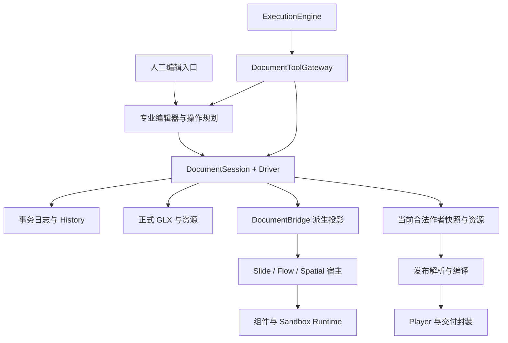

# 果铃工作台全系统架构审计与复杂度收敛方案

**研究日期：2026-10-24（Asia/Shanghai）**
**对象：D:\果铃工作台，原审计时点工作树；HEAD 2376311b3372cb0ebc4ad2915e463d8a753def71。**
**原研究性质：只读研究与设计。未实施产品源码重构，未改正式 GLX，未运行本机其他模型 Agent。**

## 结论先行

原架构优化批次已按[§15](IMPLEMENTATION_PLAN.md#architecture-batch-closeout)收口，并提交推送为 `7952cc24`；未选方向仍按原条件暂缓。Claude审查后的本轮实施与当前失败归类见[后续维护结果](../../docs/development-plan/20261024-architecture-review-followup/RESULT.md)。原审计数据及各轮“本次／下一轮／未提交”为历史时点，不回写旧统计；原方案§9—§14保留原位和锚点。Owner本次授权将原有全部未提交成果一并commit并push，发行／Portable／部署仍暂停。

以下架构判断和测量保留原审计时点，修后证据沿各轮结果读取。

果铃不需要再把所有功能塞进一个更大的统一框架。它需要让已经存在的统一边界真正结束协调：**正式内容由一个事务 owner 提交；专业操作由专业模块规划；表面负责各自布局；一个连续动态视觉区域由一个 Runtime 负责；编译结果由一种明确的语义解析与资源闭包生成，再进入不同交付封装。**

当前基础没有整体失效。DocumentSession 的单 writer、CAS、停止屏障、History、保存/冷开边界，以及工具注册、原生子任务隔离等机制有实际价值。源码也不支持“全系统都是循环依赖”或“所有 Store 都是第二份正式状态”的判断。重新实现这些机制会消耗大量时间，并增加回退风险。

真正拖慢开发的是几个反复出现的变化传播点：

1. **专业语义集中回流到大协调器。** 统一工具注册后，专业操作仍大量回到 DocumentToolGateway 的中央规划分支；人工编辑在 App、Workspace、Bridge 和专业 editor 间存在多入口协调。
2. **同一个视觉或交互结果由多个 owner 共同决定。** 特别是 Flow 的浏览器布局、浮层/选区几何与 Source Runtime 的动态变化之间，需要宿主不断测量、同步和重新解释。
3. **作者事实、临时编辑草稿、运行事实和派生投影需要按语义区分。** 额外表示有些是必要的；历史上运行通知、几何观察和投影刷新曾互相触发。当前应核查重复解释和生命周期交接，不能据此推断存在作者模型第二 writer，也不能按变量名批量删 Store。
4. **修复跨越多条消费者路径，关闭证据常常只覆盖其中一条。** 编辑、预览、Published、单 HTML、Web 包和冷开共享部分算法，又保有不同封装/运行分支。遗漏消费者造成的回退不能仅靠继续增加中央适配器吸收。
5. **验证和集成本身有可以直接删除的重复工作。** npm 生命周期重复构建 Player、重复生成组件闭包；类型检查范围有重叠；大提交、多个工作树和构建身份不足，使“修好了”和“测的是哪一版”难以对齐。
6. **现有测试基线存在未裁定红例。** 本轮 99 项针对性测试中 85 项通过、14 项失败。它们集中在执行/回执边界；不能以类型检查通过代替行为验证，也不能直接认定底层保存失效。

建议采用混合路线：**正式格式与事务底座保留；高耦合内部模块做核心重构；强动态内容局部采用更高层的单视觉 owner；构建、发现与验证先做保守收敛。** 不新增正式数据版本，不建立新的万能编辑器、平行工具注册系统或第二套 Agent 循环。

## 1. 研究边界、证据与基线

### 1.1 证据强度

本报告区分四种表述：

- **源码事实**：在本次工作树读取到的实际调用与职责；有路径/位置可复查。
- **本轮复验**：本次执行的原有测试、独立构建/计量探针结果。
- **历史故障证据**：项目最近真实创作、修复、正式 GLX/导出验收记录；不冒充本轮重新演示。
- **架构判断/方案**：由证据导出的建议；没有实施，不预填节省比例。

单次耗时受用户电脑其他活动影响。未经本轮重新打开主窗口的 GUI 行为、所有作品视觉质量、全量测试和正式发行，都不列为已完成验收。对真实 Electron 的 Runtime 状态回声测试使用独立临时 profile，没有干扰用户原会话。

### 1.2 工作现场

| 项目 | 研究起点 |
|---|---|
| 分支 / 提交 | main；2376311b3372cb0ebc4ad2915e463d8a753def71，领先 origin/main 5 个提交 |
| 已跟踪修改 | 51 个 dirty 文件，集中包含正在进行的统一选择/编辑成果 |
| 未跟踪 | 18 个条目，目录条目不等于单文件数 |
| 任务板 | 5 张 queued，无 active；这不代表电脑没有其他工作 |
| 工作树 | 29 份登记工作树；28 份 detached，分布于 5 个较旧提交 |
| 正式合同 | Project 11 / Published 4 / Component API 5 |
| 本轮写入 | 专用研究目录 output/architecture-audit-20261024；独立脚本、测量输出、报告 |

未切分支、未清理工作树、未改任务板、未覆盖 dirty、未提交或发布。旧 worktree 与旧 build-info 只是需要核对的版本证据，不能直接判定为正在运行的旧软件。

读取入口包括根 AGENTS.md、CURRENT_STATUS.md、ARCHITECTURE_CONTRACT.md、近期统一组件/编辑与 Flow 结果、10月20日真实创作执行收口、10月23日审计/编辑修复、10月24日资源 Runtime 修复及 v08 Runtime-first 作品。判断以当前源码和实际复验为主，没有把旧设计目标直接当成结论。

### 1.3 证据附件

- [开发成本与依赖](DEVELOPMENT_COST.md)：统计口径、构建/类型检查测时、工具投影、版本与工作树。
- [Agent 与 Harness](AGENT_HARNESS.md)：执行路径、专业规划、权限/回执与可拆分工作包。
- [文档与组件](DOCUMENT_COMPONENTS.md)：A/B 深入审查。
- [表面与 Runtime](SURFACES_RUNTIME.md)：C/D 深入审查和交互故障链。
- [编译与交付](COMPILE_DELIVERY.md)：E 深入审查和实际产物分解。
- [真实故障链](BUG_CHAINS.md)：至少五条完整链路与原因分类。
- [实施路线与验收](IMPLEMENTATION_PLAN.md)：模块动作、依赖、退出旧路径与质量门槛。
- [验证与未决项](VALIDATION.md)：本轮通过/失败、诊断依据及未复验范围。
- scripts 与 JSON：可以复现的分析脚本和原始指标。

## 2. 当前实际架构：统一边界存在，内部决策仍分散

下图表达职责和真实方向，不是目录分层的理想化复述。专业 planner 不是新的模块要求，而是现有内容/布局/操作规则的集合。

人工入口并不需要模拟模型工具调用。GUI 和 AI 应共享目标语义、专业规划和最终提交规则；Agent 的授权、能力广告、句柄与模型回执是专用适配，不应成为所有人工操作的必经层。

### 2.1 四条完整业务链

| 路径 | 当前关键链路 | 真正应保持的统一点 |
|---|---|---|
| 人工编辑 | 选区/专业 editor → Workspace/App 入口 → Bridge/operation planning → Session.execute → Driver → History/快照 → 投影回界面 | 同一正式目标、同一领域规则、一次事务与 Undo |
| AI 修改 | Engine → 注册工具/Gateway → 目标与授权捕获 → 当前基线/专业 planning batch → Session 最终 CAS/lease 检查 → 内部 receipt → 公开回执 | 明确文档/版本/目标；未知结果可查证；不能绕过停止屏障 |
| 保存与冷开 | Session 当前已提交模型/资源 → 保存队列/Driver 编码 → GLX → 打开边界迁移/验证 → 新 Session → 重新派生界面与运行模型 | 作者事实与资源闭包；视图和 Runtime 临时状态不偷偷混入 |
| 预览与交付 | 正式作者模型 → Published/编译语义解析 → 资源闭包/内容运行入口 → 编辑器试运行、Published Player 或 compiled Player → HTML/Web 封装 | 相同内容语义与依赖事实；输出封装可以不同 |

源码定位：DocumentSession.ts:72 起；CourseV10DocumentBridge.ts:203 起；DocumentToolGateway.ts:2518 起；ExecutionEngine.ts:2265、3068 起。更具体的编译、表面与 Runtime 路径见专项附件。

### 2.2 状态所有权必须按语义划分

| 事实/状态 | 唯一权威来源 | 允许的副本或投影 | 禁止的职责漂移 |
|---|---|---|---|
| 正式对象身份、内容、布局意图、组件实例/定义引用 | Project 模型，经 DocumentSession/Driver 提交 | 只读快照、按目标索引、导出解析结果 | Store/Runtime 直接变成第二个正式 writer |
| 正式资源身份与字节 | 工程资源系统和存储边界 | URL、解码对象、字体句柄、运行引用 | data URL / Blob URL 被误当稳定资源身份 |
| 正在输入的文本/组合态 | 专业 editor 的短期草稿 | Bridge 对草稿的展示投影 | 每个按键都回写所有模型，或异步 ACK 覆盖新目标 |
| 选中、焦点、视口、相机、深入编辑路径 | 编辑会话与表面交互 owner | 其他界面订阅的只读描述 | 写入作者模型以实现临时选择；多套选区互相回写 |
| 时间、动画、程序内部状态 | 对应 Runtime 实例 | 宿主可观察的状态/事件 | 宿主和程序逐帧同时改同一属性 |
| 实际 DOM 几何与测量结果 | 当前表面/Runtime 的布局计算 | 带来源、空间、版本的观察快照 | 把测量值无条件写回布局意图，形成反馈环 |
| History、提交结果、保存 revision | DocumentSession 与持久操作记录 | UI/Agent 紧凑公开回执 | 由每个专业编辑器独立构造正式历史 |
| 模型运行、权限、未知副作用 | Engine/Gateway 现有任务与调用生命周期 | UI 事件、上下文投影、原始来源分页 | 模型自行猜测效果，或新调用 ID 重试未知副作用 |
| Published/编译产物 | 指定正式 revision 与编译输入的派生物 | 缓存与不同交付包装 | 成为可独立回写工程的第二份作者模型 |

**同一事实只有一个 owner，不等于只能有一种数据表示。** 例如编辑草稿与已提交运行投影、内部完整 receipt 与公开紧凑 receipt、文档与用户会话状态，分别服务不同语义，不能为了“去重”合并成一个全局 Store。

### 2.3 设计宣称与代码事实的差别

| 宣称/目标 | 实际看到的进展 | 仍需收敛的部分 |
|---|---|---|
| 唯一正式写入 | Session、CAS、History 已是真实底座，并有本轮通过用例 | 上游规划与目标理解仍分散；不能把上游复杂度归咎于 Session |
| 统一工具能力 | Registration 已同源包含 parser/support/effect/targets/handler | canonical handler 多次回流 Gateway 巨型专业规划 |
| 统一组件 | 实例身份与通用能力有共同合同 | 原生、专业、程序内容需要不同运行成本；“统一”不应等于全部进 Sandbox |
| 统一编辑 | 目标/入口已有集中工作，迟到 ACK 也已有测试 | 专业 editor、选择模式与各表面几何之间仍有协调热点 |
| 通用 Runtime/Player | 实际可支撑多种内容与离线输出 | 编辑路径和 compiled/Published 路径的能力闭包、资源包装仍不同 |
| 按需能力发现 | profile/family、advertised cache 已实现 | general 默认投影仍宽；低频维护能力可继续用现有机制延后加载 |
| 快速启动/复用 | 已有 source-launch 指纹缓存 | npm prehook 与输入分组仍造成重复或过宽失效 |

## 3. 根因排序：优先改变变化传播方式

### 第一层：专业规则与边界管理混在同一 owner

Gateway 同时管理权限、句柄、生命周期、批量事务和大量专业内容规则；Engine 同时管理模型循环、作用查证、工具轮与部分具体能力处理。Workspace/App 同时连界面和决定操作语义。这些模块成为“任何变化都可能需要来这里改”的位置。

证据不是单纯行数：Gateway 3,378 行、65 个本地依赖、10月以来 29 次相关第一父链修改；其中 applyCanonicalMutations 约 696 行。Engine 3,467 行、57 个依赖，execute 约 485 行。FlowWorkspace 64 个本地依赖、21 次相关修改。应移走的是专业决策，而非只把代码搬到 helper 后传递同一个巨大上下文。

### 第二层：所有权不够局部，变化必须通过同步吸收

一个编辑或动态内容变化同时涉及 DOM 布局、宿主选择、Runtime 内部几何和正式模型时，分散的消费者可能迫使其他层重新解释结果。Flow 更容易暴露这一问题，因为它的正常布局变化本来就由浏览器决定。已确认的历史问题是运行状态、导航通知和几何观察之间的反馈；当前layoutPort保持派生DOM布局，不能将这个历史反馈解释为作者数据每帧回写。

单视觉 owner 的价值在于直接删除这类协调：耦合紧密的时间线、图层与转场在一个 Runtime 内完成，宿主只处理外部边界。它不是“所有作品都写成程序”的要求；独立编辑、重排、复用的内容仍应作为独立作者对象。

### 第三层：验证单位与变化单位不匹配

一项内容语义有多个消费者，但修复常按文件或当前可见窗口验收；另一些纯逻辑改动却触发完整 Player 构建。结果是该验证的消费者没覆盖，不必重复的生成/构建反复执行。重构需要围绕语义用例建立最小而完整的消费者验证集合，不能一律全仓重跑或一律只跑当前测试。

### 第四层：集成与反馈链放大前三层

大批集成提交、多版本工作树、源码/生成物/运行产物身份不够精确，会延长定位和返工。它们不是每个故障的根源，却使“实现已修复、实际运行仍错”“旧夹具继续报红、团队开始忽略红例”变得更难排查。

本轮确认的现象应分别处理：架构职责错误需要重划 owner；实现遗漏需要修正确认消费者；测试/版本漂移需要修复证据链。三者不能互相替代。

## 4. 六大系统的独立裁决

### A. 文档模型、状态与持久化

**结论：保留事务底座，收敛投影和准备工作，不重写Session。**

DocumentSession.ts:318–455 的正式路径先串行检查、规划与持久append，成功后accept；它不是一个多writer Store。Session.ts:247–258 已有基于effect的增量通知和惰性snapshot，不能再提“给每次事件加增量通知”作为新架构。显式read仍会克隆快照，应测调用者是否过多读取完整内容，而非删除必要的不可变隔离。

Bridge中的project、editingProject、runtimeProject语义不同：未确认作者草稿、表面展示状态、排除冲突草稿的运行输入。真正的改进点是publish扫描所有已打开projection、重建views等粗粒度工作，和上游对同一正式内容的重复准备；优先使用doc/revision/selection粒度订阅与已存在的effect。

资源、History、运行态不宜塞进一个全局可变Store。保存应继续只采用正式作者模型及资源闭包；运行中的播放位置/实验进度是否持久化，应由明确产品合同决定。Source文件投影还需要保护“未读取的人改不能被候选自动认领”；不能为了省转换直接拿最新revision覆盖旧观察基线。

### B. 统一组件与内容表达

**结论：统一身份、关系、编辑能力和生命周期合同；保持专业内容及运行实现差异。**

Project中source文本与workspace互斥、childIds单树owner、表面从容器派生，这些抽象确实减少事实来源，应保留。简单原生内容不必承担完整Source沙箱；现有编译路径已经按静态内容、动态builtin、Source/web程序分开处理，不能宣称“一切都走同样Runtime”。

组件的共同核心可继续是instance/definition；再统一“有哪些稳定可编辑能力”，而不是包装成万能组件内容树。文字、图片、表格、图表保留专业数据与编辑器；Source保留声明参数、作者记录、内容字段及源文件编辑。程序内部可见DOM不自动等于可持久定位的作者对象。

现有“统一”尚未充分降低的部分，是内容语义在工具、文件投影、编辑器和发布消费者中重复解释。把专业操作交给一个专业planner，GUI/AI共享规则，比再增加一层组件适配器更有效。高动态耦合内容允许由单Runtime管理，不能以“文字能原生化”为理由拆散视觉owner。

### C. 三表面、布局与编辑

**结论：统一目标、操作和几何语义；不统一布局算法。**

全局viewport案例已经证明，一份几何政策被绘制、逆投影和拖拽三次解释会造成连锁回退。当前共享解析修复应保留，并用相同原则检查其他几何消费者。Slide自由frame、Flow阅读流和Spatial世界/相机有合理差异。

Flow的问题容易影响其他编辑能力，不只是因为它“复杂”：FlowWorkspace把ProseMirror NodeView、React、运行投影和选择输入连在一起，专业内容又通过共同入口进入Slide/Spatial。修改一个外层pointer策略或挂接清理顺序，就会碰到PM文字输入、其他表面的选择装饰和异步编辑完成。

最有价值的结构改动是：在当前统一目标入口裁决目标/层级/意图；由专业内容处理输入；将投影挂接释放归现有World。避免靠一系列组件局部布尔值猜测当前是在选择、移动、深入编辑还是等待回执。

### D. Runtime、Player与宿主

**结论：保留隔离与作用域，减少双重视觉控制和生命周期交接。**

World负责实例、作用域、状态订阅、导航能力与投影；Sandbox负责跨realm协议与隔离。两层不天然重复。World的parking、expected-root，Sandbox的generation/writeId ACK，都在防止真实的旧回调、旧回声和iframe重挂问题，不能直接删除。

已经修正的state→navigation→layout广播环暴露了结构性风险：任意运行状态变化不应默认表示导航或所有几何都变了。依赖必须跟实际消费者一致；已有guard精确依赖是正确方向。

Sandbox将运行、测量、作者发现/输入等工厂一起拼入realm引导，存在按职责拆分的候选。但需先量化真实初始化与字节开销。播放仍可能需要持久文字override、资源和clip；不能按authoring字样删除。更高价值的上层调整是将必须共用时间、几何与显隐的动态区域归一个视觉owner，从源头减少状态和坐标桥接。

### E. 预览、编译、资源与交付

**结论：统一内容解释与资源闭包；输出包装保留必要差别。**

当前实际链有Published模型、compiled artifact及运行组件实例；GLX归档是独立作者存储路径。compileCoursePlayback.ts已经按key共享动态builtin、按signature去重静态与web，并在compiled web路径清理原文。compiledPlayer真实消费初始html、staticViews和course/World。因此不能因为三种表示内容交叠就删掉其中一种。

应处理的是重复解释和无用闭包：两个纯helper曾经绕完整Player导入而带入约457KB死依赖，属于确定错误；已经修复，不列为待再次删除任务。Source override逐presentation编译尚有复用候选，需用精确输入键和样本测量；不可跨资源环境盲缓存。

资源去重必须分开内容身份、逻辑资产身份和传输表示。在现有URL→ID反查合同下，共享Blob不能让两个逻辑ID共用同一个承担身份反查的URL；图片“能显示”不保证当前realm能读Canvas像素；HTTP地址也不保证opaque iframe字体能加载。将这些能力判断收回资源消费边界，比各输出路径遇错后再补Base64更可靠。

### F. Agent、Harness、工具与执行

**结论：已有唯一执行循环和正式写入边界值得保留；移走中央协调器中的专业规则。**

ToolRegistration已经同源持有参数解析、supports、effect、targets和handler；NativeTaskRunner已经复用Engine，子任务候选由父级采用；按需family/profile及目录缓存也已存在。不能另起同类平台。

Gateway真正过重的地方是canonical mutation专业规划；Engine则混入具体能力preflight和上下文事实拼装。目标是以已有注册和Projection/PayloadCompiler为落点，让Engine只管理任务与调用生命周期，让Gateway只管理正式文档边界。

AI不应为改一段正文理解GLX归档、SurfaceHost生命周期、编译格式和全部内部文件映射。软件应提供准确目标、专业命令、可查证回执和按需读源入口。内置Skill只描述软件能力；创作方法/模板/素材作为外部资产进入候选，不改变正式writer和离线依赖闭合规则。

## 5. Runtime-first咖啡：一个更高层的统一确实能删除协调

### 5.1 不是只读了三章PoC

本轮同时核对三章PoC说明、七章正式装配的协调/控件说明，以及最终文件、交互、保存冷开、运动性能JSON。

- 三章PoC只有七份图片、约827KB单HTML，报告明确尚未GLX集成，不能与七章正式作品直接比较。
- 七章最终r263：76个实例、47个原生文字节点、7个章节锚点、3个Source owner、14份图像资源；不是整篇文章被塞进单一黑盒。
- 场景程序负责连续动态视觉；实验控件只写少量语义state；导航有独立适配；静态图文保留原生表达。
- 正式编辑保存记录：revision254→257，文字、图片和颜色参数修改；新profile冷开revision257三项均保留、dirty=false、无缺资源。34,659ms是该历史记录的coldOpen字段，不是本轮重新测得的启动基准。
- 最终r263交付运动记录：1440/390两种宽度32个相位正反向无漂移，空闲额外绘制为0；桌面最大帧间隔83.4ms，仍不能称稳定60FPS。
- 本轮重新计算最终GLX和r263/offline HTML的字节与SHA256，与FINAL_FILE_AUDIT记录吻合。offline别名与r263逐字节相同。

证据：evidence中的FINAL_FILE_AUDIT、NATIVE_EDIT_SAVE_RESULTS、NATIVE_COLD_EDIT_RESULTS、NATIVE_MOTION_PERFORMANCE、NATIVE_INTERACTION_RESULTS；本轮文件测量见runtime-first-artifacts.json。上述行为结果是历史真实验收复核，不冒充本轮再次完整打开GLX验收。

### 5.2 为什么单视觉owner有效

原路线需要多个主体不断协商原生图片位置、视觉槽位、对象显隐和滚动进度。每个局部测量都可能正确，但不同时间的结果拼成同一画面就会错。

Runtime-first把杯子、果实、遮挡与材质等强耦合动态图层放到同一场景时间线内。宿主提供边界、进度与资源，控件提供实验语义；场景自己计算当帧画面。减少的是“为了控制同一视觉结果而跨对象同步”的机制，而非用一个大源码文件替换多个文件。

可以推广的原则是：**需要共同时间与坐标才能正确的内容，应优先拥有共同视觉owner。** 需要独立重排、独立复用、独立人工编辑的内容则保留独立作者对象。将这两个判断放进组件能力和编辑入口，比一律原生化或一律程序化更简单。

### 5.3 1.90MB与5.13MB的真实拆账

本轮只读解析实际文件，单位均为十进制字节：

| 文件 | 原始字节 | gzip level 6 |
|---|---:|---:|
| 独立七章standalone-offline.html | 1,900,686 | 1,415,059 |
| 正式r263/offline HTML | 5,127,907 | 2,999,760 |
| 正式GLX（本身为压缩包） | 1,432,248 | 1,430,821 |

正式HTML可加和物理区段：

| 区段 | 字节 |
|---|---:|
| course-data脚本区段 | 2,380,116 |
| 字体style区段 | 1,585,533 |
| compiled runtime脚本区段 | 1,153,408 |
| 基础style | 276 |
| 诊断脚本 | 1,333 |
| mount脚本 | 2,095 |
| 其余HTML/标签 | 5,146 |
| 合计 | **5,127,907** |

两份HTML差额3,227,221B，其中字体+compiled runtime为2,738,941B，占差额**84.87%**；其余净增量488,280B仍包括正式模型、预生成DOM、更新模板、源码载体和包装差异，不能全部称冗余。

内容哈希进一步证明：

- 14张图片逐字节完全相同，共1,395,694B，没有图片集合膨胀。
- 正式HTML另含20份woff2字体，1,167,252B原字节；5份application/json载体共88,365B。
- 39个字面Base64内容均唯一；没有发现同内容在字面carrier中重复。
- 独立HTML扣除图片Base64后剩39,742B；专用场景以很少非图片内容运行，是有价值的上层简化证据，但不等于正式通用运行能力都可以删掉。
- 本样本builtinFactories为空，nativeSources为3条，staticViews为70条；旧v08约0.52MB image factory不能移用到这次差额。

结论不是“5.13MB正常所以不用改”，而是：**先按实际能力证明哪里能排除，再删除闭包；不要把字体、隔离、导航、编辑参数和通用模型支持的成本混称一个Bug。** 本轮未证明20份字体可进一步安全裁减，也未测新的压缩bootstrap收益，故不主张先增加压缩/共享依赖平台。

## 6. 十二条真实故障链与原因分类

完整追踪见[BUG_CHAINS.md](BUG_CHAINS.md)。下表用于把后续重构与真实问题连接：

| 案例 | 暴露的关键问题 | 主要原因分类 | 结构性启示 |
|---|---|---|---|
| 全局viewport三次解释 | 交互overlay扣insets，绘制/逆投影/拖拽不同尺度 | 架构职责 + 实现 | 同域几何政策一个owner，布局算法仍专业 |
| Flow双击、Slide叠框 | 外层pointer capture抢PM输入，旧装饰消费者未退出 | 实现/迁移遗漏 | 统一意图不能代替真实DOM消费者验证 |
| Runtime state广播环 | 任意state变化触发导航与Flow测量，再写state | 架构依赖 + 算法 | 精确依赖和通知，避免全局changed传播 |
| 跨时间几何拼接 | viewport/layout/state不同步，容器target漏接 | 架构时间语义 + 消费者遗漏 | 同批measure；强耦合动态域共owner |
| HTML恢复被Main拒绝 | 局部组件测试通过，宿主guard仅接受course | 实现/验证缺口 | 修复需覆盖真正跨进程入口 |
| 原稿/IME/ACK混同 | 保留草稿被当作仍活跃输入 | 状态语义设计 + 实现 | 拆清内容保留与输入占用，不新增万能布尔 |
| 异步完成抢回前台 | 已完成被等同仍拥有当前选区/界面 | 生命周期归属 + 实现 | 回执有效和界面控制资格分别校验 |
| 去重合并逻辑ID | 同内容URL反查只剩第一个资产身份 | 优化候选实现/边界设计 | 内容共享、身份独立 |
| 字体HTTP外置回退 | opaque origin=null无法按原路径加载字体 | 优化候选消费者遗漏 | 资源适配按realm能力 |
| 图片显示但Canvas taint | “能显示URL”被等同“可读取像素” | 优化候选能力判断遗漏 | 显式portable bytes按需准备 |
| pure helper导入完整Player | 无用KaTeX/Babel进入compiled闭包 | 依赖归属错误 | 纯语义模块中性归属，真实metafile证据 |
| range误判自由文本 | 正则使整套101字体分片进入输出 | 实现缺陷 | 复用已有scanner；不为误判新建字体平台 |

这些大多已经修复。本报告并不把它们重新列成当前未修Bug；其价值在于识别反复发生的变化传播形式。资源ID/CORS/Canvas三例尤其是优化候选暴露的回退，不能冒充原正式作品长期已有故障。

另有10月20日的真实案例：约23.25MB有效资源被快照边界放大为约1.237GB独立buffer，回执过大超过模型窗口，以及协作通知取消未发起工具。这些表明传递范围和调用生命周期的重要性，但不构成Project格式需推倒重来的证据。

## 7. 开发为什么慢：测量能支持到哪里

| 项目 | 本轮事实 | 应作出的判断 |
|---|---|---|
| 源码规模 | 1,681文件、309,788物理行 | 用于定位热点，不作为删代码目标 |
| 声明值依赖环 | 3组；含类型共26组 | 少数明确断点，非全系统循环失控 |
| 主类型检查 | 31.30秒；Check19.496秒；约4.12百万K内存 | 查重叠与类型热点，不能只减少解析文件 |
| 三套noEmit | 顺序51.86秒，均通过 | 重复范围值得收敛；不直接删除验证 |
| Player / Renderer / Electron | 13.72 / 12.82 / 15.86秒，隔离输出 | 是成本探针，非全新正式发行验收 |
| compiled Player | 1,153,391B；内存build0.419秒 | 通用闭包仍有成本；不要误拿普通4.87MB Player套单HTML |
| 默认组件生成 | 3.270秒；20逻辑定义/19入口；与现有产物零差异 | 当前生成物未发现过期；去掉重复计算更直接 |
| 工具目录 | 84目录项、101总注册项，无重名 | 数量本身不是重复实现的充分证据 |
| general能力投影 | 合成全写GLX为43工具、66,060B定义 | 现有渐进发现有效但仍可收窄；字节≠token |
| 针对性测试 | 99项：85过、14失败，95.74秒 | 行为基线需要分项裁定，不可由typecheck代替 |
| Git与运行身份 | 51dirty、29worktrees；大批集成提交 | 需明确所测版本，不能将每个大提交当单功能修改半径 |

npm流程已确定存在Player重复构建、组件源码生成重复计算。现有start:quick已经有缓存，优先细化它而非新造缓存平台。普通功能平均涉及多少文件、模型思考占比、返工占比、纯启动/HMR成本，本轮没有完整事件数据；给出可重复测量方案，不编造数字。

尤其不能把历史创作1:54:19与准备充分的26:49直接算作“模型慢了几倍”。前者混入修复、构建、等待和续作，必须分项记账。

## 8. 目标架构与路线选择

详见[IMPLEMENTATION_PLAN.md](IMPLEMENTATION_PLAN.md)。最核心的新旧差异不是新增架构层，而是下列决策只保留一个责任主体：

| 当前高成本方式 | 目标方式 |
|---|---|
| 工具注册统一，专业规划仍回中央Gateway | 专业planner共用，Gateway保持固定授权/提交流程 |
| Workspace需要知道PM/React/Runtime清理顺序 | World收回运行根挂接/parking/释放资格；PM/React保留自身视图树、宿主恢复和输入 |
| 多消费者重新解释目标/几何/资源能力 | owner输出语义结果，消费者只适配专业呈现 |
| 宿主和多个程序协调同一动态图层 | 一个动态域的视觉owner；少量语义输入 |
| 每个构建入口触发自己的前置生成 | 一个任务图按输入只执行一次必要节点 |
| 新旧机制并行“以后清理” | 按用例迁移，一次选一路，同批删除旧责任分支 |

三路线比较：

- **保守收敛**：风险最低，构建、依赖、默认工具暴露与已知重复准备可立即收益；不足以解决Gateway/Flow生命周期的长期修改面。
- **核心模块重构**：在保持正式数据和外部合同前提下，重分专业规划、挂接、投影与执行职责；这是推荐主体。
- **更高层职责调整**：Runtime-first和统一编译事实可删除整段低层协调；适合局部试点，不宜全仓强推一种内容或运行模型。

不建议先做Project12、CRDT、微服务、万能SurfaceEditor、独立轻Player平台或另一个Agent引擎。当前证据不足以证明这些能降低主要成本。

## 9. 优先落地顺序与停止条件

本节随2026-10-24方案评估更新为摘要；逐包进入条件、直接消费者、验收和停止条件只在[实施方案§5](IMPLEMENTATION_PLAN.md#work-packages-and-acceptance)维护。

1. **P0随包准备。** 只裁定本包相关红例，复用现有构建信息、启动指纹和有效证据；不要求14项全部清零，不增加每任务全仓Hash门。
2. **首轮默认P1-A → P1-B → P2-A → P3。** 先删重复构建/生成和两组纯helper环，再沿现有`prepareCourseElementEdits`贯通`object.insert`，删除对应中央专业决定。随后收敛Flow运行根挂接；P3只依赖挂接身份/有效期明确，不等待全部P2迁移。共享FlowWorkspace接线顺序采用。
3. **后续逐切片选择。** Bridge通知/Source观察/Engine专业事实/工具发现分别作为P2-B～E；增量类型检查为P1-C。编译复用、资源消费、无用依赖和重复实现选择分别作为P5-A～D，直接证据或小测量成立后才改产品，不扩成整条交付链重写。
4. **P4是条件性试点。** 先定位实际可删除的跨对象视觉协调，再决定是否试点；没有可删机制就不新建样例或重做作品，不阻塞其他包。
5. **P6随每包收口。** 明确唯一owner、删除的旧决定/节点、受影响消费者与该包收益。普通包不附加完整任务/模型对照；需要宣称整体提速时再使用自然发生的可比任务样本。

迁移用例一次只走一条实现，不双写作者状态；候选采用时退出该用例旧职责。失败只撤回明确的软件候选，保全用户工程、恢复稿、原件与其他dirty成果。没有减少实际协调/等待的抽象停止推广。上述均为后续实施设计，本次方案修订不启动任务或改变发行边界。

## 10. 验证结论与边界

本轮完成源码/依赖/Git统计、三套类型检查、隔离构建、compiled metafile/组件生成比对、七文件针对性测试、真实独立Electron状态回声测试、四类Engine红例诊断，以及真实Runtime-first文件的尺寸/内容哈希分析。

保留的已通过基础：DocumentSession18项、componentPlatformSession4项、Flow迟到ACK3项、资源归档6项、Sandbox真实Electron回声1项。14个原红例集中在公开回执和Engine；已经发现部分是明确夹具形状/过滤条件变化，其他仍应按合同裁定，详见[VALIDATION.md](VALIDATION.md)。原测试文件与断言没有为通过而修改。

未进行正式重构、未修改产品源码、未改作品；未调用付费模型或本机其他模型Agent。未重新验收所有旧作品、完整Electron交互、物理IME或全量测试。已有作品的运行记录作为历史证据明确标注。

本轮最重要的交付是可执行的职责调整顺序，不是宣称已经实现提速。最终核对1,681个源码文件的SHA256与长度全部相同，没有新增或缺失源码，HEAD与Git状态均与起点一致；详见[source-integrity-after.json](source-integrity-after.json)。

## 11. 成熟机制的针对性参考

- **ProseMirror事务入口**：专业编辑器维护自己的输入与文档事务，通过明确dispatch更新宿主；适用于保留PM专业输入、收敛外层命令归属，不是替换果铃正式Project。参考：https://github.com/ProseMirror/website/blob/master/markdown/guide/view.md
- **tldraw文档/会话区分**：文档内容与相机、选择等会话事实分开持久化。对应果铃作者事实/视图状态边界；不建议迁移产品到tldraw。参考：https://tldraw.dev/docs/persistence
- **TypeScript项目引用/增量**：按稳定依赖边界组织构建，solution配置避免重复包含叶子输入；先验证本仓具体收益，不拆成大量包。参考：https://www.typescriptlang.org/docs/handbook/project-references.html
- **esbuild metafile**：输入、输出字节与依赖链可直接定位错误闭包；本轮已经实际使用，不需要新打包分析平台。参考：https://esbuild.github.io/api/#metafile
- **浏览器原生机制**：Flow正常文档流、CSS sticky、专业编辑器事务和既有observer能承担的责任，优先交还这些确定性机制。现有全局几何修复就是在减少自建滚动协调，而非引入新技术栈。

这些参考只说明机制如何对应已发现问题，不构成采用新库的理由。
