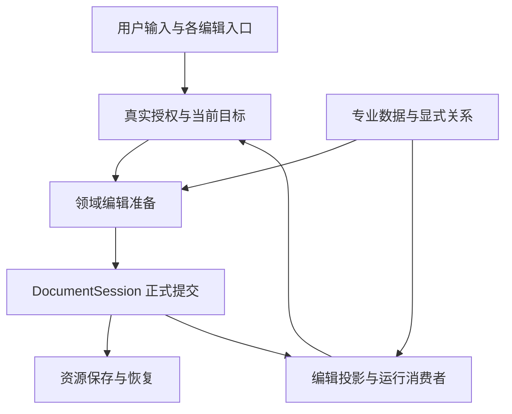

# 果铃架构收敛与系统修复方案

> **本轮执行结果（2026-10-19）：** Owner后续开发指令已执行，本方案明确的软件余项及直接消费者验证已完成，包括§15、首写区域接续、导航/动效、子任务用户控制，以及原§4.6/§5.3的队列与Source分析复用。最终类型、必要开发构建、分发及独审通过，详见[授权执行与增量验证](果铃架构收敛实施与实测记录-2026-10-19.md#根方案授权执行与增量验证2026-10-19)。以下原修订快照、研究时“待实施”表述和历史失败保留为依据，不再表示今天这些代码仍未开发；条件性模型/性能收益、Owner接受和发行边界继续按实证区分。

> **修订决定（Owner 2026-10-19）：保留现有正式文档底座，接续未完成开发；把目标区域、子任务成果、正式装配、源码修改和保存交付作为同一条用户链路收敛。模型拥有最高作者操作能力，软件承担机械职责，工具接口必须使这些能力真实可达。**
>
> 本方案保留原审计 R01–R09、P1–P5、G1–G6、H1–H3、N01–N10 的完整目标，现吸收10月19日实施与两轮真实创作评估。部分实现和相关检查已成立，整份方案及完整创作尚未完成；当前事实与剩余见 §1.4，后续从余项接续，不从原始清单重跑。

> **执行接续：** 上段及§1.4为修订启动时快照。后续已实现基础能力并完成修后代表作品，实际耗时及证据见[实施与实测记录](果铃架构收敛实施与实测记录-2026-10-19.md#原作者续改最终冷开与本轮收口)。用户复核后确认首写区域贯通、回执负担、普通导航转场/指针及子运行用户可控性仍有缺口，前次“剩余开发完成”口径已收窄，见[收口更正](果铃架构收敛实施与实测记录-2026-10-19.md#用户复核后的收口更正2026-10-19)。保留原目标及条件性性能收益、Owner接受和发行边界。
>
> 正式工作区为 `main`，HEAD `bdb9e1dc2384b1452052d43a49033619e62c15fa`，包含 HEAD 之后的既有未提交成果。10月18日的文件指纹只标识原方案基线，不代表10月19日开发后的源码。此次仅修订本方案，不改代码、Skill、配置、原作品或恢复数据，不启动新创作、构建、提交或发行；实施仍需后续开发指令。

各领域章节保留完整目标与必须退出的旧职责；不表示其中所有路径仍未实施。是否接续以 §1.4 的当前事实、实际源码及受影响证据为准。

## 一、总体决定：用领域收敛完成修复

### 1.1 本轮应达成的产品结果

用户从主聊天、元素卡、Source、外部客户端或人工编辑入口操作同一份作品时，应得到一致的目标、权限、正式修改、撤销、保存及运行结果。一个对象换成 Source 实现后，保留它仍然具备的专业创作能力；它实际执行的程序，也应被播放和观察正确识别。较长任务能够停止、继续、回读成果，已经完成的工具证据不持续挤占工作上下文。

创作的结果还须在实际承载中成立：内容进入模型选定的整页或局部范围，独立标题、说明、导航及人工布局得到保留；操作、主体变化和必要反馈在所选呈现方式下可用。模型发现问题后能沿同一对象改源码、改正式位置并完成保存，而不是停在候选、遮挡页面或反复读取接口。合理整体程序可以占满一页，不能仅凭 Web 数量判错；未经设计的满页覆盖、必需操作或反馈被挤出画面才是本轮必须解决的结果错误。

Owner 本次再次明确模型应拥有最高权限。常规已授权作者操作默认开放，不能因宿主偏好、Skill 未加载、工具未披露、输入形式或高层接口缺口轻易拒绝；必须提供具体诊断和真实可用的源码级、文件级兜底。用户明确限制、真实错写冲突、当前确实不能生效及未知副作用按事实处理，不能扩成额外防御门。落实方式见 §3.5–3.6。

“最优”按四个目标共同判断：核心能力正确且可持续编辑；同一事实只有一个实际决定者；操作、读盘、解析与模型往返减少；迁移范围能够分段交付。当前证据支持有边界的职责收敛，尚不支持另建文档系统、重写全部播放器或以更多智能体替代软件接线。

### 1.2 保留与调整的边界

| 架构资产 | 保留的责任 | 本方案调整什么 |
|---|---|---|
| Project V10、Published V3、Component API 5 | 正式作者模型、运行投影及组件接口 | 修正实际消费者的语义分叉；个别内部合同随直接消费者一起修改 |
| DocumentSession、Registry、Driver、Journal | 唯一正式 writer、身份、History、幂等回执、保存与冲突保护 | 接入一致的操作上下文、当前稿资源捕获和输入恢复生命周期 |
| Gateway、Catalog、现有宿主服务 | 正式操作准入、能力发现和服务接线 | 分清授权、焦点、披露及实际服务条件；删除外部打开稿专用提交分支 |
| 组件专业算法、Source 分析、互动和课程逻辑函数 | 解释明确的专业数据与引用 | 同一领域提供共同事实，复制、删除、诊断保留各自策略 |
| World、Host、Sandbox、Navigation | 共享运行值、实例生命周期、执行能力及导航 | 明确值所有权、消费实际准备回执、保留按需加载 |
| ExecutionEngine、RunStore、Projection、JobService | 任务循环、原始记录、上下文投影及作业 | 完整轮次归档、从准备起可取消、输入和成果直接接续 |

调整优先落在现有模块中的纯函数、窄端口和直接调用链。只有现有类混合了确实独立的持久化或编排责任时才拆出模块，例如 Host 中的原始输入恢复逻辑。拆分后旧实现必须退出，组合根只负责接线。

### 1.3 如何判断一个修复是否完成了架构收敛

一个交付切片必须同时具备以下结果：

1. 真实入口生产同一业务事实，例如当前授权或实际 Source 执行能力。
2. 修改、读取及结果消费者都接到这一事实，不能只有新 helper 被一个入口使用。
3. 旧的重复判断、旁路 writer 或日常迁移接力在该范围内删除。
4. 一条能区分新旧实现的用户操作链成立，并保留相关旧保护和已有能力。

类名一致、文件变短、接口更多、测试总数增加，都不能单独代表收敛。阶段可以小，但每阶段要在目标架构上完成一个真实闭环。

### 1.4 10月19日实施事实与未完成范围

以下为此次修订核对的接续基线，不是新的永久台账。实质结果仍记录在既有实施记录和原始回执；本表仅防止重启已修项目或遗漏原方案欠项。

| 切片 | 当前已证事实 | 后续必须接续的范围 |
|---|---|---|
| S1 当前稿保存 | 已有 Session 捕获固定修订、资源准备与准确保存 ACK 的实现和相关检查 | 复用有效证据；作者此次没有完成保存，不等于保存服务已证明回退，也不能拿服务检查代替作品实际保存 |
| S2 原始输入恢复 | **未完成**；Host 仍有路径归属/搬移，Flow 仍有独立恢复 owner，隔离候选未形成可集成实现 | 完成 §4.1–4.3 的稳定归属、不同原文保全、准确采用 ACK、Journal 终态及 Flow/SourceConflict 全部直接消费者 |
| S3 目标与正式修改 | 打开 Source 接入 Gateway 等已有实际修改与相关检查 | 补最高权限的真实能力与兜底、正文源文意图归一化和局部区域输入；其余按原目标保留已验/未验边界，不宣称整片全覆盖 |
| S4 作业与停止 | 已有准备登记、取消接力、HTML/Published 动作停止、原生容量控制等实现和相关运行证据 | 将来源冻结也纳入同一可取消生命周期；复用已验证路径，不因本次作者未完成就重写 JobService |
| S5 组件与运行 | 专业图片读取、守卫、JSON 状态和实际 Web 片段已有部分实现与相关证据 | 仍须收回对象/页面复制的重复关联算法、健康检查 builtin-only 与声明 dependencies 分叉，完成 §5.1–5.3；不能将这些欠项说成此次滚动的成因 |
| S6 上下文与请求 | 完整轮投影、动态事实位置、Anthropic 块及用量/视觉身份已有实际修改 | 复用已有检查；辅助视觉对 unknown 的拒绝与主模型能力解释仍不一致，按 §7.5 修正实际入口；同次 prepare 复用及父子费用去重按 §7.4–7.5 接续核对，真实缓存与性能未测部分保持未证 |
| S7 输入和成果 | Continue 回读、单文件读出/保存已有能力 | 当前 freeze 仍先读盘再看打开稿，V10 退磁盘、附件以64K模型表示代原材料；完成当前稿来源与模型表示分离、成果文件组直接采用及当前目标区域接力 |
| S8 自主子任务 | NativeTaskRunner 已复用 Engine，二测两子任务均 ready，父任务确实读取并装配候选 | 不重做自主工具循环；接通 S7 和 §8 的局部交付、原子采用、定向修订、最终作者交付，不能把候选 ready 当成整作完成 |
| S9 表达与实际结果 | 已有方法与范例；本次真实样本没有证明整体表达和交付达标 | 按 §8 解决整页/局部目标失配、正文修改返工及实际画面；先证明可用、可续改、可保存冷开，再讨论并行收益 |

相关组合检查 `output/architecture-remediation-20261019/resume/combined-after-fixture.json` 为134/134通过；action/native 34项及三承载运行9项与其有重叠，不相加，也不外推到未实施的 S2 或整个创作质量。独立复核只覆盖原记录写明的修改范围。

真实创作首测因重复派工由测试脚本停止，只保留未完框架。修复后二测也已停止：`real-creation-after-lifetime/author-final/freeze-facts.json` 记录949,964ms、38个主请求、110次工具、内存第14版且 dirty，2页10对象；冻结磁盘 GLX 内仍为初建第0版、1空页0对象。两个子任务已经交付并被装配，最新断点不在 job.wait，而在正式画面修整与最终交付。Root 补存、旧子模块浏览器通过、原始日志和冻结 JSON 都不能冒充作者自己完成保存、冷开和局部编辑。

二测的两块实验程序各为1280×720、位于(0,0)，遮住先建的原生页头和导航；装配已报104px/199px纵向溢出和重叠。程序保源符合此次真实输入，不是已证的静态粒度误判。作者观察后试图修改正文 CSS，但 `.content.html + intent:style` 被主题分支拒绝，补丁未生效。原实施记录中的“正在回跑/二测正在执行”已被上述终态取代。证据定位见 E15–E17；不改写旧记录中的历史过程。

## 二、目标结构：哪些事实统一，哪些职责分开

### 2.1 五组共同事实

| 共同事实 | 唯一业务来源 | 必须消费它的入口 | 关键分离 |
|---|---|---|---|
| 本次任务与操作资格 | Main 真实用户输入、批准记录及 Gateway 当前接入 | 内置 Agent、外部 MCP、打开稿 Source、保存和子任务采用 | 授权、焦点、披露、文档 lease、操作身份分别表达 |
| 当前文档及其输入、资源 | Session、当前稿捕获、现有恢复与文件 owner | 编辑、保存、另存、冷恢复、任务材料冻结 | 稳定文档归属与物理路径分开；正式模型与未提交原始输入分开 |
| 专业作者数据与显式关系 | 专业定义、互动、课程逻辑、Source 引用领域函数 | 属性、图片、复制、删除、健康、编译和提炼 | 专业身份不替代实际执行能力；引用事实不替代具体操作策略 |
| 实际运行能力与运行值 | 真实加载回执、Host、World | 导航、内部作者目标、状态订阅、编辑试运行和发布 | pending 不等于没有能力；运行值不进入作者 History |
| 请求、当前工作与封存成果 | RunStore、Projection、JobService、成果 owner | 主循环、辅助请求、Continue、自主子任务及采用 | 原始记录、工作投影、缓存前缀、成果复用与授权各有边界 |

这些不是五个新平台。不同事实沿现有身份关联，由各自领域持有；不能让一个 Gateway、全局图或超级 Manager 再次包揽它们。

### 2.2 一次正式修改的目标链路

Gateway 负责 AI、外部客户端的正式操作准入；人工编辑继续复用已有作者命令与 Session，不强迫人工入口绕进 Agent。文件系统副作用仍归现有文件服务，模型及子任务提交的是意图和候选。相同目标、领域规则、正式事务和保存结果贯穿这些入口。

### 2.3 软件、工具接口与模型的职责

| 层次 | 必须承担的职责 | 不能推给其他层的工作 |
|---|---|---|
| 软件领域 owner | 持有当前模型/资源、目标身份、正式 frame、局部视口及坐标投影；准备来源和候选、测量保真承载、事务/CAS/History、运行、停止、保存及恢复 | 不要求模型维护 ID、版本票据、重复坐标变换、文件登记、资源闭包和并发计数；不把接口不会处理的合法内容判成模型无权修改 |
| 工具及工程文件接口 | 将路径/句柄、整页或局部构图范围、源文修改意图准确解析到同一领域命令；披露实际能力，传递当前几何和来源事实，返回明确应用/保存结果、具体诊断及可执行恢复入口 | 不独立建设布局或权限真相，不按工具名字/Skill/模型输出格式另设门；高层表达不足时必须提供当前源码和文件入口，不能只返回建议 |
| 主模型 | 决定内容主线、整作构图、整页/局部选择、交互因果与编辑边界，选择值得委派的工作；依据实际回执/画面修订并完成所需交付 | 不以两个候选能运行代替正式装配；不让页头形式上原生但实际被覆盖；不把内容取舍和反馈设计交给软件自动猜测 |
| 子模型 | 在父任务选定的范围和宿主给出的当前事实内设计、实现、观察并修订局部成果，报告真正完成与受限之处；需要不同空间或职责时向父任务说明 | 不另造与父作品冲突的整页壳，不把未测试/不可见主动作写成通过；不必复制主线程历史、手工重建宿主身份或重写封存成果 |

模型拥有构图选择权，可以一次表达新区域的位置、大小或普通 HTML/CSS 布局；这属于作者设计。软件负责把该选择解析到实际目标和正式几何，再向后续消费者投影，不能要求模型在每一工具之间反复抄 frame/viewport 或补偿坐标。不存在“必须调用子任务/必须局部程序/必须原生”的固定路线；单模型及完整整页程序仍可正确交付。

## 三、任务操作：从准确目标到合法保存

覆盖 R01–R09、N09、G5 的能力发现侧，以及新成果采用的共同提交边界。依据审计 §5.1、§6、§22.3；代码定位见 E01。

### 3.1 在生产端分清授权、焦点与当前基线

SelectionContextController、元素卡及 ExecutionAssistant 应分别传递用户实际授予的范围和当前焦点。默认选中一个按钮，只决定优先处理哪里；用户明确要求“只能改这个按钮”才形成真正的窄限制。不能在 Gateway 拒绝之后通过一律升级为整文档权限来弥补生产端丢失的信息。

本次操作的宿主内部上下文应收拢已经存在的事实：原始操作身份及请求摘要、真实授权与明确限制、一次性精确批准、当前文档接入 lease、目标 epoch 和必要字段期望。它不增加模型可填的授权票据或新的权限服务。

这些身份各守其用途：`runId` 归任务记录；`documentId + epoch` 归当前文档会话；文档 lease 归此次任务接入；`operationId + requestDigest` 归一次操作及其回执。Stop 后的新操作只能重新取得当前事实和有效接入；旧操作不能借新 lease 复活。已有成功回执仍允许查询，不能因内部 ID 接口调整重放已发生的修改。

### 3.2 打开的 Source 全部接回同一正式操作准入

保持 AgentFileText 已接通 Gateway 的正式打开稿路径，原“工作区外且已精确批准”自行构造 `Session.execute` 的特例不再恢复。确实需要用户批准的模式下，本次批准绑定规范化路径、实际效应和请求摘要，仅供该操作使用；full 已授权的操作不另外造批准门。操作开始时捕获当前文档 lease，后续准备、字段 CAS、History 和停止校验沿正常路径完成。

这项调整同时处理 R03 的入口分叉和 N09 的旧停止身份误拒。一次外部文件批准不会变成永久整文档授权；驻留外部会话也不必为了合法的新批准而丢弃原任务记录。未打开的普通磁盘文件继续由文件服务操作，不把每个磁盘文件强制变成可见文档。

保存当前 Session 的资格与编辑范围分别检查：用户授权交付到某个路径时，局部编辑范围不能被误读为不允许保存；保存本身也不能扩大可修改内容。首次保存、另存、普通保存沿同一真实任务和路径授权接续。

### 3.3 工具注册是事实源，披露只是投影

ToolRegistration 持有唯一 canonical schema、handler、效应、适用目标及真实服务条件。Catalog 从它产生紧凑能力地图和按需详情，区分未授权、不适用、服务未配置与尚未披露。

单工具和 batch 都由 canonical parser 与同一准入函数处理。batch 可以向模型发送较小的参数投影，但执行时不能用“已经披露的名称集合”代替合法性判断；同文档原子性、全批预检和一次 History 继续成立。

`course.configure`、`surface.configure` 等发现漏项在同一能力源修正。`create / design / edit` 是排序和内容选择依据；显式查询某项真实能力时，应返回其实际状态，不能因任务标签把它解释为不存在。源定义和确有产品消费者的生成产物一起更新，完整 schema 不必常驻每次请求。

Catalog 的复用按真正依赖失效：授权形状、服务配置、目标类别和披露变化。普通文字修改不应无差别清空所有目录、drain 所有文档并重建无关 schema。执行仍核对当前目标，不能用缓存结果替代最终准入。

### 3.4 目标、搜索和观察提供可继续读取的事实

当前作者目标沿现有专业模型、authoring records、DOM scope 和 Source 映射提供：稳定目标身份、来源范围、精确文本或属性、绑定基线和实际支持动作。人工属性与 AI 可以有不同界面，但读到的应是同一对象。历史 `context.read` 负责过去的证据，当前目标由现有 inspect/观察路径提供。

HTML 保留首轮概览，同时提供详情、过滤、分页和可直达位置；分页游标绑定观察实例、generation 与筛选条件。grep 返回命中附近片段及可继续读取的位置，明确行列或偏移单位。长结果由实际 producer 保留原文并交付概览和引用，不能把裁剪后的文本冒充完整结果。

错误应给出当前目标确实可达的恢复方式：可用专业操作、原 Source 路径或需要补取的事实。未知锚点保持不唯一诊断；不能靠更宽选择器碰巧改中，也不能推荐 AI 没有的样式工具。

### 3.5 最高权限默认与真实操作能力

Owner 2026-10-19 再次明确模型应拥有最高权限，本次决定更新原方案“维持 workspace 默认不变”的取舍。后续实施将**未被用户主动限制的新任务默认设为现有最高档 full**，并使 UI、Main 冻结设置、Gateway、文件/Source 工具及执行器真实一致。保留四档作为用户主动选择限制的能力；不覆盖用户已明确选择的只读/询问/工作区模式，不在旧任务中无声扩大其冻结授权。当前源码 `DEFAULT_PERMISSION_MODE` 仍为 workspace，方案文字不等于已经切换。

full 由同一授权判定开放产品已实现的读写文件、Source 深改、专业/布局操作和本地执行能力，不在 Catalog、`local.run` 或 Runner 再制造固定逐次 ask、工具白名单或隐含的较低档范围。真实 EXE、参数数组及现有执行边界按实际效应解释；受管副本只服务需要副本的执行器，不能把仅改副本说成改到了正式文档。尚未实现的 shell 语义如实说明，并提供实际能生效的文件/Source 路径，不以“full”标签冒充能力。

最高权限属于模型通过宿主操作工具的能力，不意味着导入的 HTML、组件或第三方程序继承 Provider Secret、原始 Electron Main 或任意 OS 权限。用户明确的任务范围、只读要求、费用和发行决定继续有效；当前身份/CAS、防已知错写及未知副作用重放的边界保留，其失败必须按 §3.6 给出具体恢复方式。不得用这段边界恢复无事实依据的拒绝门。

`job.cancel` 根据当前任务能否控制自己发起的作业判断，不依赖作者文档是否可写。只读父任务可以取消自己启动的只读子任务。读取祖先成果不授予取消祖先作业的权力。

### 3.6 先让合法操作生效，失败可修，源码与文件能兜底

共同操作准入只判断真实授权、当前目标/基线、请求能否产生所声明的效应及已知副作用。名称未披露、Skill 未读取、缺少软件可推导的参数、未采用推荐模板、静态分析不能证明动态内容或高层接口不完整，不是拒绝合法作者操作的理由。能解析并保真承载的部分先应用，未知部分保源并给局部诊断；不静默静态化，不为了保持宿主理想结构整份拒收。

| 当前事实 | 软件及接口必须怎样处理 |
|---|---|
| 软件能补足身份、资源、当前几何或等价输入 | 在现领域 owner 内规范化并执行，回传实际目标与结果，不要求模型手工补内部簿记 |
| 内容可接入但局部超框、资源不完整或能力只能保源 | 保留可用结果和原输入，指出具体对象、尺寸/位置、缺依赖或不支持的属性；给可直接续改的当前路径和能力，不把诊断等同整份失败 |
| 解析、编译或具体字段当前无法生效 | 明确 `not_committed` 或实际部分结果，给文件/对象、行列或精确片段、原因与所需数据；保留候选，允许同任务修正后继续，不只回“参数错误/不支持” |
| 高层工具没有该能力或无法准确表达目标 | 返回并开放当前 `.content.html`、`.data.json`、`.view.*`/Source 与工程文件投影，提供真实可用的读、精确改写、完整源码修改、正式 frame 和文件操作入口；模型可直接采用这些入口完成目标 |
| 用户明确禁止、目标已经失效或存在真实字段冲突 | 指出真实限制或冲突字段及当前事实；不绕过明确限制，不靠猜测扩大选择器。无关人工修改继续保留，能局部重新准备就继续 |
| 原操作副作用确实未知 | 交付可查询的原回执和未知效应范围，沿原操作查证；不另起操作重放，不把一般可修失败也标成 unknown |

源码级兜底必须提供**当前作者源码与必要依赖**，而非只有只读摘要、渲染截图或重建整个宿主 API5 的示例。普通 HTML/CSS/JS 源文可直接编辑，宿主端口深改再读真实实现与模块。文件级兜底包含获准普通文件的读取、创建、改写和成果采用；正式工程使用现有可编辑文件投影和领域适配，不把只供观察的结构文件冒称任意写入已生效。

打开的文档沿现 Source/FileService→领域准备→canonical Session 进入同一 History、资源及保存链；未打开的文件由文件服务写入。外部客户端确实改了磁盘后，由现文件接续/冲突机制接回当前文档，不能宣称磁盘写入已自动提交到内存。源文有错误但仍可保全时继续允许保存原文；其运行与正式采用另给准确诊断。不新增第二 writer，也不以正式事务为由取消源码/文件操作能力。

同根错误由路径/目标的共同适配修复，说明、schema、生成能力与执行器同批一致。提示词只能说明已交付语义，不能承担输入归一化、授权放行或为宿主接口漏洞反复寻找咒语。

## 四、文档与恢复：稳定归属、固定当前稿、一次可靠发布

覆盖 N01–N04，并为 R03、材料冻结及成果采用提供共同文档事实。依据审计 §21、§26；补充直接消费者见 E02–E04。

### 4.1 原始输入以稳定文档为所有者

复用现有持久 `documentId` 作为本地工作文档的恢复归属，不向每份 GLX 增加全局 UUID。`projectId` 校验内容工程；`epoch` 判定当前写入资格；路径只负责磁盘定位、占用和候选查找。另存后旧路径上的文件仍是一份独立文件；重新打开它不能仅凭相同 projectId 认领新绑定文档的草稿。

Host 内的 advanced / properties / source-conflict 原始输入，以及 Flow 的原始源文恢复，接入同一文档输入生命周期。各提供者保留自己的输入、诊断、编辑状态和恢复适配；共同归属、认领、持久化及丢弃语义归现有文档恢复 owner。Flow 当前的 projectId + surfaceId + path 键、active/retired/claimed 接力也必须迁移，不能只修改 Host 的文件名后宣布恢复已经统一。

稳定所有权落地后，rename、move、Save As、trash 和 file→untitled 只改变正式 binding，无需日常搬运 raw 文件。Host 的三条 raw 搬移接力和 `moveAuthoringDrafts` 随消费者切换删除。

### 4.2 关闭、丢弃正式稿与保留原始输入分别处理

正常 close→open 保持现有的新 documentId、新 Session 语义；事故恢复和显式 unbound 恢复才延续原 documentId 及正式恢复状态。pending raw 在解决前仍由原 documentId 持有，新文档通过精确的 read/claim/采用过程接手；新 owner 已可靠持有原文或正式采用已准确 ACK 后，才消费旧记录。不建立永久 documentId 别名表。

直接保留旧 journal 并自动 restore 会把用户已丢弃的正式修改带回来，因此需要明确以下事实：

| 状态 | 正式内容与 History | 未提交原始输入 | 下次打开的行为 |
|---|---|---|---|
| 活 Session | 继续作为当前正式事实 | 按当前 epoch 写入、认领 | 复用当前会话 |
| 崩溃后有正式恢复候选 | 现有 journal 保留确定修订与 History | 保留并关联原文档 | 用户选择现有恢复入口后按原恢复合同接续 |
| 正常关闭，正式稿已保存或明确丢弃，但 raw 仍待处理 | 正式恢复资格已结束，不能自动恢复被丢弃修订 | 保留原 owner 及必要定位元数据 | 从当前磁盘建立新的 documentId、epoch 和正常打开历史，仅单独呈现可认领的 raw 候选 |
| 正式稿和对应原始输入均已明确解决 | 可按现有规则清理 | 已消费或明确丢弃 | 普通新打开 |

正常 close 不等同丢弃所有原始输入；保留 raw 也不等同保留正式恢复资格。正式 close/discard 的准确终态由 Journal 权威记录先持久化，删除失败或中断不能使已丢弃的修订重新获得恢复资格。raw-only 的 documentId、最后 binding、工程/基线及原始记录身份放在现有原始输入 envelope 中，随后可以回收已解决的旧模型、资源和 History。

**JournalBindingIndex 仍是可重建缓存。** 当前实现允许索引写入失败，且 journal 不存在时索引读取为空；不能把唯一 close/discard 或 raw-owner 事实只放入该索引。恢复发现需要枚举现有输入记录的元数据，再用索引加速定位，不能只枚举 `*.journal`。发现多个候选、文件已换成另一内容或无法证明归属时，保留可辨认候选，不按“最新一份”自动覆盖。

关闭顺序限定为：持久保全应保留的 raw → 在 Session 串行边界复核 epoch/revision 并持久关闭/丢弃终态 → 关闭活会话、撤去旧资格 → 回收可删除内容。终态未 ACK 不能宣布关闭完成。只在旧 `schemaVersion:1` 增加可选 disposition 字段不够；恢复记录需要明确的版本切换，使不认识该终态的旧 reader 拒绝并保留记录，不能忽略标记恢复旧正文。这不改变 Project V10。无 raw 且 journal 已可靠删除后，不长期保留额外墓碑。

open 的恢复发现接线、close、recoverable、restore、discard、renderer claims 和 Flow 生命周期必须在同一切片接通；Registry 正常新建身份的机制保留。Flow 的输入提供者代次与 document epoch 生命周期不同，继续保护迟到回调。原输入恢复仍检查当前目标及基线；认领原材料不是直接提交旧内容。正在输入、IME、非法但可修的 Source 不因 save 或模型读取被悄悄丢弃。

读取恢复候选不再自动整批 claim。只认领实际选入的记录身份及内容摘要，确认新 owner 持久持有或正式采用后才消费原记录。Source 冲突恢复尤其不能只按 `conflict-from-to` 的偏移 ID 填回旧 hunk 文本：同时核对原 source、diskVersion 和当前冲突基线；不匹配时保留为原文候选，不把旧偏移当稳定作者锚点。

认领是软件确认输入归属与采用结果，不是新增普遍人工确认步骤。唯一且符合当前基线的原始输入继续按既有能力自动接续；不匹配、多份不同原文或确有内容选择时才使用现有恢复界面。

### 4.3 当前恢复格式的一次迁入

这次迁入仅服务当前仍在使用的本地恢复记录，不建立旧工程格式兼容平台。新写入只使用稳定 owner；旧 path 键只用于读取迁入，退出日常双写。

迁入先读取来源与目标，按记录身份和内容确认相同或不同；不同原文都保留。通过现有临时文件、flush、原子替换与认领/序列检查，证明目标已持有全部待保全记录后，才删除旧来源。中断后再次读取应得到同样的合并结果；目标已存在并不是可以删来源的证据。多个来源指向一个 owner 时要按相关记录保序，不能并行复制后直接删除。

无归属证据的旧孤儿原文进入可定位的未认领候选，不猜绑当前文档。Flow 的旧 retained 目录也要纳入发现。`sourceConflict` 目前是单个可选值；两份不同冲突内容应保留为独立候选，不能用对象 spread 覆盖其中一份。这种保全只面向迁入、冲突和不匹配候选，不为每次按键创建永久 raw 历史。

实施先用副本/fixture 完成迁入与中断恢复验证；真实用户恢复文件的迁移采用同一已验证路径，并遵守既有用户数据授权。软件版本回退不能让旧程序覆盖已切换的新恢复格式；先保全新记录，明确 reader 版本，避免静默降级。

### 4.4 保存先固定当前稿，再按固定事实发布

目标保存链为：

**准备当前输入 → Session 捕获确定修订 → 固定正文和资源依赖 → Driver 序列化 → Journal 发布 → 确认这一修订的保存回执。**

新的当前稿资源捕获职责可以从 Journal/HTML 导入混合逻辑中提取，但不新增第二 writer。HTML 与 Markdown 保留格式专属解析器，共用资源来源优先级、依赖清单及发布输入。

导入一个新文件需要证明该入口文件存在并位于获准范围；保存已经打开的当前稿不应重新要求旧 HTML 还存在。当前正文及已持有资源足够时，可以另存到有效新目标；尚缺的依赖仍按真实来源补取。

固定资源的优先级为：

1. 当前模型仍引用且已经持有的字节。
2. 当前模型未持有、但获准的其他打开 Source 中已固定的当前字节。
3. 仍缺少时，现有文件服务从获准来源目录读取的磁盘字节。
4. 仍无法解析的依赖保留在清单及诊断中，不能删掉该项来伪称完整。

后续 writer 消费这份确定清单，不能再次从磁盘重建一个更小的集合。保存准备后出现新的人工修改，ACK 只确认捕获修订，较新的修订继续 dirty；不得用旧保存结果覆盖新的当前稿。

### 4.5 资源完整性与保全原文兼容

| 引用类别 | 保存语义 |
|---|---|
| 当前模型已持有、仍被引用的受管资源 | 必须随保存捕获保留；源盘删除不使内存字节退出集合 |
| 为当前内容新声明且应携带的本地依赖 | 明确捕获、路径和目标写入证明；缺失不能报成完整可交付 |
| 原文已有的悬空引用或明确远程引用 | 保留原文及局部诊断，继续允许保全源文件；不因为既有悬空链接拒绝整份保存 |

完整交付、发布或成果采用可以对同一诊断使用更严格的业务要求，但依赖解释保持一致。当前 Source 改完仍能保存原文，与一份可离线完整交付的内容，是不同的完成事实。

HTML 的正文版本不能代替附件集合完整性。发布前仍复核目标文件、将写入的受管附件版本及路径，保留真实资源冲突与 realpath 约束。同路径外部改动的附件不能被旧持有字节静默覆盖；另存到新目标也不能越出目标根。保存优化去掉重复读取与解析，不去掉这些实际冲突证明。

### 4.6 文档侧的性能收敛

同一次固定捕获复用引用分析和字节，不让 Driver、writer 重新解释不同资源集合。已持有且未变的资源无需回源盘读取。raw 队列按文档保序，避免一个大输入占据 Host 全局 `authoringDraftTail` 阻塞其他文档；跨 owner 迁入仍串行协调相关记录。

先测 save prepare / publish / ACK 分段耗时、资源读盘字节、解析次数和峰值内存，再决定是否需要跨操作缓存。避免常驻全工程依赖图、完整 journal 多份复制和无依据的全局缓存。

## 五、组件与关系：同一事实，按操作意图处理

覆盖 P2、P3、N07、N08，以及普通属性、Source、提炼和发布之间的语义接续。依据审计 §5.2–5.3、§23；代码定位见 E05–E07。

### 5.1 专业作者身份与实际执行能力分别解析

专业身份回答“这个对象按哪种专业数据编辑”；实际执行能力回答“当前载入的程序如何运行”。复用 `componentDefinitionBuiltinKey` 及现专业算法，让图片读取、预览、参考图准备、替换和健康检查从同一图片数据视图取得资源。

builtin、共享 Source 深改和实例 override 都依据专业身份和合法数据识别；普通自由 Source 不因恰好含有 `assetId` 就被当成图片。整对象专业图源与自定义 renderer 的最终视觉结果分别走专业资源、渲染观察两个已有入口，避免同名接口暗中改变图源含义。

N07 的修复删除 Gateway 图片读取的 builtin-only 分支，连同 Host 的预览/编辑参考图和健康资源读取一起切换。它不改变 Source 的运行方式；N10 另由实际加载回执处理。

### 5.2 互动关联只有一份算法

复用现有 `associatedInteractionRules`，将其归到互动领域共同使用的纯函数；返回与所选对象相关的规则族、动作完成链及其真实 owner。对象复制、页面复制、剪贴板、库提炼和普通点击属性消费同一结果，删除相近的重复收集算法。

整页复制先得到拥有树的 ID 映射，再取得树外但由页内对象触发的规则族，按同一映射重绑内部目标和动作。真正共享的全局背景、课程事件与公共行为继续共享；范围外目标按现有明确复制策略保留，不整份复制全局行为容器，也不扫描正文/任意 JavaScript 字符串替换 ID。

普通点击属性若读到唯一简单规则位于 project owner，应修改它实际所在的位置；多规则或有条件的关联由已有完整互动编辑器呈现，不再创建另一条看似相同的页面规则。

页面、对象、相关规则及其读依赖一次进入现有字段 expectations 和正式事务。复制页面成功后再异步补行为，会重新引入半成品和第二次 History，应随旧分支一起退出。

### 5.3 Source 健康、编译与资源使用共同依赖事实

第一步直接复用现有 `liveSourceOwners.modules`：它已经记录实际 import 解析到的模块 ID，包括被引用但不存在的目标。`definitions` 只包含找到的定义，不能用它代表全部引用。健康检查据同一事实报告缺失实际模块，并使用专业资源引用函数覆盖 Source 图片/媒体。

实际 import 缺失与未使用的 dormant binding 分别处理；未知动态资源访问沿既有保守策略保留。局部错误应可定位、可修，不能为了修健康误报增加整份内容拒收门。

当前健康收集位于 shared，Source 分析位于 core。共同收集入口放在 core，shared 保留诊断类型及不依赖编译的纯摘要；迁移直接调用者，避免 shared 反向依赖 core/Babel。如果实际操作需要精确到 import 行，再扩展同一分析结果，第一切片无需建设完整永久引用图或第三个 parser。

复制、提炼、健康和编译可以采用不同的错误策略，但必须承认同一条声明。一次准备内共享修订和相关 Source 字节身份下的分析，失效条件按真实源或绑定变化确定。

共享函数本身不会自动消除重复计算。一次 project/resources 捕获内，应让共享 Source 实例复用同一分析结果；不能每个实例各调用一次 liveSourceOwners、各做一遍 Babel 解析。普通点击属性和图片读取只请求有关关系，不触发整工程编译。

### 5.4 导航来源集合使用明确语义

在课程逻辑领域将守卫来源解析为 `all`、`only(非空集合)`、`none`。新命令写入 all 时沿用省略字段，only 写非空数组；结构删除使最后一个限定来源消失时得到 none，在同一个正式删除事务中移除该守卫。最后目标被删除时同理处理。

各 UI、命令和播放消费者不再分别用 `!from?.length` 推断含义。当前 V10 旧空数组只在统一读取边界保持其历史 all 语义，新写入不再生成歧义数组；不为一个字段升级整份工程格式，也不拿空集合同时表示禁用。

已有工程中某个 `[]` 究竟来自误删还是原本全局，单靠当前数据无法知道。修复防止再次扩大范围；只有原历史或明确作者意图能证明时，才通过可撤销的正式操作纠正已有内容，不能猜测批量改写。

## 六、运行时：让准备、状态和导航消费同一生命周期

覆盖 P5、N10；P1 作为已公开生命周期取舍按实际需要收敛。依据审计 §5.4、§11、§23.3；代码定位见 E08–E09。

### 6.1 用已有实际准备回执接通 Web 片段

N10 不需要新播放器或第二套步骤数据。已有 Host 的 `RuntimeRecord.webDocument`、slot 的 preparing/promise、World 的导航能力通知及 graph 的停靠点/片段投影可以接通。

Source 是否导出 `document:'web'`，由内容运行环境中的真实模块加载确定，沿当前 artifact/generation 传给 Host、World 和 Navigation。专业 Web 身份不能代替这一结果；真正深改成普通 renderer 的 Source 应退出 Web 片段语义。旧 generation 的迟到回执不能重新生效。

Navigation 删除自己按 effective implementation 是否 builtin 的判断。能力晚到但 project 对象未变化时，只使相关片段缓存失效并通知导航更新；不能等下一次作者修改才重新计数。

### 6.2 保留按需加载，在现有导航任务内处理 pending

当前 Source 在 mount 的 prepare RPC 后才明确能力，World 又会跳过不可见 Source。先挂载整课来统计总步数会提前执行隐藏程序并增加启动开销。

外层顺序继续来自已有 Spatial 停靠点。进入当前点先沿原相机/表面选择使必要对象进入投影，再在已有可取消 `runTransition` 中等待该点的准备，展开确认后的 fragment 子步骤。不能在目标仍不可见时等待它挂载，也不能把 pending 当成零片段使快速 Next 直接跳过。

复用已有 frame / instance / fragment 身份重定位游标。能力首次确认和缓存失效后，对齐原停靠点及已经到达的片段；数字 stepIndex 仍是派生值，不新存一份作者顺序。同步 read/canExecute 在准备期间表达暂不可知或等待，能力到达后更新；当前诊断、取消、定位到其他正常点仍可使用，不形成整课加载门。

编辑试运行、Published 和 compiled player 消费同一端口。两个既有 Web builtin 的空增强应直接恢复原片段行为；这类宿主修复不需要修改旧作品里的 Source。

编译发布侧与真实 producer 必须一致：`compiledPlayer` 的 sourceFactories 在同一次实际 factory/module 初始化中保留 `document:'web'`，webFactories 由实际 Web 执行路线声明能力。保留10月19日相关接线及运行证据，不能回到原反例中只返回 mount、缺省 `isWebDocument` 的分支，也不能为读 metadata 第二次求值 Source。

步骤缓存失效还须触发 cursorSteps 的序列重定位；当前仅按 project/pathId 变化重定位不足。跨表面的 step.previous 要保留“进入上一页末尾”的动作意图：目标可见并准备后重新计算终点，前向进入首片段，逆向进入末片段。跨 await 传递稳定目标和方向/边缘含义，不保留准备前的旧数字 index。

### 6.3 JSON 运行状态采用调用者独立快照

公开 `scope.state.get` 返回调用者拥有的 JSON 快照。修改快照不会偷偷改 World；只有 set 才提交。存储、订阅和运行事件也不向作者代码泄露内部可变引用。

World 保留现有 setter 的存储脱离与通知能力；标量可以继续按 Object.is 跳过同值，对象/数组的显式提交不依赖来源指针相同，也不新增每次 stringify/deep-equal。内部受信纯读可继续走窄私有读取，避免为了隔离作者代码而克隆所有内部读取。

Sandbox 的最近观察缓存、乐观写、writeId/generation ACK 和旧回声抑制继续存在。公开读写也遵守相同快照合同，异步桥仍按其真实时序工作。比较的是最终业务值、提交语义与有效通知，不要求两个承载的内部消息数量完全一致。

### 6.4 生命周期调整只围绕已承诺的连续性

frame-only 更新继续走 updatePlacement；实际代码换代仍 retire/cleanup；临时离页或不可见沿原 activity、suspend/resume 和保活规则。普通数据更新、DOM 重绘、作者目标重绑定与真正实现替换应由已有 Host 明确原因，不分别给 name、locked、某个样式添加无依据的排除项。

P1 已公开的增强清理→base.update→重新接入继续有效。近期不建设通用热更新、任意 JS 堆快照或动画寻帧系统。先保证监听有效、无重复响应、共享业务状态正确、取消清理完整；只有具体用户操作需要且现有消费者确实支持时，才把目标重绑定从普通 update 拆成窄能力。

若后续确实修改写入工程的增强包装模板，软件模板与当前 V10 工程内的旧 Source 分别签收。可确认未被人工深改的旧生成包装，可预览后通过同一 Session 事务采用；确认依据是来源字节及依赖结构，不能只按名字覆盖。未知或已深改模块保留源码。无需改模板就能生效的 Host/World 修复，不附带作品迁移。

## 七、执行系统：完整生命周期、适量上下文、原字节成果

覆盖 N05、N06、H1–H3、P4、委派输入、Continue、成果组及自主子任务。依据审计 §7、§14–18、§22；补读定位见 E10–E13。

### 7.1 作业从准备开始就可取消

沿现 DelegationJobService 统一“核对同 job 回执 → 登记可取消工作 → 冻结/物化输入 → 准备执行器 → 启动 → 封存候选 → 终态”。CLI、local、readonly 和现已实现的原生子 run 是执行适配器。已有准备登记修复保留；目前仍在 JobService 登记之前执行的 HostToolServices 来源冻结也接入同一取消生命周期，不能只把 `prepare()` 改名后遗漏真正读盘/取当前稿的等待段。

登记与父任务停止状态在同一同步边界核对。Runner 在异步准备后、launch 交接以及发送 prompt 前消费当前取消信号；监听建立后立即处理已经 aborted 的状态。Stop 先关闭新准入，再要求已登记工作终止，不能只在函数入口检查一次。

未开始的工作在 Stop 后不 launch、不发送 prompt；已开始的工作沿现 `stopRestricted` 停止并记录真实结算。停止请求、确认取消、已完成候选和 unknown 保持区别。迟到字节可保全为诊断或明确标注候选，不自动采用到主文档；有用的不完整输出也不因状态不完美而被删除。

父 run Stop、单文档 lease 撤销和单 job cancel 保留不同范围。停止执行器不能撤销已经发生的外部磁盘效应，未知副作用仍需查证，不自动换一个 jobId 重放。

### 7.2 取消非必要时限，不把调度变成任务配额

遵守现行 2026-10-03 合同：任务不因软件自设的累计分钟数、工具轮数、文件数量或内容体积停止。真实供应商窗口、协议限制、无响应检测、用户主动取消和用户明确费用意愿仍有效。

Windows boundary 当前的 60 秒是软件预检时效，不能写成 OS sandbox 的强制限制。预检绑定真实工作根、EXE、配置、执行范围及本次启动；这些事实变化或主动撤销时失效。只读委派的附加累计时长/输出门槛也沿同一原则校准，保留实际模型输出限制和可继续读取的不完整结果。有限的停止确认等待只决定何时报告未确认，不能冒充任务已经终止。

现有原生并发准入是同时在途工作的容量，不是整个任务只能交付多少成果。准备阶段占用容量，同 job 重放复用原回执，终态释放后可以继续；容量满应返回现有作业和可等待/取消入口，不诱导模型换 job 重复派工。本次测试的“两名子任务”只是该次用户要求，不固化为所有作品的强制编制；不让父模型承担并发计数或无限轮询。

### 7.3 原始记录与工作上下文分开

RunStore 保留原始会话、原生工具调用和结果。ExecutionContextProjection 只为本次请求生成工作视图，currentDocumentFacts 和真实回执提供当前事实，workingNote/摘要帮助压缩历史。它们不创建第二会话数据库，模型笔记也不授予权限。

N06 的保护边界改为完整工具轮：调用与匹配结果、尚未被后续有效响应消费的新观察、未完成调用和当前追加要求保持完整；随着后续轮结束并消费证据，旧轮回到现有 retain/窗口管理。不能让最后一条 user 后的全部历史永久受保护。

需要归档的大原生轮从当前工作视图整组退出，保留结果事实及原文引用；不只截一半调用/结果，也不把 `function.arguments` 替换成自造摘要对象。原生签名、调用 ID 和重放格式保持协议要求。最新必需证据确实过大时给出精确回读/分页路径，不能为了凑窗口删除尚未消费内容。

优先做廉价的旧轮投影和 producer 分页，现有整体摘要用于仍有真实窗口压力的情况，不固定每几轮追加一次收费摘要。

### 7.4 上下文构造与 Provider 序列化共同切换

稳定执行指令、真实宿主动态事实、用户要求、外部资料和历史回执在宿主内明确区分，按各端点真实支持的消息/块表达。动态 revision/dirty/目标信息保持更新，但不再因适配器抽取所有 system/developer 消息而被搬到全部旧历史前方。

这项修复要穿过实际 prepare/transport：Responses 会拒绝额外消息字段，不能仅给公共类型附加 provenance/cache 属性；把 system 改成 developer 也不能解决 Anthropic 同样前移的问题。宿主标注由共同构造器消费并投影成合法协议消息，外部内容不被提升为宿主指令，不伪造工具调用。

原 Anthropic 反例是在 contentBlocks 已保留合法缓存字段后，又将 system 数组展平成字符串；保留已修的正式 system 块表示及受支持缓存边界。其他接口按当前连接能力处理，不向未知中转硬发参数，不在本方案冻结易变模型价目或假定 OAuth 与公共 API 相同。

窗口量测、缓存前缀比较和真实发送共用实际 prepare；同次上下文准备的相同投影、图像和 schema 不重复全量构造。指令、工具和 Skill 以固定顺序和版本渲染，真实变化可以开始新兼容周期；不能为了命中缓存隐瞒最新事实。缓存亲和信息独立于 runId/requestId，不跨账户、端点和模型边界混用，也不专门发收费的虚假预热请求。

长程任务同时控制必要上下文总量和有效前缀复用。当前currentDocuments/workingNote已尾置，应保留；接续定位工具描述随remainingFamilies变化、按需展开schema及滚动归档旧历史造成的真实前缀变化，使用已有prepare做离线核对。不得为了缓存加载全部工具或保留无用原文，也不把局部序列化复用当成服务端prompt cache。缓存控制按当前供应商/端点/模型支持接入，OAuth不凭公共API文档假定支持某个key、retention或断点参数；内部现有计量观察效果，不新增聊天统计面板或收费预热。本轮已报告输入token的缓存覆盖仅约9.27%，不是已达高命中，也不是请求命中率或金额节省。

### 7.5 完整用量与视觉分析身份

主请求、子请求、摘要、视觉请求及 DelegationExecutionResult 共用完整 usage 表示，保留缓存读写、输出、推理和 raw。`usage.reported` 与终态若是同一 request 的累计数，就更新该 request 的记录，不逐事件求和。父任务汇总子请求，但不重复计入 fork 继承的父费用；未知 CLI 费用记未知，不记零。

费用归一按真实供应商字段，输入已经含缓存读写、输出已经含推理时不再重复相加。素材、重试、摘要、评审与缓存写入都属于一份可用作品的总费用。

Owner本次明确：上述完整usage与raw只属于宿主内部请求账本/诊断，常规聊天不展示token、缓存读写或计费统计，普通模型上下文也不携带它们。JobService内部快照、模型工具回执及用户聊天视图分别按用途投影；`job.status/wait/cancel`等常规回执仅提供当前状态、必要错误、成果及可继续读取引用，不展开`usage.raw.requests`。用户明确请求用量/缓存诊断时按需取得相关范围，保留完整内部记录，不靠删账本或提示模型忽略解决。模型最高作者能力与最小必要工作上下文同时成立。

VisualAnalysisService 的两个入口先准备同一种实际输入，再调用共同 once：冻结连接及实际参数、真正发送的问题、不可变图片/观察或图集及内容版本。成功结果或同输入执行中的 Promise 可复用；同图异问不能复用旧答案。unknown 限定那次请求，不能冻结整个 run 的视觉能力。

Engine 接受新的 steering 后，辅助视觉消费当前实际目的；不能继续总传最初 instruction，也不能一边用完整问题建 key、一边发送被另一规则截短的问题。`vision=unknown` 与主模型按同一实际能力解释处理，不增加收费探测、隐含重试或自动换模型。

### 7.6 材料冻结区分完整来源与模型表示

目前 taskInputs.freeze 的某些附件仅是 64K 文本摘取及 omissions，并非完整原材料。目标是在现有 owner 内统一两个层次：

| 层次 | 实际内容及消费者 |
|---|---|
| 冻结来源 | 获准来源身份、版本、完整字节或稳定回读引用及必要依赖；供计算、执行副本和正式采用 |
| 模型工作表示 | 在真实窗口内选择的文字范围、摘要、图像或当前工程投影；标明省略，支持继续读取 |

来源解析先核对真实读权并查当前已打开文档，随后按来源类型固定：Source 取当前 Session，V10 取当前正式工程文件投影与资源，未打开文件才沿文件服务读取磁盘，附件沿既有材料服务保完整来源及可继续读取引用。删除“先物理读取成功才允许看打开稿”的前提；不能为了冻结当前内容要求旧路径存在或先保存。原始未提交输入能否正式采用仍沿文档输入准备合同，不能把非法 raw 当成已经提交模型，也不能丢弃它。

委派的目标上下文与来源内容分别表达。主模型选择目标页面/对象及拟用区域；软件从当前编辑上下文解析目标、实际 frame/viewport、已有页头/导航及与本次布局直接相关的邻项，作为现有任务输入的只读投影传递给子任务。该投影随已有来源/目标版本接力，不新建 slot 登记表或第二份作者布局。局部宽高不由子任务从默认页面尺寸猜测；后续变化只在相关字段不再适用时重新准备。

Codex、local、readonly 和原生子任务使用同一冻结来源，用户明确要读磁盘版时表达该选择。同批任务共享同一版本引用，模型的窄上下文无需含全部二进制。需可写目录的执行器仍得到隔离副本，不能用共享可写硬链接省 I/O。

### 7.7 同任务成果直接接续与采用

HostToolCoordinator 沿现 continuationReads 解析允许读取的原 producer/job，compute、delegation 与素材读取共同接通。JobService 继续从原所有者读取确实封存的字节；新 run 不假扮旧 run，也不继承旧写权限或取消权。

成果组作为现内容输入的一种只读来源：入口、相对文件集合、原始字节/摘要及来源版本。模型选择成果和目标，宿主解析真实相对依赖，沿已有 ContentApply、资源准备、Gateway 与 Session 一次采用。保留单文件 artifact.save，但“逐文件保存→父模型重拼路径→重新读盘”退出必经路径。

成果来源和目标区域是同一次内容准备的两个输入。沿 §8.4 将选定区域接到测量视口与正式 frame，采用回执直接返回实际路径、几何、程序保源及具体溢出/重叠事实；不在资源采用之后再由父模型重写整个实验或另补一套位置。模型仍能选择整页、局部或有意重叠；缺少区域参数不拒收，按实际已采用范围明确诊断并允许续改。

采用前重新核对相关当前字段。用户在子任务运行期间的无关改动继续保留，重叠才需要局部重新准备；不拿旧整份快照覆盖当前作品，不默认重跑整个子任务。来源和资源装配、ID、History 与保存由软件完成，父模型无需复述长源码。

### 7.8 自主子任务建立在同一执行循环上

完整自主子任务复用现 ExecutionEngine 的工具循环、RunStore、上下文、停止及用量合同；JobService 提供父任务拥有的作业回执和执行适配。现一次 readonly 分析保留轻量 Provider 路径，只共用输入、请求、取消、用量和成果合同，不强迫每次小分析都运行完整 Agent。

开放创作或复杂协调时，主协调者持有紧凑能力地图、用户要求和简短创作约定；明确的局部编辑只给相关目标和动作，不为了保留编排能力默认加载全局能力地图。按能够独立交付的场景、素材或交互模块并行；强耦合实验保留一个实现负责人，按需要另请素材或独立校核。内容、视觉、代码是可选专业职责，不是每次固定启动的五段流水线。明确、高频任务复用现有入口中的有效执行路径，不让主模型每次重新设计工作流；开放任务继续动态编排，具体要求见§15.4。

子任务携带目标、允许范围、来源版本、必要约定和预期成果。默认窄上下文；同类任务可用相同稳定前缀；返工恢复该子任务自身记录；同背景独立评审需要时才考虑兼容完整 fork。角色偏好不另设永久权限，父会话历史也不为了工具继承而全量复制。

局部创作的共享约定不仅是色彩：还包括主模型选定的表达任务、宿主投影的实际可用区域、外围内容归属、必要状态/导航关系和成果读取方式。模型决定这些设计关系，软件负责当前目标与几何的传递、来源冻结和正式采用。子任务可以要求调整区域，也可通过定向消息收到新的当前事实后修订；不要求所有子任务都使用固定像素根、特定 HTML 包装或完整主线程历史。主模型检查集成后的作品，不逐字转写子代码。

通信使用现任务身份的定向消息和事件等待，主线程消费摘要、阻断、成果引用，按需回读；不高频轮询、不广播全部日志。并发宽度依真实资源、账户限制、依赖和用户明确费用意愿决定。必需子任务尚未交付时主任务不能报完成；Stop 后的迟到消息不能恢复写入。

用户必须能从父任务点开子运行，按需查看目标/区域、状态、消息、工具与候选，并沿现JobService执行单子停止、定向补充和终态续接；父流保持紧凑，不将子日志全量灌入主模型。当前服务的`delegate.message`实际只支持该job的父子双向，兄弟子任务无直达通道，不能把父转达表述为子间直连；跨任务通信和权利继承也不由消息内容自行取得。上述UI接线未完成，后端有run/events/stop不替代用户可控验收。

## 八、创作表达：能力说明、保真内容与有效范例一起交付

覆盖 G1–G6 与报告主线 D，保留已修问题的有效证据。依据审计 §13、§18；本轮 G6 的直接调用链限域见 E14。

### 8.1 保留作者意图与真实源内容

现有 ContentChangeRequest 的 intent、target、editingContext 决定这次允许改动哪里。measurement 负责尺寸和保真承载分析，不能因 CSS 关系把局部改字变成整页重做。

继续使用已实现的 retainedSource / sourceScope / program.html 保源链。原 CSS、脚本和共同布局保持在需要整体运行的局部单元中；静态测量仍用于几何、字体、资源观察和合适的专业提取。普通修改不重测重排整页，也不全局删除 getComputedStyle。

对象组合按共同状态、坐标关系和用户的独立编辑/复用需求决定。受支持的内部文字、图片沿既有 authoring records 和 owned-document 暴露；Canvas 像素、任意 SVG 几何及未知业务程序保留 Source 深改，不伪称全部可视编辑。

本次整页程序来自真实脚本和整段候选，不是已证的 cursor/ancestor-paint-order 误判。不能用强拆任意 JavaScript 或限制 HTML 输入修复这次装配问题。软件必须既保内容运行，也让正式目标范围和作者源码可控；模型负责选择哪些内容应成为一个共同状态单元，不能仅在满页程序前面放几个原生文字就宣称整体可编辑。

### 8.2 G6 先准确说明当前路线，避免扩建旧承载链

补读确认，严格 managed HTML 自然流 profile 用于禁脚本镜像的缩高/无裁切证明；其直接挂载 consumer 明确标注 Published V2 / Surface Runtime API3。当前已读 V10/Published V3 播放链使用 ComponentRuntimeWorld，现有证据不能证明它必经旧 profile。

因此，这一项的确定交付是把实际表面、承载、可编辑范围、运行与输出能力接入当前能力说明，并用一个真实 V10 代表内容贯通已有路线。不能把“Flow”大类无条件宣传为任意程序自然排版，也不应先扩建旧准入链、删除无裁切检查或创造新的通用容器。

当前 V10 如在 SVG/Canvas、内容展开或宽度变化的实际样本中仍失败，应在现 ComponentLayoutPort 与该表面直接消费者内解决那条真实尺寸接力。使用已有程序单元、内容高度回执和生命周期；没有证明必要前，不新增第二布局协议、额外 iframe 或全局尺寸调度器。局部失败保留原输入，不暗中静态化或加内层滚动掩盖裁切。

### 8.3 动效与示例服务内容，不成为新框架

复用现 Navigation/Motion 和可取消过渡，提供真实可调用的低摩擦参数；不默认对所有点击、拖拽和状态加同一时长。静态格式继续沿既有就绪与捕获合理降级，动态 HTML/ZIP 保留支持的行为，不另建动画终态、寻帧和双页脚本系统。

Owner本次明确采用“少量软件预置与默认参数，模型保持高级打磨能力”。软件沿现Motion/Navigation提供淡入、滑入、轻缩放及必要页间过渡等少量可复用预置，维护合理时序、取消和生命周期，接通当前V10实际属性与工具入口；模型可选择、禁用、改参数/关键帧，也可沿API5/Source自定义复杂DOM/CSS/JS动态表达。宿主对象Motion现有transform/opacity通道与Source局部编程能力分别如实披露；预置不成为模型能力上限，不因效果不在预置列表而拒绝合法源码。预置和高级路径消费同一现有owner，不新建第二动画执行系统。

场景原生可点击文字的可供性由软件提供。当前有效、可交互的播放态`node.click`对象应派生默认pointer，随停用、解绑、状态变化及卸载清理，尊重作者显式cursor；当前两处翻页原生文字属于此缺口。Runtime内部按钮已有样式继续保留，编辑态文字选取/拖动不受影响，不要求模型逐处添加CSS。

保留简洁原型示例，补齐不同表达目标：直接操纵并同步解释、同场景过程演进、证据比较、连续阅读与局部互动、空间层级探索。示例可使用按钮、滑块或双栏；评判在于主体变化、控制、结果和解释是否连贯，不换成另一套固定 HUD 模板。

每个新增示例先在真实支持路线完成编辑、保存重开和运行，再同步相应 Skill/能力生成产物。通用 Agent 系统提示只描述软件能力与操作语义，创作方法按任务加载。软件合同、模型实际采用和作品表达质量分别验证；源代码中出现动画词汇不等于体验改善。

### 8.4 目标区域、测量视口和正式 frame 沿同一链接力

**本次根因不是缺一句“不许整页 Web”，而是新内容的局部交付目标没有贯穿接口。** 当前 `project.read/apply` 已返回 frame/viewport，既有对象内容更新和对象级 redo 可保身份与外框，`object.update` 已能改正式 frame；但 `project.apply` 的新内容输入未表达局部采用区域，内部 `ContentChangeRequest.viewport` 只有宽高，页面 target 会退到整页设计视口。现 `placeNewRoots` 只尝试平移找空位，不能替模型把满页程序设计成正文区域。

在现 ContentApply/工程文件适配及布局 owner 内补足下列接力，不新建通用布局平台：

| 环节 | 软件实现与接口结果 | 模型负责的选择 |
|---|---|---|
| 选择已有范围 | 复用当前实例/容器及 editingContext，投影实际 frame、内部 viewport 和相关邻项；不从后续焦点改写目标 | 选择要改/采用的对象、页面或容器，说明需要保留和改变的构图 |
| 新建局部区域 | 在现内容请求及 `project.apply` 输入补可选的一次放置范围，复用现有 frame 类型。新区域只作为本次准备事实，采用后由实际对象 frame 持有；不先建空 Web 占位、不持久另一套 slot | 表达一次新构图的区域位置/大小或已有 HTML/CSS 布局；可以选择整页或有意重叠，不必搬运内部 ID 和派生坐标 |
| 准备与委派 | 将同一范围的局部尺寸投影为测量/程序视口，并传给子任务；位置由正式 frame 投影，父子不分别手工减页头、归零或回补偏移 | 子模型据实际空间安排主体、控制和反馈；不够用时选择局部重构或提出具体空间调整 |
| 测量及采用 | 静态内容沿现专业提取，耦合程序保源；响应式、width:100%、vw 和自动高度在选定局部视口实际测量。只沿当前目标提交内容、资源和位置，一次事务/History | 主模型选择成果和目标，依据实际采用结果判断是否符合构图 |
| 继续修改 | 内容改写保既有 frame/邻项；用户明确改位置大小时更新同一正式 frame 并重投影内部视口。回执提供当前路径/几何及可修诊断 | 修改内容、布局或范围以解决当前具体问题，不重新插一层同位置对象、不凭旧策划覆盖人工调整 |

局部范围是新增可用能力，不是输入准入门。未传范围时继续采用当前对象/容器及现默认规则，并明确实际使用了局部还是整页视口；存在溢出或无空位时保留可用内容和原输入，报告实测边界及原对象保留情况。模型可用现正式 frame/源码工具修正，也可以明确保留有意重叠。软件不能擅自挪动原对象、按剩余空白缩小整幅内容或猜出另一种构图。

固定单根程序的缩载体优化只在其条件实际成立时复用，不再要求所有子任务人为改成固定像素根才能局部交付。正式 frame 仍为外部几何唯一 owner，源码保自身内部布局与动态运动；新能力不需要第二 iframe、第二尺寸调度器或任意 JS 影响域逆向分析。

### 8.5 源文修改按目标归一，局部失败可直接续改

`.content.html` 是 HTML/CSS/页内脚本的作者源文，`.style.json` 是当前实例受支持的结构化外观，主 Source/依赖文件是实现代码；工程文件适配 owner 必须区分这三种实际目标。修复公开 schema 接受 `style + edits`、执行却把 HTML 内 CSS 当整课主题拒绝的分叉：**对已经观察的 `.content.html` 字面写入，显式 style 按该目标的源文更新归一到现 HTML 内容路径**，不让模型只因选择这个合法意图而失败。`content/from/edits` 的来源、精确替换和一次提交语义保持一致。

这不是放开 canonical style planner 从整页 HTML 猜主题。结构化样式继续走明确字段；外部位置归正式 frame，普通源文修改不重排外围或偷偷覆盖人工尺寸。专业对象不能接受 HTML 正文的真实限制，应给其可用 `.data.json`/Source 或文件入口和具体数据合同；不能只报“不支持”而让模型重读整个运行器。

HTML、CSS、JS 解析/编译及资源错误按 §3.6 返回当前文件、精确位置、未生效部分、已提交事实和可直接采用的修复工具。源码和依赖必须可完整回读、分页及精确改写；高层样式/布局操作无法表达时，模型能够在同一对象源码或文件上完成兜底。接口本身缺失的可写能力由软件接通，不能把“换个提示词/换模型/重建整页”写成兜底。

目标范围、源文归一及能力披露在现项目文件适配/领域 owner 集中实现。内置 Agent、外部 MCP 和 UI 实际使用的同源入口接入同一语义，相关能力生成产物及 Skill 同批准确同步；不在每个客户端分别增一条补丁。

### 8.6 模型负责整作表达与实际修订，软件不代猜内容

主模型将“避免要点 PPT”解释为内容关系和操作后果的设计，不能默认换成一整页表单/说明/指标卡片。实验、过程、阅读或探索可选合适表面；关键输入、主体变化、实际结果与必要解释应按观众当前任务组织，允许同场景逐步展开、比较或替换，而不是不断纵向追加。软件提供可操作的范围和状态能力，不自动替模型决定主次、删说明或改变业务反馈。

有限画面中内容超出时，模型应选择真正的信息取舍与构图：重组控制和反馈、按步骤显现、让结果替换已完成提示，或明确改变局部/整页范围。不能默认用9.5/10px小字、隐藏必需操作或新加内部滚动掩盖不适配。用户明确需要的 Flow 阅读、历史记录或长列表滚动继续支持，不设普遍禁滚动或全页固定布局。

主模型消费采用诊断、真实画面和主动作后态。已知超框/重叠不再被泛化成“静态分析提示所以忽略”；也不能因为有 warning 就否定可用程序。依据具体影响修当前内容或范围；高层改修失败后使用 §3.6/§8.5 的实际源码/文件兜底。子任务自检只证明自己的候选，主模型仍负责集成后页头、导航和核心动作能共同使用。

当前任务要求保存时，主模型在所需内容和主路径成立后通过现保存入口落盘并读取明确回执。恢复稿、候选 ready、文档 revision 增长或观察已调用不等于保存完成；中断则如实报告未完，原件和候选保全。这里规定交付事实，不新增强制自动保存、额外确认、全课截图或每页修饰门。

## 九、实施顺序：先兑现基本操作，再扩展创作执行

### 9.1 三类工作分别收口

| 工作级别 | 本方案范围 | 完成含义 |
|---|---|---|
| 已有明确反例的缺陷 | R01–R09、P2–P5、H1–H3、N01–N10、G5 的发现漏项 | 对应业务链恢复正确，实际消费者一致，旧错误路径删除 |
| 已有能力的接续 | Continue 成果回读、当前稿委派、只读 job 控制、能力说明一致 | 已存在的操作可顺利接续，不以重开任务或人工搬运绕过 |
| queued 扩展与条件性改进 | 成果组直接采用、完整自主子 run、有收益的并行、范例丰富；P1/G2–G4/G6 中需要具体样本支持的改进 | 单独说明新增能力与实际效果；不作为保存、恢复、停止等基本修复的前置 |

G1 的示例覆盖有源码观察，尚无因果对照；P1 是公开取舍；G2–G4 多处已有能力，G6 还须按当前 carrier 限域。这些条目不能被重新包装成全部需要重写的已证缺陷。

### 9.2 建议交付切片及必要依赖

以下编号用于本方案定位，不要求创建九套任务系统或固定九个 PR。每片都迁移自己的生产者、共同合同和直接消费者。

| 切片 | 本次交付的用户能力 | 开始所需前置 | 本片结束必须删除/退出 |
|---|---|---|---|
| S1 当前稿保存 | HTML 原文件或附件消失后，保全当前源文和已持有资源，正确另存、冷开 | 保留当前实现及 T1 有效证据；不因稳定 raw 迁入或作者中止重做 | 已打开 HTML 保存复用“新文件导入必须存在”的前提；磁盘闭包覆盖当前资源 |
| S2 原始输入恢复 | 碰撞不丢原文；改名、另存、unbound、trash、正常关闭重开都能正确接续 | 可独立实施；Host/Journal 共享实体由同一集成者协调 | 路径决定 raw owner、三条日常搬移、Flow 独立路径归属、读即整批 claim |
| S3 从目标到正式交付 | 主聊天/元素卡/外部客户端定位同一对象，最高权限及 Source/文件兜底真实可达；局部采用、源文改修、Undo、保存成立 | 接续 §1.4 余项；复用已修 Gateway/保存，局部采用不等 S2 或多 agent | 焦点造窄 grant、披露决定执行、隐含低权限、HTML正文CSS误入主题拒绝、区域无法传递及无可用恢复入口 |
| S4 作业与停止 | 准备、启动、封存各阶段都能停止；full 和 readonly 控制按真实授权工作 | 保留已修生命周期，接续来源冻结段；公共 run/operation 由单 writer 集成 | 生命周期外准备副本、只检查一次 signal、重复固定 ask、非必要预检/任务时限 |
| S5 组件语义与播放 | 专业图片 Source、复制关联、守卫删除、JSON 状态和 Web 片段一致 | 共用领域/运行端口明确即可；不等多 agent | builtin-only 专业判断、重复关联算法、歧义集合推断、导航执行猜测及公开内部引用 |
| S6 上下文与费用 | 长工具任务可归档旧轮，事实及时、前缀稳定，用量完整，视觉新问题正确 | 可在现 Engine 独立推进；不等待 S4 或自主子 run 全部完成 | 永久 last-user 尾部保护、动态事实整体前移、cache block 展平、usage 缩水、视觉 run 锁 |
| S7 材料与成果接续 | 未保存当前稿和实际目标区域形成可靠输入，Continue 回读，文件组原字节与正式位置一次采用 | 复用已有 Continue 与单文件路径；完整采用消费 S1/S3/S4 已有合同和 §8.4 区域准备 | 当前稿委派另读磁盘、附件表示冒充完整来源、必须逐文件落盘再采用、父子重复算坐标 |
| S8 真实自主子任务 | 子任务自行取材/调用工具/修订/交成果，主线程可定向接续，在当前构图中正式采用并完成作者交付 | 自主 Engine 已实现；接续 S7/§8 的实际输入、采用与改修，不重写执行循环 | 固定角色全开、子日志全量回灌、候选 ready 冒充整作完成、父线程复述长代码 |
| S9 表达与实际收益 | 能力说明与真实承载一致，示例能编辑/运行，少量并行对照证明效果 | 只依赖所用路线；发现文案和例子可提前准备，真实签收等相关能力贯通 | 把旧 carrier 限制当全产品能力、软件机械登记交给模型、未证实的统一模板或静态降级 |

**下一轮按当前用户失败及未完成 owner 接续，不再从 S1/S4 重启。** S2 仍是必须兑现的数据保全切片，沿 §4 完整完成，不能因创作问题遗漏；S3 的最高能力、局部目标和正文改修接口可独立推进，先解除当前装配与返工断点。S7 消费同一目标/输入合同，完成当前稿冻结与成果组采用；S5 健康/关系及 S6 能力解释余项在非重叠写域接续。已完成的保存、取消、运行片段和上下文成果只在实际受影响时增量验证。

S8 自主子运行已存在，后续需证明它能消费上述接力并完成正式作品，而非继续增加子任务数量。先用单执行路径或现有确定候选证明局部采用/改修本身成立，再在相关能力接通后做必要真实作者验证；不以第二次运行次数代替修复。S9 的范例和收益不能承接 S3/S7 的基本接口缺陷，也不作为其前置。整份原方案仍须完成 §1.4 余项，不能仅修当前画面就关闭 S2/S5/S7。

### 9.3 按真实写域并行

设计和独立审查可以并行；产品实施按实体文件与责任划分。DocumentHostService、Journal、Gateway、ExecutionEngine、NavigationOwner、公共 schema 和生成入口均属于潜在共享写域，不能让多个子任务同时修改同一文件后再靠最后覆盖合并。

主集成者先确定本切片的窄端口和必需源码范围，非重叠叶子再并行。已有稳定端口允许相关叶子先做，不先冻结全项目类型。共享文件由一名实际 writer 顺序集成；独立 reviewer 核对的是集成后的真实 diff 和用户行为。

按现工作协议，仅在实际多执行者协调、交接或重叠风险存在时使用既有任务卡。queued 状态不自动算 active；也不为一份计划开一批没有产品改动的治理任务。完成事实回到一个既有结果位置，本方案保留目标与依赖，避免维护第二套完成账本。

## 十、必须兑现的删除与合并清单

| 当前重复决定/旁路 | 归并到哪里 | 需要一起切换的真实消费者 |
|---|---|---|
| 选区同时生产唯一 writable | 真实任务授权 + 独立焦点 | SelectionContextController、元素卡、ExecutionAssistant、Gateway |
| 目录已披露名称充当执行白名单 | 唯一 ToolRegistration/canonical parser | 隐藏单工具、batch、Catalog、Provider 投影 |
| 批准外部打开稿自行构造 Session operation | Gateway 本次操作上下文 | AgentFileText、ExternalMcp、lease/Stop、当前稿保存 |
| HTML 导入/保存混用同一存在性前提 | 格式解析 + 当前稿资源捕获 | Session save prepare、Journal、HTML 与 Markdown writer |
| raw 按路径改名和三条 move 接力 | documentId 所有权 + 输入认领 | Host、close/open/recovery、FileCoordinator、Flow、renderer drafts |
| 从可重建索引决定唯一恢复处置 | Journal 终态与 raw envelope | recover/list/restore/close/discard、索引重建与清理 |
| 专业图片读写分别判断 builtin | 专业图片数据/资源视图 | Gateway、预览、image.edit 参考准备、替换、健康 |
| 页面/对象/剪贴板各解释互动关联 | 互动领域规则族函数 | 三种复制、库提炼、普通点击属性、正式事务 |
| 健康另认 dependencies、忽略真实 imports | 当前 Source 分析结果 | core 健康收集、共享诊断类型、编译/提炼/资源分析 |
| 删除清空数组、播放按空即全部 | 课程逻辑 all/only/none | 新命令、结构删除、UI、Navigation、Undo |
| Navigation 由 builtin 标签猜实际 Web | Host/World 的实际准备回执 | Sandbox、compiled factory、编辑/发布导航、计数和游标 |
| Native 公开状态泄露内部引用 | World 公共 JSON 快照合同 | get/set、订阅、事件、Sandbox 缓存边界 |
| Codex/local/readonly 各拥有部分开始/停止语义 | JobService 生命周期 + 执行适配 | 输入准备、预检、launch、取消、封存及作业控制 |
| 最后 user 后全部历史永远保留 | Projection 的完整工具轮边界 | Engine、RunStore 原文回读、真实 Provider prepare |
| Provider 展平稳定块、子请求只留三项 usage | 协议合法块 + 完整请求用量 | Responses、Anthropic、readonly、摘要、视觉、父汇总 |
| 同任务成果只有 compute 可接续 | 既有 continuation 与成果 owner | delegation、媒体原字节、artifact.save、成果组采用 |
| 当前稿、附件摘要、完整原文件混作一种输入 | 冻结来源 + 模型工作表示 | taskInputs、compute、CLI 副本、readonly、原生子 run |
| 模型最高权限只体现在标签、端内仍暗降权限或固定 ask | 同一任务冻结的 full 与真实能力事实 | UI 默认/显式选择、Main、Gateway、Catalog、文件/Source、本地执行器；保用户主动限制 |
| 页面插入只有整页默认、父子各猜程序尺寸 | 现目标/布局 owner 的局部范围、内部 viewport 与正式 frame | project.read/apply、ContentApply、测量、委派输入、成果采用、运行投影 |
| HTML 内 CSS 写入按主题 style 拒绝 | 工程文件适配的目标语义归一 | content/from/edits、单项/operations、内部 Agent/MCP、诊断与实际分发说明 |
| 高层失败只给不可用建议或让父模型重建整页 | 当前作者源码/文件映射与已有读写命令 | 专业/源文/Source/文件入口、错误回执、继续执行和保存 |

这是删除目标，不是按名称全库扫除清单。删除前核对实际静态/动态 consumer、IPC、生成入口、Published/Player 与持久化义务。不能为清空表格删除仍承载受支持能力的分支；替代路径贯通后，同一切片退出对应旧解释。

## 十一、性能方案与度量

### 11.1 优先消除确定的重复工作

| 用户等待或资源消耗 | 本方案减少它的原因 | 核验方式 |
|---|---|---|
| 找错对象、合法操作被拒后多次重试 | 精确目标与真实授权贯穿修改到保存 | 同一个代表修改的目标查找、无效重试、请求数及完成耗时 |
| 保存反复读盘、闭包反复解析 | 固定当前稿与已持有字节，同次捕获重用分析 | 资源重新捕获的读取次数/字节、parse 次数、prepare/publish/ACK 耗时 |
| 一个大 raw 阻塞其他文档 | 按文档保序，稳定 owner 无路径搬移 | 两个文档并行输入的等待；稳定运行时 path-change raw 搬移次数为 0 |
| 共享 Source 重复分析或准备 | 同次捕获按真实源和绑定复用，编译共享、实例状态独立 | 相同源 AST/compile 次数、峰值内存、实例启动数 |
| 为导航提前启动隐藏程序 | 当前停靠点消费实际能力，保留延迟挂载 | 首个可用画面的耗时、为统计启动的隐藏 Source 数应为 0 |
| 旧工具轮、schema 和大输出反复进入模型 | 完整旧轮归档、按需披露、原文引用与精准分页 | 实际序列化输入体积、摘要/回读次数、必需信息是否仍可恢复 |
| 动态事实导致前缀无必要变化 | 合法稳定块与变化内容分开映射 | 最终 prepare 输出中的稳定字节、真实 cache read/write 与费用 |
| 父线程搬运和重新装配成果 | 输入冻结、封存引用、文件组原位采用 | 主线程重复源码/文件读取、通信 token、采用冲突与返工次数 |
| Stop 后仍有新工作启动 | 作业从准备开始登记，无缝 signal 交接 | Stop 后新增 launch/prompt 为 0；已启动进程的实际停止或 unknown 结算 |
| 局部素材落整页后反复改原点、压字号、读回源码 | 选定范围贯穿输入/测量/采用，正文写入按目标归一 | 实际采用范围、布局返工与重复读回、主动作到反馈的可用性、源码兜底是否能一次生效 |

这里的“已持有资源不重读”限定于资源重新捕获；目标资源冲突、路径和版本证明需要的读取不算浪费。资源复用沿现有 clone / validate / retain 的用途区分，外部可写缓冲区仍脱离，不能用别名共享换正确性。

JSON 公共快照会增加必要复制，应通过高频标量和代表性较大 JSON 两种实际写法观察分配与耗时。若需要优化，先限制到公开作者边界、合并已经允许的同批通知；不靠泄露内部引用、随意丢通知或设置内容大小门解决。

### 11.2 用现有证据记录测量，不建设监控平台

复用请求 ID、工具/作业回执、保存事实、编译与运行日志。只补足本次决策缺少的字段；计数与计时应使用已有结果，避免为每个热路径额外全量序列化、散列、深复制或持久完整快照。

端到端指标优先于工具数：从用户发起到第一份可用结果的时间，局部修改到稳定画面的时间，保存与冷开时间，首版可用率，关键互动和继续编辑是否成立，人工修改是否保留，以及每份可用成果的真实总费用。并行任务墙钟按实际关键依赖链观察，不把各子任务耗时简单相加或只报最快一个。

没有测量前不承诺“快一倍”“节省某百分比”。当前可以明确的收益目标是删除重复工作与错误返工，具体时延、内存及费用由同输入、同模型/effort、同环境的对照决定。

### 11.3 多 agent 与表达只做有信息增益的对照

表达和完整交付先按 T10–T12 成立，不以并行实验为基本修复前置。需要签收多 agent 收益时，仍保留原计划两类有区分力的对照：多个低耦合体验单元，以及一个强耦合连续体验并插入人工修改。固定用户目标、来源、模型/effort、工具版本、素材条件和用户费用意愿，比较现单执行者与少量并发。冷启动与热前缀分别记录，避免把模型升级或更多重试算成架构收益；这项对照不会随本次文档修订自动启动。

质量达标、核心互动、可编辑性和完整交付同时成立后，比较总耗时和费用。收益不成立就保留单执行路线并修具体交接成本，不扩大全模型、全表面、全格式测试矩阵，不为了预热专门发无产出的收费请求。

## 十二、验收：以反例和真实消费者证明闭环

### 12.1 决定性验收组

| 验收组 | 必须观察到的结果 | 证据层级与保留边界 |
|---|---|---|
| T1 当前 HTML 保全 | 旧 HTML 缺失仍能另存；仅磁盘图片消失而模型持有字节时，新目标完整；保存 r 时的新 r+1 仍 dirty | 真实 Session/Journal 保存与冷开，临时材料；另加既有悬空引用可保全、同目标外部资源冲突对照 |
| T2 原始输入恢复 | 不同 raw/sourceConflict 与 Flow retained 均保留；rename/SaveAs/unbound/trash 接续；正常 reopen 新身份、事故 restore 原身份 | 实际存储和 renderer provider；覆盖迁入/终态前后中断。已 discard 正式 revision/History 不因 raw 复活；不匹配 hunk 不自动套用 |
| T3 授权和目标到交付 | 新任务无用户限制时实际使用 full；主聊天/元素卡、未披露单工具/batch 同等合法；含同名文字的 HTML 准确定位，高层不支持时源码/文件级修改确实生效，可 Undo、保存、冷开 | UI选择/冻结、Gateway、文件及 Source 的真实入口；保用户显式限制与字段冲突并给具体恢复，不靠放宽 selector、静默覆盖用户设置或只展示 full 标签通过 |
| T4 外部重新接入 | 无 Stop 正常；其他实际 writer 使关闭进入 Stop 后，取消关闭保留 Session，外部重新接入再精确批准的新操作成功 | 复用 N09 条件，保当前 lease；旧未提交操作不复活、旧成功回执仍可查询 |
| T5 作业取消 | 启动前、日志/输入准备中、监听建立后及封存中 Stop 正确；readonly 可取消自己子任务 | 真实 runner + 可控进程验证时序；实际进程树停止属性再用相关受限进程验用，未知不洗成 cancelled，不为此调用收费模型 |
| T6 专业数据与关系 | 三类图片承载的图源一致；页面/对象复制保同规则族；属性修改原 owner；实际缺失模块可见；删除来源不扩大 guard | 一组正式工程与实际 command/consumer，含 Undo/保存；保共享全局内容、dormant 区别和教师强制导航 |
| T7 状态与片段 | Native/Sandbox get 未 set 不变；set 后业务通知正确；两个 Web 空增强仍为原 3 步；延迟准备、取消、正向/逆向定位正确 | 真实运行承载与 compiled factory，不能仅计数 helper。保 ACK、同 generation 缓存失效、旧回执不回写、隐藏 Source 不提前启动 |
| T8 上下文与请求 | 多轮工具及 steering 后旧轮可归档；最新必要 pairs 完整；稳定块不被动态事实改写，合法 cache 标记保留；同图异问不同答 | 实际 Projection 和 Provider prepare；原文可回读，最新输入过大诚实处理，usage 按 request 去重；假 Provider 足以先证合同 |
| T9 输入、成果与接续 | 旧路径失效仍冻结当前未保存 Source/V10 与资源；附件完整来源可回读；Continue 读原 producer；HTML+附件文件组随实际选定区域一次采用，保无关人工修改 | 真实输入/成果服务与 Session 一次 History；不继承祖先写/取消权、不以64K模型表示冒充字节，不要求模型逐文件搬运及复述源码 |
| T10 当前承载与表达 | 页面已有标题/说明/导航，动态候选可进入选定局部范围且回执/正式 frame/运行 viewport 一致；外围仍可用；同对象源文/CSS修改与正式尺寸修改均生效，核心动作及反馈可见可操作 | 真实当前 V10 carrier；同时保明确整页/有意重叠、响应式源码及合法 Flow 滚动。源码 style 意图按目标正确归一，保同一身份/邻居和必要 Undo/保存；不靠固定根尺寸、微小字体或暗加滚动掩盖失败 |
| T11 自主子任务真实接续 | 子任务实际调用工具、交成果，可沿自身记录定向修订；父任务取得目标和原成果直接采用；容量/停止由软件处理，相关人工变化局部重准备 | 复用真实 Engine/JobService 与成果回执，候选 ready、采用、交付分开；不固化两名角色或固定任务总量，不将等待成功说成整作成功 |
| T12 完整作者交付 | 主模型完成本次范围的正式作品，关键输入→主体变化→实际反馈和必要导航成立；按用户要求保存并读取明确回执，冷开后关键互动和局部编辑成立，人工调整被保留 | 原作者终态/保存回执与副本实机核验分别记录；中途停止保持未完成，Root补存/代改/冻结JSON不替作者成功。检查一次代表主路径和必要续改，不默认全课截图、全分支或导出 |

这些是行为组，不是每个变体各建一套测试。复用已有反例、专业测试、固定关键基线和有效实机记录；同一夹具可以证明多个相关属性。受影响的真实保存、IPC、播放和发布属性不能只靠纯函数探针签收，未改变的历史通过也不重复跑。

T9–T12 可复用一个包含原生外围、真实程序、响应式内容和局部改修的代表作品；不要求为每格另跑一轮模型。两概率实验是原始失败证据，软件验证应走通用目标/源码/文件接口，不出现题材、类名前缀、页数或1280×720专用分支。目标解析和归一化先用已有 fixture 证伪，视觉/动作再用实际 carrier，最后只在相关改动需证明模型采用时运行真实作者。已有有效子任务/停止证据不因 reviewer 更换或文档修订失效。

### 12.2 每片的收口记录

实施者在既有结果位置记录四项：恢复了哪条用户操作；哪些旧消费者已切换或删除；有效检查及其覆盖；剩余具体边界。重要结构由未参与实现的 reviewer 集中检查实际 diff、直接 consumer、迁移及原断言保留，修正后只增量复审。

软件候选正确、真实模型采用、实际作品体验与 Owner accepted 分别记录。既有任务板中的未完完整作品/原生发行验收继续保留；本方案不借局部成功把它们关闭。发现测试基线已有无关失败时保留事实，不扩成全项目清扫，也不删断言制造通过。

完成口径必须分开写：来源已冻结、候选已封存、已正式采用、当前 revision/dirty、已保存的实际 revision/路径、冷开及实际互动、局部人工/模型编辑。使用现回执字段和证据，不新增完成登记平台或每次必填 checklist。原实施记录滞后时先核终态再报告；不能将“正在执行”沿用到 stopped，也不因只差保存而把未落盘作品算成完整交付。

### 12.3 交接给下一执行者的行动说明

收到后续开发指令后，先读取 §1.4、既有结果的最新终态、相关任务卡及本切片直接源码，保留当前 dirty 成果和冻结原作品。按 §9.2 接续 S2、S3、S5–S9 具体余项，已修保存、Gateway、取消及原生循环复用；共享操作/工程文件适配由唯一集成者写入。不要先建通用接口目录、统一注册中心、关系数据库、第二 Engine 或区域登记系统。

每片以“现有反例 → 共同事实和领域实现 → 全部直接消费者切换 → 旧路径删除 → 对应验收”推进。实施中的具体文件和类型可按源码调整，但不能省略本方案明确指出的发布 factory、Flow 恢复、SourceConflict、旧 reader、逆向片段等消费者。新问题若属于同一已修改职责，可在该闭环内修正；无触发依据的可选平台建设不进入本批。

费用、真实用户数据和发行继续按现行授权执行；本次交付仅为方案文档，不自动启动产品代码修改、真实内容迁移、付费作者或发行。

## 十三、完整审计覆盖映射

| 原审计项 | 处理选择 | 对应章节 / 切片 |
|---|---|---|
| R01 焦点窄化授权 | 从入口正确生产授权和独立焦点 | §3.1 / S3 |
| R02 allowed 与披露混用 | 注册事实与 Catalog 投影分开 | §3.3 / S3 |
| R03 打开 Source 修改/保存分叉 | 精确批准接 Gateway，保存权限与编辑范围分清 | §3.2、§4 / S1、S3 |
| R04 batch 依赖已披露名称 | canonical 单项解析及共同准入，同文档原子提交 | §3.3 / S3 |
| R05 full 下固定 ask | 按本次 Owner 决定以 full 为未主动限制的新任务默认，实际能力开放；保用户显式限制及真实执行边界 | §3.5–3.6、§7.1–7.2 / S3、S4 |
| R06 当前精确目标不足 | 作者事实/records/Source 共同目标查询 | §3.4、§5.1 / S3 |
| R07 grep 长行片段不含命中 | 命中附近片段及可回读位置 | §3.4 / S3 |
| R08 HTML 概览固定裁剪 | 当前 generation 下的详情、筛选与分页 | §3.4 / S3 |
| R09 推荐不可用样式入口 | 当前实际操作或 Source 恢复路径 | §3.3–3.4 / S3 |
| P1 增强 update 重接 | 保留公开取舍，按真实连续性需要收窄；模板采用单独证明 | §6.4 / S5 的条件性工作 |
| P2 页面/对象复制与普通属性不一致 | 统一关联规则族及真实 owner，一次正式事务 | §5.2 / S5 |
| P3 缺失模块/Source 媒体健康遗漏 | 复用实际 Source 引用和专业资源，core 收集/shared 摘要 | §5.3 / S5 |
| P4 视觉缓存/unknown/当前问题 | 两入口共用实际输入身份，unknown 限请求，steering 接续 | §7.5 / S6 |
| P5 Native JSON 引用与通知 | 公共独立快照，保 Sandbox ACK 与真实异步语义 | §6.3 / S5 |
| G1 范例窄 | 补不同表达目标并验证采用，不假定唯一因果 | §8.3、§11.3 / S9 |
| G2 一体化场景与可编辑范围 | 按共同状态/关系组合，保作者锚点和 Source | §8.1 / S9 |
| G3 动态 CSS/测量边界 | 复用现保源链，静态测量保留专有用途 | §8.1 / S9 |
| G4 动效表达 | 沿现 Navigation/Motion，条件性低摩擦参数，不强制全局 FLIP | §8.3 / S9 |
| G5 能力发现过滤 | 真实能力源修漏，任务偏好与能力存在性分开 | §3.3、§8 / S3、S9 |
| G6 managed Flow 限制 | 限定旧直接 carrier，先验当前 V10 路线再按真实缺口修复 | §8.2 / S9 |
| H1 动态事实前移 | 宿主构造与真实 Provider prepare 一起切换 | §7.4 / S6 |
| H2 system cache block 丢失 | 在 Anthropic 正式块表示保留支持字段 | §7.4 / S6 |
| H3 子任务用量缩水 | 公共 usage、请求累计更新、父子去重和真实费用 | §7.5 / S6 |
| N01 HTML 另存要求旧文件存在 | 导入与当前稿保存前提分开 | §4.4 / S1 |
| N02 HTML 已持有资源丢出保存集合 | 当前字节优先，依赖清单完整，writer 不重新缩集合 | §4.4–4.5 / S1 |
| N03 raw 迁入目标已有时删源 | 稳定 owner、不同原文保留、可靠持有后消费 | §4.1–4.3 / S2 |
| N04 unbound/trash 恢复接续遗漏 | 文档输入生命周期消费 binding 变化，含 Flow | §4.1–4.3 / S2 |
| N05 停止间隙后启动 Codex | 准备前登记、signal 无缝交接、真实结算 | §7.1 / S4 |
| N06 旧工具轮长期受保护 | 完整轮次消费边界推进、原始证据可回读 | §7.3 / S6 |
| N07 Source 专业图片图源误拒 | 图片领域数据/资源视图，读取与修改一致 | §5.1 / S5 |
| N08 最后限定来源删除扩大导航阻断 | all/only/none，none 同事务移除守卫 | §5.4 / S5 |
| N09 外部新批准带旧停止身份 | 本次批准、当前 lease、旧回执在 Gateway 接续 | §3.1–3.2 / S3 |
| N10 Web 增强丢 Spatial 片段 | 真实 Source/factory 回执、计数与游标、正反向准备 | §6.1–6.2 / S5 |
| Continue 委派成果 | 合法读者解析原 producer，读权与写/取消权分开 | §7.7 / 可提前交付的 S7 子闭环 |
| delegate.start 当前稿来源差异 | 冻结来源与模型表示统一，显式保留磁盘版本选择 | §7.6 / S7 |
| readonly job.cancel | 当前作业控制不依赖作者写权限 | §3.5、§7.1 / S4 |
| 成果文件组直接采用 | 原字节只读来源接现 ContentApply/Session | §7.7 / S7，新增能力单独签收 |
| 自主子 run、定向通信、角色与上下文 | 复用 Engine，窄任务/适当 fork/原任务 resume，共同作业合同 | §7.8 / S8 |
| 创作效率、表达质量、缓存收益 | 真实载体与同条件对照，按可用作品总耗时和总费用 | §8、§11–12 / S9 |
| 10月19日局部成果占整页、遮页头及超框 | 接通当前目标区域→冻结/委派→局部测量→正式 frame，保合理程序整体与可修输入，不强拆或拒收 | §2.3、§7.6–7.8、§8.4 / S3、S7；T9–T11 |
| HTML 内 CSS 合法字面修改被 style 分支拒绝 | 按工程文件目标归一源码操作，明确结构化样式与源文，真实 Source/文件工具兜底 | §3.6、§8.5 / S3；T3、T10 |
| 原生对象存在却被覆盖、反馈在画面外、未保存终态 | 模型负责整体表达与实际修订，软件提供具体结果和可操作恢复；保存事实不由对象数/候选替代 | §8.6、§12.2 / S8、S9；T10–T12 |
| 最高权限被宿主能力或输入偏好架空 | 默认与真实执行一致，非必要拒绝退出；不能生效时具体报错并开放源码/文件操作 | §3.5–3.6 / S3；T3 |

审计已纠正的 cursor/SVG 保源、Sandbox ACK、DOM/PNG 顺序、嵌套作者编辑等历史问题，不作为本轮新增缺陷重派。相关消费者被改动时保留已有有效反例。P1/G1 等尚无普遍因果证明的内容也不转成强制重构。

## 十四、证据、独立反审与交付记录

### 14.1 直接证据入口

下列路径均为实际仓库绝对路径；原审计证据与10月19日新增证据分开。设计选择不等于已实施，已有运行事实也只覆盖对应样本与 consumer；后续以实际候选和相关有效证据接续。

| 编号 | 证据与关键源码 |
|---|---|
| E01 授权与目标 | 原审计 §5.1、§6、§22.3；`D:/果铃工作台/src/core/tools/DocumentToolGateway.ts`；`D:/果铃工作台/src/main/workbench/execution/AgentFileText.ts`；`D:/果铃工作台/src/renderer/workbench/SelectionContextController.ts`；`D:/果铃工作台/src/shared/workbench/executionPermission.ts` |
| E02 当前稿保存 | 原审计 §21.1–21.2；`D:/果铃工作台/src/core/documents/DocumentSession.ts`；`D:/果铃工作台/src/main/workbench/documentJournal.ts`；`D:/果铃工作台/src/main/workbench/htmlImport/readHtmlClosure.ts`；`D:/果铃工作台/src/core/drivers/resources.ts` |
| E03 恢复身份与终态 | 原审计 §21.3–21.4；`D:/果铃工作台/src/main/workbench/DocumentHostService.ts`；`D:/果铃工作台/src/core/documents/DocumentRegistry.ts`；`D:/果铃工作台/src/main/workbench/JournalBindingIndex.ts`；`D:/果铃工作台/src/renderer/documentFiles/documentFileSession.ts` |
| E04 Flow 与原始输入 | `D:/果铃工作台/src/main/flowDocumentRecovery.ts`；`D:/果铃工作台/src/shared/flowDocumentRecovery.ts`；`D:/果铃工作台/src/renderer/app/useFlowDocumentRecovery.ts`；`D:/果铃工作台/src/renderer/authoring/flowDocumentDraft.ts`；`D:/果铃工作台/src/shared/workbench/desktop.ts` |
| E05 专业图片 | 原审计 §23.1；`D:/果铃工作台/src/shared/contracts/component-platform/project.ts`；`D:/果铃工作台/src/core/tools/componentImageApplication.ts`；`D:/果铃工作台/src/core/tools/HostToolServices.ts` |
| E06 显式关联与守卫 | 原审计 §5.3、§23.2；`D:/果铃工作台/src/core/components/library/references.ts`；`D:/果铃工作台/src/core/course/courseObjectEdits.ts`；`D:/果铃工作台/src/core/course/courseSurfaceStructure.ts`；`D:/果铃工作台/src/shared/componentInteractionData.ts`；`D:/果铃工作台/src/core/drivers/courseV10Operations.ts` |
| E07 Source 健康 | 原审计 §11 P3；`D:/果铃工作台/src/core/components/compilation/liveSourceReferences.ts`；`D:/果铃工作台/src/shared/componentProjectHealth.ts` |
| E08 运行值与生命周期 | 原审计 §5.4、§11 P1/P5；`D:/果铃工作台/src/player/components/ComponentRuntimeWorld.ts`；`D:/果铃工作台/src/player/components/runtime/ComponentRuntimeHost.ts`；`D:/果铃工作台/src/player/components/runtime/SandboxComponentRuntime.ts` |
| E09 实际能力与发布步骤 | 原审计 §23.3；`D:/果铃工作台/src/renderer/components/ComponentNavigationOwner.ts`；`D:/果铃工作台/src/player/surfaces/spatial/componentPlatform/graph.ts`；`D:/果铃工作台/src/player/componentPlatform/compiledPlayer.ts` |
| E10 作业 | 原审计 §7、§22.1；`D:/果铃工作台/src/main/workbench/delegation/DelegationJobService.ts`；`D:/果铃工作台/src/main/workbench/delegation/CodexDelegationRunner.ts`；`D:/果铃工作台/src/main/workbench/delegation/WindowsCodexSandboxBoundary.ts`；`D:/果铃工作台/src/main/workbench/delegation/ReadonlyTaskRunner.ts` |
| E11 上下文与 Provider | 原审计 §17、§22.2；`D:/果铃工作台/src/main/workbench/execution/ExecutionContextProjection.ts`；`D:/果铃工作台/src/main/workbench/execution/ExecutionEngine.ts`；`D:/果铃工作台/src/main/workbench/providers/ChatGPTResponsesProvider.ts`；`D:/果铃工作台/src/main/workbench/providers/AnthropicMessagesProvider.ts` |
| E12 输入与成果 | 原审计 §7、§15；`D:/果铃工作台/src/main/workbench/workbenchToolServices.ts`；`D:/果铃工作台/src/core/tools/HostToolServices.ts`；`D:/果铃工作台/src/main/workbench/DocumentHostService.ts` |
| E13 视觉与用量 | 原审计 §5.5、§17.3；`D:/果铃工作台/src/main/workbench/execution/VisualAnalysisService.ts`；`D:/果铃工作台/src/shared/workbench/modelProvider.ts`；`D:/果铃工作台/src/main/workbench/delegation/ReadonlyTaskRunner.ts` |
| E14 Flow 限域与表达 | 原审计 §13；`D:/果铃工作台/src/player/surfaces/runtime/managedHtmlFlowAdmissionProfile.ts`；`D:/果铃工作台/src/player/surfaces/runtime/managedHtmlContentMeasurement.ts`；`D:/果铃工作台/src/player/surfaces/runtime/publishedSurfaceRuntimeMount.ts`；`D:/果铃工作台/src/player/componentPlatform/compiledPlayer.ts`；`D:/果铃工作台/src/core/contentApply/assembly/htmlAssembly.ts` |
| E15 10月19日实施与真实作者终态 | `D:/果铃工作台/果铃架构收敛实施与实测记录-2026-10-19.md`（实施中检查点）；`D:/果铃工作台/output/architecture-remediation-20261019/resume/combined-after-fixture.json`；`D:/果铃工作台/output/architecture-remediation-20261019/real-creation-after-lifetime/author-final/freeze-facts.json`、`project.json`、冻结 GLX；同轮 `actual-run-final.json` 的 `data.result.run.tools[5/6/81/94]` 为委派约定、正式装配诊断和失败改修，`terminal.png` 为保留终态截图 |
| E16 局部区域与源码改修 | `D:/果铃工作台/src/core/contentApply/planning/types.ts`（当前 viewport 只有宽高）；`D:/果铃工作台/src/core/projectFiles/componentPlatform/coordinator.ts`（公开 apply schema、源文映射和 intent）；`D:/果铃工作台/src/main/workbench/contentApply/applyService.ts`（HTML+style 拒绝、程序更新及 designViewport）；`D:/果铃工作台/src/main/workbench/contentApply/application/plan.ts`（只平移的新对象放置、既有对象 redo）；`D:/果铃工作台/src/core/contentApply/assembly/htmlAssembly.ts`（程序保源与尺寸）；`D:/果铃工作台/src/core/tools/ProjectFileTools.ts`（当前公开说明） |
| E17 最高权限和未完成消费者 | `D:/果铃工作台/src/shared/workbench/executionPermission.ts`（当前默认仍 workspace）；E01/E10 的实际准入和执行入口；`D:/果铃工作台/src/main/workbench/workbenchToolServices.ts` 的 taskInputs.freeze；`D:/果铃工作台/src/shared/componentProjectHealth.ts`；E06 的对象/页面关联；`D:/果铃工作台/src/main/workbench/execution/VisualAnalysisService.ts` 与 `ExecutionEngine.ts` 的 unknown 能力解释 |

### 14.2 原方案设计阶段的独立反审（历史）

本轮开发前的原方案阶段先由三名子智能体分别设计文档、执行、内容运行时，再由三名未参与对应设计的子智能体做架构反驳、迁移行为和覆盖/性能审查；最多并行仍为主审加三名子审。主审补读直接 consumer、选择方案并整合。使用的是当时同一已核验代码版本，不把同一探针复述算成新的运行证据。

已吸收的关键修正：

1. 正常 reopen 保持新 documentId；raw 接手不复活旧 Session/History。
2. 可重建索引不成为恢复权威；Journal 终态、raw envelope 和 reader 版本各守职责。
3. Flow retained、两种代次、SourceConflict 单值及偏移锚点纳入真实输入迁移。
4. 编译发布 factory 必须生产实际 Web 能力；导航晚到能力还需游标重定位及逆向末片段语义。
5. G6 不外推为当前 V10 全链限制，不预排扩建旧 carrier。
6. Source 共同分析在同一次捕获内复用，不能只抽 helper 仍逐实例重复解析。
7. 保存、恢复、停止和 Continue 读取可以独立交付，不等待完整多 agent；人工编辑继续直接复用领域命令。

这些是对原设计的独立审查；当时没有产品 diff，不能将它称为后来修复实现的独立签收。10月19日已有产品修改及限定范围的独立复核，实际覆盖按原实施记录判断，不用设计评审替代实现评审；未受此次修订影响的有效结论继续复用。

完整稿的三项增量复审均已完成：上述持久化与迁移意见、运行直接消费者，以及排程/覆盖/性能口径，在各自审查范围内没有剩余必要设计阻断。没有因此重跑旧探针或扩大产品验证。

### 14.3 原方案文档交付边界（历史）

原方案阶段完成整合方案及根报告的方案导航，保留原审计证据和当时未提交代码。当时没有修复产品、变更配置/Skill、迁移真实恢复数据、重跑旧探针、调用收费模型、启动应用、构建、提交、推送或发布。这一历史边界不否认10月19日后续开发已经发生。

原源码基线指纹为 `1a3c948d362628a3837dbf6c24d36b91f956086fbfe0c4b4485b21d19ff430f6`，范围是当时排序后的 `src / tests / scripts` 文件名与内容摘要，仅用于定位原评估版本。当前文档修订不重建此指纹，不将 Hash 当一般正确性或未改代码的验收门。

### 14.4 本次评估后的方案修订（2026-10-19）

本次只修改本方案。根据当前源码、既有检查结果、冻结工程和作者终态修正实施状态，保留原审计全部目标；将未完 S2/S5/S6/S7 与创作链路的区域传递、局部采用、源文改修、整作表达和实际保存接续到 S1–S9，保留 T1–T10 并补 T11/T12 的自主接续和完整交付。Owner 的最高权限、具体可修诊断与源码/文件兜底落在 §3.5–3.6 和 §8，不以提示词或两概率实验专用分支替代软件修复。

修订由 Root 单一写入；只读协作分别核对未完成范围/旧口径及创作接口/职责边界，依据实际源码纠正“仍在等待子任务”“只能固定像素根”“只需再写提示词”等错误归因。文档一致性检查只核对目标保留、章节/证据路径和新旧口径，不运行产品矩阵。新默认 full、局部采用输入及接口归一化均为**后续实施要求**，没有因本次写文档而在产品中生效。

另一名未参与前述设计/写入的 reviewer 对修订差异、直接源码及终态证据作集中只读复核，确认区域接力、最高权限/兜底、原目标保留和验收口径没有必要设计阻断。该结论只属于方案审查，不替后续代码实现或作品验收。原覆盖映射39项均保留，新增章节引用和绝对证据路径可定位，修改未引入空白错误。

## 十五、内容生产上下文与成熟Harness调研接续（2026-10-19，原实施规格）

本节为授权前研究形成的完整实施要求；本轮软件开发和直接消费者验证已按上方执行结果收口。“待实施／未改产品”等原研究文字保留历史时点，当前结果以实施记录最新节为准，不据此重启整批或推定已测缓存/效率收益。

Owner要求以内容生产能力排查多余上下文、评估兄弟通信，并深研成熟harness缓存方案。当前源码、真实模型消息和官方/固定提交来源统一见[专项调研](果铃架构收敛实施与实测记录-2026-10-19.md#内容生产上下文子通信与成熟harness专项调研2026-10-19)。以下补足§3、§7及§8的具体实施目标，不表示研究已修改产品，不重启已通过且未受影响的切片。

### 15.1 最小必要信息以生产结果判断

模型需要当前目标/局部区域、相关内容/真实素材与状态、最新用户要求、最近必要操作事实及可继续读取的来源。遥测、重复教程、已取代过程不进入普通工作上下文。精简不能隐藏关键内容、来源、当前frame、控件、独有反馈或未决操作，不缩最高作者能力；按需披露与注册执行资格分离。

Owner进一步明确：最高能力可用不表示完整内容、全局能力和源码入口应成为普通编辑的默认上下文。普通改字只给精确目标正文、用户要求及必要版本；格式调整再给相关字符/段落格式及必要局部几何，只有图文布局任务才补相关邻居/局部画面。整页、全工程、组件实现和源码说明不作为这些任务的初始输入或惯常前置。已有精确目标应直接定位，不要求先读工程目录；普通read默认返回所需语义内容，不夹带源码目录/共享教程，也不同时发送整对象数据和另一份正文表示。

默认扩展路径先服务明确的任务需要：相关字段、局部内容/画面、必要依赖；常规软件能力不能完成时给具体诊断及实际可用的Source/文件级兜底。模型识别到复杂程序/组件化需要或用户直接要求源码时，可直接使用相应能力，不要求先制造一次失败、证明资格、逐级试遍工具或再获批准。明确请求完整内容时返回完整所需来源，不静默裁切；完整读取是保留的能力，而不是鼓励每次使用的默认路线。

| 当前职责与owner | 本批研究确认的接续要求 |
|---|---|
| HostToolServices/modelToolResult作业回执 | raw及normalized usage均只留内部，普通状态给状态、必要错误、成果/读取引用；原始诊断用户主动需要时按需读。聊天usage统计退出，不将内部快照直接spread成模型回执 |
| 工程projection/ToolCatalog/Gateway | 工程目录给内容摘要、typed入口、实际路径/frame及差异，共享API说明一次按需读，不逐组件/Source/工作区文件复制；能力族说明唯一化，局部任务初始仅相关核心schema，复杂协调才补紧凑能力地图；未用工具不据此删能力，真实工具随时可加载 |
| project虚拟文件读取 | 复用现字面查找返回当前未保存内容的命中附近/版本/定位；固定来源续页与当前稿新读分开；错误给当前文件局部刷新入口，不要求整目录重读 |
| 适配器具体错误 | 约束错误给操作索引、真实目标、期望形状及最短修复读法，复用repairDetails；不输出全部Zod union分支，也不只报无法局部修复的泛化句子；唯一匹配/CAS/未知副作用查证保持 |
| 观察/资源owner及投影 | 过滤非可见style/script和重复祖先，保独有可见文字/实际结果/控件；原图和完整观察保现资源owner，按目标/反馈/局部图或全页构图读取；回执给当前可操作页/generation，历史图片不冒充活动句柄；旧revision结构按后继生命周期退役 |
| Engine当前任务/历史 | 一个当前工作记录，旧note、已结算操作和continuity重叠转为来源引用；原始用户约束与最新要求保留。初始历史的相关性也需处理，不能因初始前缀永久豁免。原生历史按协议与完整工具轮处理，不拆改签名内容 |
| 委派/内容采用 | 当前正式布局/区域是必要输入，由软件冻结并贯穿候选预览与采用；不能一边精简，一边让child按整页默认猜局部视口 |

读取接口形成可跳转的“当前目标或必要内容地图→所需局部正文或结果→必要时命中附近源码→完整所需Source/依赖/原图/历史”。有明确目标时省略地图；优先定位具体内容，不把全文读取与精确读取当成同等默认入口。模型仍可直接请求完整所需来源，不强制经过全部层，也不增加固定Skill、检索次数或输入大小准入门。Material分页/命中、成果组直接采用、现apply投影、子任务窄上下文及无工具的辅助请求均保留。

### 15.2 兄弟定向通信建议纳入开发

当前果铃精确父子消息不等于兄弟直达。建议沿现DelegationJobService和Engine消息队列开放同一协作任务内的兄弟定向消息，使用宿主解析的任务身份及按需职责/成果引用；发送、等待、继续执行分别表达，避免每条状态消息都唤醒全队或广播日志。当前父子路径及UI问答/审批保留，用户可点开子任务、指导和单独停止应消费同一job/run owner。

使用依据是实际信息依赖：数据→图表、状态接口→表现、必要同伴校准可以省父模型转述；独立任务默认不互聊，紧耦合内容可继续由一人实现。父模型持有整作约定、冲突决定和正式采用，消息不复制全量父历史，也不授予另一文档writer或冒充用户批准。收益按减少的父转述回合和可用内容交付总成本判断，不预设一定节费，不设置任意消息配额或新通信平台。

外部支持有边界：当前Claude Code官方普通subagent具备SendMessage时可以直连已知agent，不要求teams；Codex固定公开main的V2同runtime兄弟寻址为静态调用链证据，不等于本机版本实测；OpenCode本次已核内置child续接只归当前parent，不能概括所有harness。

### 15.3 缓存由现请求与上下文owner共同负责

1. 稳定必要策略、工具定义/顺序和历史消息边界，动态当前事实追加；按需工具不能为了稳定prefix变成全量加载。协议支持尾部发现工具时使用合法表达，不支持时在真实工具变化后形成可复用的新阶段。
2. 在现ModelRequest/prepare加入宿主维护的窄会话亲和上下文，与变化requestId、工程身份、Provider response lineage和用户参数分开。Adapter仅按实际endpoint/模型支持映射header、key或断点，模型不维护这些簿记；有会话key不代表已命中，不跨账号/端点冒充可复用缓存。
3. 当前动态事实尾置、同次prepare复用和原生合法回放保留。归档、context编辑与缓存边界共同设计：先退役确定无用/已被取代的信息，必要压缩保最近工作后缀、完整工具对、当前结果/来源及最新约束，以新基线继续；不每几轮机械摘要，不以JSON字节阈值单独判断reasoning价值。
4. 当前OpenAI各模型代际、Anthropic及OAuth协议分别处理。公共API支持显式breakpoint不证明旧ChatGPT backend支持；不硬发未知参数、不改用户模型/effort/收费路由、不启用虚假付费预热。传输增量、服务端KV命中与本地解析缓存各自报告。
5. 验收先在现冻结消息与实际Provider prepare离线核对冗余、必要事实、精确回读和前缀真实变化，再对直接consumer做最小聚焦检查。需要证明模型采用时复用一份代表任务，内部现有usage/请求事实计量即可；未改保存/恢复不机械重做冷开，未实测不承诺外部项目的命中率/金额/速度倍率，也不新增聊天统计面板。

执行优先级是明确冗余/必要目标→精确读取与错误恢复→合法缓存前缀/亲和→有信息依赖的兄弟消息与用户控制→剩余长程相关性。各项在现owner闭环，目的为正确内容的首次产出和持续修改，不建设第二harness、统一消息平台或全仓验证工程。

### 15.4 明确任务复用执行路径，开放任务动态编排

当前实现以主模型动态编排为主：主模型逐次决定是否委派、目标、角色偏好、来源、声明成果和先后；宿主管理作业、并发、冻结来源、独立候选空间、取消与正式采用。原生子任务复用同一Engine自主调用工具，默认不继承父历史和正式文档writer；readonly分析则是无工具的单次模型请求。Skill提供方法指引，不等于软件已经具备按任务选择并执行的固定流程。

不能让每个明确任务都付出规划整作、发现全能力、拆子任务和汇总的成本。以下路径在现入口/工具与Skill职责内收敛，不另建工作流平台：

| 任务性质 | 默认执行路径与主模型职责 |
|---|---|
| 明确文字替换/格式调整 | 宿主准备精确内容、相关格式和直接动作；模型生成文案或决定参数，软件完成目标解析、校验、事务和回执；通常无须子任务、整页读取、工程目录或计划文件 |
| 明确换图、现有素材采用、已有文件保真导入等常规任务 | 复用各现有领域服务的有效路径，只给本次所需素材/目标与选择；机械取用、资源闭包和装配由软件承担，模型处理内容选择及实际例外，不每次重设计服务流程 |
| 目标清楚但包含多个独立工作单元 | 主模型复用已经有效的任务组织方式，调整本次单元、必要依赖和并发；只有确有价值时创建子任务，宿主自动传递必要事实/成果，不强制固定角色数或审查阶段 |
| 开放创作、陌生机制或跨领域复杂任务 | 主模型自行选择单模型/子任务、工作流与调整时机；子任务在自身范围自主工作，强耦合内容可保单一实现者，按需定向通信 |

默认路径依据用户实际入口、明确意图和当前目标事实选取；不新增收费路由模型、含糊任务的强分类器或大段流程提示词。确定性机械步骤进入现有软件服务，专业内容方法按需留在Skill；重复方法不能因为叫工作流就再次常驻所有请求。已经有效的路径可复用，但未经任务证据不宣称全局最优，不要求先跑比较矩阵才可使用常规直接操作。

模型可以按真实需要跳过、调整或退出默认路径；失败返回具体原因和准确兜底入口，不能以“任务被分到某类”为由拒绝更高能力。明确任务的低成本路径与开放任务的最高创作能力共用同一正式事务、资源、作业和保存owner。

### 15.5 授权目标持续执行，普通失败不转为整任务终止

Owner再次明确：正常执行应自主完成本次提示词目标。模型负责判断相关可行路径、恢复方法、是否需要用户决策以及何时确已受阻；宿主不能以高层接口失败、部分成果已生成、单次模型输出结束或自行设定的进度门替模型决定停止。默认窄上下文、常规路径与最高权限同时成立：优先直接有效的方法，遇到问题可补取必要事实、修正输入、换同源能力、调整任务组织、续接或接手子任务，常规能力不足时可用Source/文件级操作兜底。

具体落在现ExecutionEngine、executionOutcome、JobService及工具回执owner，不新增完成审批、结束工具、必填方案/笔记或恢复平台：

| 当前情况 | 接续要求 |
|---|---|
| 供应商返回单次响应截断或窗口相关结束原因 | 保留原始原因，区分请求输出额度、模型本身上限及上下文剩余空间；不能将归一化length一律当成软件自设总任务预算。保留已确认正文/完整工具回执及未执行参数，按实际原因接续生成、分段/文件写入或整理相关上下文；不重放已提交动作，不要求用户再发“继续” |
| 已知工具失败、校验/版本不匹配、候选不可用或子任务失败 | 给模型具体错误、当前可读取/修改位置与已生效范围，由其修正、换路径或接手。一次方法失败及原作业终态不表示目标失败，不把所有failed/unverified/unsaved直接等同任务终态 |
| 当前记录仍有必需项，但模型回复结束或检测到无进展 | 把目标差异、已有尝试及当前事实作为紧凑诊断交回模型，允许它重新选择路径、澄清真实阻塞或提问。不能用固定提醒次数、没有新增工具回执或旧笔记未清空直接决定partial；不靠机械重复同一提醒制造无限循环 |
| 原操作副作用确实未知 | 仅限制该未知效应的盲目重放，提供原操作查询/查证入口；可安全独立推进的其他工作继续。不能把unknown扩大为全部工具、整项任务或整个会话冻结 |
| 模型判断需用户决定、任务复杂到当前不能可靠推进或相关可行路径确被阻塞 | 模型用正常回复或提问说明具体缺口、已完成部分及需要的决定；宿主保留现场并等待。不要由软件仅凭任务类别、复杂度猜测、累计轮数/分钟数或已有部分成果代判 |
| 用户明确Stop，或实际执行环境/供应商持续不可用导致模型本身无法再运行 | 宿主按真实范围停止或报告具体阻塞并保留当前成果/恢复入口；不得假称模型主动决定，也不把可恢复的普通工具错误升级成该情形 |

主模型与原生子模型遵循同一持续执行语义；子任务局部失败可经现消息/恢复/成果入口交回主模型处理，不迫使整个作品停止。模型决定完成的是用户当前目标，不能因一个候选通过而提前收口，也不为了任意额外精修扩张用户目标。需要穷尽的是与当前目标有关且有希望有效的路径，不是机械试遍全部工具或重复同一无效请求。

当前源码接续点已确认：`ExecutionEngine.ts:3084–3087,3151–3157`将length直接落partial；`:3042–3047,3065–3071`按再次结束且无回执进展落partial；`executionOutcome.ts:444–448`仅将pending/unknown判为continuable，其余未完成问题由Engine直接落partial。这些条件不能独立证明模型已尝试可行恢复或需要用户决定，须按上述职责修正，不能仅新增“继续努力”的提示词。

验证围绕真实接续属性，在现直接consumer用最小代表例证明“已知失败后能选择另一条有效路径/长度截断后从已确认事实继续”，并保用户Stop及未知效应不重放；不为本节再建全矩阵或逐类收费验证。partial仍用于真实保全与未完成事实，不作为软件提前结束授权目标的捷径。本节为待实施要求，本次没有改产品代码或运行新模型。

### 15.6 PTC：代码编排工具与中间数据，按任务使用

Owner提出Programmatic Tool Calling以降低复杂任务的往返与上下文负担。依据已打开的[Anthropic官方PTC文档](https://platform.claude.com/docs/en/agents-and-tools/tool-use/programmatic-tool-calling)、[Code execution with MCP](https://www.anthropic.com/engineering/code-execution-with-mcp)及当前源码，建议在现执行体系内提供按需代码编排路径，不替换普通直接工具，也不为此更换模型/供应商或建设第二harness。

PTC的关键是模型先写必要控制逻辑，代码在执行器中调用软件工具并进行循环、条件、并行读取、过滤和聚合。中间结果可在执行器变量/现资源中传递，不逐项进入主模型上下文；模型收到必要结果、真实失败与成果/原文引用，需要语义、视觉或用户判断时再返回模型。若脚本把全部原始结果打印回去，仍会污染上下文；不能只把已有调用包进代码就宣称节省。已有多工具同轮、静态batch和直接成果采用继续有效，不将传统工具调用描述为必然每项一次模型请求。

本次确认现有能力与缺口：`ToolCatalog.ts:154–168`的batch只收静态canonical mutation数组，无读取结果依赖；`LocalToolRunner.ts:27–55,66–74`运行已安装EXE和stdio，未注入软件工具桥，不能直接操作当前未保存工程。`DocumentToolGateway.execute(runId,callId,call)`和既有Session可复用，但Engine还拥有文件预检、现有批准及unknown重放协调；代码子调用须共用现单次工具执行路径，不裸暴露Host服务或用shell改盘绕过当前工程。

| 职责 | 要求 |
|---|---|
| 模型 | 决定本次是否值得用代码编排、所需逻辑及保留给自己的判断；简单改字仍直接操作，数据/多目标/连续机械装配等任务按需用PTC，不增加必写脚本前置 |
| 代码执行器及现job/run | 执行循环/条件/过滤/聚合，局部状态与原始结果留执行器或现资源；显式返回必要数据、关键事实和精确回读引用，保真实错误，不静默吞掉失败或只报成功数 |
| 现工具执行路径/Gateway/Session | 维护真实授权、目标、每个子调用身份、执行/回执、当前稿及正式事务/History；不降低模型既有能力、不额外逐调用审批、不新增writer或登记规则 |
| 现取消与恢复owner | 用户Stop能中断代码及后续子调用；已完成子调用回执保留，代码部分失败后可精确接续，不自动从头重跑已产生副作用的整段脚本。仅现batch表达其已有原子性，普通脚本不冒充全段事务 |

任务选择与§15.4一致：明确小操作用直接工具；确定且高频的机械过程由现领域服务直接承担；复杂但可编程的数据/控制流由模型按需编排；需要审美、内容取舍、实验反馈理解的地方继续由模型判断。PTC减少中间数据进入上下文，不能代替必要内容阅读、真实视觉观察、长程上下文退役或单次响应后的持续执行。

Anthropic的allowed_callers、托管容器和caller续跑协议是其原生产品合同，不直接套给当前OAuth/中转。果铃可借鉴自管代码执行+工具桥机制，让能生成代码的当前模型使用；实际适用能力按现模型验证，不假设支持供应商专有字段。工具本身调用、外部服务及运行成本仍存在，不把PTC说成免费或缓存；不采用外部宣传倍率作为本项目收益。

实施优先复用现工具注册信息形成按需函数签名/输入输出说明，避免重新逐组件复制API教程。中间完整数据与必要事实分开，模型可按需回读，不能为了少token只给不可核查的自报摘要。用一个确有多步读取/处理的代表任务验证子调用进入现正式链、模型所见结果范围和实际交付；不改用户模型/effort/路由，不额外开启收费探测或全矩阵。本节为待实施要求，产品尚未具备PTC工具桥。

本次仅更新研究与协调文档并保存研究证据，未改产品代码、测试、Skill、AGENTS、运行配置或原作品；未运行新的模型创作、迁移真实用户数据、构建、提交、推送或发行。旧实施记录和失败原件保留，后续正式开发需沿实际修改在原结果位置记录新增事实。
