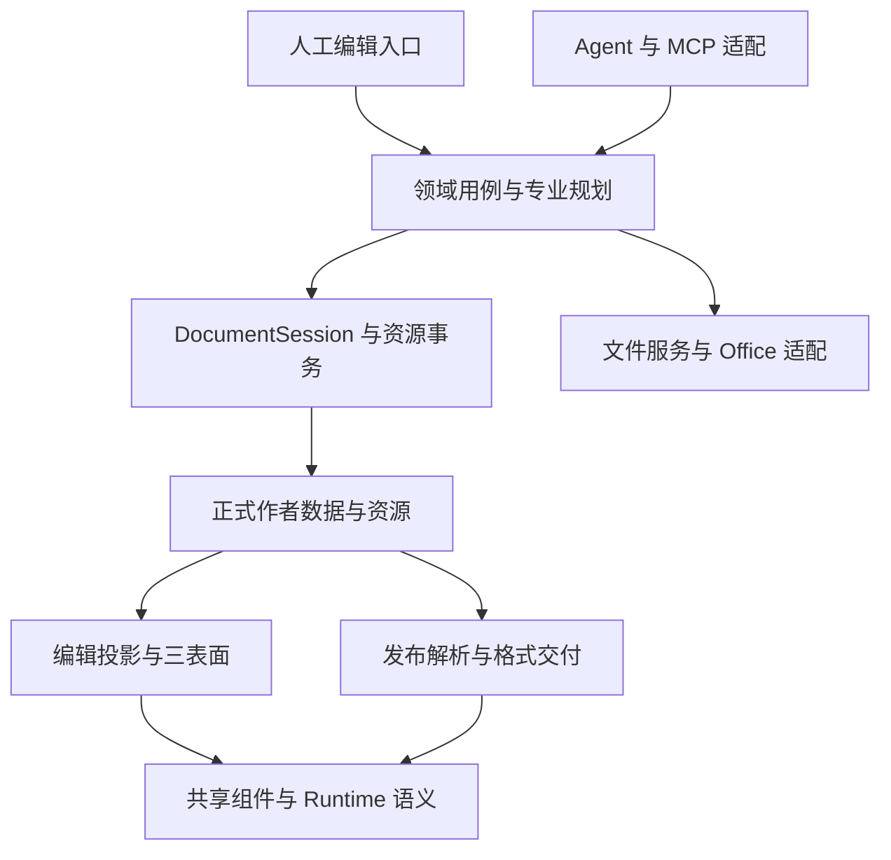

# 果铃工作台：架构演进、模块化必要性与产品开发优先级研究

研究日期：2026-10-26（北京时间）  
研究范围：`D:\果铃工作台` 与 `D:\alepha`  
性质：只读研究、独立静态分析、现有检查与隔离验证；不实施产品重构。

## 0. 决策结论

**果铃需要继续做有范围的架构治理，但现有证据不支持暂停产品开发、进行全系统重构，更不支持重新搭一套五级组件框架。** 当前最有价值的方向，是保留已经成立的正式工程、事务、资源和运行底座，收口实际存在的边界偏差，再让真实产品任务带动少数热点的职责调整。

建议采用“先完成具体边界治理，再进入由产品任务驱动的渐进改造”：近期 B 为默认，具备直接收益证据的模块进入 C。后文路线 F 表示这个阶段组合，并非第六套技术架构。

上述顺序约束的是结构治理本身。产品 P1/P2/P3 可以同时推进，G1/G2 不是全部产品开发的统一前置；只有确实依赖同一接口或共享文件的任务需要先形成共同基线。

- **应保留：** Project 11 / Published 4 / Component API 5、DocumentSession、现有 History/保存/恢复、资源与文件服务、专业算法、已有工具注册和能力发现机制。
- **应先处理：** 已查实的能力资料不同步、一个 Core → Player 反向依赖，以及对当前普通编辑和大 HTML 打开体验仍有实质影响的断点。
- **应按任务改：** Gateway 中仍有重复专业决定的具体分支、布局与运行的共享语义、实际阻塞两个开发任务的集中所有权。
- **不宜现在启动：** 全仓目录搬迁、统一五层包装、第二套 Harness/注册平台、再次升级正式文件版本、为了独立模块而分拆文档事务。

第一轮可用开发产能建议为 **50% 产品可用性和真实用户任务，30% 已证实的局部结构治理，20% 受影响行为验证与集成**。上述具体边界闭合后，转为 **70% 产品能力和创作验证，20% 随任务发生的模块化，10% 集成与回归保护**。比例是资源配置建议，不是测量结果，也不把所有功能都置于全局重构之后。

这里的 30% 是第一轮结构治理的投入上限，不是必须用完的重构配额。G1/G2 提前完成，就把产能还给产品任务；不要为了维持比例寻找下一批抽象。单人开发按时间分配，多 Agent 按所有权隔离，并不要求额外安排固定角色或同时启动所有工作包。

| 决策问题 | 本轮回答 |
|---|---|
| 是否需要重构 | 需要少数有实际证据的职责调整；不需要全系统推倒或再次统一模型迁移 |
| 是否紧迫 | 用户可见错误和初开性能优先；生成资料同步和确定边界违规近期处理；其他结构热点按实际任务触发 |
| 架构是否已是开发的主要瓶颈 | 局部是重要瓶颈；不足以证明整个开发周期或创作耗时主要由整体架构造成 |
| 功能是否应暂停 | 不应整体暂停；暂缓新增通用框架和跨全栈能力扩张，继续独立可交付功能 |
| Alepha 应怎样借鉴 | 借鉴职责、公开接口、依赖约束和装配根；其真实实现和机械生成范围须分别核验，不能照搬形式 |
| 能否保证任何修改的完整影响范围 | 可以大幅改善可追踪性；静态图、类型和生成均不能独自保证动态语义影响完全可知 |

## 1. 研究基线与证据边界

果铃本轮基线为 `c211524bc0e56599e76820b2f9e3b940dd695987`，提交时间 2026-10-25 22:21:58 +08:00，分支 `main`，研究开始时工作树干净。`CURRENT_STATUS.md` 中的多项“未提交”属于此前实施记录，不能据此推定当前仍有未合并修改。

本报告把证据区分为：本轮实际执行结果、当前源码、经定位的历史结果、建议和待证假设。没有重新打开全部 GUI、遍历全部旧作品、调用内置模型或付费服务；也没有把某个单测通过解释成完整产品通过。原生子智能体仅做本轮独立研究，没有调用本机 Codex、Claude Code 或 OpenCode。

主研究 Agent 直接完成两个仓库的源码、Git、依赖与检查核验。三名原生子智能体的首次远程读取受阻，随后改为基于这些证据独立评议；附件明确记录该限制。三份评议不能被计成三次独立源码实测或三轮行为认证。

### 1.1 本轮果铃静态与生成检查

| 指标 | 结果 | 正确解释 |
|---|---:|---|
| `src` 下 TS/TSX 源文件，排除 `.d.ts` | 1,684 | 源文件规模，不是业务模块数量 |
| 文本行数，含空行和注释 | 310,740 | 不能单凭总行数证明必须重构 |
| 导入、重导出、字面量动态导入及 require 语句 | 9,723 | 包括外部包和类型引用 |
| 可解析到内部 TS 文件的语句 | 8,479 | 去重为 8,074 条文件依赖边 |
| 排除显式 type-only 的内部语句 | 5,636 | 仍可能包含被编译器擦除的类型用途，称“值形式”更准确 |
| 包含类型引用的强连通组 | 24 | 不能等同运行时循环 |
| 值形式强连通组 | 1 组，4 文件 | 包含延迟 import 的 Main 装配环，没有据此证明启动故障 |
| `generate-contracts --check` | 5 个制品通过 | 结构协议生成物一致，不证明运行行为完整 |
| `generate-ai-capabilities --check` | 11 项过期 | 已有机械派生机制，但同步闭环存在缺口 |
| 现有 S11 边界检查 | 1 处违规 | `compileCoursePlayback → componentPlacementStyle` |
| V11 递归结构隔离探针 | 6/6 符合预期 | 1 个合法组合与 5 个拒绝场景；不是 Runtime/GUI 测试 |

全量边、统计与读图说明见 [依赖图](output/architecture-evolution-research-20261026/DEPENDENCY-MAP.md)、[原始基线](output/architecture-evolution-research-20261026/dependency-baseline.json) 及完整 dependency-edges.json；脚本使用当前安装的 TypeScript AST，保留类型边与值形式边的区分。图不覆盖任意字符串消息、运行时注册、资源引用、模板内部代码或所有动态加载，因此它只能给出影响审查候选，不能承诺完整的实际行为影响范围。

### 1.2 已有架构改善不能重新归零

10 月 24 日架构批次已经完成共享插入规划、Bridge 投影准备、部分 Flow 挂接生命周期、工具结果投影及构建/类型检查收敛。现有 `IMPLEMENTATION_PLAN.md` §15 已明确其已完成、计量后不采用及条件性暂缓的区别。

例如，历史同条件暖检查记录分别为主配置 12.06→1.37 秒、Electron 3.13→0.55 秒、e2e 5.18→0.79 秒；这些是各配置的局部收益，不能直接相加为一次完整开发节省，也不是本轮重新计时。另一个 Source 解析缓存候选因为代表作品没有重复输入而未采用，这是一项有依据的收口结果，不是遗留必做任务。

### 1.3 创作时间不能直接归因于架构

仓库最新创作收敛方案已纠正：Luna 约 54 分 29 秒是观察到终态的轮询快照，不是精确服务端结束时刻；首存约 5:58，首导约 13:15。主 Agent 首次成功导出约 14:06，正式阶段 43 次 MCP 调用中有三次约一分钟超时。模型、上下文、已有素材和工具路径并不相同。

这些样本证明仍有速度和完成质量问题，不能单独证明“架构是首要耗时来源”，更不能用工具耗时之和从总墙钟中相减后，把剩余时间全归为模型思考。

## 2. 当前问题的性质与重构必要性

### 2.1 架构没有整体失效，局部边界确有偏差

当前源码具备统一正式数据、文档事务和共享工具注册。DocumentSession 的直接源码依赖者为 7 个，静态传递可达消费者为 56 个；这些数字描述依赖范围，唯一 writer 是否成立仍须由实际写入链验证。另一方面，公共 Schema 的静态传递可达消费者达 813 个，Runtime 契约达 887 个，说明再次重写底层协议会触及很宽的审查范围。

这两个事实共同指向：**应优先保护稳定的公共语义，改善发生变化的具体使用边界。** 公共类型被很多模块引用本身正常；真正的问题是内部实现是否也跨域泄漏、调用者是否重复决定同一规则，以及用户行为是否能随迁移完整保留。

### 2.2 本轮确定发现

**F1：能力生成物和源码已经不同步。** 内存重新生成比较发现 11 项磁盘资料过期，两个运行打包 JSON 也过期。差异涉及 Flow 分栏、插入位置、资产来源参数与项目应用说明，不只是日期或排版。`DocumentToolGateway.describeRun` 和 Engine 从活的 ToolCatalog 描述工具，因此不能推定所有内置 Agent 调用都拿到旧 Schema；静态 CaseBuilder 发现 API 与打包 Skill 则确实消费这些制品。现有 CI 的 `capability_check` 路径选择没有覆盖 `src/core/tools/**`：如果只改工具定义，检查可能不被选中。该缺口可由配置证明，但没有本次 CI 运行日志，不能将全部漂移归因于它。应同步真实消费者并补齐原有检查的实际源输入，无需重建发现平台。

**F2：公共绘制规则放在 Player 文件里，被 Core 反向调用。** `componentPlacementStyle.ts` 同时包含纯 `componentPaintStyle` 和带 HTMLElement/WeakMap 的 DOM 应用函数。正确候选是将纯规则交给已有公共布局语义域，并让编译、编辑和播放消费者引用它；DOM 应用仍属于适配端。把整个文件搬进 Core 或增加转发 barrel 都不自动完成职责治理。

**F3：Main 存在延迟装配环。** AttachmentsDesktopService、WorkspaceFilesDesktopService、ExecutionDesktopService、workbenchToolServices 通过直接调用与动态 import 构成一个四文件环。它是模块独立测试/替换的潜在阻力，但没有当前失败证据，优先级低于用户可见错误。将来触及相关装配时，可复用现有构造器端口注入收口；不能把它报成已发生的运行故障。

**F4：生成大文件容易污染 AI 开发上下文。** `src/shared/generated/` 中 20 个 TS 文件只有 196 行，却含约 19.79 MB 生成源码字符串。源码导航应指向生成器与真实组件源码，默认排除这种派生大块；不应让 Agent 因搜索命中而加载整份制品。这里减少的是不必要输入，不需要修改文档模型。

**F5：Skill 分发有实在的多份维护问题。** npm `prestart` 仍调用全局安装脚本，默认目标为用户 `.agents/skills`，DevSpace 报告七个全局与仓库同名 Skill 的遮蔽提示。10 月 25 日根目录收敛方案提出停止自动分发，但该方向尚未实施。本轮未执行安装或清理用户文件；也不把这个事实当作某次模型失误的已证根因。

### 2.3 分类原则

| 类别 | 判断标准 | 合理处理 |
|---|---|---|
| 架构设计 | 一个决定有多个权威来源，或边界本身强迫跨域写状态 | 改 owner 和接口，接通所有直接消费者 |
| 架构迁移 | 新 owner 正确，但旧决定未退出或消费者未迁完 | 完成该切片，退出对应旧路径 |
| 工程实施 | 输入、ACK、样式、异步身份等具体实现错误 | 在原 owner 修复，不默认换架构 |
| 开发流程 | 测试未穿过真实入口、生成资料不同步、集成批次过大 | 改变化识别与受影响验收 |
| 产品决策 | 统一操作时改变了原来受支持的使用语义 | 先明确产品结果，禁止用代码整齐替代用户能力 |

一个有明确 before/after 证据的反例是 `e7796375` 的 Engine/互动收口：同一批四个遗留项，只有暂停复位后的初始化状态是实际互动实现缺陷；另一个是取消拒绝的错误码合同不准确，另外两个分别是教师控制台测试夹具和 steer 终态的历史预期。该批只修改两个产品 owner，没有重写 Engine 或再建导航系统。其记录的 66 条选中检查和真实浏览器计数属于 10 月 24 日历史验收，本轮阅读并核对提交，不冒充再次执行。

这类区分直接改变投资决定：把四项都当作架构失败，会得到不必要的重构预算；把它们都当测试陈旧，又会漏掉真实 replay 缺陷。其他历史案例在附件中按相同口径列出。

以下历史切片进一步解释“为什么重构后容易回退”。它们来自已读结果记录及最新提交，不是本轮新发现的未修 Bug：

| 真实案例 | 主要问题类别 | 对下一轮的约束 |
|---|---|---|
| 共享插入 planner 用 childIds 存在性拒绝合法空程序根；限制实际只属于 Gateway 的目标适配 | 边界设计与迁移接线 | 共用的是业务决定；某个调用入口的限制不能误提升成所有入口的领域规则。修复已在 c211 的 planner/Gateway 差异中对应 |
| 统一选择/格式控件时，普通文档的原格式、段落、链接、稳定文档动作入口需要恢复 | 产品范围与实施越界 | 有过为了统一呈现扩大到未要求载体、影响成熟操作的实际情况；不应因此否定专业画布共享控件，也不能让代码统一自动授权 UI 改版 |
| AI 高层 appearance 成功写默认值，实际文字 inline/公式 style 继续覆盖显示 | 重复语义决定，适合局部架构治理 | GUI 与 AI 共用既有专业字段规划，比另建样式系统更有效；必须验证真实呈现而非只看工具 saved 回执 |
| 旧 realm ACK 抢回新选择，失效手势记录吞同 pointerId 的后续 up | 异步身份与生命周期实现 | 沿原 owner 检查精确记录、意图和 generation，不需要重建所有状态管理 |
| Worker/Python 用例根环境超时，控制页也在 Worker 前卡住 | 开发验证环境 | 区分开发载体、产品计算链和业务算法；后续当前状态已记录定向处理，不以旧超时证明整个计算模块不可用 |

上述记录还包含测试夹具遮蔽后续断言、历史预期未更新和实际产品缺陷混合的情形。多数既有验收只覆盖代表载体，不能把它提升成全部 HTML/GLX/Office/任意嵌套的保护。下一轮应当针对改变的行为穿过真实消费者，而不是只增加更严格的结构规则。来源为 20261024-regression-boundary-repair、20261025-format-core-repair 及 CURRENT_STATUS 的后续纠正。

### 2.4 Git 热点：局部集中与批量集成并存

对当前 HEAD 可达、2026-10-01 起、涉及 src 的非 merge 提交统计：483 个有效样本，修改源路径数中位数 2、P90 为 7、最大值 473；33 个提交触及至少四个顶层 src 目录。文件触及次数以 Gateway 57 次、Engine 51 次、HostToolServices 34 次、ExecutionDesktopService 和 workbenchToolServices 各 29 次最突出。详情见 [Git 基线](output/architecture-evolution-research-20261026/guoling-history.json)。

这些数字不支持“所有开发都必须跨全仓修改”：大量提交本来很小。它们支持另一判断——少数执行/工具接线文件持续承受变化，另有少量大批集成扩大验收范围。最新 c211524b 涉及 50 个 src 路径；此前 76101357 和 bdb9e1dc 的集成分别涉及 442、473 个。大提交包含多个工作项，不能把触及文件数当单个功能成本。

该口径不统计人时、模型上下文、功能大小或 Bug 引入率，也不保证一项任务只有一个提交。行级 churn 还会被格式/换行变化放大，因此本报告不以增删行数建立效率结论。是否把 Gateway 的某一专业分支移走，要看实际重复决定、消费者与任务冲突，不能只看文件长或提交频繁。

## 3. Alepha：实际模块化、Contract 与工程代价

### 3.1 当前基线和边界

本轮读取的 Alepha HEAD 为 1f2eb7f656a28da32d677c83865c2e622ea39c8e。工作树已有本任务之前的修改，包含前端播放/方向等正在演进的代码；本轮完全保留。静态分析读取当前工作树，Git 样本分析已提交历史，两者不能混为同一个发布版本。没有启动服务、连接数据库、构建 Android 或认证真机行为。

| 实测结构 | 本轮结果 | 含义及限制 |
|---|---:|---|
| 后端 src/modules 目录 | 22 | 不是 22 个独立部署服务；文档仍有 21 的旧统计 |
| 后端扫描的 TS 文件 | 660 | 包含测试和契约链接文件 |
| Android 显式 Gradle 子项目 | 26：app 1、core 16、feature 9 | 实际构建分区；context 的 15 core 已过时 |
| Gradle 主代码字面依赖声明 | 116，所扫描图无强连通组 | 未执行 Gradle 解析，不涵盖 convention plugin 动态增加的依赖 |
| 同级 feature 主代码依赖 | 6 | author/explore/messages/profile/search → feed，以及 explore → search |
| 后端跨兄弟目录生产导入语句 | 72，其中值形式 47、显式类型 25 | 不是 72 个产品 Bug；范围与旧审计不同，不作增长率比较 |
| API alignment 实际执行 | ALIGNED | 仅说明手工端点清单与文档一致 |

数据和抽取规则见 [Alepha 基线](output/architecture-evolution-research-20261026/alepha-baseline.json) 与 inspect-alepha.cjs。若把 Gradle 测试依赖与主代码混合，会出现 feed–shell 强连通组；这是测试使用宿主的关系，不能直接报告为生产构建循环。后端按目录聚合的生产值形式图有两组互达关系：admin/content/moderation/upload/user 与 cloud-session/recommendation。目录聚合互达不等于文件初始化循环，本轮没有据此声称运行故障。

### 3.2 横向与纵向的划分确有工程内容，但并不完全隔离

后端是模块化单体：app.ts 挂载路由，container.ts 集中实例化和接线，领域目录含 router/service/repository；公共数据库、日志、认证中间件等是横向能力。ContentReadRepository 将正式内容查询留在 content 领域，接口允许消费方请求投影；这比让每个消费方自行解释所有内容表更有独立性。

Android 以 core 承载网络、资源、Runtime、媒体、启动端口等，以 feature 承载页面和用例，app 负责装配。GameLaunchPort.kt 明确目标、来源、账户 generation 与运行实例身份；这些语义能防止调用者用一个模糊字符串替代真正的执行上下文。值得借鉴的是这种边界中的具体不变量，而不是把果铃也改成 Android 的层数。

实际代码也有重要偏离：

- comment.service.ts 同时消费根合同和 ContentServiceInstance、content 目录中的 visibility 实现，说明并非所有跨模块调用都只面对稳定公开端口。
- release-quality-check.ts 直接引入 ModRepository；upload/package-directory.ts 直接依赖 content 的 manifest parser/validation。部分是共享规则归属不理想，部分是内部实现泄漏，应逐个判断。
- analytics.repository.ts 的 upsertStatsSnapshot 直接写 content_schema.stats_snapshot，并读 content_schema.items。因此“每个模块绝不访问别的 schema”不是已完全实现的事实。
- container.ts 610 行主要承担装配，不能单凭其中心位置判定为坏模块；相反，DefaultFeedViewModel.kt 2,449 行、DefaultWebViewRuntime.kt 2,265 行、user.service.ts 2,283 行仍是需要较多上下文的热点。模块目录并未自动消除复杂协调。

对果铃而言，领域内聚、明确端口和集中装配是有价值的参考；“所有模块完全独立”“单向边界已经全面强制”则不是可以直接引用的成功事实。

### 3.3 Contract 的权威来源与机械派生范围

Alepha 实施的是**可编译代码合同＋人工语义文档双轨**：

| 内容 | 当前实际机制 | 是否全自动 |
|---|---|---|
| 后端公开接口/枚举 | 根 contracts/backend/*.ts；后端有 23 个文件级符号链接直接引用原件 | 共享同一份源码，不是生成第二份接口 |
| Android 共享纯类型 | core/contracts/build.gradle.kts 用 sourceSets 编译根 contracts/android | 直接纳入编译 |
| Android 各领域端口 | 位于所属 core/feature 源码，调用方通过 Gradle 依赖消费 | 代码维护，非从统一跨栈 DSL 生成 |
| API、端口语义和依赖矩阵 | docs/contracts/*.md、CHANGELOG、API_REFERENCE | 需人工同步；源码优先 |
| HTTP 客户端 | PlayableFeedApi.kt 的 Retrofit 声明与 DTO | 本轮所查为显式源码；未发现由同一后端 Schema 全量生成的证据 |
| 事件 | EventType 枚举；EventBus 的 payload 为 unknown | 事件名有枚举约束，载荷并非完整按事件映射的类型契约 |
| 影响范围 | 编译错误、源码引用、依赖声明、人工审查与现有测试 | 未形成覆盖全部动态语义的消费者自动图 |
| API 对齐检查 | 人工 APP_ROUTES 与 API 文档比对 | 不能证明真实 Express 路由与 Android 消费端完全一致 |

check-api-alignment.mjs 的开头已主动说明其人工清单限制；本轮运行通过也没有消除该限制。EventBus.emit 不等待所有处理器完成，因此更不能将通知总线当作跨模块原子事务。对后端真正需要一致性的工作，现有 PoolClient/事务接口属于明确的工程约束，它使模块仍绑定同一数据库事务环境，不能声称可以无成本替换成任意远程服务。

所读前端 CI 配置包含 assembleDebug 和部分 guard，未见常规单测/lint 步骤；本轮未取得 CI 运行日志。这限制了“任何内部修改均有独立行为保护”的结论。可以拥有良好模块结构，同时缺少充分行为验收。这一点正好解释为什么果铃只复制 Contract 外观仍可能继续回退。

### 3.4 真实变更样本支持什么，不支持什么

本轮对当前 HEAD 可达、2026-10-01 起的非 merge 提交，按 backend/src、frontend、contracts 路径统计，共 176 个有相关文件的提交，涉及文件数中位数 8、P90 为 37。这不是人时、功能大小或质量指标，也不能与果铃不同提交习惯直接比较。

两个相邻样本说明边界的实际价值与成本：

- 1c384762 的作者页帖子阅读入口主要修改 author 模块的 UI、三语文案和测试，共 6 个所查路径；bf8fcada 在 app 的 MainActivity 接线，1 个路径。叶子实现可以聚焦，但完成用例仍需要宿主接线。
- 3343d5c3 的发布/内容交付集成涉及 194 个所查路径；bd5efcd7 的前端与 portal 修复批次涉及 332 个。它们说明实际集成仍会出现大跨度批次，不能凭模块合同承诺小改动范围。批次包含多个工作项，单项功能的变化传播程度不能由此判定；具体跨 owner 成本由前述 author 与 app 接线样本支持。

该历史窗口内 container.ts 被 14 个提交触及，user.interface.ts 也是 14 个。内部修改不改变公共语义时，合同和文档可以不动；一旦改变公开行为，TS/Kotlin 调用者、端口文档、矩阵/CHANGELOG 与测试仍有维护成本。缺少等价任务的前后对照和人时记录，本轮不能量化模块化降低了多少修改、冲突或模型 token。

**借鉴结论：**采用代码权威、窄公开面、装配根、可执行的部分边界和真实用例验收；不照搬 PostgreSQL schema 分区、Android 工程结构、全局事件总线、人工多表登记或所有破坏性修改都经过同样流程。果铃已经具备多项对应机制，应先补当前机制的缺口。

## 4. 果铃各系统成熟度

“源码存在”“代表行为曾验收”“所有受支持场景均可靠”是不同强度的结论。下表的“已实现”表示当前源码中有完整机制，不代表本轮重新认证整个产品；“部分”也不表示必须重建。

| 系统/能力 | 当前成熟度 | 当前源码证据与实际边界 |
|---|---|---|
| 正式定义、实例与容器 | 已实现 | project.ts 有 Definition/Instance、role、childIds、container、rootIds、entry；正式版本 11 |
| 原子、组合和递归内容 | 已实现结构协议；复杂行为覆盖仍需按场景判断 | 所有权只有 childIds 一套关系，Surface 是实例容器的只读投影；schema 校验唯一归属、引用与可达性 |
| 内容、行为、专业组件 | 已实现 | role 为 content/behavior/mixed；专业 schema 归 Definition，Source 增强可保留 professionalBuiltinKey；builtins 覆盖正文、图表、表格、输入等 |
| 组件内与跨组件运行状态 | 已实现机制，完全可追踪尚不足 | RuntimeWorld 拥有运行态，scope 提供 target/events/state/measure；事件名为字符串、状态值为 JSON，任意动态通信不能由 import 图完整捕获 |
| DocumentSession | 可保留的核心底座 | 串行提交、epoch/revision、请求幂等回执、停止任务约束、History；先写恢复持久化边界再接受状态，不等于每次编辑已保存用户正式文件 |
| Runtime 生命周期 | 已实现且已有多轮修复 | RuntimeHost 的 generation、AbortSignal、prepare/update/dispose 与 World 的媒体/互动/挂接；ModelPlayer 等待真实投影提交 |
| 独立渲染与编辑 | 部分成熟，专业与任意 Source 需区分 | 共用运行生命周期，作者局部字段通过 AuthorSpot/authoring records；不能据此承诺任意应用都有完整可视化编辑器 |
| 注册与能力发现 | 已实现，有同步缺口 | ToolRegistration/ToolCatalog 活目录成立；静态能力包和部分 Skill 制品过期 |
| 独立版本与替换 | 已有版本记录、库导入/替换；不是完备的独立版本生态 | library/replacement.ts 保留实例 data/frame/overrides，阻止未经确认覆盖本地 Source；未证明任意版本自动兼容、数据自动迁移 |
| Flow、Slide、Spatial | 三表面已实现，专业投影各有语义 | ModelPlayer/World 共享，Flow 阅读流、Slide 状态、Spatial 相机/路径分别处理；不宜为统一而删除这些区别 |
| 编辑、Player、导出一致性 | 已有共享语义，仍是重点回归面 | buildPublishedCourseV4 捕获正式快照，compileCoursePlayback 派生交付；纯绘制规则反向依赖和旧适配路径仍需有范围收口 |
| Office、文件与资源 | 已有独立格式能力，可继续发展 | OfficeContentService 纯字节变换，OfficeFileService 复用文件 writer、版本条件、物理提交前归属检查与未知结果回读；不经过第二套内容事务伪造统一 |
| Harness/Agent 执行 | 可用且复杂度集中 | Gateway 3,347 行、Engine 3,462 行；已抽出不少 planner/服务，应该按具体重复决定调整，不能直接拆循环核心 |

### 4.1 本轮隔离验证

对当前 courseProjectV11Schema 执行了六项不写产品状态的结构探针：三级容器/组合/叶子与共享定义能通过；重复归属、悬空定义、未归属的循环、非根入口、向 V11 写边界提交 V10 被拒绝。六项均符合预期，具体脚本为 verify-recursive-contract.ts，结果见 [六项结构探针](output/architecture-evolution-research-20261026/recursive-probe.json)。

它证明递归结构与部分关键不变量已真实实现；没有运行 DOM、复杂 Runtime、专业内容 Schema、完整文件往返或 GUI。因此不能写成“所有递归场景已通过”。同样，buildPublishedCourseV4 源码明确把 offlineComplete 定义为准备证据，不能拿这个布尔值代替真实离线交互验收。

### 4.2 状态所有权：不是把一切塞回一个 Store

| 状态 | 合理 owner | 不能混淆的边界 |
|---|---|---|
| 正式作者数据、资源与撤销历史 | DocumentSession 与现有文件服务 | 正式写入应有身份、版本与回执 |
| 正在输入的文字、IME、拖拽预览 | 当前编辑会话/输入适配 | 未接受草稿不应被旧 ACK 覆盖，也不等同已提交事实 |
| 选中、滚动、视口、相机观察 | 所在 Surface/视图 | 不为每个观察写 History |
| 动画、播放、临时交互与 mount 状态 | RuntimeWorld/运行实例 | 高频运行变化不回写作者内容；正式修改另走命令 |

同一个决定有两个可互相覆盖的权威来源才是“双事实”问题。上述四类状态并存是合理的。当前 Session 源码中的版本/请求判断、Runtime 文档中的“运行态不写作者数据”、ModelPlayer 的真实投影提交协议，方向是一致的；近期 ACK/选择修复更像边界实现和迁移覆盖问题，不是需要把四类状态重新合并的证据。

### 4.3 旧名字、旧实现与迁移接缝

CourseProjectV10 已是 V11 的内部类型别名，buildPublishedCourseV3.ts 实际导出 V4 构建；这些名字不是额外的可写事实。为了名称整齐再做全仓改名，收益很小，变化面反而会扩大。

另一方面，API 4 的包解析、旧 ComponentRegistry 与部分 published adapters 仍真实存在。当前静态图中 renderer 的 executeComponentRuntime.ts 没有 src 内导入者，而 Player 的旧注册器仍由若干发布适配器消费。前者可作为以后触及该范围时的退役候选；后者不能直接删除。静态“没有导入者”也不排除测试、构建入口和字符串加载，退役必须先核对实际支持边界。

这说明当前确有迁移接缝，但不能把所有旧路径一概称为不必要兼容层。正确动作是每次完成一个用例后，确认它的旧决定是否退出；不要另外宣布“彻底清理所有 V4/V9/V10”的新大项目。

## 5. 递归组件化：保留组合思想，取消强制五层

### 5.1 内容树、工程依赖图与应用装配需要区分

“原子组件 → 组件 → 模块 → 应用 → 工作台”可以帮助描述产品组合尺度，但不应直接变为每个对象都要经过的五级代码继承或包装体系。

- 内容对象适合递归：叶子内容、容器、复合内容、子树共享定义与引用；现有 Definition/Instance/childIds 等已经提供基础。
- 工程模块依据职责和变化原因划分：文档事务、文件、资源、渲染、专业算法、执行编排分别有自己的 API 和生命周期。
- 应用与工作台是装配位置：把多个领域模块连接到人机入口，不必伪装成一个可以塞入文档树的内容组件。

“原子”只表示在某个编辑边界内不再拆分。文字内容仍可能有字符范围、图表内部仍有数据系列；没有必要为所有尺度建立一套相同状态协议。真正应统一的是稳定身份、可发现操作、资源引用、错误与生命周期接点，而不是内部算法、运行状态和 UI。

### 5.2 最小充分的组合模型

建议保留现有两类构造：**内容对象及其组合协议；领域模块及其窄接口。** 两者在文档、渲染、编辑与交付用例中连接。不是建立第二种工程格式。

| 系统 | 应成为内容组件吗 | 原因 |
|---|---|---|
| 正文、图片、图表、可复用交互作品 | 可以 | 有作者内容、实例、布局和交付语义 |
| 连续动画/游戏/复杂模拟 | 可以作为合理整体 | 同时间、坐标、状态高度耦合；内部仍可暴露可改字段 |
| DocumentSession、History、保存队列 | 不需要 | 属于文档一致性基础，不是作品树里的内容 |
| 资源解析、文件授权、Office 读写 | 服务或适配器 | 管理宿主与文件能力，不能让组件自行拥有第二 writer |
| 数学排版、图表计算、布局算法 | 专业引擎/纯模块 | 可供多个组件复用，不必包成有生命周期的实例 |
| Agent 工具与执行循环 | 适配与编排 | 工具调用领域能力，内容节点不应依赖某个 Agent |

### 5.3 真实复杂场景

| 场景 | 最小合理边界 | 递归组合的收益与限制 |
|---|---|---|
| Flow 混排正文、图表与 Runtime | Flow 拥有阅读顺序/布局；专业内容和程序拥有内部语义 | 有利于复用，但不能另造一份正文布局状态 |
| 动画、输入、图表和共享逻辑组成应用 | 一个程序拥有高频时间/状态；低频内容以参数或子对象连接 | 拆得过细会把复杂度转给事件和同步 |
| Slide/Flow/Spatial 共用内容 | 内容数据共用，各 Surface 保留 placement/导航/选择语义 | 不应强求相同 frame 和相同手势 |
| 人与 AI 交替编辑 | 同一个当前文档、领域命令和事务；各自保留输入适配 | 不要求人工能逐项编辑任意程序代码 |
| HTML/GLX/Office 保存与导出 | 格式边界有明确能力差异；原件与可编辑语义分别保护 | 不能把有损静态输出当可逆转换 |
| 背景、滚动和导航联动 | 正式导航 owner + 受其驱动的一个动态域 | 不应让每个小组件持有互相回写的滚动位置 |
| 组件独立使用或组成应用 | 公开输入、事件、资源和挂接边界 | 独立可测试不等于独立存档、独立数据库或独立事务 |

对一段需要持续融合的动态内容，一个 Runtime 往往比几十个跨宿主同步对象更容易保持正确；但独立正文、图片与需要人工修改的字段仍保留恰当边界。粒度应由修改需求与实际耦合决定，不能用原生节点占比评价架构好坏。

## 6. Contract 驱动的最小架构

### 6.1 不另起平台

优先复用现有 TypeScript 接口、Zod Schema、Component 定义/Manifest、`ToolRegistration`、工具目录和生成脚本。

`ToolRegistration` 已将输入 Schema、能力、effect、支持条件、目标解析和 handler 连接起来；Gateway 与外部 MCP 共用目录。新增模块接口应围绕真正独立的 owner，而不是先建一个通吃所有模块的注册 DSL。

建议先以以下逻辑边界组织任务。它们大多已存在，表格不是要求新建八个 package；只有真实职责调整需要搬迁文件。

| 领域/基础能力 | 当前主要位置 | 应拥有的决定和公开边界 |
|---|---|---|
| 文档一致性内核 | `src/core/documents`、drivers、shared/workbench 文档合同 | 当前快照、合法提交、CAS、History、资源增量；公开快照/事务端口，不暴露可任意修改的完整 Store |
| 内容与专业编辑语义 | `src/core/course`、`src/components/*` 的 data/edit 与现有工具 planner | 正文、图表、表格等业务变更计划；GUI/AI 各自适配输入但复用同一决定 |
| 组件与程序运行 | `src/core/components`、`src/player/components`、组件 web/source 实现 | 定义/实例、实现解析、挂接与释放、运行端口；不取得正式文档 writer |
| 三表面和交互投影 | renderer/componentPlatform/surfaces、player/surfaces 及现有专业 adapter | 阅读流、页面、空间的 placement/选择/视口；纯共享规则与具体 DOM/React 适配分开 |
| 文件、资源与格式服务 | main/workbench 的 projectFiles、Office、资源与文件服务 | 文件身份、路径、字节、授权和实际格式读写；不复制内容领域规则 |
| 发布与交付 | core/publish、实际 Player/导出封装及文件服务 | 从正式快照生成运行语义和资源闭包；不反向修改编辑器事实 |
| Agent 执行与工具适配 | core/tools、main/workbench/execution、providers、external | 工具描述/目标适配、执行状态与副作用回执；专业决定下沉既有领域，运行循环不重写 |
| 应用装配 | main/renderer 的真实启动与组合入口 | 建立实例、接线生命周期和用户反馈；不成为全部业务判断的兜底 owner |

每个被实际改造的模块，通常只需要一个清晰公开入口、已有类型/Schema，以及一段说明“拥有哪个状态、调用哪些公开端口”的文档。消费者清单由解析生成；不再人工维护一份相同的模块登记表。

防止私有实现泄漏，可以在原 S11 AST 检查中为已经确定的领域公共面增加窄规则；不能把简单的 index 转发当成封装完成。测试内部实现和应用装配可以有明确例外，规则按实际 owner 建立，不一次冻结全仓所有目录。跨组件引用继续使用稳定实例/定义身份；公共通信优先窄端口，动态程序的字符串事件只承诺运行时可观察，不能制造一份假完整的静态消费者清单。

| 权威定义 | 可以机械生成/校验 | 仍需设计或验证 |
|---|---|---|
| Zod wire Schema | JSON Schema、输入输出类型、字段文档 | 跨对象引用、归一化、副作用、顺序和体验 |
| TS public exports/窄 port | 公共面、静态消费者、禁止深层导入 | 业务含义与允许的行为变化 |
| ToolRegistration | 工具定义、可发现能力、调用解析、清单 | 何时该用、模型是否采用、真实操作能否完成 |
| Component Manifest/定义 | 类型、资源声明、版本与运行入口 | 任意代码实际资源闭包和生命周期正确性 |
| 源码 AST 与真实构建输入 | 文件依赖、消费者候选、受影响任务候选 | 字符串路由、动态事件与实际语义影响 |
| 既有行为样本和测试 | 按模块关联的验证入口 | 正确预期、视觉体验、任务完成质量 |

契约测试可以机械产生装配/序列化往返的调用壳、边界导入检查和现有样本的 consumer 参数化入口；不能由实现本身生成预期答案后宣称行为正确。目标切换不误写、保留人工布局、一次撤销、保存重开和导航语义这些不变量，需要来自真实受支持行为与经过确认的样本。

当前果铃的 Project TypeScript 接口和 Zod Schema 仍有分别维护的部分，schema 中的 ZodType<T> 约束不等于所有规则均自动同源。五个合同快照通过只证明这些派生产物一致。今后新增线协议可优先从现有 Schema 派生类型；无需为了形式统一，将已经稳定的全部接口重新定义一遍。

Zod 官方说明有些结构无法完整表示为 JSON Schema，`unrepresentable: 'any'` 会放宽为 `{}`；果铃生成器也明确运行 parser 和 runtime source 才是最终行为来源。因此，不能把生成文档与 Schema 一致称为“契约行为已保证”。

### 6.2 单一事实与跨组件事务

经 DocumentSession 管理的 GLX/HTML/Markdown 等作者修改，继续以现有文档事务接纳内容、布局意图、资源引用及已准备资源。组件内部可以生成意图或变更计划，但不应直接写另一个组件私有作者状态，也不应每个工程模块创建自己的正式 writer。Office、外部文件的物理字节写入和网络副作用不自动成为同一原子事务。

同文档中一次可撤销的跨组件逻辑编辑，沿已有“当前快照 → 领域计划 → 校验全部目标/资源 → Session 提交 → 按既有规则形成一个可撤销历史项或分组 → 派生投影”完成。无变化回执、内部观察和运行态变化不因此获得额外 History。跨文档、外部文件和网络作业不是天然同一原子事务，应沿已有独立回执与未知结果查证明确状态，不能用一个全局事件总线伪造跨系统原子性。

公共宿主接口的通信建议采用三种机制：直接窄 port 请求当前决定；有类型的事件发布已发生事实；只读订阅持有明确生命周期的状态。当前 Runtime 仍允许字符串事件与 JSON 状态，这个建议不表示任意用户程序的通信已经可静态追踪。事件不能代替需要原子一致性的文档命令。高频动画共享一个时间和坐标 owner，避免在组件间反复回写同一个值。

### 6.3 先改善真实边界，再决定目录和构建拆分

以下是建议保留和收口的职责关系，不是一份要求重建目录的方案。GLX/HTML/Markdown 的正式编辑继续走文档事务；二进制 Office 的格式与文件写入继续由已有服务负责，不能为统一示意图制造第二模型。

现有 `src/core/shared/components/renderer/player/main` 表达运行位置和共用程度，并不自动等于领域模块。可以先在现目录建立真实公共面与依赖限制，再按任务搬迁必要 owner；不必先重排全部目录才能得到模块化收益。

TypeScript project references、独立包或 Nx 等机制可以加强构建与模块边界，但果铃已经有 AST 检查和增量类型收益。没有新的构建成本或隔离需求证据时，暂不引入新的 monorepo 平台。要借鉴的是公开面和可执行约束，不是工具堆栈。

## 7. 路线比较与产品开发顺序

| 路线 | 短期速度/产品价值 | 可靠性与长期成本 | AI 开发与迁移风险 | 本轮判断 |
|---|---|---|---|---|
| A 暂不重构，优先功能 | 新功能最快开工 | 已知边界偏差继续传播 | 热点上下文和返工不减少 | 不作为全局默认；独立成熟模块可采用 |
| B 局部修复与边界治理 | 能较快恢复用户结果 | 投入可控，结构收益有限但真实 | 上下文减少，迁移范围小 | 当前默认 |
| C 功能与渐进模块化并行 | 可交付能力持续增加 | 切片闭合时收益较好 | 需要协调共享核心，可能并行冲突 | 有明确任务和边界后采用 |
| D 暂缓部分功能集中重构 | 推迟用户反馈和新价值 | 可处理已确认系统性错误，也可能再引入回退 | 高迁移/验收成本 | 当前不支持全局启动；仅严重子系统可条件触发 |
| E 重新定义产品、选择性重建 | 需要重新验证目标 | 可能大幅减复杂度，也可能丢失已有优势 | 产品风险与工程风险叠加 | 当前缺少否定产品核心的证据 |
| F B 收口具体问题后，按产品任务进入 C | 把结构改造约束在可交付结果内 | 保留稳定底座、逐个缩小变化传播点 | 少量核心串行，叶子任务并行 | 推荐的阶段组合 |

### 7.1 先做的产品任务

1. 普通文件进入工作台后，能选择、修改、让 AI 接着改，并保存和重开；优先保住文字、局部格式、图片和来源编辑这些高频能力。
2. 大 HTML 首次打开的实际瓶颈。最新报告仍有 14.77–20.89 秒样本；先判断这类文件在目标任务中的频率和阻断程度，再对该链定位和改造，不用拆模块数量代替性能改善，也不围绕一个咖啡作品优化全系统。
3. 小而完整的创作与复用闭环：参考可找到、可采用、可改，内容能交付；不以再制作许多复杂精品作为软件稳定的前置。
4. Skill 能力说明与创作方法/参考的分责，以及停止重复全局分发；沿已有目录和服务实现，不先建独立 MCP 资产服务器。

### 7.2 可以继续、适合作试点与应暂缓的工作

| 类别 | 建议 |
|---|---|
| 可以继续 | 独立内容/素材生产；不改变正式语义的现有 Office 适配完善；专业组件内部改进；现有工作空间和文件体验的具体修复 |
| 适合作模块化试点 | 一个 GUI 与 AI 共享的局部编辑用例；现有能力资料同步；一个跨编辑/预览/导出的公共布局规则；参考资产检索→采用→局改 |
| 暂缓扩面 | 新的大规模通用编辑框架、完整动画人工编辑器、所有格式深度互转、强制多 Agent 编排、云资产平台/插件市场、再次全局 Schema 迁移 |

暂缓指新增投入顺序，不表示删除已支持的能力。产品最稳定的核心是“同一工作空间、同一当前事实、人和 AI 接力、可保存交付”；精确 UI、创作粒度和参考组织仍在变化。适合先冻结这些不变量，不适合现在把全部上层形式冻结成五级结构。

目标用户、任务频率、Office 编辑深度、任意 Runtime 的人工编辑粒度仍未从本轮仓库证据中完全确定。这里的“产品核心稳定”不等于完整产品定义已稳定。普通办公主路径也应从当前已修复结果继续推进，只在下一项实际任务触及或出现新反例时扩展验收，不自动重开所有已闭合问题。

## 8. AI 与多人开发的最小工作方式

Agent 首先拿到本次用户结果、当前模块公开面、必要直接消费者和验证入口；需要扩大时沿实际依赖展开，不加载整份仓库和所有历史方案。生成制品指向源头，旧合同只在追溯需要时读取。静态传递影响 813 个文件，不表示一次小改需要阅读 813 个文件。

独立 worktree 用于隔离实现。文档事务、公共协议和装配根同一时点单 writer；共享接口变更先形成可用的最小基线，再让相关叶子从该基线并行。合并后验证实际组合版本，不能把各分支分别通过当成集成通过。

推荐并行的是不同所有权的结果，例如 HTML 打开性能、能力/Skill 同步、内容参考验证。不要让多个 Agent 同时改 Gateway 的相邻分支，再依赖事后自动解冲突。

允许合理扩大范围，但要说明原修改为什么无法完成结果、涉及哪一个额外 owner 和保留什么行为。无需每次小改重新设计整个模块，也不能用“顺手统一”改变产品操作语义。

无需正式重构即可立即改进的工作方式包括：生成制品默认不进入上下文；以当前 HEAD 和直接消费者定位；在改前写清必须保留的具体行为；把格式整理与语义调整分开；小批集成后验证实际组合；用现有检查的真实输入识别影响。模块化的额外收益应体现在更少的重复业务决定、更窄的稳定接口及更少共享文件冲突，而不是把这些流程收益全部记到架构名下。

## 9. 收益、成本与停止规则

### 9.1 现在能够证明什么

本轮能证明现有结构规模、具体边界偏差、机械派生同步差异和历史局部改善；不能可靠估算全面重构将提高多少倍开发效率。Git 提交包含批量集成和文档/素材，提交文件数只是变化范围代理，不能当人时或 Bug 率。

### 9.2 建议记录的最小基线

| 评价维度 | 当前可用基线 | 合理预期与验收方式 |
|---|---|---|
| 功能开发效率 | 源路径中位 2/P90 7；热点反复触及，但没有每任务人时 | 对同等范围任务比较主动开发、返工和接线文件；不承诺倍数提速 |
| 可靠性 | 合同快照通过；能力资料与导入边界有明确失败；结构探针通过 | 关闭确定缺口，保留对应用户行为；不能只用检查全绿替代体验 |
| AI 上下文 | 生成 TS 文本约 19.79 MB；没有实际任务 token 统计 | 源头导航与局部读取立即可做；从真实调用日志计输入/返工，不用行数换算 token |
| 并行开发 | Gateway/Engine 为高频共享文件；没有可比较冲突日志 | 独立所有权任务可并行；衡量合并冲突与集成返工，而非 Agent 数量 |
| 长期维护 | 多份能力制品和人工合同仍需同步 | 减少人工重复定义，复用生成器；计算生成/检查及消费者迁移的完整成本 |
| 产品创作 | 有首次导出时间样本，但模型/素材不一致，最终质量口径不同 | 同模型、同输入条件比较首个合格作品；质量与十分钟目标分别保留 |
| 迁移风险 | 底层 Schema/Runtime 静态消费者很广；现有版本已成立 | 不升级正式格式，以单用例切片完成迁移；检查旧路径是否真正退出 |

对一个普通办公共编任务和一个图文/互动创作任务，记录：首个合格结果的墙钟时间、主动开发时间、等待与返工、实际读写文件/模块、共享接口变更、首次通过情况、保存冷开/交付结果、合并冲突和后续修复。模型输入量有日志就取真实值，没有就记未知，不按文件行数伪造 token。

速度与质量分别达标。给已知导航缺失的作品补一个保存成功回执，不能算完整创作通过；用更强模型或更多预置素材跑出更快结果，也不能单独归功于架构。

用于选择下一轮改造的最小任务组合可以是：①普通 HTML/Markdown 的人改→AI局改→保存重开；②Flow 正文、专业组件与一个程序组合，完成真实导航/互动和离线交付。测试范围由修改涉及的消费者决定；Office 或 Spatial 发生相关变化才补对应格式/表面的行为。创作速度试验另以同模型、可比素材和相同质量标准比较首个合格作品，保留十分钟绝对目标；若要声称可泛化，再增加一个未用于调参的题材，不用反复优化同一咖啡作品证明普遍能力。

### 9.3 成本核算

局部改造成本包括：定位和契约设计、实现迁移、直接消费者更新、行为保护、集成与后续维护。不能只计算搬文件和编译通过。每个包应先给独立可结束的范围，再用实际完成记录校准下一包预算。

按风险排序，G1 是较小范围的生成同步与检查输入维护；G2 是有限共享规则迁移，需要检查全部直接消费者；C1 的成本由选中的具体用例决定，不能提前合并成“大 Gateway 拆分”。D/E 目前连稳定迁移边界和产品验收范围都未具备，不给出看似精确的人日报价。第一轮用 30% 治理上限控制机会成本，超出时先说明新增的实际阻塞，不能把未完成扩面自动解释为继续加预算的理由。

打平周期可以用“改造成本 ÷ 每周期实际节省”粗估。例如投入 3 个开发日、每周减少 0.75 个开发日返工，则约 4 周打平；如果只省 0.2 日，则约 15 周。这只是敏感性示例，不是果铃已测收益。没有节省数据时，不应据此承诺大规模重构回报。

### 9.4 进入、扩大与停止

- 进入：一个已有用户目标被重复业务决定、错误 owner、共享核心冲突或真实性能成本阻塞，且结构调整比局部修补更能消除根因。
- 扩大：当前切片证明变化范围/返工/等待下降且行为保留；新的消费者需要同一边界时再扩大。
- 停止：直接消费者已收口，旧重复决定退出，受影响行为通过；不为了全仓统一再增加包装。
- 暂停并复核：适配器越来越多、公共接口持续变动、模块改造必须再改另一个大核心才能交付，或出现原有操作退化。
- 升级到 D：多个已证核心用户任务共同被同一不可局部消除的错误模型阻断，且迁移能限定在某个子系统。
- 考虑 E：用户任务本身和产品价值假设被新证据推翻。当前没有这样的证据，不能用工程复杂度直接推导产品应转型。

## 10. 可执行的下一轮研究后工作包（尚未实施）

| 包 | 目的 | 范围和退出条件 |
|---|---|---|
| G1 让现有能力来源真正同步 | 解决代码与模型可读资料不同步 | 使用原生成器，更新真实消费者；区分静态说明、打包 Skill 与活目录；相关检查通过，禁止另建注册平台 |
| G2 收口纯绘制语义归属 | 关闭 Core→Player 的实际违规 | 提取纯规则，保留 DOM 适配；全部直接消费者同批迁移，必要样式/播放行为保持 |
| P1 普通办公主路径 | 降低高频使用摩擦 | 从当前支持的实际入口验证人改→AI局改→保存重开，按具体失败修原 owner |
| P2 大 HTML 首开 | 解决当前明显体验成本 | 定位实际准备/解析/挂接成本，优先删重复工作；验收同文件同条件结果与编辑可用 |
| P3 参考与创作闭环 | 验证产品价值和可复用性 | 少量完整任务，同条件比较；复用真实实现但允许拒用参考，不新增固定创作流程 |
| C1 条件性领域切片 | 降低真实跨模块修改成本 | 只在 P1/P2/P3 暴露重复决定或热点冲突时进入；一个用例有一个规划 owner |

本报告不授权自动实施这些包。已经明确的产品能力和原有权限继续保留；后续执行选择应直接从具体用户结果进入，不再以整份重构方案作为必须一次完成的清单。

## 11. 来源与复现

完整定位和可执行命令见 [证据索引](output/architecture-evolution-research-20261026/EVIDENCE.md)。本轮报告、统计和研究脚本组成一个可复查交付；脚本在果铃仓库根运行，不包含或替换产品源码。

- [检查原始返回](output/architecture-evolution-research-20261026/check-results.json)
- [能力资料差异](output/architecture-evolution-research-20261026/capability-drift.json)
- [Alepha 独立评议](output/architecture-evolution-research-20261026/alepha-audit.md)
- [组件与 Runtime 独立评议](output/architecture-evolution-research-20261026/component-runtime-audit.md)
- [历史与产品排序独立评议](output/architecture-evolution-research-20261026/history-product-audit.md)

子任务附件保留其形成时的证据限制；后来补充的源码/Git/探针事实以本报告及对应 JSON 为准。

### 本地主要证据

- `docs/development-plan/CURRENT_STATUS.md`：10 月 25 日有效结果与未完成范围。
- `docs/development-plan/ARCHITECTURE_CONTRACT.md`：正式版本、事务、owner 与产品行为；旧版本段落按其历史地位读取。
- `output/architecture-audit-20261024/IMPLEMENTATION_PLAN.md` §15：此前架构收口与局部收益。
- `果铃创作体系收敛方案-2026-10-25.md` §3：最新创作时间口径及参考/Skill候选。
- `scripts/generate-contracts.ts`、`scripts/generate-ai-capabilities.ts`：实际生成与检查。
- `scripts/check-g20-import-boundaries.ts`、`tests/unit/architectureDependencyRatchet.test.ts`：实际边界范围。
- `src/core/tools/ToolRegistration.ts`、`ToolCatalog.ts`、`DocumentToolGateway.ts`：注册、发现、规划与事务接线。
- `src/main/workbench/execution/ExecutionEngine.ts`：真实执行与工具目录消费者。
- `src/player/components/componentPlacementStyle.ts`、`src/core/publish/componentPlatform/compileCoursePlayback.ts`：当前反向依赖。
- 本轮 `check-results.json`、`dependency-baseline.json`、`capability-drift.json` 与分析脚本：新取得的证据。

### 外部一手资料

- [Zod：JSON Schema](https://zod.dev/json-schema?id=unrepresentable)：结构转换、不可表示语义与输入/输出差异。
- [TypeScript：Project References](https://www.typescriptlang.org/docs/handbook/project-references.html)：构建分解及其配置义务；本报告不据此建议立即引入。
- [Nx：Enforce Module Boundaries](https://nx.dev/docs/features/enforce-module-boundaries)：公开边界、依赖约束与可执行规则。
- [Nx：Affected Tasks](https://nx.dev/docs/features/ci-features/affected)：从变化与真实任务输入确定候选范围，而不是把静态图当成完整行为证明。

外部资料用于核对机制与限制，不用于替代两个仓库的本地证据。所有改造收益建议均需在果铃本身验证。
