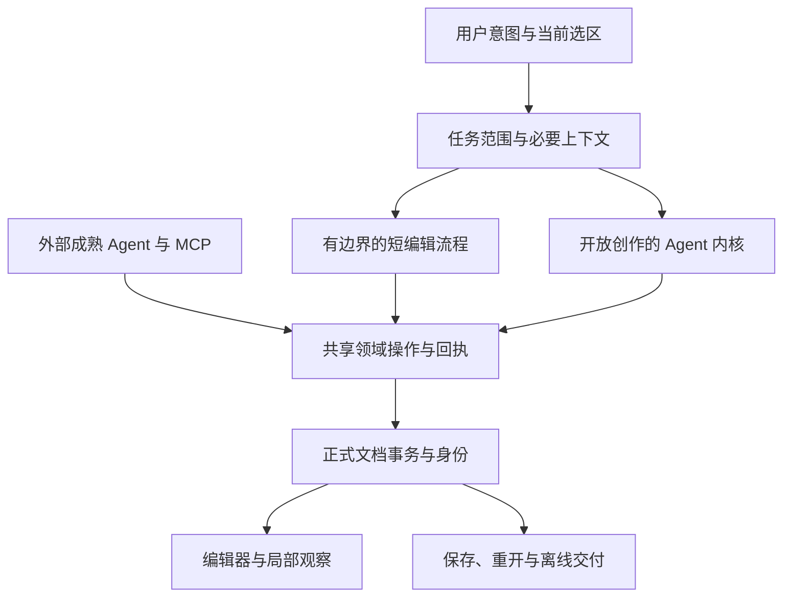

# 果铃工作台：架构路线与 AI 生产力综合研究

> 状态：历史研究与技术参考。2026-10-27开发前收口后，开发治理见 [DEVELOPMENT](DEVELOPMENT.md)，当前行动见 [下一阶段执行方案](docs/development-plan/NEXT_EXECUTION.md)。下文保留原时点的证据、失败、建议与授权语境，不再作为并行启动清单。

**研究日期：2026-10-27。研究基线：be65efef69c6be879ed5c4054624489c19031e4b，加接手时已存在的工作区整改。**

本报告用于下一阶段决策。本轮只读研究、原生子智能体交叉调查、历史真实执行记录复算和隔离分析；没有修改产品实现，没有启动新的正式创作，没有提交、推送或发布。本报告不代替原始审计台账，也不把旧验收自动转成当前验收。

## 阅读建议

先读“决策摘要”和第 2、4、9 节；技术路线见第 3、7 节；现有整改承接见第 8 节；全部 146 项去向在附录 A。证据路径、版本边界及互联网一手资料在附录 B。

## 决策摘要

**最值得优先解决的问题，是一次用户意图为什么被展开成过多的模型决策、定位、协议适配、装配和验证回合。** 当前证据不足以把总差距归为“自研 Harness 不行”，也不足以说“结构化方向没有价值”。但已有充分理由改变下一阶段的工作重点：从逐条修补功能，转向减少模型必须完成的工作，同时将通用执行器与果铃的领域能力分开。

这不是抽象判断。最新市集返修中，正式工程唯一的业务变化是一个原生表格单元格从 28 改成 30；对象身份、人工修改后的默认到场人数 1200、书摊固定成本 450 均保留，汇总数据自动更新正确。实际修改足够局部，仍用了 **14 次模型请求、18 条工具记录，监测墙钟 177.398 秒**。同一记录的 run 创建至更新时间为 167.371 秒，后验 QA 更晚，不能把这些端点混写为一个“完整合格 T3”。这说明必须同时保留两个事实：精确修改和联动能力已经存在；用户完成一次小修改的路径依然过长。[E05]

最新工程负载也改变了原优化顺序。10 月 26 日旧样本中，样式约占工程 JSON 的 79%—84%；本轮只读解包最新市集文件，A 的组件定义占 93.88%，C 占 88.95%。大头包括被复制进工程的内置 table、chart、html-program 源码。当前 enhancement 实现会在增强内置组件时将其完整源码捕获为 Source 定义。这是一个可定位的表示成本，不等于已经证明这些全部进入模型请求，也不等于文件字节就是墙钟瓶颈。[E02][E08]

**建议采用的方向是“以编辑关系决定结构、软件完成确定性工作、通用 Harness 可替换、内置和外部 Agent 共用领域能力”。** 保留正确目标、对象身份、可撤销、人工修改保留和可靠交付这些已成立的语义；复用 DocumentSession、History、资源闭包等基础，同时允许合并重复承担同一职责的实现边界；重新设计把普通局改和数据联动变成漫长 Agent 任务的路径。成熟内核应进入有边界的对照，不能只因历史投入继续扩建自研，也不能在没有同条件证据时整套替换。

下一阶段应先证明三个小而关键的闭环：

1. **准确指向的短改**：用户已有选区或已知数据目标时，直接带上当前身份、修订和局部事实；模型主要决定“改什么”，软件完成匹配、提交、派生更新及必要验证。
2. **可编辑的数据作品**：原始数据、持久化默认值、运行时试算状态、派生结果有明确关系；简单联动不需要每次重新学习内置组件实现。
3. **适合任务的创作入口**：连续阅读直接走已有 Flow/正文结构；自由排版和强耦合交互各用合适单元，避免先走错整页路线再返工。

多 Agent 是有条件的生产方式。先让独立任务拥有清晰输入和可装配产物，再并行；小修无需让主 Agent 变成只会调度的管理者。装配、ID 分配、事务和资源合并应由软件承担，不能把子任务节省的时间重新花在主 Agent 手工搬运内容上。MCP 与外部成熟 Agent 同样可以使用这套领域合同。

## 1. 研究范围、证据强度与限制

### 1.1 本轮如何接续历史工作

原审计汇总了 23 份报告、349 条来源意见，归并为 146 个事项；事项数不等于 Bug 数。原逐条核查已评估 146/146，保留了相反提案和错误归因。本轮全量承接其索引、原处置及 B0—B7 归属，对核心问题回到源码、原始输入、工具事件、请求载荷、保存工程和实际 UI 记录重新检查，而非重复统计报告中出现了多少次同一结论。[E01]

研究分为四条并行线：根智能体负责跨主题综合、全部事项承接、整改对账及工程只读解包；原生子智能体分别研究 Harness 历史与执行成本、结构化编辑与目标引用、多 Agent 与技能发现。子会话首次 DevSpace 读取发生长时间挂起，而根连接正常，随后改为根智能体统一提取源码/日志到共享研究区，子智能体独立阅读、复算、查阅公开资料并互相反驳。该工具接入问题不作为果铃产品缺陷。没有调用本机 Codex、Claude 或 OpenCode 作为研究代理。

使用以下证据分级：

| 标记 | 含义 | 本报告允许的结论 |
|---|---|---|
| D：直接证据 | 本轮读到的当前源码、原始执行记录，或本轮只读复算 | 可描述精确机制、发生过的行为和该样本结果 |
| M：部分落地 | 工作区有实现及相关历史测试/隔离记录 | 可说明哪些范围已改，不能据此宣布整个批次或产品已验收 |
| H：历史承接 | 继承原核查及明确版本的证据，本轮没有重放 | 保留原结论和适用边界，不伪装成现版复现 |
| P：待证假说 | 机制合理，但缺同条件实验或实际路径证据 | 可提出候选与判别实验，不能承诺收益 |
| R：不采纳强方案 | 原推论被反证、过强，或会重复建设 | 保留问题价值，拒绝不成立的归因和不必要实现 |

### 1.2 必须保持的比较边界

A 为外部主 Agent 通过果铃 MCP，B 为同类外部主 Agent 独立生成 HTML，C 为产品内置 Agent。最新 A/B 记录主模型是 GPT-6 Astra Pro；C 实际请求是 gpt-6.1-sol、chatgpt-responses，使用 xhigh。它们不是固定模型、固定宿主的 Harness 消融实验。题目、原生/代码组织、独立验收进度也存在差异。[E03][E04]

本轮没有重跑一套新的付费创作比赛。新证据主要来自真实历史执行的逐请求/逐工具核对、保存文件解包、当前代码路径和隔离机制分析。离线重算可证明文件组成、调用次数和已发生的行为；不能测出更换模型或内核后的真实速度。

接手时已有 33 个 tracked 文件修改及若干 untracked 整改、测试和报告。它们是本轮基线的一部分。本文区分 HEAD、工作区改动、之前的测试记录和本轮新计算，不把“源码存在”“测试有记录”“真实产品旅程合格”合并成一个完成状态。

## 2. 速度差距：哪些已经能确认

### 2.1 10 月 26 日旧对照的结论仍成立，但只在原口径内

| 路线 | 首次合格 T2 | 共同返修 T3 | 重要边界 |
|---|---:|---:|---|
| B：独立 HTML | 372.403 秒 | 95.816 秒 | 原实验口径 |
| A：外部 Agent + MCP | 909.667 秒 | 521.474 秒 | T2 为 B 的 2.44 倍，T3 为 5.44 倍 |
| C：内置 Agent | 1718.933 秒 | 1229.347 秒 | T3 含人工 Stop 与独立补验，属于辅助完成，不能当自主成功 |

原始 UTC 事件和 SDK 计时已复算。A 首创 24 次 SDK 调用的同步执行时间合计约 10.209 秒，只占 T2 的 1.12%；返修 27 次合计约 10.518 秒，占 T3 的 2.02%。因此，仅把领域工具内部执行加快，无法解释或消除这份样本的大部分差额。**但“墙钟减 SDK 时间”不是纯模型思考时间**，其中仍可能包含客户端/网络往返、工具准备、上下文组织、观察、验证器修正和人工等待。[E02]

旧 C 三个 run 共 87 次请求尝试、84 次完成，累计 input 5,417,000、cached input 159,232，缓存占 2.94%；这是多次请求的累计量，不是一个 prompt 长达 541 万 token。157 条工具记录包含 116 条根记录与 41 条嵌套记录，也不是 157 个模型回合。工具定义累计占 input 约 27.69%，值得优化；这仍不证明某个缓存参数缺失就是根因。[E02]

### 2.2 最新整改后的记录显示：可靠性进步与效率达标是两件事

| 最新任务/路线 | 原始时间或状态 | 请求/工具记录 | 本轮判读 |
|---|---|---:|---|
| B 市集首创 | T2 250.144 秒 | 不与 C 工具数直接横比 | 已有本路线 QA 记录 |
| A 市集首创 | T2 858.908 秒 | MCP 路径 | 本路线验收记录存在，独立盲评不据目录推定完成 |
| C 市集首创 | 监测 elapsed 1376.890 秒，run completed | 71 / 113 | 后面还有质量返工，不能写为最终合格 T2 |
| B 连续故事 | T2 303.580 秒 | — | 保留题目及本路线验收边界 |
| A 连续故事 | 候选 589.993 秒，随后被拒 | — | 原候选做成 4 个独立场景；冻结要求为连续阅读。后有 Flow 重做，但未找到合格 T2 收口 |
| C 连续故事 | 监测 elapsed 1493.653 秒，run completed | 67 / 147 | 不自动推导完整人工编辑与终版独立评审已通过 |
| B 市集返修 | T3 16.145 秒 | — | 原记录口径 |
| C 市集返修 | 监测 elapsed 177.398 秒 | 14 / 18 | 精确单格变化成立；后验 QA 与后续质量返工另记 |

这些数值用于判断“差距仍存在、路径仍长”，不用于计算“自研内核拖慢多少倍”。B 故事返修另有一个 4.7 秒局部执行事件，但完整记录后来采用包含准备的 51.118 秒保守口径；不能挑最小值比较。[E03][E04][E05]

C 市集又发生约 470.832 秒、30 次请求、54 条工具记录的质量返工。其 QA 时间晚于单格 T3。首次产出、业务返修、图表质量修正和独立验证必须分开，不能把后续修好反写为最初就合格。[E04]

### 2.3 最关键的成本模型

对用户有意义的是：

**首次合格时间必须按不重叠的实际时间区间分解。** 同时给请求与工具标注首创、返工、恢复、验收等阶段；阶段成本与执行类型成本是两套分类，不能相加。并行区间取真实关键路径或时间并集，避免把重叠的模型、工具和人工时间重复计算。

其中请求次数、单次等待、输入/输出量、模型档位和失败重试都会相互影响。减少几个小工具的毫秒，不一定减少一次模型往返；减少一次不必要的定位或发现决策，可能同时减少等待、上下文增长和后续恢复机会。

这解释了为什么应优先研究“模型为什么需要做这一步”。OpenAI 的延迟指南将减少请求、并行独立工作、将确定性任务交给普通代码列为不同的优化杠杆；它并没有给果铃的当前 OAuth 路径或实际任务提供特定提速承诺。[W01]

## 3. Harness 路线：保留产品控制，不把通用循环自研当成目的

### 3.1 历史决策有合理动机，但没有完成性能证明

本轮把仓库中的 S05、10 月 8 日综合评估、git 历史与历史会话检索分开使用。会话检索只能辅助还原意图，不能代替当时实际代码。可确认的演变如下：[E07]

| 时间与材料 | 当时解决的问题或决定 | 今天应如何理解 |
|---|---|---|
| 9 月中下旬历史会话 | 外部 CLI 接入起步快；随后三个 CLI 随版本分别维护造成负担 | 旧 Adapter 的维护困难真实有意义，但不等于所有成熟 Harness 的嵌入方式都失败 |
| 9 月 23 日历史会话 | 用户提出以自建执行器为核心，退役三 CLI，保留 MCP 外部协作 | 体现产品控制和维护收敛诉求；不是同条件性能实验结论 |
| 9 月 25 日 S05 的 git 版本 | 果铃拥有 ExecutionEngine、任务循环、工具闭环、取消与回执；同文明确允许成熟 SDK/轻量 Agent 核心 | “产品拥有执行语义”与“每个通用部件自写”不是同一要求 |
| 10 月 1 日历史会话 | 为避免反复迁移和回滚，暂不转 Pi/OpenCode/ACP、不建设双运行时 | 是当时的收敛约束；不能成为今天拒绝重新比较的永久理由 |
| 10 月 8 日综合评估 | 单 Agent 主循环已形成，但成熟度和复杂任务成功率没有量化证明；撤回“达到 pi 的 60%—70%” | 已有历史反思支持复用通用能力；不能把测试通过率写成长任务成功率 |

**未找到的证据也必须明确：**本轮没有找到“计划采用的 pi-core”最早完整选型文件、明确放弃它的对照记录，或能证明 pi 包曾接入生产后又删除的依赖历史。针对 package.json、package-lock.json 及规划目录的 git 关键词检索无命中，不足以证明历史上从未讨论或试验过 Pi。因此，本报告不编造一条已经实施过的“CLI → Pi → 自研”技术迁移链。

较准确的历史评价是：从 CLI 适配转向可控产品执行层具有合理性；如果随之承担了大量协议、会话、压缩、流式恢复的长期维护，却没有持续比较收益，那么合理的阶段性选择可能逐渐变成未经验证的默认路线。这里要重新验证的是边界，不是追责某次决定。

### 3.2 自研的独特价值究竟在哪里

果铃真正需要掌握的是：当前用户与选区指向什么，哪些对象可以改，正式内容如何提交与撤销，人类已经改过什么，什么已经保存，停止以后哪些写入必须被阻断，以及观察失败是否影响已提交事实。这些是领域语义和产品承诺。[E06][E09]

通用模型循环、厂商协议、流式解析、会话压缩、工具发现、排队、通用重试和上下文持久化，则可以复用成熟实现。保留领域控制也不意味着当前每一个中间模块都不可改变：如果几层都在要求模型重复证明相同事实，应允许合并其最短路径，只保留正确目标、冲突保护、可撤销、人工修改保留和真实交付这些保证。

自研仍可能有独特优势：低耦合的桌面状态事件、对未保存文档的精确观察、停止后的写屏障、跨提供商策略，以及与正式对象事务深度整合。问题在于这些优势有多少必须放在通用 Harness 内部，而不能由一个可靠的领域工具/宿主接口提供。当前材料没有证明后一种集成不可行。

### 3.3 当前长任务的成本已经可见，归因仍需要拆开

本轮从原始 requests 独立复算以下数据；工具 token 是载荷估算，input/cached 是记录中的 usage。数值用于描述同一组日志，不把估算和供应商计费等同。[E04][E05][E12]

| 指标 | C 市集首次 | C 连续故事首次 | C 市集单格返修 |
|---|---:|---:|---:|
| 请求尝试／完成／失败 | 71／70／1 | 67／64／3 | 14／14／0 |
| run 创建至更新时间 | 1361.243 秒 | 1478.713 秒 | 167.371 秒 |
| 第一请求首内容等待 | 4.294 秒 | 2.565 秒 | 4.485 秒 |
| 各请求首内容等待累计 | 905.539 秒 | 876.336 秒 | 90.262 秒 |
| 累计 input usage | 7,695,267 | 6,438,004 | 536,906 |
| 单请求 input 峰值 | 165,909 | 163,854 | 54,478 |
| 累计 cached usage | 507,904 | 464,896 | 0 |
| cached／input | 6.600% | 7.221% | 0% |
| 工具定义估算累计 | 1,975,313 | 1,156,450 | 232,610 |
| 工具估算／累计 input | 25.669% | 17.963% | 43.324% |

这里的 905.539 秒不是开始后一直空等约 906 秒，而是 70 个有效记录的首内容等待之和。firstEventWait 已包含在 firstContentWait 中，不能相加。769 万 token 是累计输入，不是单请求上下文。最新记录尚不足以把请求派发、网络、响应头、供应商排队、预填充与推理逐项分离，因此不能把上表全部等待归为模型思考或网络问题。

请求数量多、工具面重、输入反复携带、失败重试和高推理档位都可能叠加。当前任务还存在领域层定位、采用和交付回合；这部分即使换成更成熟的内核也可能仍然发生。相反，工具平均执行很快也不能证明内核组织得高效。

### 3.4 一个已经验证的机制：原始记录只追加，发送投影仍会改写旧历史

当前 ExecutionContextProjection 默认保留最近两轮；较大的工具结果离开近期窗口后，变成摘录、尾部和来源引用；较大原生调用参数的旧轮次也会整体归档。ExecutionEngine 每轮调用这一投影。原始 RunStore 记录保持 append-only，并不意味着后一次发送内容以前一次为完整前缀。[E06]

本轮复制当前真实 projectExecutionContext 函数，在隔离脚本中排除观察退休、业务回执解释和最终超大包裁剪的影响，使用固定消息、两轮调用，再追加第三轮；根智能体核对函数正文与源码完全一致并重跑。结果如下：[E14]

| 隔离情景 | 先前 6 条消息中不变的前缀 | 发生什么 |
|---|---:|---|
| 500 字符工具结果对照 | 6 条 | 旧消息完全保留 |
| 第一轮 10000 字符工具结果 | 3 条 | 原第 4 条工具结果被改写为归档表示 |
| 第一轮 10000 字符调用参数 | 2 条 | 原第 3、4 条整轮被改写 |

三个情景的原始消息都没有改变。这证明通用保留窗口本身能够改变发送前缀；它不是对真实供应商缓存的复现，JSON 字符前缀也不等于 token 前缀，不能据此声称解释了全部低命中率。

OpenAI 的 Codex 工程说明把稳定前缀、工具顺序和增量附加作为缓存的重要条件，同时也明确上下文需要在适当时候压缩。值得借鉴的是权衡压缩收益与重复预填充成本，而不是永远保留全部历史。[W02]

还有一个反证：T3 十四次请求的工具集合没有再通过 tools.load 扩展，工具估算始终是 16,615，但 cached usage 仍全为零。这说明不能只用本 run 中 tools.load 扩展工具面解释低缓存；工具顺序、描述、schema 内容与其他前缀是否稳定，仍需逐请求比较。当前 B5 的保序和减少 schema 回声是有效方向，但不等于缓存已收口。

源码中默认 prompt_cache_key 限于匹配条件的官方 OpenAI API-key 路径，OAuth 路径不默认发出。当前 C 走 chatgpt-responses。**缺少默认 cache key、投影改写、模型端缓存策略和请求路由是不同变量**；没有端点支持与实际对照，不应盲加参数，也不能保证缓存达到 81% 或节省固定比例额度。

建议先基于已保存请求标注第一次发生前缀分歧的位置、工具/指令变化、观察退休和归档边界，再在真实支持的同一端点做最小消融。中期候选是稳定的任务段落加明确压缩边界、近期有效事实和按需回读；是否采用，应由总延迟、费用和信息保留共同判断。

### 3.5 成熟内核值得比较，但必须选清楚层级

| 候选 | 能复用的部分 | 集成代价与限制 | 本报告建议 |
|---|---|---|---|
| 现有 Engine＋局部成熟组件 | 最大限度复用当前产品接线 | 继续承担通用协议、上下文和恢复维护 | 保留为基线，停止未经验证的横向扩建 |
| Pi 的 AgentSession／coding-agent SDK | 会话、工具循环、排队、压缩、扩展和模型边界 | session owner、事件映射、停止和恢复语义需要对齐；只接极薄 agent-core 后继续自写其余部分，节省可能有限 | 适合作为进程内窄对照的优先候选，先固定具体版本和层级 |
| Codex App Server＋果铃领域工具/MCP | 成熟会话与 GUI 嵌入接口、事件和恢复能力 | 独立运行时、可用模型/认证覆盖与领域接线成本；直接 dynamicTools 回调仍属实验 API，可先比较既有 MCP [W14] | 是外部成熟宿主的重要路线，不应等同旧一次性 CLI 文件中转 |
| Claude Agent SDK＋领域工具 | 代理循环、上下文、子任务和工具隔离 | 更自然地适配其生态，不能假定覆盖果铃所有模型与低成本渠道 | 在模型/渠道需求吻合时比较，不为选型引入第二套产品事实 |
| Pi Durable | 长任务持久化与多会话机制有参考价值 | 官方 2026-10-01 仍标为 experimental [W12] | 观察研究，不当作已经成熟的替代品 |

截至本轮读取的 Pi 官方 SDK 文档，AgentSession 和 SessionManager 有明确会话所有权；模型运行时、资源加载器与工具可由宿主提供。CLI 自带的 codemode、tool_search、MCP 扩展不自动进入 SDK 会话，需要显式配置。不能以“用了 Pi”代替对实际集成层的说明。[W03]

Codex 官方说明，App Server 用于把同一个 Harness 嵌入交互产品；旧 Codex-as-MCP 不容易完整表达会话语义。这提示可复用路线不限于包一层 CLI。Claude SDK 的子 Agent 则提供独立上下文和受限工具等机制，是否符合果铃的任务与渠道仍需本地验证。[W05][W06]

**推荐是保留一个生产执行所有者，做一次有截止条件的候选比较。** 不同时建设多内核自动路由，不让两个层各自重试、压缩、恢复或判定任务结束。领域提交与权限仍由果铃裁定；模型会话的上下文和通用恢复归选定内核所有。迁移成功标准包括减少持续维护面，而不只是跑通一条 demo。

## 4. 结构化创作：真正的瓶颈是编辑关系与任务接口

### 4.1 “改得局部”和“改得快”必须分别验收

旧实验已经证明局部性：A 的 111 个实例中 5 个发生变化，C 的 146 个中 6 个发生变化，身份与顺序保留；但 A 有一个 frame 因内容变长而改变，不能写成全部几何不变。最新市集又出现了更强的正例：只改表格单格，经现有数据与增强链，派生总订单 480、营业额 19,392、总成本 11,524、净结余 7,868 自动正确，人工修改也保留。[E02][E05]

因此，根因不能概括成“Agent 总是重建整页”或“没有数据绑定”。实际问题包括：

- 用户的准确目标有没有在请求开始时传给 Agent；
- Agent 是否能直接看到完成这一任务所需的最小局部事实；
- 已有目标、读取资格、当前修订和保存目标是否贯通；
- 修改成功后，软件能否给出足以结束任务的可信回执；
- 是否把一次局改重新当作一轮发现能力、读取方法、定位文件和交付作品的创作任务。

稳定 ID 是必要基础，却不自动回答“咖啡单价是哪一个对象里的哪一格”“这个值影响哪些图表”“哪些人工修改应保留”。

### 4.2 精确引用要看整条链，不只看 API 是否有 instanceId

最新 T3 原始输入确实冻结了 documentId、epoch 和 revision 28，但 selection 只有 course-surface，没有表格或单元格。它沿用创建任务的 conversation，并非完全冷启动；历史中可能已有相关身份，但本次没有把明确 cell 引用作为任务目标直接绑定。实际轨迹是：[E05]

| 模型请求（从 1 计数） | 实际动作 | 判断 |
|---|---|---|
| 1 | project.list，limit 100 | 重新查看工程目录 |
| 2 | programmatic.execute 内继续 project.list，offset 40 | 多一层程序化结果中转 |
| 3—4 | 分段 programmatic.read | 两轮用于读回定位结果 |
| 5 | 读取业务表、默认值表、表格增强 view 与控件 HTML | 得到修改所需局部事实 |
| 6 | project.apply，按 cell ID、column ID 将 28 改为 30 | 真正写入足够精确 |
| 7—8 | 观察正式页面、打开 GLX 取得保存目标，再 file.save | 可研究同一授权下的软件接续 |
| 9—11 | 导出被拒；把旧离线文件改名；重新导出 | 旧交付文件存在，引入两次额外决策 |
| 12—14 | 打开离线文件、观察、最终答复 | 交付与终止继续占用请求 |

正式工程差异只有 revision 28→29 和表格目标单元的 text 28→30；其余身份与人工改动保留。18 条工具记录中 17 条为根记录，1 条为嵌套记录。前五轮首内容等待累计 21.059 秒；写入之后八轮累计 63.691 秒；其中失败导出与改名两轮为 23.495 秒。这是等待字段的局部分账，不是所有阶段墙钟占比。

需特别反驳一个容易出现的归因：此轮读取的表格 view 只有约 3585 字符，控件 HTML 约 2353 字符；**没有读取百万字符的内置 table 实现**。大型 Source 定义确实存在于工程，但不能把本次返修慢直接归因于模型读入全部依赖源码。

10 月 26 日 C 的 revision1 和 rework1 也只绑定到 course-surface，之后反复列目录、按摘要和位置筛选、读取具体路径，最后才执行局部更新。这与最新单格例子相互印证：在这些已核对的返修中，精确对象路径/ID 主要在 Agent 定位后获得，不能说此前已充分验证“从用户选区直达局改”的优势。A 的全部编辑入口没有在本轮逐一重放，不扩张为“所有路线从未利用过选区”。[E15]

Tiptap 官方的选区方案强调提交时捕获具体选区与位置；其 workflow 入口则面向单一明确动作。这为果铃提供一个可比较的产品机制：选区明确的短改可走有边界的转换流程，开放创作再交给自由工具循环。借鉴此边界无需替换当前编辑器。[W07][W08]

目标上下文至少应区分四层：

| 层次 | 应由软件提供的事实 | 模型主要承担的工作 |
|---|---|---|
| 文档/页面 | documentId、epoch、当前 revision、页面范围、实际可写目标 | 判断用户意图是否跨页或跨文档 |
| 对象/选区 | 当前对象身份、文本范围或数据单元、对应内容、必要父约束 | 决定如何修改表达或业务含义 |
| 编辑关系 | 数据来源、派生消费者、相关邻居、现有人工修改 | 判断修改是否应联动、是否涉及结构变化 |
| 执行回执 | 已提交差异、当前修订、派生/观察状态、保存结果 | 处理真实歧义或未满足的用户要求 |

“选区已知”的短改不应重新搜索整个工程；“选区未知”的自然语言修改应有一次紧凑的查询/候选定位路径。出现歧义才让模型进一步判断，真实冲突才让用户选择。不能用去掉 CAS、忽略版本或静默覆写来换取快。

tldraw 的官方 Agent 示例把用户选区、视口内简化形状、重点对象和视口外聚合信息区分提供，而不是把全画布完整细节默认灌入请求；其动作层再负责校验和执行。可借鉴的是“按任务和关注范围投影上下文”，不是迁移整个编辑器或认为该示例已解决果铃的性能问题。[W04]

### 4.3 结构粒度应由未来的编辑操作决定

把所有 DOM 盒子拆成对象，会保留很多局部几何，却可能丢失“这些数值属于同一条业务事实”的关系。把整个页面装进一个程序对象，创作可能简单，却会使许多人工编辑退回源码。两条路线都有合法使用范围，不能用原生节点比例选择。

建议采用下列默认粒度，复用现有机制：

| 作品内容 | 合适的正式编辑单元 | 应避免的成本 |
|---|---|---|
| 连续正文 | 段落、标题、列表、图文块等 Flow/正文结构 | 先测量整页绝对坐标，再逐小块还原阅读关系 |
| 可复用数据/图表 | 一份数据源、可识别的行列/字段、派生关系、视图参数 | 多处复制常数，修改一个值要搜索并重写多个对象 |
| 自由排版 | 有独立编辑意义的文字、图片、形状与语义组合 | 每个装饰性 span/div 都成为需要 Agent 管理的对象 |
| 强耦合交互/动画 | 一个局部 Source/Runtime 组件，外露必要数据、参数和事件 | 强迫每个内部细节原生化，或用整页黑盒吞掉全部可编辑内容 |
| 持久化默认值 | 可见、清晰的编辑入口，与实际试算控件连接 | 为了可保存而临时把技术参数变成作品上的辅助表格 |
| 样式与主题 | 共享作者样式、有限必要的测量事实 | 每次采用都复制大量与表达无关的浏览器默认值 |

“更粗”或“更细”都不是目标。目标是用户预期的改动可以落在少量明确单元上，相关事实能自动联动，不相关内容不被重做。旧结构化成果的身份、History 和局部提交应继续使用。

更大胆的候选是**渐进结构化**：允许熟悉的 HTML/CSS/JS 或连续文稿作为局部创作输入，明确哪些内容是人类需要独立编辑的语义单元，只在这些边界建立正式数据和编辑接口。它不等于任意 HTML 都能无损转回可视化结构，也不能形成“外部源码”和“工程结构”两个互相争夺真相的写入者。若采用这条路线，源模块、参数与编辑操作必须仍归入同一个正式工程和事务所有者。

### 4.4 新发现：普通增强会捕获完整内置组件源码

本轮对最新保存文件做只读 ZIP 解包，统计未压缩 project.json；以下不是模型输入大小，也不是压缩 GLX 的磁盘大小：

| 当前文件快照 | revision | 工程 JSON 字节 | 定义占比 | 显式 style 字段占比 |
|---|---:|---:|---:|---:|
| A 市集 | 9 | 2,231,850 | 93.88% | 5.07% |
| C 市集（含后续整改） | 31 | 2,964,183 | 88.95% | 9.28% |
| A 故事原路线后续快照 | 18 | 456,018 | 0.34% | 88.28% |
| A 故事 Flow 重做 | 6 | 34,833 | 3.49% | 0.93% |
| C 连续故事 | 20 | 78,714 | 1.71% | 59.73% |

style 占比只统计相应字段，不包括嵌在局部代码中的 CSS。A Flow 重做的文件小，不代表它已经质量合格，也不能把不同内容、不同版本的体积差直接当性能收益。[E08]

C 市集最大的定义为：

- source-guoling.table：1,139,235 字节；
- source-guoling.html-program：944,668 字节；
- source-guoling.chart：541,870 字节；
- 另有增强运行时代码、业务增强模块及小型包装定义。

当前 componentAuthorSource.ts 中，prepareComponentAuthorSource 对 builtin 读取 getBuiltinComponentSource，创建完整 Source 定义；componentAuthorEnhancementEdits 在此基础上生成实现、增强、运行时和包装模块，并给实例挂 implementationOverride。实例仍可能显示为原生 table/chart，因此“原生组件数量很多”不能反映背后的实现成本。[E08]

这个设计有合理动机：需要冻结实现、支持深度定制和离线闭包。问题是**仅给一个现成表格增加普通业务联动，是否也必须立即冻结整份内置实现**。建议区分：

1. 常规数据/参数联动：沿现有数据与绑定接口使用内置能力。
2. 局部行为增强：优先探索版本明确的内置引用加短增强模块。
3. 真正改写内置实现：显式进入 Source 分叉，承担完整复制与维护成本。

这里可以重新设计，但本轮没有实现或证明新表示一定更快。必须验证编辑器、Undo/Redo、离线导出、版本锁定、资源依赖和跨实例隔离都保持。工程字节、编译/保存时间、模型可见内容和最终打开时间分别计量，不能只做压缩率漂亮的改造。

### 4.5 人机职责：不要把确定性软件工作外包给模型

模型适合决定表达、结构、业务解释及不确定的设计取舍。软件更适合分配和解析身份、维护 read-set、检查冲突、执行事务、计算确定性派生值、合并资源、保存与生成交付回执。

这并不要求“新增一个万能高层编辑平台”。已有 project.apply、批量编排、DocumentSession 和专业编辑能力足够形成第一条短路径。应先去掉已有目标的重复发现、已成功动作的重复执行、可计算派生值的人工多处改写和每次查看都全量导出的步骤；仅在这些工作仍重复时，封装一个边界清楚的领域动作。

一个小修改的合理过程是：读取明确目标及必要关联 → 生成局部意图 → 一次正式提交 → 软件检查直接影响 → 返回可结束的结果。不是规定每次必须固定为一两次工具调用；需要的语义判断、冲突处理和质量验证仍应保留。

### 4.6 UI/UX：有编辑能力还不等于容易编辑

本轮查看的是最新实验保存的真实操作截图与 JSON，不是对当前运行界面做了一轮新的完整可用性审计。

现有记录证明：原生表格可以通过键盘/Tab 修改单元格，Undo/Redo 能恢复，新增/删除行列和保存也有真实操作证据。最新 UI 修改修复了表格提交边界、改善单元格可访问名称，并让对象列表/面包屑更容易识别。这些应保留。[E13]

同时，历史截图中的九列表格编辑区被压在较窄侧栏内，输入框很窄。完成操作的自动化脚本不能证明真实用户操作轻松。另一个样本把默认 N/W 做成作品上可见的两列表格；这是一条可工作的作者方案，但不能因此断言软件没有通用参数编辑器——当前已有全局参数、组件 dataSchema 与属性编辑相关实现。

下一步应观察少量真实用户完成“改一个数据并联动”“改默认情景”“撤销误改”时的操作和理解成本，再决定是否需要专门的数据编辑区域、就地编辑或参数入口。让用户清楚地区分“保存的默认情景”和“当前试算值”有直接价值；无需向普通用户暴露 scope.state、implementationOverride 等实现术语。

## 5. 多 Agent：基础机制已有，当前断点在“可用但未选择”

### 5.1 最新创作为什么没有用，哪些理由已经排除

最新 C 市集、C 连续故事及 C/t3 的实际工具记录均无 delegate 调用。C-story 的 delegation/jobs 目录确有一个失败 job，但 executionKind 为 local，没有 childRunId；它不能作为调用原生子 Agent 的证据。[E09]

只看初始 47 个工具 schema 中没有 delegate，会得到一个不完整判断。更深的运行时证据是：两次首创都实际读取 orchestrate-courseware，随后读取 material-assembly；后者分别约 7802 和 8213 字符，均未截断，包含 delegate.agent 的目标、候选源码和 project.apply.from 采用路径。tools.load 的可用 jobs 列表包含 delegate.agent/resume/read 等 14 项，unavailable 为空。主 Agent 后来加载过其他能力，却没有申请加载或调用委派。

因此，可以确认的断点是：**说明已经到达、能力可以发现，模型没有选择进入委派路径。** 不能归因为注册缺失、整个 jobs 隐藏、Skill 截断或本次存在明确的权限拒绝；也不能在未调用的情况下证明执行层完全正常。

模型为什么没有选仍未确定：任务耦合、规模、分解收益、采用成本、首段工作流惯性、指令显著性都只是候选解释。多一次加载可能增加摩擦，但模型可以在已有 tools.load 回合顺便加载，不能把一个额外往返直接定为唯一原因。继续增加一篇更长的多 Agent Skill 也缺乏依据。

### 5.2 不应重建已经存在的生产基础

当前 NativeTaskRunner 是现有 Engine 的 run adapter，没有另造 Provider client。它建立独立候选空间，显式传入冻结来源和 sharedBrief，沿用相应模型/视觉/压缩选择；documents 为空，不继承父文档的正式写入资格、上传授权或原始文件系统绑定。parent/child run、停止/恢复和用量归属已有实现。[E09]

WorkbenchServiceTools 的 delegate 描述已指向独立成果单元，并提供 job.wait → delegate.read → project.apply.from 的直接采用方式。主 Agent 不必把子任务的长源码重新读一遍再重写。角色偏好不等于自动最小工具集；子任务默认沿用父模型，也不等于自动获得廉价生产模型。

值得保留的是候选空间、明确输入和一次正式采用的分工。待验证的是：典型任务是否自然进入这条路径，候选可否低成本采用，整体风格与业务事实是否一致，失败与取消能否清楚收口，以及最终净收益。

### 5.3 合理生产方式不是“主 Agent 永远只调度”

先区分两种并行：独立读取、验证、资源加工等确定性工作，通常可在软件或一次程序化调用内并发；需要独立思考、生成候选或复核的工作，才值得增加模型上下文。

已有 programmatic 能力应先把过滤、聚合和确定性控制流留在执行器内，只返回决定所需结果。把完整列表搬到执行器后再让模型分几轮分页读回，并不会自动减少往返。Anthropic 的 MCP 代码执行经验支持这一分工；果铃无需因此另造一套平台。[W13]

| 任务 | 建议组织 | 主要风险 |
|---|---|---|
| 明确选区的小改、单格数据改动 | 主 Agent 或有边界的转换直接完成 | 分包反而增加交接与结束判断 |
| 多个相对独立图文/素材单元 | 主 Agent 保持整体创作，子 Agent 分别产出候选 | 共享事实、风格和资源需要紧凑约定 |
| 同一数据模型驱动多个强耦合交互 | 一个主要作者掌握关系，局部独立工作再分包 | 切开后持续互相等待，最终主 Agent 重写 |
| 独立质量检查或证据审查 | 独立上下文复核，返回具体问题和依据 | 不应再做一次无边界“全面重创作” |

软件负责身份、资源、引用和事务合并；主 Agent 负责整体含义、风格冲突和必要的最终选择。共享少量风格约定不代表不适合并行；真正不利的是持续循环依赖和反复转抄。

理论关键路径可近似写成：规划与交接 + max(独立分支时间) + 采用 + 全局修正。费用通常要加上全部分支与主 Agent 的消耗，还可能受并发限额影响。不能承诺开三个 Agent 就快三倍，也不能只用第一个候选完成时间忽视复核减少返工的价值。

Anthropic 2026-10-22 的经验提醒：固定 router/planner/domain 分工可能增加交接和信息丢失；并行探索、独立检查及隔离仍有价值。它支持按实际边界选择组织，不支持所有任务强制单 Agent 或多 Agent。[W09]

### 5.4 MCP 与外部成熟 Agent 同样可以参与

外部宿主可以使用自己的原生子 Agent，再经果铃 Gateway 采用候选；也可以调用果铃已有 delegate；或者仅在一次代码执行中并发独立工具，不另建 Agent。这三条都可复用正式文档语义。MCP 本身不是生产组织，也不赋予服务端直接操纵外部宿主内部 spawn 的能力。

当前 MCP Tasks 扩展提供异步任务句柄、状态、取回与取消，不规定语义分工、上下文分发或成果合并。没有必要把引入 Tasks 或 A2A 作为本轮生产力优化前置。[W10]

下一步应主动指定一个具有合理独立性的单元使用现有 delegate，与主 Agent 直接完成、单 Agent 软件并行比较。先证明首次合格时间、质量、总费用和返工有净收益；有收益却自然运行仍不选择，再比较短策略提示、直接预载 schema 等入口因素。**调用率上升不是验收目标，省去不必要工作才是。**

## 6. 细小摩擦如何叠加，以及 Skill、上下文、观察应该怎样一起改

### 6.1 当前更像一条累积成本链，而不是一个慢函数

已核对的任务中，局部修改可以提交正确，SDK 内部执行也不占墙钟大头；同时存在页面级目标、反复目录发现、分页回读、宽工具面、旧历史投影变化、同名导出拒绝和再观察。这些因素不必各自很严重，就能让任务变长。

一种与证据相容的链条是：目标不够明确 → 额外查询与读取 → 更多模型请求与历史 → 需要更早裁剪/回读 → 再增加定位与恢复机会；修改后交付状态不贯通 → 模型继续处理本可计算的保存、导出和结束条件。链条前后不是独立变量，不能把每项预计节省相加得到总提速承诺。[E05][E06][E15]

这比“模型不聪明”或“结构化天然慢”更可操作。判断优化价值应问：它有没有删掉一次必须由模型决定的分支，减少一次重新理解工程，或使一个已成功动作能够可靠结束？某个优化即使只少传 1KB，如果消除一次错误恢复，价值也可能高于大文件压缩；反之，压缩了 80% 工程字节却不在关键路径上，未必缩短任务。

### 6.2 Skill 应降低学习成本，不能替软件承担状态机

当前已有能力/方法拆分、按需读取与生成目录，不能再把“需要拆分 Skill”当作空白工程重做。近期 material-assembly、teacher-controller、main-progression 的定向修订也确实存在。但方法更新本身不能解决目标未传入、读取资格失效或导出归属不明。[E10]

建议按三类处理内容：

- **必须由软件提供的当前事实**：准确目标、当前版本、可写范围、已采用结果、当前交付路径、是否保存成功。不要写成让模型记住并手动重建的操作口诀。
- **少量稳定任务合同**：如何读取局部内容、怎样表达一次编辑、怎样辨认成功/冲突/待验证；给一个代表性短例子。高频路径应直接可用，不靠连续读几篇说明才会操作。
- **按需方法与参考**：设计方法、复杂组件用法、领域示例、素材与模板。按任务匹配，也允许拒用，不把“没读参考”本身当失败。

按需读取的目标是总任务成本最小，不是首轮 token 最少。已知任务需要的内容可预取，少见能力再展开。Anthropic 的上下文工程文章明确讨论了运行时探索的延迟代价，以及前置一部分内容、保留自主查询的混合策略。[W11]

因此，不建议机械规定“工具最多 10—15 个”“入口 1500 字符”“每次创作固定六阶段”。相同数量的工具可能有清楚或混乱的语义；更有用的是任务相关、命名稳定、参数清晰、结果可结束。T3 初始已经有 63 项工具，却仍要重新定位；零 tools.load 也没有缓存命中。这比工具个数本身更值得诊断。

### 6.3 上下文要保留决定和身份，不反复搬运机械细节

长任务应有明确、紧凑、可追溯的状态：用户已确定的要求、人工修改、正式文档身份与修订、已成功采用的成果、未解决问题，以及必要的局部依据。原始记录完整保留，模型工作上下文可按任务投影；两者的职责不同。

当前已有来源引用、context.read、观察退休、工作摘要与 changed work/doc facts 追加机制；不能继续沿用 10 月 8 日“只截最后几段文本”的旧结论描述现状。应检查这些机制是否让真实任务少回读、少忘记，以及是否以合理频率改变发送前缀。[E06][E07]

对截图也一样：原图保留用于追溯，模型副本可以适配其实际视觉需要；中文小字、数值和布局边界不能因缩图而失真。大图字节不直接等于图像 token，是否降采样应看任务正确率和真实 usage。回收已过时观察有必要，永久保留全部旧图不是缓存优化方案。

### 6.4 观察、写入和交付要分清真实状态

B1 新改动给观察总流程设置有 owner 的约 20 秒截止，并处理父取消、晚到图像与有界清理。将“动作已应用”和“观察成功”分开是正确修复。它不证明旧挂起的唯一根因，也不能自动销掉同一回执 DOM/像素不一致、首次内容可见或跨视口验证的问题。[E11]

公开 view.observe/HTML 动作 schema 当前仍没有 CSS viewport 参数，而内部预览有相应能力。正式实验需要两个桌面视口时，作者绕道包装或新开页面可能增加成本。这个较小接口缺口应与短编辑闭环一起优先处理；但必须继承正确目标与未保存内容语义，不能仅在外部浏览器里拍到一个与正式稿不同的页面。[E11]

程序化批量中的子截图是否可靠进入模型，是另一项潜在高价值优化。原审计已有相关问题，本轮未完整重验当前所有 runner 的图像出口，故保留为 H/P。先核对实际出口；如果成立，补这个边界可能使多步观察留在一次软件执行中，而不必创建更多模型轮次。[E01]

交付方面，用户已经要求保存并更新同一离线成果，软件应尽量消费这个明确意图；同名文件可能是上次本任务导出，也可能被外部修改，二者要区分。正确方向是带版本与归属的更新、准确冲突回执，不能直接取消保护或把每次合法更新都变成“拒绝—改名—重导”。

## 7. 从产品本质重新选择路线

### 7.1 果铃需要证明的价值

果铃最有机会形成长期价值的承诺是：**AI 能快速生成有表现力的作品，人可以直接理解和修改关键内容，后续 AI 接着人类修改继续工作，作品能够可靠保存、重开和独立交付。** 这是本报告提出的定位建议，不是已经得到市场验证的结论。

它包含四种可验证收益：创作表达、真正的人类编辑、连续迭代、可靠交付。拥有更多原生节点、更长的能力目录、更多模型渠道或自有 Harness，都不是用户价值本身。现有 Source/Runtime、Flow 和原生组件应服务于这些收益，不应成为每份作品必须经过的技术仪式。

“专业创作工作台”和“通用 Agent 宿主”可以共存，但竞争资源不同。若下一阶段同时追求所有 Agent 平台能力、所有内容模型、全套跨客户端适配和每种编辑细节，维护面会继续扩大。建议首先围绕桌面可编辑作品证明闭环；外部成熟 Agent/MCP 作为一等入口，内置 Agent 提供选区、连续性和低操作成本方面的独特便利。内置的目标不必是在每个通用任务上超过专业编码宿主。

### 7.2 结构化的生命周期优势不能只靠未来想象

对相近质量和交付要求，生命周期成本应包括首次创作、各次人/AI 编辑、验证与恢复，以及人工注意力。当前 AI 首创与返修都更慢时，不能声称“只要改得够多总会赚回来”。

若只比较时间，并假定每次修改代价固定，结构化首创多花 ΔC，后续每次相对 HTML 节省 ΔE，只有 ΔE > 0 时，修改次数超过 ΔC/ΔE 才可能抵消首创差额。当前已测样本尚未证明 AI 返修有这样的正节省；人类直接编辑、复用和可靠性仍可能有收益，但需要另行实测，而非拿假定收益抵扣现在的延迟。

因此，下一轮同时看两个任务：一个精确选区短改，一个连续图文首创。前者检验结构化是否兑现迭代价值；后者确保优化没有把产品缩成一个数据表工具，仍能快速完成自由表达。

### 7.3 内容表示与 Harness 是两条独立决策轴

| 产品表示路线 | 优势 | 现实成本和风险 | 判断 |
|---|---|---|---|
| 继续扩大全面原生化和逐对象控制 | 局部身份、属性编辑与统一选择能力强 | 把装饰细节也提升为正式对象，增加采用、定位、几何与上下文负担 | 保留适用部分，不作为所有作品的默认目标 |
| 整页代码作品＋少量可编辑入口 | 熟悉 Web 表达，首次创作链短 | 人类可能仍依赖代码；局部关系难以稳定暴露，后续 AI 容易重做 | 是有合法场景的产品选项，不能假装等价于完整可视化编辑 |
| 语义结构＋局部代码组件 | 文稿、数据、自由排版和强耦合交互各有合适边界 | 需要清楚的跨单元数据/参数合同与一致交付 | 推荐主方向，优先使用现有能力形成最短路径 |
| 渐进结构化／代码优先的可编辑区域 | 在真正需要人改的位置建立正式接口，减少转换 | 需要界定哪些编辑可保真；任意 HTML 双向同步可能极其昂贵 | 值得有边界验证，不先承诺通用无损转换 |

无论采用哪种表示，都可以配现有或成熟 Harness。把两条轴绑成“必须自研循环才能结构化”“采用成熟 Agent 就只能整页 HTML”，会人为缩小方案空间。

### 7.4 推荐的职责划分

下面是建议的职责关系，不是本轮已经实施的新架构。

复用现有单一 DocumentSession 写入者，不增加一个竞争的内容真相。模型可以提出编辑、生成局部候选、选择设计方案；软件负责可确定的解析、校验、依赖采用、提交和交付。领域层也允许简化内部边界，只要现有语义保证仍成立。

对于普通短改，未必需要启动开放式 63 工具循环；可以把明确目标和当前局部内容交给模型，得到一种受限编辑意图，再由软件完成事务与必要回执。有真实歧义、跨结构变化或失败时才扩展。这是产品入口的重新设计，比单纯要求 Agent“再聪明一点、少调工具”更可靠。

对于复杂新作，保持开放工具循环和可组合能力。已有 HTML/CSS 作者经验、成熟网页生态和外部 Agent 可继续利用；果铃把优势集中在可编辑关系、正式采用和人机接续，避免每次让模型重新发明完整应用骨架。

## 8. B0—B7 与最新整改：哪些继续，哪些重新设计

### 8.1 当前不能写成“整改已全部完成”

| 批次 | 当前证据 | 继续完成 | 需要改写的方向 |
|---|---|---|---|
| B0：证据和验收 | 旧数据已复算；最新有 protocol、分路线记录、QA、返工和截图，但未形成完整统一收口 | 冻结端点、模型、题目、人工介入与后验 QA；保存失败和未签状态 | 不再用 run completed、工具数、单一 80 分或任务卡 active 代替质量和完成事实 |
| B1：观察与动作可靠性 | 截止/取消/晚到图像处理等工作区代码已改，有历史定向测试 | 同回执事实、真实内容可见、指定视口、必要图像交付；不得重放已提交动作 | 先补影响真实路径的小边界，不先造预览池或第二套观察状态机 |
| B2：读取、发现和恢复 | 同修订 list 保留读取、分页来源与当前修订说明已改 | 跨修订但不相关编辑的读取资格、错误修复提示、精确目标和导出归属 | “用户意图到保存”短路径优先，减少模型反复补齐机器已知事实 |
| B3：保真、语义与生命周期 | Source 编译输入身份有窄修；真实单格联动和人工改动保留成立 | 采用宽度链、内容变长约束、同 ID 更新与状态保留、离线一致性 | 0.03125px 临界换行不由 Source 身份修复自动解决；增强复制与粒度需重审 |
| B4：Skill 与创作入口 | 若干文档、导航返回和订阅说明已有定向修订 | 清理仍可达的误导示例/旧措辞；保留事实推导、方案对照等创作质量方法 | 短改/连续正文/自由排版按任务路由，不再扩建固定阶段或规则墙 |
| B5：请求、上下文、模型与并行 | 工具保序追加、tools.load 精简回执已改；真实请求仍多、缓存低 | 实际请求前缀和阶段计时；档位对照；一次有价值的委派实验 | 通用内核进入有界比较；不把 cache key、固定工具数或强制多 Agent 当万能修复 |
| B6：样式、字体、运行时与冷开 | 旧样式膨胀成立；新市集负载主要变成内置组件源码 | 按题型拆负载，量化实际编译/保存/导出/打开，保留字体与动态内容正确性 | 优先避免不必要实现分叉；不按旧百分比全局清洗样式/字体 |
| B7：复用、生命周期与人类编辑 | 当前有真实表格编辑与保存重开证据，但净收益未建立 | 提前验证一两个能跨题复用的组合、真实用户编辑任务和生命周期成本 | 不应被排到“以后再说”；也不先建大组件市场/RAG/万能转换平台 |

### 8.2 已有测试应该怎样解释

本轮读取而未重跑的历史测试记录包括：B1 33/33、B2-final 17/17、B3 23/23；UI 19/21，单独 navigation 记录为 1 通过、5 跳过；历史失败基线为 21/30。B2 早期记录还存在 16/18，相关旧失败有基线说明。不能把这些重叠套件相加成覆盖总量，也不能把跳过写为通过。[E11][E13]

文件名中的 b1/b2/b3/ui-integration.json 实际包含补丁数组，不能当成集成测试结果。adoption/RESULT.md 是明确的局部结果文档，不代表整个整改计划已闭环。

Source 输入身份隔离探针从 20 次更新、20 份输入变为 1 份，相关克隆量从约 6MB 降为 0.3MB，耗时约 14.29→3.86ms；这是有价值的机制结果。原始 fixture 缺少 artifactIdentity 导致的重挂不能外推为所有生产实例都在重挂，毫秒级探针改善也不能用来宣称长创作已大幅提速。[E11]

### 8.3 低优先项也有明确去向

附录 A 保留全部 146 项，逐项给出处置，而不是只保留前几个高优先问题。价值较低或证据不足的项分为四类处理：

1. 与正在修改的 owner 紧邻、成本低且可少一次往返：例如短错误修复提示、视口参数、引用失效说明、可识别对象名称，随主闭环推进。
2. 潜在收益大但因果未证：例如截图投影、组件源码复制、字体和运行时裁减，先做小测量，达到真实热路径条件再实现。
3. 面向作品质量与人类体验：例如替代方案、证据与假设分离、情景预设、复用参考，保留到真实作品对照，不因不是底层 Bug 而丢弃。
4. 已反证或过强：例如统一 nowrap/加宽、重建已有 Flow、永久保留旧图、重复 writer、强制多 Agent，不实施原强方案，但保留其背后合法问题。

“不立即实施”必须有触发条件；“建议保留价值”也不意味着为它新增一套基础设施。

## 9. 下一阶段优先级与能改变决策的验证

以下是讨论后的开发建议，不是本轮已启动的开发任务。顺序以信息收益和用户价值为准，不机械照 B1→B7 排队。

### 9.1 第一优先：用两个真实入口证明少做工作仍能保质

**短改闭环**：选择已存在的市集单格任务，同时准备一个有文本选区、会影响换行的局改。保留版本、人工修改和离线要求；让软件把有效精确引用和最小关联内容直接提供。使用已有短 edits 和事务，不新增另一套 patch 引擎；把明确授权的保存、已知交付目标更新及结果汇总尽量由软件接续。

验收重点是：目标不再通过全目录反复发现；没有把已成功修改重做；无关对象与人工修改不丢；真实冲突仍报告；保存重开和必要观察成立。设计目标可以是把 14 次模型请求缩到少数几次，但不把固定 1—2 次当硬门槛，更不能删掉必要的语义判断。优先减少模型决策数，再看同条件完整墙钟是否接近 HTML 路线。

**连续图文首创**：选择另一题连续阅读内容，给出同一素材、阅读顺序、视觉要求和人工修改任务。比较当前入口与正确路由后的 Flow/局部组件入口，检查是否更快得到合格作品，是否保持自由表达和编辑体验。这样可以避免只把最容易优化的小改做好，却继续首创慢、路线选错。

现实成本：主要涉及任务入口、目标投影、少量领域合同与交付接续，预期小到中等；如果方案开始要求重做文档模型、通用参数平台或编辑器，应缩小到现有机制能覆盖的首个闭环，而不是把它伪装成“小优化”。

### 9.2 并行完成：可靠性剩余边界与请求可解释性

继续 B1/B2/B3 中会污染真实实验的窄问题：观察截止后的真实状态、跨修订读取有效性、采用宽度/换行边界、必要视口与图像交付。并补足请求派发、响应头/首事件/首内容、工具开始结束、恢复与结束原因的可关联计时，采用脱敏与有界保留，不新建庞大监控系统。

缓存先用已有载荷回放定位变化，再比较两个有明确差异的上下文策略；保持端点与模型一致，记录前缀变化、缓存 usage、总费用、信息丢失与回读。不要先追求某个命中率，再用变慢的任务为它买单。

这些工作对任何 Harness 都有价值；应控制接口所有者，避免为当前内核专用字段增加一堆外部宿主无法共享的领域语义。

### 9.3 第二优先：成熟内核的有限路线对照

先选一个版本明确、集成层明确的候选；若以进程内与多模型适配为主，优先研究 Pi AgentSession SDK；若重在已有成熟宿主与 GUI 接线，Codex App Server 有独立价值。无需同时接入所有候选。

公平对照保持相同任务、领域能力、用户权限、目标与验收，尽量保持模型、端点和推理档位一致；**允许各内核使用自己的正常上下文与恢复机制**。若把现有全部投影、披露、重试和终止逻辑包在外面，只替换一个循环，就无法验证成熟内核的真实收益。若模型/渠道不能匹配，要明确比较的是整套产品路线，不冒充纯 Harness 消融。

对照至少覆盖短改、带人工插入修改的较长接力、一次可恢复失败和一次取消；检查停止后无越界写入、已提交事实不重放、恢复不丢人工修改、会话与领域结果保持一致。只需覆盖足以暴露差异的窄纵切，不先补齐全部产品再决定迁移。

短路径契约与内核可组成两轴实验：当前契约/精简契约 × 现有内核/候选内核。预算不足时先在现有内核验证契约收益，再比较新契约下的两种内核。分别报告用户时间、质量、总 input/output/cached、失败与恢复、人工介入、接入工作量和后续维护所有者。

每个条件先做少量重复，例如三次作为筛选；这不是统计稳定性或发布门槛。有明显方向再扩样，无明显收益就停止该候选，不把实验变成永久双内核平台。**要允许结论是保留现有 Engine，也要允许为维护与可靠性而迁移，即使速度收益不是最大。**

### 9.4 第三优先：以热路径和真实编辑需求决定表示优化

先区分内置源码复制是每种定义一次的固定成本、每个增强分叉的成本，还是随实例重复增长。测它实际影响的保存、编译、热预览、导出、冷开和内存。当前 T3 已把小业务 view 与大依赖分开投影，应保留这种有效边界。

如果普通联动导致频繁完整分叉，优先让这些联动使用已有数据/参数接口；需要时再比较内置引用＋短增强模块。若只是压缩后可接受的一次性离线冻结成本，未进入热路径，就不应为漂亮的 JSON 占比先做格式迁移。

同时把样式瘦身、字体归属、动态字形和播放器依赖放在实际样本中检查。保存小、打开快、保真、可编辑都要成立；任何去掉依赖的方案都要承担版本锁定、离线自足和跨版本重开的成本。

### 9.5 多 Agent 与复用提前做小验证，不等待“大平台完成”

选择一个有两个或三个合理独立分支的真实作品，对比主 Agent 顺序、单 Agent 工具并行、现有 delegate 生产；另选一个强耦合短改作为反例。记录规划、交接、采用、全局修正和总 token，保留独立复核减少返工的价值。若赢面只出现在某类任务，就形成任务策略，不设置全局强制委派。

从真实重复工作中提取一两个组合，例如有共享数据的指标/图表组合，或连续图文的常用段落组织；先看换题后是否减少实现和修正。允许作者拒用不合适资产。不要先铺大目录、上 RAG，再期待它自动产生复用收益。

### 9.6 应停止自动延续的工作

停止以“自研完整度”为目标扩建通用 Agent 功能；停止为原生比例强拆对象；停止增加只是教模型绕过软件缺陷的长规则；停止用后续修好覆盖首稿失败；停止把每个小修都升级成完整三路线比赛。保留必要的定向验证，在跨边界或改变策略时做真实新题验收。

这些停止项并不要求立即删除已有代码。先停止继续投入错误衡量标准，再根据实际替代路径退役没有消费者的部分。

## 10. 确认、推测与讨论结论

### 10.1 已确认到什么程度

| 问题 | 当前结论 | 不能据此推出什么 |
|---|---|---|
| 结构化 AI 返修慢 | 旧对照与最新单格都显示路径长；本次14请求且前五轮用于取得目标信息 | 所有编辑都重建，或底座不能局部更新 |
| 精确引用利用 | 已核对的旧/新 C 输入只有 surface；最终写入才使用明确对象/cell | 所有历史 A/MCP 入口都从未传精确选区 |
| 缓存低 | 最新两首创约6.6%/7.2%，T3为0；当前函数可改写旧发送前缀 | 某个参数或投影独自造成全部低命中，或能承诺固定提速 |
| 最新子 Agent 未用 | 说明完整到达、能力可发现，实际无 delegate 调用 | 权限阻止了委派，或多 Agent 没有收益 |
| 工程表示变重 | 新市集 JSON 约89%—94%是组件定义，存在完整内置源码捕获 | 这些字节全被模型读取，或它就是当前主要墙钟瓶颈 |
| 已有整改有效 | 观察、读取、编译输入身份、工具披露与部分 UI 有窄实现/测试证据 | 全部 B0—B7验收完成，或者长任务已经可靠 |
| 自研与成熟内核优劣 | 自有领域控制有价值；通用能力复用可行候选明确 | 现有日志已因果证明某个内核会赢，或必须立刻全量重写 |

### 10.2 仍然可能改变推荐的关键不确定性

如果大部分延迟来自同一模型/端点的等待而内核策略影响有限，先缩短业务往返最划算；如果长程恢复、上下文质量和协议维护持续吞掉开发时间，成熟内核的价值可能主要是维护与可靠性。若细粒度结构在真实人工编辑中显著节约时间，部分首创开销可以接受；如果用户最终仍频繁改源码，当前结构化投入的价值需要进一步收缩。

如果内置 Source 捕获只是一种廉价稳定的离线冻结方式，而业务投影已经足够轻，不应贸然拆掉；如果增强入口让普通数据作品都复制和编译大实现，应重设计该路径。多 Agent 同样要允许不同任务得出不同结论。

### 10.3 本轮建议带入讨论的决定

第一，是否把“快速生成、直接人改、继续 AI 改、可靠交付”作为优先产品承诺，用真实生命周期收益衡量结构化，而不以自研程度或原生比例衡量。

第二，是否接受先重设计任务入口和确定性工作分工：短改与开放创作走不同长度的路径，语义单元与局部代码共存，产品控制层保留保证但允许简化实现。

第三，是否用一个有边界、可以结束的成熟内核对照，取代继续自研或立即迁移的先验立场；只保留一个生产执行所有者，让外部 MCP 与内置共享领域能力。

我的推荐是接受这三个方向。下一步先讨论边界和验收，再开发。当前最值得优先解决的根本问题，是**果铃让模型承担了过多可以由产品设计与软件机制消除的工作；通用 Harness 的维护与运行质量则应单独、诚实地与成熟实现比较。**

## 附录 A：原146项逐项承接矩阵

保留原ID和批次便于对照；原完整判定与处置另存本轮 audit-continuation.json。D/M/H/P/R含义见第1节，组合标记表示同一事项含有不同强度证据，不表示其中每一个旧缺陷都已在本轮复现。下列是下一步去向，不能当成已完成清单；H类不会被自动升级为现版Bug。

| ID | 原事项 | 原批次 | 本轮证据 | 新处置／验证边界 |
|---|---|---|---|---|
| I001 | 结构化底座与全生命周期净收益 | B7 | D/H | 生命周期净收益提升为主线验收；用真实短改与人工改数据判断，不以节点数或未来收益抵扣当前延迟。 |
| I002 | 裸HTML中间环节较少与路线额外成本 | B4 | D | 重排到最前：减少定位、映射、装配和反复交付的模型任务量；SDK耗时不能解释墙钟差额。 |
| I003 | T1/T2/T3、首帧与墙钟的口径 | B0 | D | 并列候选、run完成、独立QA和最终交付端点；嵌套区间取并集，未知空档不归为思考。 |
| I004 | 差距全部发生在写完以后这一归因 | B0 | D/R | 最新长run仍有大量生成前后请求，不沿用“全部差距都在写完后”的强归因。 |
| I005 | 同为80分、离散门槛与质量差异 | B0 | H/D | 旧80分不可视为等质；新A故事候选被拒、C后续质量返工单列，未有终版独立评审不补签。 |
| I006 | 共同局改后终版缺独立质量复评 | B0 | H/D | 旧80分不可视为等质；新A故事候选被拒、C后续质量返工单列，未有终版独立评审不补签。 |
| I007 | 验收器误报、漏报及覆盖不等价 | B0 | H/D | 共用业务断言、路线适配和版本明确的检查器；检查器修正也计用户墙钟，不建庞大统一评分平台。 |
| I008 | 检查器冻结、变更记录和统一复用 | B0 | H/D | 共用业务断言、路线适配和版本明确的检查器；检查器修正也计用户墙钟，不建庞大统一评分平台。 |
| I009 | 盲评包泄漏脚本及来源路径 | B0 | H/D | 沿用盲评与封存规则；最新题面/注入脚本已有分段，但完整盲评成绩不能凭截图目录推定。 |
| I010 | 封存局改与迁移任务提前泄漏 | B0 | H/D | 沿用盲评与封存规则；最新题面/注入脚本已有分段，但完整盲评成绩不能凭截图目录推定。 |
| I011 | 模型、宿主、顺序、热启动的混杂 | B0 | D | 保留模型、宿主、题目、顺序混杂；先做单机制小对照，再按决策所需扩样。 |
| I012 | 下一轮对照题量、重复次数与执行顺序 | B0 | D | 保留模型、宿主、题目、顺序混杂；先做单机制小对照，再按决策所需扩样。 |
| I013 | 帮助中心题面哈希及结果记录冲突 | B0 | H | 保留原哈希冲突的更正，不改写历史；后续归档收口时修正引用。 |
| I014 | 旧夜线、新三组与迁移成绩分开使用 | B0 | D | 保留模型、宿主、题目、顺序混杂；先做单机制小对照，再按决策所需扩样。 |
| I015 | SDK时间、原始墙钟与嵌套区间不可混算 | B0 | D | 并列候选、run完成、独立QA和最终交付端点；嵌套区间取并集，未知空档不归为思考。 |
| I016 | 首次合格、十分钟与相对125%目标 | B0 | H/P | 125%是旧方案提出的比较界线，保留为讨论候选，不当本轮已获用户确认的硬目标；run completed不等于首次合格。 |
| I017 | 产物可交付、自主完成与人工介入终点 | B0 | D | 自主产出、人工发送任务、人工改作品、后验QA分账；旧C辅助终点不能回填自主成功。 |
| I018 | DevSpace连接/读取与产品观察挂起分账 | B0 | D/H/R | 本轮子会话DevSpace读取挂起、根连接正常；研究连接与产品观察分账，不将其归因为产品Harness缺陷。 |
| I019 | 历史失败与现版修复证据的适用边界 | B0 | D | 以be65efef加现有工作区为本轮源码基准；原审计、现有改动、历史测试、当前复算分层。 |
| I020 | 大HTML点击坐标与验证器缩放 | B6 | H/R | 保护既有坐标夹具修正，不重新开发命中系统。 |
| I021 | 大HTML首次打开与总冷启动剩余成本 | B6 | H/P | 保留冷开专项；当实际分享/打开影响目标旅程时按阶段测，不因P2永久搁置。 |
| I022 | 多Agent、参考、压缩等普遍提速尚需实证 | B0 | D/P | 多Agent、参考、缓存都做收益条件检验，不默认普遍提速。 |
| I023 | 动作后观察无总截止/取消穿透及阶段计时 | B1 | M | 观察所有者已有总预算/取消/晚结果丢弃等改动及相关测试记录；保留根因诊断与跨入口实际收口。 |
| I024 | 定位具体await与止损超时的关系 | B1 | M | 观察所有者已有总预算/取消/晚结果丢弃等改动及相关测试记录；保留根因诊断与跨入口实际收口。 |
| I025 | 隐藏iframe双rAF被断言为挂起根因 | B1 | H/P | 隐藏帧双rAF仍是条件假说；有界等待已落地不等于具体历史挂起根因已证。 |
| I026 | 帧级/整树固定硬超时方案 | B1 | M | 观察所有者已有总预算/取消/晚结果丢弃等改动及相关测试记录；保留根因诊断与跨入口实际收口。 |
| I027 | 执行引擎普通工具及观察的普适看门狗 | B1 | P/R | 不新增全工具统一硬超时；按副作用、取消和提交状态决定工具预算。 |
| I028 | 动作已应用与观察失败分开结算和恢复 | B1 | M | 观察所有者已有总预算/取消/晚结果丢弃等改动及相关测试记录；保留根因诊断与跨入口实际收口。 |
| I029 | 观察失败后禁止同handle重放的额外约束 | B1 | H/M | 保护已应用事实、幂等和既有hidden/display窄修；不重复建设新门禁。 |
| I030 | Published导航hidden被作者可见性覆盖 | B1 | H/M | 保护已应用事实、幂等和既有hidden/display窄修；不重复建设新门禁。 |
| I031 | 顶层转嵌套后的display清理 | B1 | H/M | 保护已应用事实、幂等和既有hidden/display窄修；不重复建设新门禁。 |
| I032 | 不可见帧、owner缺失和握手超时诊断 | B1 | M/P | 沿现有观察阶段补必要诊断；衡量到真实内容可见的端点，不先造预览池。 |
| I033 | 同回执位置、DOM、像素及全局导航对账 | B1 | H/P | 仍需针对同一回执DOM/像素局部不一致的窄复现；总截止修复不能自动销项。 |
| I034 | Source reparent/同ID生命周期遗留失败 | B3 | M | Source输入身份已有窄修与隔离证据；同ID内容更新/状态保留边界单列，不能宣称所有reparent已解决。 |
| I035 | 指定视口观察及临时包装页绕路 | B1 | D | 公开view.observe仍无CSS viewport参数；提升为减少临时包装页和返工的短闭环组成。 |
| I036 | 首次预览应有真实内容和稳定像素 | B1 | M/P | 沿现有观察阶段补必要诊断；衡量到真实内容可见的端点，不先造预览池。 |
| I037 | 可见相交/超框/溢出的非阻断诊断 | B1 | H/P | 非阻断几何提示保留价值；先覆盖已知缺陷与合法重叠反例，不能自动修版式。 |
| I038 | 隔离预览首次观察与换页固定成本 | B1 | M/P | 沿现有观察阶段补必要诊断；衡量到真实内容可见的端点，不先造预览池。 |
| I039 | 创作热预览与最终离线打包的路径选择 | B1 | H/P | 优先复用现有热预览；编辑阶段不为每次查看重复全量离线交付，性能收益按日志测。 |
| I040 | 批量工具子截图交付与逐动作回合 | B1 | H/P | 子调用截图交付是批量观察能否减少模型轮次的关键；检查实际runner图像出口后做窄补齐。 |
| I041 | list清除页外已读及覆盖内容续页来源 | B2 | M | 同修订list保留已读、续页显示当前revision等已见代码；跨修订读集有效性另证，不放松身份/CAS。 |
| I042 | 目录续页沿旧revision快照的诊断 | B2 | M | 同修订list保留已读、续页显示当前revision等已见代码；跨修订读集有效性另证，不放松身份/CAS。 |
| I043 | 保留读取状态时身份/CAS保护及反对limit绕路 | B2 | M | 同修订list保留已读、续页显示当前revision等已见代码；跨修订读集有效性另证，不放松身份/CAS。 |
| I044 | file-not-observed修复提示再次list的循环 | B2 | M/P | 随读取修复核对恢复提示与临时绕路说明；有软件合同后撤销多余技能补丁。 |
| I045 | 读取缺陷临时Skill说明及修复后的退役 | B2 | M/P | 随读取修复核对恢复提示与临时绕路说明；有软件合同后撤销多余技能补丁。 |
| I046 | 项目全文查找、目录过滤与反复定位 | B2 | D/P | 有效精确引用直接供给局部读改；目标缺失、歧义或失效时才针对性定位，不让已知目标重扫全工程。 |
| I047 | 批量部分提交及请求—结果机器映射 | B2 | H/R | 保留现有逐项映射/部分成功语义；只缩短反馈，不凭旧误判重建原子批处理。 |
| I048 | 路径not-found和错误回执的可执行恢复提示 | B2 | H/P | 按常见错误提供可执行修复信息；优先减少导致再次模型往返的高频错误。 |
| I049 | 未知工具名静默忽略及大结果续读入口 | B2 | H/R | 服务器未知工具与operation.read并非缺失；检查真正客户端可达性，避免重复工具。 |
| I050 | 目录预算截断中的null占位 | B2 | H/P | 目录采用完整条目分页；不把任意JSON中的null一律删掉。 |
| I051 | local.run的sandbox前提与可用性披露 | B2 | H/P | 先披露实际环境可用性，再让模型选择；保留启动前安全检查。 |
| I052 | 同名导出保护、前置提示与可恢复换名 | B2 | D/H/P | 最新T3请求9—11（从1计）出现同名导出拒绝、改名、再导出；让已授权更新意图贯通，同时保留外部修改冲突保护。 |
| I053 | 跨run同文档按已知版本认领并更新导出 | B2 | D/H/P | 最新T3跨run更新既有离线产物仍走拒绝—改名—重导；研究按归属与版本认领目标，不为省时取消文件保护。 |
| I054 | 冻结历史索引和context.read可读范围 | B2 | H/P | 索引必须只指向允许回读的记录或说明限制；避免看见不可读取入口后反复尝试。 |
| I055 | view/html工具分流及html.errors上下文 | B2 | H/P | 统一推荐观察入口与目标绑定；保留HTML专项能力和未保存草稿语义。 |
| I056 | 删除临时文件后的当前文档及直接观察路径 | B2 | H/P | 统一推荐观察入口与目标绑定；保留HTML专项能力和未保存草稿语义。 |
| I057 | 外部MCP和内置的工具面/ACK/完成保证差异 | B2 | D/P | 内置与外部共享领域结果合同、精确目标和回执；不强迫外部套内置执行循环。 |
| I058 | programmatic父子错误与工具记录重复计算 | B2 | H/D | 根/子工具记录分开计数；已有cause与部分成功事实保留，数量不直接等于模型轮次。 |
| I059 | 0.03125px临界窄化与生产测量链定位 | B3 | H/P | 真实采用宽度链仍未收口；这是保真必要工作，应按owner追踪，不能由Source身份修复代替。 |
| I060 | fixed零余量被提出为多种版式缺陷共同主因 | B3 | H/P | 真实采用宽度链仍未收口；这是保真必要工作，应按owner追踪，不能由Source身份修复代替。 |
| I061 | 作者定尺、脚注和相邻区域分配的责任 | B3 | H/P | 真实采用宽度链仍未收口；这是保真必要工作，应按owner追踪，不能由Source身份修复代替。 |
| I062 | 自然单行增加0.5px或ceil方案 | B3 | H/R | 不采用统一加宽、ceil、nowrap、缩字等全局捷径；必要局部策略须有测量和约束依据。 |
| I063 | 自然单行增加1–2px并nowrap方案 | B3 | H/R | 不采用统一加宽、ceil、nowrap、缩字等全局捷径；必要局部策略须有测量和约束依据。 |
| I064 | Native文字增加4–8px容差方案 | B3 | H/R | 不采用统一加宽、ceil、nowrap、缩字等全局捷径；必要局部策略须有测量和约束依据。 |
| I065 | 禁固定死宽高及指标强制nowrap方案 | B3 | H/R | 不采用统一加宽、ceil、nowrap、缩字等全局捷径；必要局部策略须有测量和约束依据。 |
| I066 | 反对全局nowrap/加宽/截行/缩字方案 | B3 | H/R | 不采用统一加宽、ceil、nowrap、缩字等全局捷径；必要局部策略须有测量和约束依据。 |
| I067 | 局改变长、父约束与frame保留冲突 | B3 | H/D | 保留对象身份不等于全部frame不动；变长内容应检查目标、父约束与邻近容量。 |
| I068 | stage的作用域与不拆原生后果 | B3 | H/P | 入口按期望编辑操作选择语义单元；stage/原生数量都不能作为质量代理。 |
| I069 | 真实观察前整页redo的风险 | B4 | H/P | 扩大修改范围须有依据；已有当前结构/局部观察足够时不强迫整页截图。 |
| I070 | 删除文案留下空对象与信息去向 | B3 | H/R | 空对象不自动删除；有意留位、动画状态与丢内容分别判断。 |
| I071 | 接口手册替代方法、方法未被读取 | B4 | H/D | 技能读取按任务需要；读取毫秒与模型理解/往返分开，不声称数分钟都是磁盘读。 |
| I072 | 按需读取退化成开局预载与1–3分钟损耗 | B4 | H/D | 技能读取按任务需要；读取毫秒与模型理解/往返分开，不声称数分钟都是磁盘读。 |
| I073 | material-assembly与project-files内容重复 | B4 | H/P | 去重、减少空跳转和手写Schema回声；用实际短改路径衡量，不用固定字数指标。 |
| I074 | 多主题长段、否定规则与注意力负担 | B4 | H/P | 去重、减少空跳转和手写Schema回声；用实际短改路径衡量，不用固定字数指标。 |
| I075 | Skill复制Schema的双份接口漂移 | B2 | H/P | 去重、减少空跳转和手写Schema回声；用实际短改路径衡量，不用固定字数指标。 |
| I076 | 孤儿assemble脚本和同名不同内容文件 | B4 | H/R | 按消费者判断脚本保留或退役，不按同名/孤儿推断直接删除。 |
| I077 | 通用入口去教育化与导航短文档分离 | B4 | H/P | 通用创作入口按用户任务表达，保留教学专长；不因历史命名重做整个方法体系。 |
| I078 | 短指针文件和跨根引用歧义 | B4 | H/P | 去重、减少空跳转和手写Schema回声；用实际短改路径衡量，不用固定字数指标。 |
| I079 | course-state子操作及导出保存名称易误读 | B4 | H/P | 保留course-state子操作与保存/导出名称误读问题；原核查已确认当前保存名正确，清理仍可达旧例，不以readLocation修订替代本项。 |
| I080 | Skill重整规模、1500字符/5KB轻入口与JIT | B4 | H/R | 不建设第二套Skill平台或固定六阶段流程；轻入口的效果用少轮次、少错误实测。 |
| I081 | readLocation返回类型与导航/完整台资料 | B4 | M/H | 导航返回类型、初始读取+订阅等已有定向文档改动；剩余旧名按真实可达路径清理。 |
| I082 | 派生值、跨对象事实和局部替换唯一性 | B3 | D/P | 本样本经现有数据与增强链实现正确联动，不能说软件没有绑定；全场景声明式绑定的发现、易用性和覆盖分别判断。 |
| I083 | 按任务状态一次批量核对与五项首稿检查 | B4 | M/H | 沿已有短业务核对和公式指引；不把检查单变成每次固定追加模型回合。 |
| I084 | 决策试算专用附录与公式核对 | B4 | M/H | 沿已有短业务核对和公式指引；不把检查单变成每次固定追加模型回合。 |
| I085 | 长动作止损及应用/验证状态话术 | B1 | M | 应用与验证分开的话术应与新有界观察回执一致；不另设武断60–90秒通用规则。 |
| I086 | Slides默认与Flow完整操作路径不对称 | B4 | D/P | Flow与Slide路由提升优先级；A连续故事首候选被拒说明入口/作者选择错误可吞掉整轮收益。 |
| I087 | 读取Skill改变工具披露与不解锁的表述 | B4 | D/P | 技能读取会影响披露，权限另有边界；任务需要的能力应可发现，避免必须碰巧读对文件。 |
| I088 | 方法必读/固定阶段门禁及其效果争议 | B4 | H/R | 不建设第二套Skill平台或固定六阶段流程；轻入口的效果用少轮次、少错误实测。 |
| I089 | 能力方法拆分和全局自动安装清理的现状 | B4 | H/R | 保留已有能力/方法拆分及全局清理；不恢复多份全局Skill或无条件重同步。 |
| I090 | 可达参考当前V9措辞与历史版本材料 | B4 | H/P | 修正可达资料的当前版本措辞；不批量删除历史材料或把course-v10内部名当旧格式。 |
| I091 | 多方法组合及新作/导入/短改路由 | B4 | D/P | 新作、导入、短改、只读查找明确走短路径；路由由任务/选区上下文支持，不增加规划仪式。 |
| I092 | 协议ID、路径、summary及能力名同源性 | B4 | H/P | 同源整理和分层版本保留触发条件：真实漂移/构建失效成本出现时小改；不修不存在的自指hash。 |
| I093 | 单Skill修改与整体semanticVersion扇出 | B4 | H/P | 同源整理和分层版本保留触发条件：真实漂移/构建失效成本出现时小改；不修不存在的自指hash。 |
| I094 | 全局retired清单与工作区活跃源码关系 | B4 | H/R | 保留已有能力/方法拆分及全局清理；不恢复多份全局Skill或无条件重同步。 |
| I095 | 清理全局注册表并向多客户端重同步方案 | B4 | H/R | 保留已有能力/方法拆分及全局清理；不恢复多份全局Skill或无条件重同步。 |
| I096 | 未读取参考与真实复用收益的关系 | B7 | H/P | 未读参考不自动构成缺陷；先验证一两个跨题复用组合能否减少重复实现，参考可发现、按问题匹配且允许拒用。 |
| I097 | 商业题材及即插即用资产缺口 | B7 | H/P | 复用一到两个跨题有用的数据/版式组合，提前验证能否消除重复实现；不先扩大组件目录或RAG平台。 |
| I098 | 按问题匹配、允许拒用与局部能力沉淀 | B7 | H/P | 按问题匹配并允许拒用参考；只沉淀真实重复且采用成本低的局部能力，不用参考调用率证明收益，不先建RAG平台。 |
| I099 | 新增或增强Flow/Flex/Grid原生容器 | B3 | D/R | Flow/grid/flex已存在；修默认路径、发现和实际采用，不再新增同义容器。 |
| I100 | 决策长看板与幻灯片双模式 | B7 | H/P | 按任务选择连续阅读或演示；双视图仅在确有需求时试，不承诺任意无损转换。 |
| I101 | 标准决策滑块与指标卡组件 | B7 | H/P | 复用一到两个跨题有用的数据/版式组合，提前验证能否消除重复实现；不先扩大组件目录或RAG平台。 |
| I102 | 一次定位修改保存导出的高层宏 | B2 | D/P | 短改应形成少量模型决策的闭环；复用已有编排/事务，软件承担确定性保存和回执，不新造通用patch平台。 |
| I103 | 窄闭环与广义平台重构的选择 | B4 | D | 保留窄验证，但不把历史“只小修”当永久禁令；增强路径/领域接口可重设计，需直接收益证据。 |
| I104 | 粒度由DOM盒子而非编辑关系决定 | B3 | D/P | 语义粒度由预期人改与数据关系决定；保留局部代码组件，避免DOM全面拆碎或整页黑盒两极化。 |
| I105 | 原生/局部Runtime/连续正文及共享状态归属 | B3 | D/P | 语义粒度由预期人改与数据关系决定；保留局部代码组件，避免DOM全面拆碎或整页黑盒两极化。 |
| I106 | 模型能力与方法缺失是主要失败原因 | B4 | D/P | 已证机械往返和作者选择错误，认知70%没有测量；优化模型被迫做的工作，再做内核对照。 |
| I107 | 协议转译挤占创作认知的主因假说 | B4 | D/P | 已证机械往返和作者选择错误，认知70%没有测量；优化模型被迫做的工作，再做内核对照。 |
| I108 | 事实推导假设和缺失证据逐分支对应 | B4 | H/P | 事实、推导、假设与缺失证据逐分支对应，复用data-and-report；数据算对不等于论证成立，不假称本轮重验所有旧语义。 |
| I109 | 替代方案、机会成本与渐进试点判断 | B4 | H/P | 按任务比较替代方案、量化副作用与机会成本，允许渐进试点；不为每件作品强造公式或推荐，保留明确假设。 |
| I110 | 业务反馈、推荐快捷预设与方案对照 | B4 | H/P | 必要业务状态与反馈按用户要求验；快捷情景预设和方案对照依题目提供，不机械全加，也不被纯数据核对替代。 |
| I111 | 风格趋同、辅助文字及洞察图参考 | B4 | H/P | 可读性、图表语义和整体视觉需真实作品判断；不能用统一字号或一个80分替代。 |
| I112 | 几何/站序/图文及时间显示共用数据 | B4 | H | 旧几何、站序、图文与时间显示问题仍按历史证据使用；新市集支持数据同源原则，不等于旧交通缺陷本轮重现。 |
| I113 | 窄屏缩放、390检查及当前桌面任务边界 | B7 | H | 继续桌面范围；移动适配有需求时另启，不混入本轮性能标准。 |
| I114 | 线性说明加必要试算的合法路线 | B4 | H/R | 线性说明和必要交互仍合法；不设全作品互动门槛。 |
| I115 | 历史真实媒体缺失与新素材路径验证 | B7 | D/H | 最新两题已含共同图片素材；这不是语音/所有媒体路径全签，按实际作品需求扩验。 |
| I116 | 全量computed style入正式工程及默认样式瘦身 | B6 | D/P | 旧样式膨胀仍成立，但最新市场工程主要是组件源码；按题型重拆负载，不固定样式第一。 |
| I117 | 无文字编组测量字体与误嵌子集 | B6 | H/P | 字体继承/动态字形需验证，不能见无文字组就删；和采用来源精简联合评估。 |
| I118 | 固定播放器/公式栈/内置工厂及重复依赖 | B6 | D/P | 增强会捕获完整内置源码，先测固定/重复成本及热路径；最新T3仅读3585字符增强view，未读百万依赖，不混同工程和prompt。 |
| I119 | 大出口是否主耗时及按需裁减的保真条件 | B6 | D/P | 大出口先测实际保存/导出/冷开与保真；T3未读百万内置依赖，已有源码投影分离应保留，字节下降不冒充耗时收益。 |
| I120 | OAuth不发prompt_cache_key是低缓存主因假说 | B5 | D/P | 实际请求前缀、上下文退役与端点缓存行为分开测；不将cache key或永久append-only当默认答案。 |
| I121 | 低压力前缀改写机制与真实因果边界 | B5 | D/P | 实际请求前缀、上下文退役与端点缓存行为分开测；不将cache key或永久append-only当默认答案。 |
| I122 | 历史改写导致97%未命中的强归因 | B5 | D/P | 实际请求前缀、上下文退役与端点缓存行为分开测；不将cache key或永久append-only当默认答案。 |
| I123 | 彻底append-only并保留所有旧图方案 | B5 | D/P | 实际请求前缀、上下文退役与端点缓存行为分开测；不将cache key或永久append-only当默认答案。 |
| I124 | tools.load重复Schema与工具排序/追加策略 | B5 | M | 最小tools.load回执与已有顺序稳定追加已见改动；不能把整个B5写成完成。 |
| I125 | 任务最小集合与核心常驻/渐进披露取舍 | B5 | D/P | 稳定任务相关工具面提前进入主线，尤其短改；不硬编码10–15个工具。 |
| I126 | 大回执是否主瓶颈与无损诊断归并 | B5 | H/P | 紧凑回执保留信息与回读；只有会进入关键模型路径的高频重复先做。 |
| I127 | DPR2 PNG降采样/转码及字节Token区别 | B5 | H/P | 保留截图原件，只优化模型副本；先验证中文小字/数字可读，再看实际输入与时延。 |
| I128 | xhigh推理相关性及质量不降的选档实验 | B5 | D/P | 最新仍使用xhigh；模型档位与Harness必须分开对照，质量/返工后的总成本决定默认值。 |
| I129 | ECONNRESET因果与已提交动作不重放 | B5 | H/D | 头前网络失败与缓存/图片因果未证；重试不得重放已提交领域动作。 |
| I130 | 累计输入、缓存字段和唯一内容/费用区别 | B0 | D/P | 继续累计输入、cached、首事件/首内容分账；补请求阶段观测，首内容等待总和不是一次首屏空白。 |
| I131 | 首响应头、阶段计时与订阅限额可见性 | B0 | D/P | 继续累计输入、cached、首事件/首内容分账；补请求阶段观测，首内容等待总和不是一次首屏空白。 |
| I132 | 缓存81%和60–70%额度收益的估算边界 | B5 | H/R | 拒绝把81%缓存或60–70%节省作保证；实际usage和端点支持证据决定收益。 |
| I133 | 页面委派的可并行区间与风格合并成本 | B5 | D/P | 最新已读完整委派说明、工具可发现却未选择；先指定一个独立分支比较净收益，有收益再验证短提示或schema预载，不强制全局多Agent。 |
| I134 | 同轮只读工具并发范围与写屏障 | B5 | H/P | 软件内并发独立只读操作，保留写屏障；不要把便宜工具调用全部升级成子Agent。 |
| I135 | 退出判定/task.note是否制造额外回合 | B5 | H/R | task.note不天然强制多一轮；只补真实续轮原因，不删除终止保障。 |
| I136 | WebSocket增量传输的后续实验价值 | B5 | H/P | 传输协议是后续可选变量；当前OAuth支持未核验前不默认切WebSocket。 |
| I137 | 缺失RESULT路径与active任务卡状态 | B0 | D | 现有最新实验仍缺统一结果收口；保存真实失败、未签与改动范围，状态卡不等于验收。 |
| I138 | 保存冷开离线状态恢复分别验收 | B0 | H/D | 工程保存/冷开/离线与临时runtime状态分别判断；原稿和返工快照分开，不强改文件权限。 |
| I139 | 冻结首稿只读和返工另路保存 | B0 | H/D | 工程保存/冷开/离线与临时runtime状态分别判断；原稿和返工快照分开，不强改文件权限。 |
| I140 | 每项修复后异题材和新修改验证的范围 | B0 | H/R | 以机制实验和批次新题覆盖迁移，不每条都重新做完整三路线创作。 |
| I141 | 六周叠影及88秒验收挂起的不同解释 | B0 | H/P | 旧叠影和估计88秒保留不确定性；不当当前持续缺陷或已修结论。 |
| I142 | 外围定位与验证器修正是T3主成本假说 | B2 | D/P | 最新单格改动仍14请求；定位、发现、交付和QA具体分段，不能未经分解声称外围占大头。 |
| I143 | 可保真承诺包含临界文本可见性 | B3 | H/P | 保真包含关键文本真正可见；边界风险随采用owner验，不用全课截图堆积替代。 |
| I144 | 统一验收H1—H9应包含真实总体/原表/导航状态 | B0 | H/D | 业务正确性、结构编辑能力、视觉质量分别验；自动检查与独立视觉判断互补。 |
| I145 | 自动与人工质量判断边界有不同主张 | B0 | H/D | 业务正确性、结构编辑能力、视觉质量分别验；自动检查与独立视觉判断互补。 |
| I146 | 完整content范例覆盖了短改edits策略 | B2 | D/M/P | 最新T3已经成功使用短edits；继续改善示例默认和目标入口，剩余定位/交付链不随接口局部化自动变短，无需新编辑工具。 |

## 附录 B：证据索引、复算方法与公开资料

### B.1 仓库与执行证据

以下路径相对仓库根目录。报告日期为 2026-10-27；部分执行记录的 UTC 时间为 2026-10-26，不能只看目录日期判断发生顺序。表中“当前”指本轮接手的 HEAD 加已有工作区修改。

| 编号 | 主要来源 | 使用范围与限制 |
|---|---|---|
| E01 | 根目录《果铃创作审计-最终报告-2026-10-27.md》《果铃创作审计-分批开发方案-2026-10-27.md》《果铃创作审计-逐条核查-2026-10-27.md》《果铃创作审计-意见汇总-2026-10-27.md》 | 全量承接146项索引、原判定和批次；关键项深入回查。没有把7097行旧核查全部重新实测。原判定与新处置均保存在本轮 audit-continuation.json |
| E02 | output/creation-audit-consolidation-20261027/evidence/metrics-recomputed.json；output/three-route-production-20261026/ | 旧T1/T2/T3、SDK同步时间、usage、原始与修改工程差异。只按原版本和口径使用 |
| E03 | output/audit-remediation-20261027/benchmark/protocol.md；A、B下 market-timing.jsonl、story-timing.jsonl、story-flow-rework-timing.jsonl及相应 evidence/qa 文件 | 同素材与桌面验收要求、A/B时间、连续故事被拒及重做状态；不把独立盲评目录存在当签字 |
| E04 | benchmark/C/control/original/run-record.json与summary.json；C-story对应路径；C/quality-rework/control/original及evidence/qa.json | 最新C首创真实请求、工具、监测墙钟、后续质量修正；completed不是最终合格T2 |
| E05 | benchmark/C/t3/control/original/run-record.json、summary.json；benchmark/C/t3/control/verification.json；C/market-evidence与quality-rework/evidence | 精确输入、14请求、17根+1嵌套工具、单格差异、保存与导出轨迹；QA端点单列 |
| E06 | src/main/workbench/execution/ExecutionEngine.ts；ExecutionContextProjection.ts；src/main/workbench/providers/providerSessionAffinity.ts；相关模型载荷/回执代码 | 当前工具保序、上下文投影、只追加原始日志、changed facts、默认缓存键路径。来源中的注释不替代运行证据 |
| E07 | GPTpro方案/guoling_2_0_execution_plan/short_term/S05.md；docs/archive/果铃_全会话综合评估与优先级建议_2026-10-08_GPT.md；git历史；本轮相关历史会话检索 | 区分计划、讨论和实际实施。会话摘要辅助还原意图；没有找到最初pi选型/放弃的完整决定链 |
| E08 | benchmark/A/workspace/market.glx、story.glx、story-flow.glx；C/workspace/market.glx；C-story/workspace/story.glx；src/core/components/source/componentAuthorSource.ts | 最新各文件快照只读解包，分别统计project.json定义与显式style；不是同一T2时刻，也不是模型输入。组件增强源码捕获机制回查 |
| E09 | src/main/workbench/delegation/NativeTaskRunner.ts；src/core/tools/WorkbenchServiceTools.ts；HostToolServices.ts；上述最新run的实际Skill结果、tools.load结果、工具记录及job状态 | 区分注册、说明到达、可发现、被选择、实际运行、被采用。已确认最新未委派；未实际调用的执行层不宣布合格 |
| E10 | .agents/skills/orchestrate-courseware/、build-courseware-project/；对应artifacts/ai-capabilities生成材料；当前diff | 当前导航、订阅、装配等定向说明改动；生成副本不当成独立实现证据 |
| E11 | src/main/workbench/observation/相关diff与observationDeadline.ts；src/core/projectFiles/componentPlatform/coordinator.ts；componentCompilationInput.ts；output/audit-remediation-20261027/b1-vitest.json、b2-final-vitest.json、b3-vitest.json、historical-failure-baseline.json、adoption/RESULT.md及source-input-identity-result.json | 近期观察、读取和Source身份窄修；测试为历史记录，本轮未重跑产品测试。integration.json文件实为补丁数组 |
| E12 | 本轮证据目录 request-metrics.json、harness-metrics-recalculated.json | 从原始请求选择非敏感字段复算；首事件/首内容单位在原始摘录为毫秒，报告换算秒；input/cached累计，不把嵌套工具当模型轮次 |
| E13 | NativeTableProperties.ts、NodesTab.tsx、Workspace.tsx、componentDefinitionPresentation.ts等当前diff；ui-vitest.json、ui-navigation-vitest.json；benchmark真实编辑截图与记录 | 表格提交/标签/对象识别的窄改和已有操作证据；不是本轮重新开展完整当前UI可用性测试 |
| E14 | 本轮证据目录 harness-prefix-experiment.mts、harness-prefix-experiment.json、context-projection-verification.json | 当前真实投影函数隔离实验，根智能体重跑；明确stub边界，不含供应商请求，不测真实cache收益 |
| E15 | output/three-route-production-20261026/C/control/revision1/original/run-record.json及rework1/original/run-record.json | 本轮回查旧返修输入、surface选区及前段定位工具。没有把所有历史路线都逐一重放 |

E04、E05、E08表内省略的 benchmark 前缀均为 output/audit-remediation-20261027/benchmark。涉及源码的详细位置以当前工作区文件为准；主文已列关键函数，不依赖容易随编辑移动的行号。

本轮新增研究证据集中在 **output/architecture-productivity-research-20261027/**：

- request-metrics.json：三组请求的紧凑字段，用于独立复算。
- harness-metrics-recalculated.json：聚合量、缓存、工具频率、请求变化点。
- artifact-measurements.json：工程只读解包结果、revision、实际文件大小与时间。
- t3-tools-and-context.txt、runtime-skill-delegate.txt：本次关键输入与能力披露摘录。
- old-revision-targets.txt：两次旧返修的限定字段摘录。
- harness-prefix-experiment.mts、harness-prefix-experiment.json：隔离机制实验及结果。
- context-projection-verification.json：复制函数与源码正文一致性、快照哈希、运行环境和实验边界。
- audit-continuation.json：146项原判定、原处置、本轮证据与新处置。
- README.md：复算口径、复现方法、已做和未做的事情。

证据目录只保存本研究需要的摘录和结果，没有复制连接凭据或完整私有配置。原始run仍以仓库原位置为准。

### B.2 公开一手资料

均于 2026-10-27 读取。外部案例用于提出机制和反例，不用于预测果铃会获得同样百分比的提速。以下资料在本报告中均以摘要表达。

| 编号 | 官方资料 | 用途 |
|---|---|---|
| W01 | [OpenAI：Latency optimization](https://developers.openai.com/api/docs/guides/latency-optimization) | 分别考虑减少请求、并行和普通代码；不是特定OAuth端点的延迟保证 |
| W02 | [OpenAI：Unrolling the Codex agent loop](https://openai.com/index/unrolling-the-codex-agent-loop/)（2026-01-23） | 稳定前缀、工具顺序、增量附加与压缩的权衡；不把API与OAuth支持混为一谈 |
| W03 | [Pi：SDK](https://pi.dev/docs/latest/sdk) | AgentSession、SessionManager所有权、可替换边界、CLI与SDK扩展差异；latest文档，实际接入需锁版本 |
| W04 | [tldraw：Agent starter kit](https://tldraw.dev/starter-kits/agent) | 选区、视口、重点与周边上下文分层，动作校验；不据示例声称产品成熟度 |
| W05 | [OpenAI：Unlocking the Codex harness](https://openai.com/index/unlocking-the-codex-harness/)（2026-02-04） | App Server作为交互嵌入接口，区别于一次性CLI或旧Codex-as-MCP |
| W06 | [Claude Agent SDK：Subagents](https://code.claude.com/docs/en/agent-sdk/subagents) | 独立上下文、并行与工具范围机制；不代表自动适配果铃模型渠道 |
| W07 | [Tiptap：Selection awareness](https://tiptap.dev/docs/ai/ai-toolkit/client/agents/selection-awareness) | 提交时捕获选区及位置，明确目标范围 |
| W08 | [Tiptap：Workflows](https://tiptap.dev/docs/ai/ai-toolkit/client/workflows) | 单个明确动作的有边界工作流与开放代理入口分开 |
| W09 | [Anthropic：When to fold subagents into your main agent loop](https://claude.com/resources/articles/building-agents-when-to-fold-subagents-into-your-main-agent-loop)（2026-10-22） | 固定分工的交接成本；保留按任务需要并行、复核和隔离 |
| W10 | [MCP Tasks extension：2026-07-28 specification](https://tasks.extensions.modelcontextprotocol.io/specification/2026-07-28/tasks) | 异步任务状态与句柄边界，不负责语义生产编排 |
| W11 | [Anthropic：Effective context engineering for AI agents](https://www.anthropic.com/research/effective-context-engineering-for-ai-agents)（2025-09-29） | 最小充分上下文、探索延迟和前置/按需混合策略 |
| W12 | [Earendil：Pi Durable](https://earendil.com/posts/pi-durable/)（2026-10-01） | 长任务持久化机制参考；官方仍标实验性 |
| W13 | [Anthropic：Code execution with MCP](https://www.anthropic.com/research/code-execution-with-mcp)（2025-11-04） | 在执行器内过滤数据、控制流程，减少模型搬运；果铃已有程序化能力，应先用好现有机制 |

| W14 | [OpenAI：Codex App Server 文档](https://developers.openai.com/codex/app-server/) | 稳定会话接口与实验性 dynamicTools／item/tool/call 回调分开评估 |
